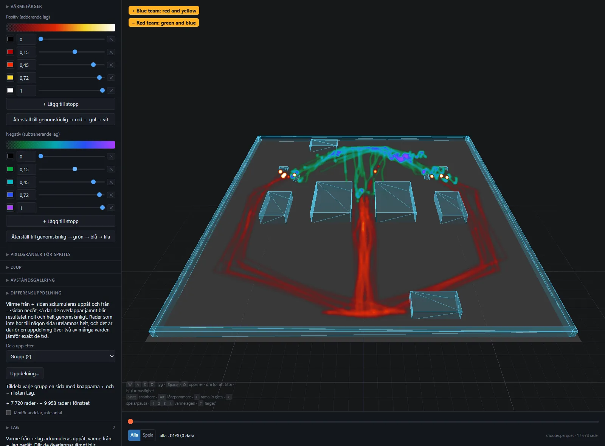

# Differens

Rött där lag A var mer, grönblått där lag B var mer, ingenting där de var lika.

**Differens** (tangent 2) är signerad värme. Rader ur en population adderar värme; rader ur en annan subtraherar den. Där de två överlappar jämnt blir resultatet noll och helt genomskinligt. Där den ena dominerar syns den i den sidans färger – som standard varma (genomskinlig → röd → gul → vit) för **+**-sidan och kalla (genomskinlig → grön → blå → lila) för **−**-sidan.

## Så använder du det {#how-to-use-it}

1. Tryck `2` (eller välj **Differens** i lägesfältet).
2. Öppna **Differensuppdelning** i sidofältet.
3. Välj vad du vill **Dela upp efter**: oftast *Grupp*.
4. Lägg en grupp (eller ett värde) på **+** och en annan på **−**.
5. Läs färgerna: varmt betyder +-sidan, kallt betyder −-sidan. Panelen varnar om en sida saknar rader (se [Meddelanden du kan se](#messages-you-may-see)).

*Vilka* två populationer som jämförs är hela frågan, så uppdelningen kan ske efter vilken behållen kolumn som helst, inte bara grupper. Rader som hamnar på **ingen** av sidorna **utelämnas**, de räknas inte som noll. Det är vad som gör att en uppdelning över två av många värden jämför exakt just dessa två. Den kombineras med [filtren](filters.md): filtrera ned till en karta och dela sedan upp den efter byggversion.

Läget behöver två sidor: en gruppkolumn med minst två grupper, eller en uppdelning över en kolumn som behållits för filtrering. På data med färre än två grupper startar en inläsning med en kolumnuppdelning – först *Källfil*-kolumnen vid en inläsning av flera filer, annars den första kategorikolumnen med två värden, annars den första numeriska kolumnen med ett spann. Så fungerar *jämför två inläsningar* även på data utan några grupper. Bara data utan något av detta gör läget otillgängligt. Så gör också en kolumnuppdelning som lämnar en sida tom.

## Panelen Differensuppdelning {#the-difference-split-panel}

Visas i läget Differens, under värmepanelerna.

**Dela upp efter** erbjuder:

| Alternativ | Visas som | Uppdelningsregel |
|---|---|---|
| Grupper | *Grupp (N)* (när det finns en gruppkolumn) | Varje grupp på +, − eller ingen sida, satt i [Lagslistan](teams-list.md) |
| En kategorikolumn | *kolumn (N värden)* | Värden på +, − eller ingen sida |
| En numerisk kolumn | *kolumn (numerisk)* | Ett värdeintervall för varje sida |
| Filen som datan kommer från | *Källfil – jämför två inläsningar* (när flera filer lästes in) | Filer på +, − eller ingen sida |

Bara kolumner som behålls under *Behåll för filtrering* vid inläsningen erbjuds.

### Jämför andelar, inte antal {#compare-shares-not-counts}

**Jämför andelar, inte antal** (standard av) väger varje sida med ett delat med sitt eget antal rader. En sida med fem gånger fler rader vinner då inte bara på antal. Färgen visar i stället var varje sida är proportionellt vanligare än den andra. Använd det när de två sidorna har mycket olika mängder data, till exempel två sessioner av olika längd.

### Meddelanden du kan se {#messages-you-may-see}

Panelen varnar när bilden inte är en riktig differens:

| Meddelande | Betydelse |
|---|---|
| *N + / M −* (eller *N + / M − / K oanvända*) | Hur många värden som ligger på varje sida (och på ingen sida). |
| Ingen rad i fönstret ligger på **+**-sidan | Bara **−**-sidan ritas. Flytta tidslinjefönstret eller ändra uppdelningen. |
| Ingen rad i fönstret ligger på **−**-sidan | Bara **+**-sidan ritas. |
| Inget värde ligger på någon sida | Differensen ritar ingenting. Lägg minst ett värde på **+** eller **−**. |
| *kolumn* kan inte delas på det här sättet | Den valda kolumnen passar inte uppdelningen. Välj kolumnen igen. |
| Uppdelningskolumnen fick inte plats i GPU-minnet för N av M delar | De raderna ritas inte. Höj GPU-budgeten under Prestanda → Resursbudgetar, eller läs in färre rader. |

### Efter grupp {#by-group}

Panelen pekar bara på [Lagslistan](teams-list.md), där varje grupp har en **+**- och en **−**-knapp. Vid varje inläsning hamnar den första hälften av grupperna (avrundat uppåt) på +, resten på −. **Dela jämnt** i Lagslistan gör detsamma igen. En grupp som inte ligger på någon sida, eller som är dold med sin kryssruta, bidrar inget.

### Efter kategorivärden {#by-category-values}

| Del | Betydelse |
|---|---|
| `a + / b − / c oanvända` | Hur många värden som ligger på varje sida och på ingen sida. |
| **Rensa** | Lägger varje värde på ingen sida. |
| Värdelista | Varje värde med en **+**- och en **−**-knapp (klicka på den aktiva igen för att ta bort den från den sidan). Ett tomt värde listas som *(saknas)*. |
| Upplysning om gräns | Bara de första 200 värdena listas: *Visar de första 200 av N värden. En så bred kolumn är bättre att först begränsa med ett filter, eller dela upp efter intervall om värdena är ordnade.* |

När du väljer kolumnen läggs dess första värde på + och dess andra på −. När ingen sida har något värde faller uppdelningen tillbaka till grupper i stället för att visa en tom bild. *Källfil* fungerar på samma sätt, med ett värde per fil. Så jämför man två exporter, två testkörningar eller två byggen.

### Efter intervall {#by-range}

| Del | Betydelse |
|---|---|
| Tips | Kolumnens minsta och största värde. |
| **Positivt intervall (+)**, **från** / **till** | Rader med ett värde i det här intervallet, inklusive i båda ändarna, adderar. |
| **Negativt intervall (−)**, **från** / **till** | Rader i det här intervallet subtraherar. |
| **Dela vid mittpunkten** | Sätter + till [minsta, mitten] och − till [mitten, största]. Det är också vad som händer när du väljer kolumnen. |

Ett värde som ligger i båda intervallen räknas som +. Intervallen behöver inte täcka kolumnen. Värden som ligger i ingetdera utelämnas. *De två första minuterna mot de två sista* är en intervalluppdelning på en tidsliknande kolumn.

## Färger {#colours}

Avsnittet **Värmefärger** visar två rampeditorer i det här läget: **Positiv (adderande lag)** och **Negativ (subtraherande lag)**. Var och en har sin egen återställningsknapp (*Återställ till genomskinlig → röd → gul → vit*, *Återställ till genomskinlig → grön → blå → lila*). Sammansättningen tar absolutbeloppet av nettovärmen genom [mättnadspunkten och responsen](colour-and-exposure.md) och väljer den negativa rampen där nettot är under noll. Se [Färg och exponering](colour-and-exposure.md#the-ramp-editor).

Använd den *linjära* täthetsresponsen när differensens storlek spelar roll. Det är den enda responsen där samma färg betyder samma antal.

## Hur det fungerar {#how-it-works}

Varje rad får ett tecken, +1, −1 eller 0, i vertex-shadern ([`POINT_HEAT_VS`](https://github.com/Holdi601/3DHeat/blob/main/src/render/webgl2/shaders.ts)). En 0 avvisar raden innan något fragment ritas.

- Efter grupp kommer tecknet från en grupptabell med 4 096 poster, indexerad med radens grupp-id. Grupp-id:t ligger i den fjärde kanalen på radens positionstexel.
- Efter kategori kommer tecknet från en andra tabell med 4 096 poster, fylld per kategorivärde. Radens värde läses från kolumnens filtertextur. Ett värde bortom tabellens slut avvisas på båda bakändarna.
- Efter intervall jämförs radens värde med de två intervallen.

Att ändra uppdelningen startar om ackumuleringen.

**Dolda grupper förblir dolda vid varje uppdelning.** Vid en uppdelning efter en kolumn bär grupptabellen inga tecken längre. Den håller 1 för en synlig grupp och 0 för en dold ([`frameSignTables`](https://github.com/Holdi601/3DHeat/blob/main/src/render/filterTables.ts)). Båda tabellerna når shadern tillsammans: två rader i en teckentextur på WebGL2, två halvor av en lagringsbuffert på WebGPU. En rad ritas bara när dess grupp är synlig *och* dess kolumnvärde ligger på en sida. En grupp som avmarkerats i [Lagslistan](teams-list.md), eller som utelämnats av sidfokus i fliken Match, bidrar alltså inget oavsett hur differensen delas.
