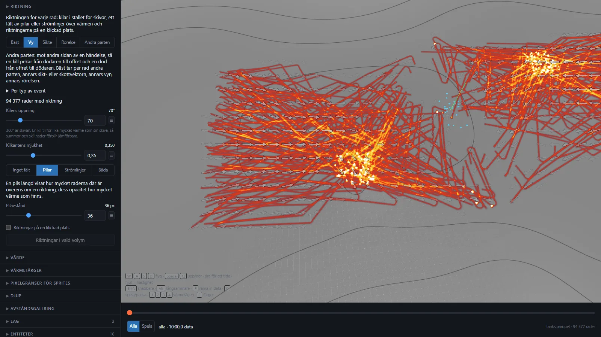

# Riktningsvärme

Vanlig värme visar **var** saker händer. Riktningsvärme visar också **åt vilket håll**: vilket håll folk tittade, siktade, rörde sig, eller var den andra sidan i en strid fanns.

En vanlig sprite är en hel skiva (360 grader). Med en **Kilens öppning** på 70 grader blir samma sprite en smal kil som pekar åt det håll raden var vänd mot, och den lägger till samma totala värme.

## Så använder du det {#how-to-use-it}

1. Läs in data som har en riktning i sig (se [Vad som ger en rad en riktning](#what-gives-a-row-a-direction)).
2. Välj **Värme**, **Differens** eller **Lagvärme** i lägesfältet.
3. Öppna avsnittet **Riktning** i sidofältet.
4. Välj en **källa** (vilken riktning som ska användas) och slå sedan på ritningen:
   - sänk **Kilens öppning** under 360° för att rita varje rad som en kil som pekar åt sitt håll i stället för en skiva.
   - välj ett **Fält** för att rita pilar eller strömlinjer över värmen.
   - bocka i **Riktningar på en klickad plats** och klicka på värmen för att få ett polärdiagram över just den platsen.

Statusraden säger hur många rader som har en riktning från den valda källan.

## Inställningar {#settings}

| Inställning | Standard | Vad den gör |
|---|---|---|
| Källa: **Bäst**, **Vy**, **Sikte**, **Rörelse**, **Andra parten** | Bäst | Vilken riktning varje rad får. *Bäst* tar, per rad, den andra parten, annars siktet, annars vyn, annars rörelsen. |
| **Per typ av händelse** | som ovan | En annan källa för varje händelsetyp, till exempel *Andra parten* för dödanden och *Vy* för positioner. Visas när datan har en händelsekolumn med högst 40 värden. |
| **Kilens öppning** | 360° | 360° är den vanliga skivan (av). Mindre värde ger en smalare kil. En kil lägger till lika mycket värme som sin skiva, så summor och differenser förblir jämförbara. |
| **Kilkantens mjukhet** | 0,35 | 0 är en kil med skarp kant, 1 en mjuk fläkt. |
| **Fält**: Inget fält, Pilar, Strömlinjer, Båda | Inget fält | Pilar: pilens längd visar hur mycket raderna där är överens om en riktning, och dess opacitet visar hur mycket värme det finns. Pilar visas bara där det finns värme. |
| **Pilavstånd** | 28 px | Avståndet mellan pilarna på skärmen. |
| **Animera strömlinjerna** | på | Strömlinjerna flyter när den är på. |
| **Riktningar på en klickad plats** | av | Klicka på värmen för att se riktningarna där (nedan). |
| **Riktningar i vald volym** | | Samma diagram för allt inuti den valda [volymen](volumes.md). |

## Polärdiagrammet på en plats {#the-polar-chart-at-a-spot}

Med **Riktningar på en klickad plats** på klickar du på värmen. Raderna nära den punkten (inom 1,5 spriteradier) samlas i en ros med 24 skivor om 15° vardera:

- **orange** kronblad: utgående riktningar (dit raderna pekar),
- **blå** kronblad: inkommande riktningar (varifrån de kom),
- ett kronblads **yta** växer med dess antal. En pil visar huvudriktningen,
- raderna under diagrammet anger huvudpejlingen, hur starkt raderna är överens (R, 0 till 1), spridningen i grader och antalet rader.

0° är uppåt i diagrammet, vilket är världens −Z (norr för Tacview-inspelningar). Platsen markeras också i 3D-vyn med en pil och en ring.

## Vad som ger en rad en riktning {#what-gives-a-row-a-direction}

| Källa | Behöver finnas i datan |
|---|---|
| Vy | en girningskolumn (mappad som blickriktning): `yaw`, `heading`, `azimuth`, `view_yaw`, `rot_z` |
| Sikte | talpar som `aim_x`/`aim_y`, `shot_x`/`shot_y`, `fire_x`/`fire_y`, `hit_dir_x`/`hit_dir_y` (ett valfritt `…_z`) |
| Rörelse | inget extra: steget från samma persons föregående sampling (högst 10 s tidigare, samma session) |
| Andra parten | en kolumn som anger den andra sidan i en händelse (`other`, `victim`, `target`, `killer`, `attacker`, `shooter`, `other_player` ...) vars värden är personnamn. Ett dödande pekar från dödaren till offret, ett dödsfall från offret till dödaren |

## Tips {#tips}

- Kilar behöver en viss storlek på skärmen. Under några pixlar ritas de åter som skivor.
- Använd *Andra parten* på dödanderaderna för att se **varifrån** strider vanns. Använd *Vy* på positionsrader för att se **var folk tittar**.
- Med **Differens** pekar kilarna från de två sidorna i sina egna riktningar, så att omstridda skottlinjer syns tydligt.
