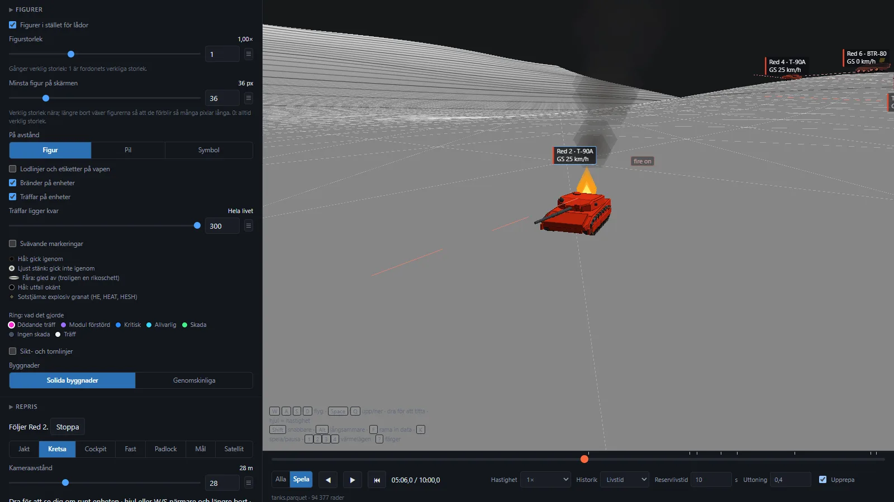

# Figurer

En **figur** är en liten 3D-modell av vad en enhet verkligen är: en stridsvagn, ett jetplan, ett fartyg, en soldat. [Repriset](match-replay.md) ritar varje enhet som sin figur i verklig storlek, i stället för en vanlig låda.

Det finns cirka 2 000 namngivna fordon, flygplan, fartyg, vapen och soldater, alla byggda av visaren själv.

## Vad som finns i katalogen {#what-is-in-the-catalogue}

| Område | Exempel |
|---|---|
| Personer | soldat stående, huk, liggande; krypskytt, pansarvärn, sjukvårdare, besättning |
| Mark | stridsvagnar, stridsfordon, luftvärn, artilleri, lastbilar och bilar, tåg och spårvagnar |
| Luft | jaktplan, attackflygplan, bombplan, transportflygplan, helikoptrar, från dubbeldäckare till moderna jetplan |
| Sjö | krigsfartyg efter klass, hangarfartyg, ubåtar, båtar, handelsfartyg |
| Vapen | robotar, raketer, bomber, torpeder, facklor och chaff |
| Markörer | rök-, blixt- och brandgranater, placerade bomber, flaggor, spawns, waypoints |

## Så görs figurerna {#how-the-figures-are-made}

- **Byggda från publicerade mått.** De flesta figurer görs av visarens egen figurbyggare från offentliga siffror: längd, bredd, höjd, bandhjul, torn och kanon, vingar och stjärt. Deras form finjusteras sedan mot offentliga fotografier, ritningar och publicerade mått. Inga spels modeller används.
- **Fria modeller.** Några figurer använder fria 3D-modeller (CC0 eller CC BY) där de är sannare, ibland kombinerade med det byggda skrovet. Upphovsmän till CC BY-verk krediteras på [Figurkrediter](figure-credits.md). CC0-verk kräver ingen kredit och listas inte där.
- Varje figur finns i en full, en grov och en version för långt håll (detaljnivåer, LOD), så att tusentals kan ritas samtidigt.

## Vilken figur en enhet får {#which-figure-a-unit-gets}

Visaren tittar på datans egna kolumner:

1. **Namn**: kolumner som heter *Name*, *Vehicle*, *Unit*, *Unit type*, *Model*, *Aircraft*, *Plane*, *Tank*, *Ship*, *Craft*, *Loadout*, *Kit* eller *Figure* jämförs mot katalogen: exakt, genom cirka 4 000 alias (spelens enhets-id för flera spel), efter den längsta kända början (`F-16C_50` är F-16C), eller efter det kortaste figurnamnet som börjar så.
2. Ett namn vars figur inte passar enhetens **typ** används inte. En lastbil som heter *Typhoon* är inte jaktplanet.
3. **Typer**: kolumner som heter *Type*, *Class*, *Kind*, *Category*, *Icon*, *Role* eller *Domain* ger en klassfigur: Tacview-taggar (`Air+FixedWing`, `Ground+Heavy+Armor+Vehicle+Tank`, `Sea+Watercraft+Warship`, `Weapon+Missile`), kartikoner eller vanliga ord (tank, helikopter, infanteri).
4. Data med ingetdera är data om personer: alla är soldater.

Det enklaste sättet att få rätt figurer är därför en `vehicle`-kolumn med de riktiga namnen, eller en `type`-kolumn med Tacview-taggar.

**Min enhet visas som en låda eller en soldat.** Lägg till en `vehicle`-kolumn med det riktiga namnet, eller en `type`-kolumn med en Tacview-tagg. För musen över enheten för att se vilket namn som matchades. Data som har sådana kolumner men inget om en enhet lämnar den som låda. Data utan någon av dem ritas som soldater.

## Inställningar {#settings}

Avsnittet **Figurer** i reprisets sidofält anger storlek, minsta storlek på skärmen, vad enheter på avstånd blir (figur, pil, symbol) och effekterna som ritas på dem. Se [Matchrepris](match-replay.md#figures). Rök, eld och andra tidsbundna effekter: [Figurer i figuröverlägget](figure-replay.md).

## Ett valfritt lokalt figurpaket {#an-optional-local-figure-pack}

Du kan behålla ett valfritt paket med egna figurer på din egen dator. Dess figurer ersätter katalogfigurer med samma namn. Paketet ingår aldrig i förrådet eller i en publicerad version. Utan ett paket ändras ingenting.
