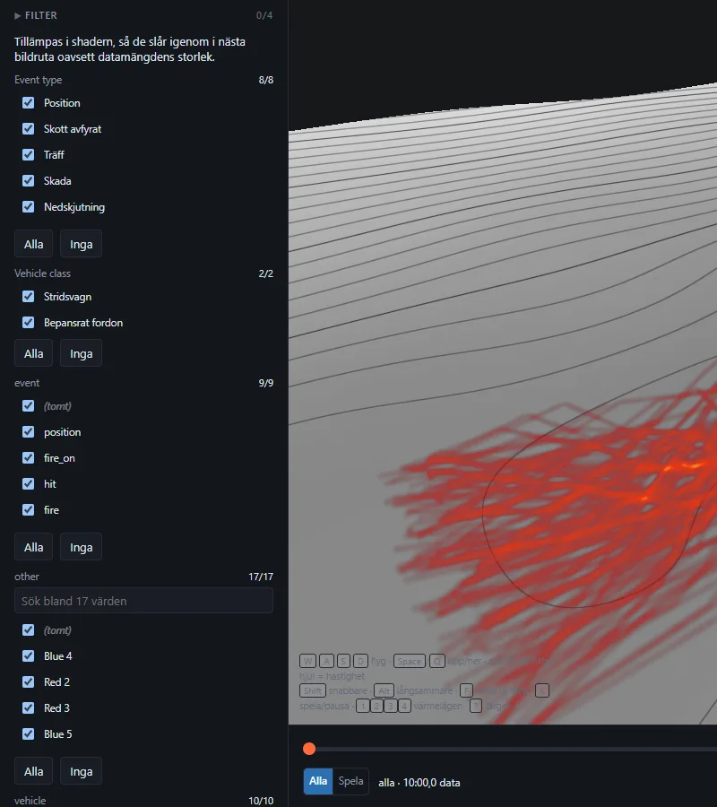
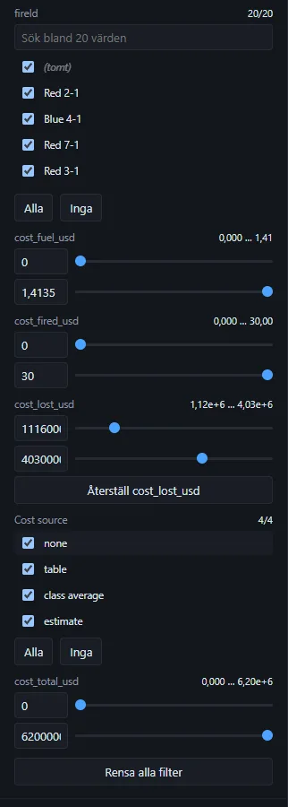

# Filter

**Filter** döljer de rader du inte bryr dig om, till exempel en fordonsklass eller en händelsetyp, och bilden uppdateras på en gång. Panelen listar kolumnerna som behållits vid inläsningen under *Behåll för filtrering* ([Kolumnmappning](column-mapping.md)), plus *Källfil* när flera filer lästes in.

## Prova det {#try-it}

1. Läs in en datamängd och öppna **Filter** i sidofältet.
2. Under **Fordonsklass**, avmarkera *Stridsvagn*. Bilden ändras på en gång.
3. Tryck **Rensa alla filter** för att ångra.

De första raderna är visarens egna kolumner (nedan). Raderna efter dem kommer från din fil.

## Kolumner som visaren lägger till {#columns-the-viewer-adds}

Vid inläsning räknar visaren ut fyra egna kolumner och listar dem **först**, med namn och värden på ditt språk. Då fungerar samma filter för varje spel och varje datakälla:

| Kolumn | Värden | Räknas ut från |
|---|---|---|
| **Händelsetyp** | 23 slag: Position, Skott avfyrat, Avfyrning (robot, raket, bomb), Träff, Miss (vapnet slutade nära inget mål), Explosion, Skada, Dödning, Död, Förstörd, Krasch, Utkastning / nödutrymning, Uppdykning, Försvinnande, Start, Landning, Markkontakt, Stopp på marken, Ombeväpning / tankning, Erövring / mål, Lockbete, Meddelande, Övrigt | en kolumn som heter `event`, `events`, `event_type` eller `event_name`. Varje spels egna ord (`shot`, `burst`, `fired`, `struck`, `flare`, `plant` ...) mappas till dessa slag. Hela tabellen: [Händelsetyper och klasser](ref-event-types.md). |
| **Spelare eller AI** | Spelare, AI | en kolumn `ai`, `is_ai`, `bot` eller `actor`; annars `is_player` / `human`; annars ett konto-id (`user_id`, `steam_id`; tomt eller 0 är AI); för Tacview-inspelningar, om objektet har en pilot |
| **Fordonsklass** | 17 klasser: Jaktplan, Attackflygplan, Bombplan, Övriga flygplan, Helikopter, Stridsvagn, Pansarfordon, Luftvärn, Artilleri, Lastbil / bil, Fartyg, Ubåt, Infanteri, Vapen, Lockbete, Konstruktion, Övrigt | fordonets eller enhetens namn (jämfört mot [figurkatalogen](figures.md)) och typkolumner |
| **Målklass** | samma klasser | motpartens fordon (`other_vehicle`, `target_vehicle`, `victim_type` ...) |

Direkt efter dem kommer [resultatkolumnerna](data-formats.md#outcome-columns), där datan har dem: **Rondresultat** och **Matchresultat** (*Alla*, *Vunnen*, *Förlorad*) och **Hur ronden slutade**, med värdena på ditt språk. Filtrera på dem, eller dela upp värmen efter dem som en [vinstandelskarta](win-rate.md).

Bara de slag som förekommer listas. Värdekolumner (`cost_*`, `earn_*`, `net_*` och *Kostnadskälla*, se [Värdeviktning](value-weighting.md)) kan filtreras precis som vilken talkolumn som helst. Avmarkera till exempel *estimate* under *Kostnadskälla* för att bara behålla prissatta rader.

En kategorilista med fler än 12 värden får en sökruta (*Sök bland n värden*) och en knapp **Bara dessa**, som tillåter exakt de värden som matchar.

Vilka kolumner som kan filtreras avgörs vid inläsningen, eftersom de måste läsas då. Utan någon behållen kolumn säger panelen det och pekar på *Behåll för filtrering*.

## Snabbfilter för Rainbow Six Siege {#rainbow-six-siege-quick-filters}

När en Rainbow Six Siege-match är inläst börjar panelen med knappar som ställer in filtren med ett klick: **Kulhål och märken** (märkena som lämnats på banan), **Märken med skytt** och **Märken med vapenklass** (de där en skytt, eller ett vapen från skyttens dödning i samma ögonblick, har räknats fram; dela upp eller filtrera dem vidare efter `byOperator` eller `byItemClass`), **Försök att plantera och desarmera**, **Avbrutna försök** (påbörjade, inte slutförda, där spelaren slutade) och **Förstärkningar** (där en vägg eller lucka förstärktes, vid den försvarare som konverteraren härleder). Varje knapp ersätter filtret på händelsekolumnen och behåller resten; **Rensa alla filter** ångrar det. Kolumnerna beskrivs i konverterarens dokumentation.

## Talkolumner (intervall) {#numeric-columns-range}

| Del | Betydelse |
|---|---|
| Namn, och `min ... max` | Kolumnen, och det aktuella intervallet (kolumnens hela intervall så länge inget filter är satt). |
| Första raden: sifferruta och reglage | Den nedre gränsen. Drar du reglaget över den övre gränsen, drar det med sig den övre gränsen. |
| Andra raden: sifferruta och reglage | Den övre gränsen. Drar du under den nedre gränsen, drar den med sig den också. |
| **Återställ *kolumn*** | Tar bort det här filtret. |

Reglagen täcker kolumnens minsta till största värde i 1 000 steg. Sifferrutorna accepterar valfritt värde. En rad klarar sig när dess värde ligger inom intervallet, med båda ändarna inräknade. Stora värden visas i exponentform (`1.23e6`).

## Kategorikolumner {#category-columns}

| Del | Betydelse |
|---|---|
| Namn, och `tillåtna/totalt` | Kolumnen, och hur många av dess värden som tillåts. |
| Värdelista | En kryssruta per värde. Ett tomt värde visas som *(tomt)*. |
| **Alla** / **Inga** | Tillåt alla värden / inget värde. |

Att tillåta alla värden tar bort filtret.

## Regler {#rules}

- **Fyra filter samtidigt.** Rubriken visar `aktiva/4`. Ett femte filter tillämpas inte, och panelen säger det. Ett val i [Entiteter](entities.md) (eller spelarfokus i fliken Match) använder ett av de fyra. Ett filter som täcker hela kolumnen använder inget.
- **En kategorikolumn har högst 4 096 värden.** En bredare behålls inte vid inläsningen.
- **Filter kombineras med OCH**, och med lagsynlighet, differensuppdelningen, tidsfönstret, bortsorteringen på avstånd och [snittet](slice.md).
- **Att ändra ett filter startar om ackumuleringen och mäter om exponeringen några bildrutor senare**, eftersom filtrering kan ändra tätheten mycket ([Färg och exponering](colour-and-exposure.md#auto-exposure)).
- **Rensa alla filter** tar bort varje kolumnfilter. Lagsynlighet och spelarval som satts på annat håll behålls.
- Kolumnfilter ändrar värmelägena. De ändrar inte figurerna i [figuruppspelningen](box-replay.md), som följer lagsynligheten och valet i Entiteter. Valet i Entiteter ändrar båda.
- I [linjevärme](line-heat.md) testas ett filter på raden som varje segment *slutar* vid.
- Vid varje ny datamängd rensas alla filter.

## För utvecklare {#for-developers}

**Platser.** Varje aktivt filter tar en av fyra GPU-platser ([`MAX_FILTER_SLOTS`](https://github.com/Holdi601/3DHeat/blob/main/src/render/types.ts)), en textur med 4 byte per rad. Platserna går till filtren i den ordning de senast ändrades ([`filterSlots`](https://github.com/Holdi601/3DHeat/blob/main/src/render/filterTables.ts), delas av shadern och båda panelerna). Efter fyra visar ett fel meddelandet *Only the first 4 filters are applied. Clear one - the rest are being ignored, not silently combined* (på engelska i visaren), och de extra filtrens namn visas som *kolumn (tillämpas inte)*. Filtren körs per rad i vertex-shadern, så att ändra ett tröskelvärde kräver varken ny tolkning eller ny uppladdning.

**Filter som panelen inte visar.** Två till slag finns i programtillståndet ([`FilterSpec`](https://github.com/Holdi601/3DHeat/blob/main/src/state/types.ts)):

- ett **grupp**-filter, satt av fliken Match när den fokuserar ena sidan. Det döljer de andra grupperna i varje läge, även en [differens](difference.md)-uppdelning efter en kolumn.
- ett **personer**-filter, satt av panelen [Entiteter](entities.md) och av fliken Match när den fokuserar en spelare. Det begränsar figuruppspelningen och värmelägena. I värmen är det ett kategorifilter över person-id:na och tar en av de fyra platserna. Dess mask rymmer 65 536 id:n ([`FILTER_MASK_CAPACITY`](https://github.com/Holdi601/3DHeat/blob/main/src/render/types.ts)); en person bortom det ritas inte i värmen medan filtret är aktivt, även när den är vald. Figuruppspelningen visar dem ändå.
