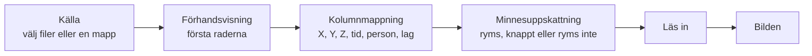

# Läsa in data

Innan 3DHeat kan rita något behöver den en tabell: varje rad säger var något var och, om du har det, när och vem. Det här avsnittet visar hur en fil blir en bild. Inga data än? Prova [demodata](demo-data.md).

**Gör detta nu:**

1. Öppna **Källa** i sidofältet för Värmekarta och tryck **Filer…** (eller släpp en fil eller mapp på släppytan).
2. Titta på **Kolumnmappning**: rutorna är oftast redan ifyllda.
3. Kontrollera att **Minnesuppskattning** säger *ryms*.
4. Tryck **Läs in**.

Allt som fliken Värmekarta visar kommer från en enda **datamängd**: en tabell med rader, var och en med en position och, om man vill, en tid, en person, en grupp, en session, en blickriktning och valfritt antal extra kolumner som sparas för filtrering. Det här avsnittet förklarar hur en datamängd görs.

## Vägen från filer till bild {#the-path-from-files-to-picture}

1. **Välj filer** i panelen **Källa** – en fil, flera, ett mappträd eller genom att släppa dem. Parquet, CSV, Tacview, GPS-spår med mera godtas; hela listan finns i [Dataformat](data-formats.md#files). Se [Läsa in filer](loading-files.md).
2. **Förhandsvisning.** Den första filen i urvalet öppnas: dess kolumnnamn, de första 50 raderna, vilka kolumner som ser numeriska ut och (Parquet) varje kolumns logiska typ och filens egna läsinstruktioner, posten `heat3d` i fotern.
3. **Automatisk mappning.** Kolumner tilldelas roller – X, Y, Z, tid, person, session, grupp, blickriktning – och några behålls för filtrering. Varje gissning visas i panelen **Kolumnmappning** och kan ändras. Se [Kolumnmappning](column-mapping.md) och [Axlar, enheter och tid](axes-units-and-time.md).
4. **Räkning.** Varje fils antal rader läses (exakt ur Parquet-fotrarna, uppskattat för CSV), så att panelen före inläsningen kan säga hur mycket minne den behöver och om det ryms. Om inte föreslår den att man läser in var *N*:te rad. Se [Minne och budgetar](memory-and-budgets.md).
5. **Läs in.** En bakgrundsarbetare tolkar bara de mappade kolumnerna i varje fil – flera filer samtidigt, upp till budgeten för [parsertrådar](memory-and-budgets.md#parser-threads) – och slår ihop dem, i urvalets ordning, till en datamängd: en gemensam ordbok över personer, grupper och sessioner för alla filer, en gemensam tidsnollpunkt, alla rader sorterade efter tid. Se [Sessioner, personer och grupper](sessions-persons-groups.md).
6. **Uppladdning.** Huvudtråden meddelar ”Laddar upp N rader till GPU:n” under en bildruta och packar sedan raderna i GPU-minnet inom GPU-budgeten. Se [GPU-minnets residens](gpu-memory.md).
7. **Första bilden.** Kameran ramar in datan, spriteradien och mättnaden sätts från datans omfattning och antal rader, och efter 8 renderade bildrutor mäts mättnaden från bilden själv ([Färg och exponering](colour-and-exposure.md)).

## Krav som kontrolleras före en inläsning {#requirements-checked-before-a-load}

| Behov | Vad som händer utan det |
|---|---|
| **Minst två av X / Y / Z** | Inläsningen nekas. Med exakt två är den tredje axeln 0 och datan ritas som ett platt plan i 3D-scenen – vilket en värmekarta uppifrån vill ha. |
| En tidskolumn | Valfri. Utan den är tidslinjen avstängd, vyn stannar i läget **Alla** och sidofältet säger det. |
| En personkolumn | Valfri. Behövs för [figuröverlägget](box-replay.md) (en figur för varje person), [linjevärme](line-heat.md) (vägen varje person gick), interpolering, spår och historiken **Livstid**. |
| En gruppkolumn | Valfri. Behövs för [lagvärme](team-heat.md) och för läget [differens](difference.md) (minst två grupper). |

Ett läge som den inlästa datan inte kan stödja är nedtonat i lägesfältet; när du för musen över det står det varför.

## Utan egna data {#without-your-own-data}

Panelen **Datamängd** (under **Källa**) har en [syntetisk generator](synthetic-generator.md) som skapar en datamängd i battle royale-form, av valfri storlek. Den är användbar för att prova visaren och för att testa vad en maskin klarar.

## Sidor i det här avsnittet {#pages-in-this-section}

- [Läsa in filer](loading-files.md) – väljare, mappar, dra och släpp, sammanslagning av flera filer, regeln för rörelsefiler, förlopp och avbrytning
- [Kolumnmappning](column-mapping.md) – varje fält i mappningspanelen, hur den automatiska mappningen gissar, `heat3d`-tipsen
- [Axlar, enheter och tid](axes-units-and-time.md) – uppåtaxel, vändningar, enhetsskala, tidsenheter, blickriktning
- [Sessioner, personer och grupper](sessions-persons-groups.md) – vad var och en gör, gränserna, delade namn, entitetsstorlek, panelen Datamängd
- [Syntetisk generator](synthetic-generator.md)
- [Minne och budgetar](memory-and-budgets.md) – minnesmodellen, passningskontrollen, decimering, sorteringsgränsen, resursbudgetar
