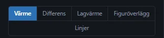

# Värmelägen

Varje prick lägger till en liten glöd, glöden staplas på varandra, och stapeln målas med färger. Det finns fem sätt att måla den, och var och ett svarar på en fråga.

Lägesfältet överst i sidofältet för fliken Värmekarta väljer hur [datamängden](glossary.md) ritas. Tangenterna 1–4 väljer Värme, Differens, Lagvärme och Linjer. Figuröverlägg har ingen tangent.

| Läge | Fråga det svarar på |
|---|---|
| **Värme** | Var hände det, och hur mycket? |
| **Differens** | Vilken sida gjorde det mer? |
| **Lagvärme** | Vems var det? |
| **Linjer** | Vilken väg tog folk? |
| **Figuröverlägg** | Vem var var, och när? |

| Läge (etikett i fältet) | Tangent | Vad det ritar | Behöver |
|---|---|---|---|
| **Värme** | 1 | Additiv täthet: varje synlig rad lägger till en kameravänd radiell sprite. [Värme](heat.md) | en datamängd |
| **Differens** | 2 | Signerad täthet: en population adderar, en annan subtraherar. [Differens](difference.md) | två sidor: minst två grupper, eller en uppdelning över en behållen kolumn |
| **Lagvärme** | 3 | Täthet färgad efter grupp: en nyans per grupp, blandad där grupperna överlappar. [Lagvärme](team-heat.md) | en gruppkolumn |
| **Figuröverlägg** | - | En figur (eller låda) per person, som rör sig längs tidslinjen: repriset. [Figuröverlägg](box-replay.md), [Matchrepris](match-replay.md) | en personkolumn |
| **Linjer** | 4 | Linjevärme: en linje från varje sampling av en person till nästa, med värmen avtagande åt sidorna. [Linjevärme](line-heat.md) | en person- och en tidskolumn |

Ett läge som datan inte klarar är nedtonat, och dess verktygstips anger skälet, till exempel *Ej tillgängligt – läget Differens behöver två grupper eller en behållen kolumn att dela upp efter; den här datan har en grupp.* När en ny datamängd inte klarar det aktuella läget faller vyn tillbaka till **Värme**.

Tangenterna 1–4 kontrolleras mot datan på samma sätt: en tangent för ett nedtonat läge gör ingenting.

## Vilka paneler varje läge visar {#which-panels-each-mode-shows}

| Panel | Värme | Differens | Lagvärme | Figuröverlägg | Linjer |
|---|---|---|---|---|---|
| Rutter ([linjevärme](line-heat.md)) | | | | | ja |
| Värmeform (med **Följ vyn** och **Samma täthet vid all zoom**), Värmefärger, Spritens pixelgränser, Djup, Bortsortering på avstånd | ja | ja | ja | | ja |
| Riktning ([riktningsvärme](directional-heat.md)), Värde ([värdeviktning](value-weighting.md)) | ja | ja | ja | | ja |
| Lagvisare ([figuröverlägg](box-replay.md)) | | | | ja | |
| Differensuppdelning ([differens](difference.md)) | | ja | | | |
| [Lagslista](teams-list.md), [Entiteter](entities.md), [Filter](filters.md), Bakgrund / nivå, [Snitt](slice.md), [Mätning](measure.md), Kamerabana & rendering, Prestanda, Kamera & scen | ja | ja | ja | ja | ja |

## Vad alla värmelägen delar {#what-every-heat-mode-shares}

Alla fyra värmelägena (allt utom figuröverlägget) är samma maskineri med olika indata ([`engine.ts`](https://github.com/Holdi601/3DHeat/blob/main/src/render/engine.ts)):

1. **Vilka rader.** [Tidslinjens](timeline.md) fönster väljer ett sammanhängande intervall av tidssorterade rader; [filter](filters.md), gruppsynlighet, differensuppdelningen, [bortsortering på avstånd](depth-and-culling.md#distance-culling) och [snittet](slice.md) avgör per rad, i vertex-shadern, om och hur starkt varje rad bidrar.
2. **Splatting.** Varje bidragande rad ritas som en sprite (eller, i läget Linjer, ett segment) i en flyttals-**värmebuffert**, där den adderar sitt rampvärde. Ett stratifierat urval av raderna ritas när det finns fler än vad en bildruta klarar, med vikter som kompenserar. Se [Sampling och budgetar](sampling-and-budgets.md).
3. **Ackumulering.** Medan inget ändras slås bildrutor ihop tills varje rad har bidragit exakt en gång. Se [Ackumulering](accumulation.md).
4. **Sammansättning.** Det ackumulerade värdet i varje pixel delas med **mättnadspunkten**, formas av **täthetsresponsen**, lyfts av **minsta värme** och slås upp i **färgrampen**, vars alfa blandar in den över scenen. Se [Färg och exponering](colour-and-exposure.md).

Allt i steg 4 tillämpas vid sammansättningen, så när du drar i de reglagen startar ackumuleringen aldrig om. Det som ingår i steg 1–2 gör det.

## Sidor i det här avsnittet {#pages-in-this-section}

- [Värme](heat.md) – det vanliga värmeläget, och en översikt över dess paneler
  - [Spriteform](sprite-shape.md) – radie, intensiteter, avklingning, kurveditorn, pixelgränser, plattning
  - [Färg och exponering](colour-and-exposure.md) – rampeditorn, mättnadspunkt, autoexponering, minsta värme, täthetsrespons
  - [Djup och bortsortering](depth-and-culling.md) – skymning av banan, dölj bakom terräng, bortsortering på avstånd
- [Differens](difference.md) – differensuppdelningen
- [Lagvärme](team-heat.md)
- [Linjevärme](line-heat.md) – rutter
- [Figuröverlägg](box-replay.md) – repriseläget (filen heter fortfarande box replay)
- [Riktningsvärme](directional-heat.md)
- [Värdeviktning](value-weighting.md)
