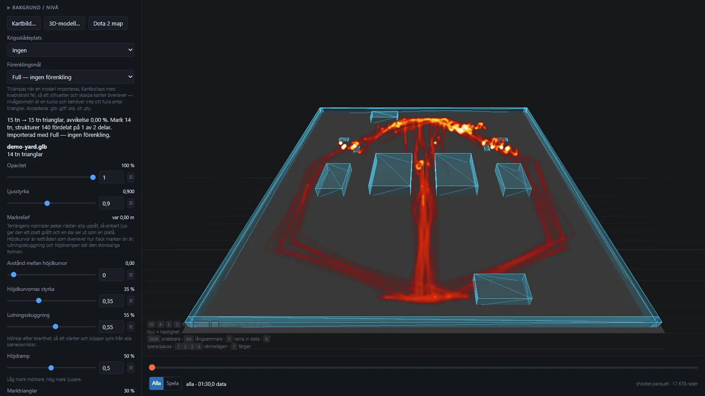
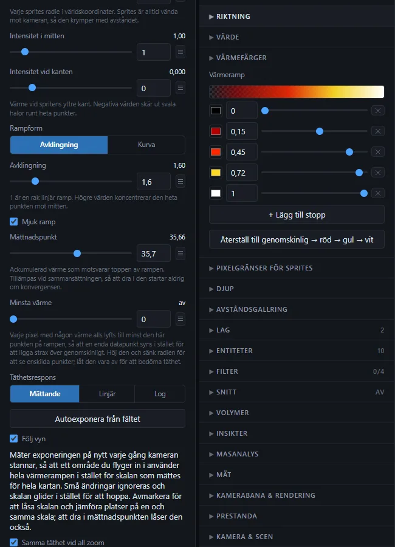

# Värme

Värme målar platserna där mycket har hänt: rött där det hänt lite, vitglödande där det hänt mycket. Den svarar på frågan ”var händer det här, och hur mycket”.

**Värme** (tangent 1) är standardläget. Varje synlig [rad](glossary.md) bidrar med en kameravänd rund [sprite](glossary.md). Överlappande sprites adderas i en flyttalsbuffert. Summan avbildas genom en färgramp, som standard genomskinlig → röd → gul → vit, och ritas över scenen.

Bilden visar värmen från en skyttespelsrunda på en bana med byggnader. Heta punkter sitter i rummen och på trapporna, inte bara på marken.

## Så använder du det {#how-to-use-it}

1. Läs in data och tryck `1` (eller välj **Värme** i lägesfältet).
2. Om allt är vitt eller tomt, tryck på **Autoexponera från fältet** i avsnittet **Värmeform**.
3. Ändra **Spriteradie** tills närliggande prickar går ihop till band. Mindre ger enskilda fläckar, större ger områden.
4. Öppna **Värmefärger** för att ändra färgerna, eller **Djup** för att låta kullar och väggar dölja värmen bakom sig.

Samma paneler formar [Differens](difference.md), [Lagvärme](team-heat.md) och [Linjevärme](line-heat.md). De skiljer sig i vad som adderas (signerat, färgat eller längs linjer), inte i hur det görs.

## Panelerna och deras standardvärden {#the-panels-and-their-defaults}

Varje reglage förklaras på sin egen sida. Kolumnen Detaljer länkar dit. Reglagen har ett inmatningsfält bredvid sig och ett draghandtag (det lilla greppet till höger: dra uppåt eller nedåt, längre är snabbare, Shift för finjustering). Där ett reglages spår slutar före en verklig gräns kan handtaget gå förbi den, upp till *jogg-taket* som anges här. Värden märkta *vid inläsning* räknas om för varje ny datamängd.

### Värmeform (öppen) {#heat-shape-open}

| Reglage | Standard | Intervall (jogg-tak) | Detaljer |
|---|---|---|---|
| **Spriteradie** | 6 m; vid inläsning omfattning / 120 | 0,05–2000 m, logaritmiskt (50 000) | [Spriteform](sprite-shape.md#sprite-radius) |
| **Intensitet i mitten** | 1 | 0–10 (1000) | [Spriteform](sprite-shape.md#centre-and-edge-intensity) |
| **Intensitet vid kanten** | 0 | -2–10 (1000) | [Spriteform](sprite-shape.md#centre-and-edge-intensity) |
| **Rampform** | *Avklingning* | *Avklingning* / *Kurva* | [Spriteform](sprite-shape.md#ramp-shape-falloff-or-curve) |
| **Avklingning** (endast Avklingning) | 1,6 | 0,1–8 (64) | [Spriteform](sprite-shape.md#falloff) |
| **Mjuk ramp** (endast Avklingning) | på | | [Spriteform](sprite-shape.md#falloff) |
| Kurvredigeraren (endast Kurva) | förinställningen *Mjuk* | | [Spriteform](sprite-shape.md#the-curve-editor) |
| **Mättnadspunkt** | 24; vid inläsning en uppskattning, sedan uppmätt | 0,1–4000, logaritmiskt (10 000 000) | [Färg och exponering](colour-and-exposure.md#saturation-point) |
| **Minsta värme** | av (0) | 0–100 % | [Färg och exponering](colour-and-exposure.md#minimum-heat) |
| **Täthetsrespons** | *Mättande* | *Mättande* / *Linjär* / *Log* | [Färg och exponering](colour-and-exposure.md#density-response) |
| **Autoexponera från fältet** | | knapp | [Färg och exponering](colour-and-exposure.md#auto-exposure) |
| **Följ vyn** | på | | Mäter exponeringen på nytt varje gång kameran kommer till ro. Ett område du flyger in i använder då hela färgrampen. Små ändringar ignoreras, och skalan glider. Avmarkera den, eller dra **Mättnadspunkt**, för att låsa skalan och jämföra platser på en och samma skala. [Färg och exponering](colour-and-exposure.md#follow-the-view) |
| **Samma täthet vid all zoom** | på | | En färg betyder samma antal rader per markyta, hur nära du än är. En sprite som pixelgränserna gör större (långt bort) eller mindre (nära) behåller den värme som dess verkliga storlek skulle ge. Därför blir inte en bild som exponerats på avstånd svagare när du flyger in i den. Av: en begränsad sprite lägger till hela sin vikt i sin begränsade storlek. [Spriteform](sprite-shape.md#pixel-clamps) |
| **Platta ut på markplanet** | av | | [Spriteform](sprite-shape.md#flatten-onto-ground-plane) |

### Värmefärger (stängd) {#heat-colours-closed}

| Reglage | Standard | Detaljer |
|---|---|---|
| Gruppfärgprov och **Färgseparation** (endast Lagvärme) | 1,4 | [Lagvärme](team-heat.md) |
| Redigeraren för **Värmeramp** (*Positiv (additiva lag)* i Differens, *Opacitetsramp* i Lagvärme) | genomskinlig → röd → gul → vit | [Färg och exponering](colour-and-exposure.md#the-ramp-editor) |
| **Återställ till genomskinlig → röd → gul → vit** | | |
| Rampen **Negativ (subtraherande lag)** (endast Differens) | genomskinlig → grön → blå → lila | [Differens](difference.md#colours) |

### Pixelgränser för sprites (stängd) {#sprite-pixel-clamps-closed}

| Reglage | Standard | Intervall (jogg-tak) | Detaljer |
|---|---|---|---|
| **Minsta pixelradie** | 1 px | 0–16 (512) | [Spriteform](sprite-shape.md#pixel-clamps) |
| **Största pixelradie** | 96 px | 2–1024, logaritmiskt (8192) | [Spriteform](sprite-shape.md#pixel-clamps) |

### Djup (öppen) {#depth-open}

| Reglage | Standard | Detaljer |
|---|---|---|
| **Dölj bakom terräng** | på | [Djup och bortsortering](depth-and-culling.md#hide-behind-terrain) |
| **Dolt bakom geometri** | 0,8 (*80 % svagare*) | [Djup och bortsortering](depth-and-culling.md#hidden-behind-geometry) |

### Avståndsgallring (stängd) {#distance-culling-closed}

| Reglage | Standard | Intervall (jogg-tak) | Detaljer |
|---|---|---|---|
| **Nära** | av (0) | 0,5–5000 m, logaritmiskt. Spårets nederkant = av (200 000) | [Djup och bortsortering](depth-and-culling.md#distance-culling) |
| **Fjärran** | av (0) | 1–200 000 m, logaritmiskt. Nederkanten = av (10 000 000) | [Djup och bortsortering](depth-and-culling.md#distance-culling) |
| **Skär vid ett plan** | på | | [Djup och bortsortering](depth-and-culling.md#distance-culling) |
| **Skär nivån också** | på | | [Djup och bortsortering](depth-and-culling.md#distance-culling) |

Tangenter: `[` och `]` skjuter den längsta gränsen inåt och utåt. `\` slår av och på den ([Djup och bortsortering](depth-and-culling.md#keyboard)).

### Riktning och Värde {#direction-and-value}

Två avsnitt till finns under Värmeform. **Riktning** ritar varje rad som en kil och lägger till pilar. Se [Riktningsvärme](directional-heat.md). **Värde** väger värmen efter vad varje rad kostade eller tjänade. Se [Värdeviktning](value-weighting.md).

## Vad som sparas {#what-is-saved}

Värmeinställningarna ovan sparas inte mellan sessioner. När du laddar om sidan återgår standardvärdena. Två saker sparas i webbläsaren: den senaste uppspelningshastigheten (`heat3d.speed`, se [Tidslinjen](timeline.md)) och inställningarna för de avlägsna figurerna i [figuröverlägget](box-replay.md) (symbolstil, storlek, träffmärken med mera). Likaså språket, [inverterade världsaxlar](camera.md#invert-world-axis), de namn på bilar som loppfliken minns och [banbiblioteket](level-library.md). Hela listan finns under [Sparade inställningar](ref-settings-storage.md).
