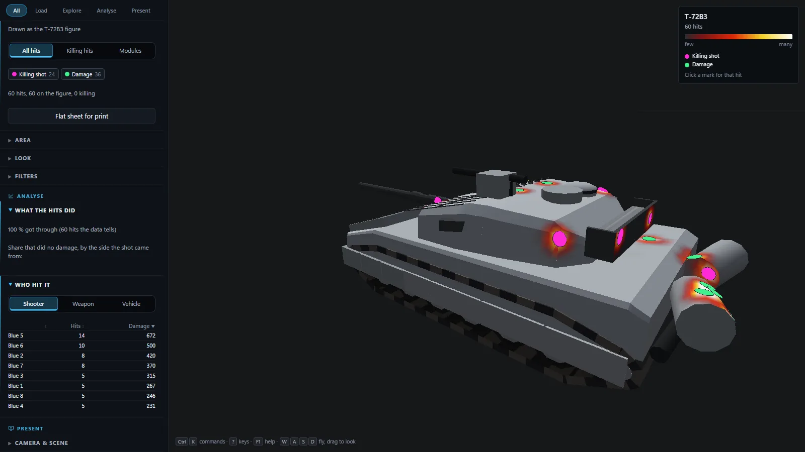

# Träffanalys (fliken Fordon)

Fliken **Fordon** visar var en stridsvagn, ett fartyg eller en soldat träffades, och av vem. Använd den för att se vilken sida av en stridsvagn som blir beskjuten, eller vilken fiende som gör skadan.

## Prova det {#try-it}

1. Läs in en match med träffar (tabellen nedan visar vilka spel som ger dem).
2. Öppna fliken **Fordon** högst upp.
3. Under **Fordon** väljer du en enhet, till exempel en stridsvagnstyp. Siffran inom parentes är hur många träffar den fick.
4. Läs figuren. Varje märke är en träff, placerad där den slog in.
5. Öppna **Vem träffade** för att se skyttarna, vapnen eller skyttarnas fordon, med träffar, skada, dödanden och avstånd.



Om inget är inläst, eller om data saknar träffar på fordon, säger fliken vad som saknas och vilken konverterare du ska använda.

```
        shooter ----> o  hit mark on the figure
        shooter ----> o
  [ tank figure ]
```

Figuren visar träffarna där datan ger en punkt eller en kroppsdel. Uppdelningen (vem som träffade, med vad, hur hårt, från hur långt bort) fungerar för alla källor.

## Vad varje källa ger {#what-each-source-gives}

| Källa | Punkt på enheten | Skytt | Vapen | Skada / utfall |
|---|---|---|---|---|
| War Thunder | ja, i enhetens koordinatsystem, med skottets riktning | ja | skyttens fordon | kritisk, allvarlig, moduler förstörda, dödande skott |
| CS2 | kroppsdel (hitgroup) | ja | ja | skada, pansar, kvarvarande hälsa |
| World of Tanks | ja (komponentlåda, in- och utgång) | ja | - | skada eller ingen (studs, ingen genomslagning) |
| World of Warships | ja, i fartygets koordinatsystem | ja | träfftyp | - |
| Squad | fordon: ja. Nedslaget placeras i fordonets koordinatsystem utifrån dess egen position och riktning | nej (datan anger ingen) | skadetypen | fordonets hälsas fall vid just det ögonblicket, förstörd |
| Squad-soldater | nej: träffresultaten (ben och nedslagspunkt) sparas råa av konverteraren. Rader `impact` med `hitBone` läses så snart den skriver dem | | | sår och dödsfall bara |
| Arma (OCAP, Arma 3-inspelaren) | nej: OCAP registrerar vem som träffade eller dödade vem, med vad och från hur långt bort, inte var | ja | ja | träff eller dödande, avstånd |
| Tacview ACMI | ja där ett vapenobjekt slutar inom 30 m från en enhet (inte dess avfyrare): dess sista plats i enhetens koordinatsystem (riktning, stigning, rulle), med den väg det flög | vapnets `Parent` | vapnets namn, eller en Timeouts AmmoType | Timeouts Outcome, fall i `Health`, `Destroyed`. Utan vapen: ett dödande eller en skada utan punkt |
| IL-2-telemetri (Watcher) | ja: händelserna `hit` / `damage` bär punkten i spelarens egna flygplans koordinatsystem (tolkat som x framåt, y upp, z höger) | nej | nej | kraften |
| Dota 2 | nej: stridsloggen har ingen plats på en hjälte | den angripande enheten | förmågan eller föremålet (ingen: en attack) | skada, hjältens död |
| Battlefield 6 (GameCapture) | nej: inspelningen läser dödsflödet (dödanden, dödsfall, flagga för huvudskott), inte träffar | | | |
| DCS / andra Watcher-livekällor | nej: inga träffhändelser utöver vad deras Tacview-inspelningar innehåller | | | |

Där ingen träff på enheten har en punkt visar figuren inga märken, och uppdelningen **Vem träffade** öppnas av sig själv. Den visar skyttar, vapen eller skyttens fordon, var och en med sina träffar, skada och dödanden, samt medianavståndet och det längsta avståndet.

## Begränsa till ett område {#restrict-to-an-area}

Avsnittet **Område** begränsar analysen till träffar som skedde på en plats på kartan.

1. Tryck på **Rita rektangel** eller **Rita polygon** och rita på marken i 3D eller på den taktiska kartan.
2. Välj **Offer inuti** (en träff räknas när enheten som träffades var i området) eller **Skytt inuti** (när den som sköt var det).
3. Tryck på **Använd dem som filter**. Bricka visar "{n} av {total} träffar i området".
4. **Återställ område** tar bort alla områden.

Varje område är en [volym](volumes.md), så samma former filtrerar också värmekartan och repriset. Ett område kan ta med eller utesluta. Ett uteslutande område tar bort sina träffar, och visas som "{n} av {total} träffar utanför området". Varje område visas som en bricka med hur många av enhetens träffar som låg i det. Kryssen på en bricka tar bort den. Siffrorna, figuren, uppdelningen och filterlistorna följer alla med.

Träffarnas platser: raden som träffen kommer från har en parts plats (offrets vid en skada eller ett träffat, skyttens vid ett skott). Den andra partens plats är den egna samplingen för den enheten som ligger närmast i tid (inom 5 s). En träff vars parts plats är okänd utelämnas medan ett område filtrerar, och panelen säger hur många det är ("Utelämnade, ingen känd plats").

## För utvecklare {#for-developers}

Vilken konverterare som helst kan lägga till träffar. Det görs med en rad för offret (`hit`, `impact`, `hurt`, `wounded`) med `hitBone` (ett skelettben, ett Arma-val, en Reforger-träffzon, mappad till huvud, bröst, mage, armar och ben) eller `hitLocalX/Y/Z` (meter, x framåt, y upp, z höger). `other` är skytten och `damage` är skadan.
