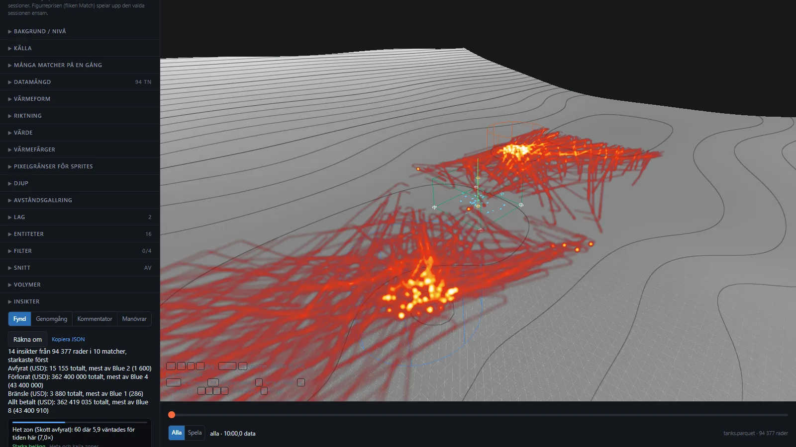
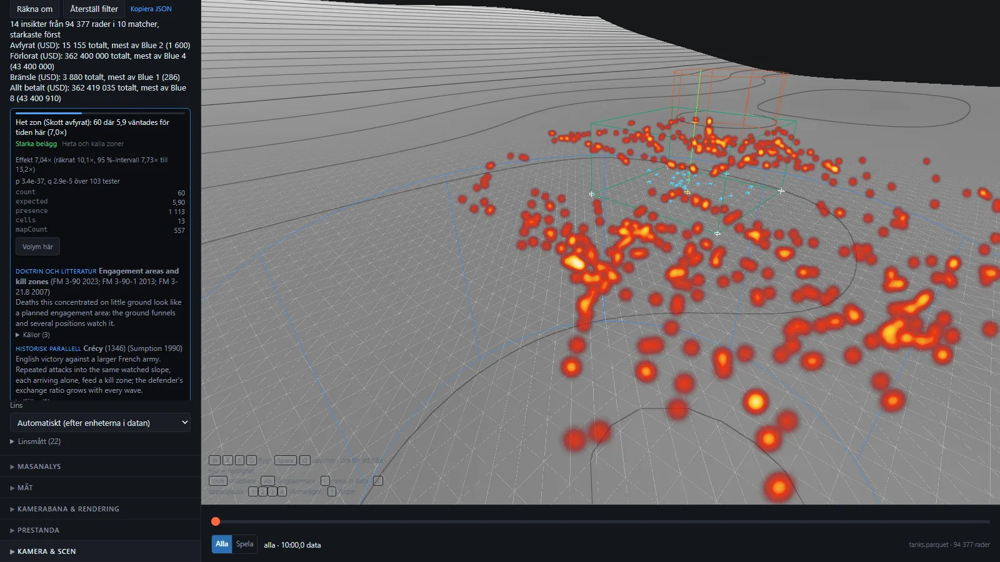
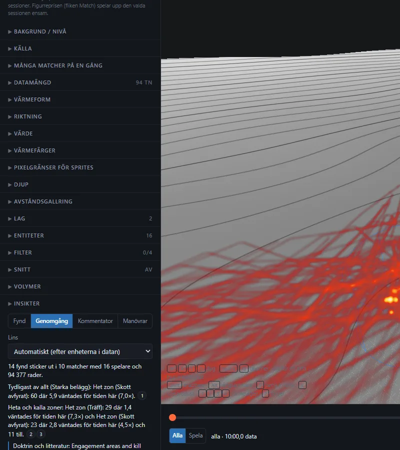
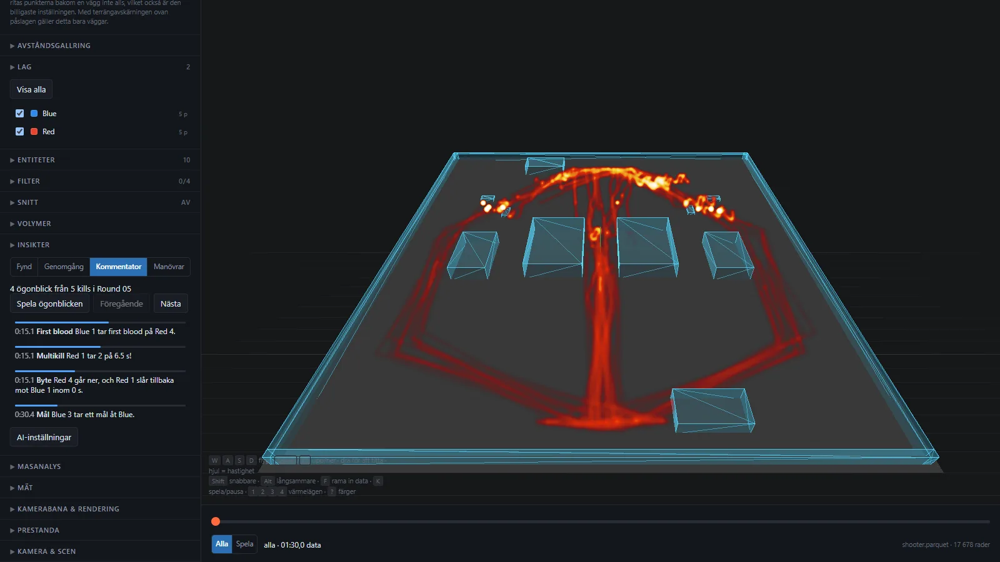

# Insikter

**Insikter** letar igenom den inlästa datan efter det som sticker ut: starka positioner, dödlig mark, spawn-fällor, flaskhalsar och spelare långt över sina jämlikar. Den berättar det, starkast först, med underlaget. Med den kan du på en minut lära dig var en match vanns eller förlorades. Den kan sedan skriva en genomgång, och i en enda repris kan den fungera som kommentator som hoppar till de stora ögonblicken.

Allt räknas i din webbläsare. Ingenting lämnar datorn om du inte slår på en extern AI (se [Extern AI](#external-ai)).

Avsnittet **Insikter** finns i sidofältet i flikarna Värmekarta och Match. Det har tre flikar: **Fynd**, **Genomgång** och **Kommentator**.

## Fynd {#findings}

1. Läs in data och öppna **Insikter**. Tryck **Hitta insikter** (”Räknar… n %” visar förloppet).
2. Läs listan. Varje fynd har en styrkestapel, en mening, hur gott underlaget är (*Starkt underlag*, *Bra underlag* eller *Visst underlag*), vilken detektor som hittade det och fordonsklassen där det spelar roll.
3. **Klicka på ett fynd**: visaren tillämpar dess filter, flyger kameran till platsen och hoppar till tiden, och öppnar detaljerna. Där visas effekten med dess 95 %-intervall, p- och q-värdena, det räknade underlaget och **Volym här**, som ritar en [volym](volumes.md) runt platsen.
4. **Återställ filter** lägger tillbaka dina filter. **Kopiera JSON** kopierar hela rapporten.

Räkningen använder de aktuella filtren, dolda grupper och vald match över hela tidsintervallet. Ändrar du filtren efteråt visas en notis om det; tryck **Räkna om**.

Raderna överst i listan (till exempel summorna för pengar) sammanfattar hela datan före fynden.

### Detektorerna {#the-detectors}

| Detektor | Vad den hittar | Behöver i datan |
|---|---|---|
| **Maktpositioner** | Platser med mycket bättre förhållande mellan dödningar och dödsfall än resten av kartan, och *säker mark* där få dör för tiden som spenderas | dödnings- och dödshändelser |
| **Heta och kalla zoner** | Platser där en händelsetyp (skott, träffar, erövringar ...) sker långt oftare eller sällnare än tiden där förutsäger | en händelsekolumn |
| **Öppen mark och skydd** | Dödsfall i det öppna mot närliggande nivågeometri, och långsamt mot snabb rörelse | dödsfall; en 3D-bana för geometridelen |
| **Spawns** | Starka spawns, spawn-fällor, säkra spawns, tid till första kontakt | tid och personer |
| **Klass per plats** | En fordonsklass, eller spelare mot AI, som gör det mycket bättre eller sämre i ett område | dödningar plus en fordonsklass eller en **ai**-kolumn |
| **Spelare** | Spelare som dödar eller dör långt oftare eller sällnare än andra i samma klass | **person** och dödningar |
| **Flaskhalsar och flanker** | Flaskhalsar (långt fler passager än marken runt) och flankrutter (sällan använda, men leder till dödningar) | **person** |
| **Värde** | *Dyr mark* och *Inbringande mark* | [värdekolumner](value-weighting.md) |
| **Vad som avgjorde rundorna** | Vad som skilde vunna från förlorade rundor, och de spelare som lade till eller kostade mest vinstchans (se [Vem vann](#who-won-what-decided-the-rounds)) | rundor, dödningar och dödsfall, och [utfallskolumnerna](data-formats.md#outcome-columns) (`won`) |

Detektorer som inte kan köras på datan listas längst ned, med skälet.

### Så rangordnas fynden {#how-findings-are-ranked}

Varje plats eller grupp testas mot resten av kartan (exakta binomial- eller frekvenstest). Andelen falska upptäckter hålls på 5 % (Benjamini-Hochberg). Slump kan se ut som ett mönster. Det här håller falsklarmen nere: bland de visade fynden väntas högst ungefär ett av tjugo bero på slump. Effekter från få händelser dras mot ”ingen effekt” före rangordningen. Högst 60 fynd listas, och varje detektor får några platser högst upp.

### Vem vann {#who-won-what-decided-the-rounds}

Där matcherna säger vem som vann varje runda ([utfallskolumnen](data-formats.md#outcome-columns) `won`) är resultatet ett eget mål:

- **Platser: vinstandel.** För varje sida andelen av dess rundor på en plats som den vann, mot andelen den vann i samma match var som helst – så kartans balans, sidans och matchens egen är baslinjen, och bara platser vars innehavare vinner fler (eller färre) av sina rundor sticker ut. Ett påhittat exempel: *”Dust: sida T vinner fler av sina rundor när den är här: 61 % av 412 vunna, mot 49 % väntat utifrån dess egen andel i samma matcher (odds 1,6x; hölls i 31/48 matcher).”* Samma falska upptäcktsfrekvens och stabilitetskontroller som för varje plats; **Läs in** läser in de matcher den höll i och visar den sidans positioner.
- **Nischer: rundseger.** Tabellen **Rundor** innehåller varje livs runda: kartan, sidan, delen av matchen (rundor 1–4, 5–8, ...), fordonet (en operatör, en agent), vapnet det använde mest, platsen det höll längst, köpet (eco, force, full) och om dess sida fick första nedskjutningen. En grupp bedöms mot vad dess sida vann i samma matcher, så *T på Dust med en AWP* är en nisch bara när de rundorna vanns oftare än T:s andra rundor i de matcherna. Ett påhittat exempel: *”m1 · T · AWP: vinner 80 % av 320 rundor, mot 62 % väntat utifrån samma sidor i samma matcher (odds 2,3x; 40 matcher).”* Rangordnas efter lyftet gånger stödet; **Läs in** läser in de matcher vars rundor visar det mest.

Båda behöver sammanfattningar av version 2 (se [Få sammanfattningarna](#getting-the-summaries)): äldre räknas fram igen.

## Genomgång {#debrief}

Fliken **Genomgång** skriver ner fynden som en kort text: en inledning, det tydligaste fyndet, ett för taktik, ett för balansering, sedan – där datan säger vem som vann – vad som avgjorde rundorna, resten grupperade efter detektor och hur många som bygger på svagare underlag.

Vad som avgjorde rundorna kommer i fyra stycken: ställningen och var vinstchanserna kommer ifrån; de starkaste faktorerna med sina siffror, intervall och q (när ingen klarar den falska upptäcktsfrekvensen säger texten *inget av det är säkert ännu* och nämner ändå den starkaste); de tre största vändpunkterna; och de spelare som lade till och kostade mest vinstchans, med de platser som vann mest. Ett påhittat exempel:

> T vann 23 och CT vann 17 av 40 rundor med känt resultat (T: 58 %, 95 % 42 % till 72 %). Vinstchanserna kommer från en modell anpassad till dessa rundor.
>
> Vad som skiljde vunna från förlorade rundor: T vann 79 % av de 19 rundor då den höll Mid, mot 24 % av 21 utan (55 procentenheter, 95 % 26 till 74) (q 0,004), ...
>
> Vändpunkter: runda 17 vid 48 s, en dödning av CT vid B site flyttade dess chans från 31 % till 58 %, och den tog rundan, ...

Varje stycke har numrerade knappar som visar dess fynd. **Kopiera text** kopierar den.

Den inbyggda berättaren fungerar offline, på ditt språk. Väljaren **Lins** ovanför den (se [Kunskapslinsen](knowledge.md)) avgör vilken litteratur styckena hänvisar till.

### Extern AI {#external-ai}

**AI-inställningar** låter en AI-modell du väljer skriva genomgången i stället:

| Inställning | Betydelse |
|---|---|
| **Leverantör** | Anthropic (Claude), OpenAI (ChatGPT), OpenRouter, Ollama (lokal), LM Studio (lokal), llama.cpp-server (lokal) eller valfri OpenAI-kompatibel slutpunkt |
| **Bas-URL**, **Modell** | Ifylls av leverantören. **Lista modeller** frågar servern |
| **API-nyckel** | Skickas bara till bas-URL:en. Loggas aldrig och sparas aldrig i vyer, exporter eller `.3dheat`-filer. De flesta lokala servrar behöver ingen. |
| **Kom ihåg nyckeln i den här webbläsaren** | Av som standard: nyckeln glöms när sidan stängs |
| **Använd en extern AI** | Av som standard |
| **Skicka spelarnamn** | Av som standard: spelare skickas som P1, P2 ... |

Skriv sedan en valfri fråga och tryck **Skriv med AI**. Bara fynden och deras siffror skickas, aldrig raderna i din data. Svaret strömmar in, och citerade fynd blir knappar. Där datan säger vem som vann får modellen besked att börja med vad som avgjorde rundorna, med varje siffras intervall och q, och att säga till när en faktor bygger på få rundor eller när vinstchanserna kommer från prior-modellen.

## Kommentator {#caster}

För **en match** (välj en om flera är inlästa) hittar **Kommentatorn** de ögonblick som är värda att titta på: första blodet, multidödningar, byten, vändningar i slutspel, skiften i mål, comebacks, framträdande spelare, långskott och **vändpunkter** – de dödningar som flyttade en sidas chans att vinna rundan mest (utifrån spelarna som är kvar i livet på varje sida, i rundor utan respawn).

Där datan säger vem som vann varje runda säger varje ögonblick det: *”Anna tar ner Ben: T:s chans att vinna rundan går från 38 % till 62 % – och de tar rundan.”* Ett ögonblick för den sida som till slut vann räknas mer när kommentatorn väljer vilka som ska behållas, och en comeback räknas i vunna rundor.

- Klicka på ett ögonblick: vyn byter till repriset, hoppar till strax före det, flyger dit och följer spelaren.
- **Spela ögonblicken** spelar upp varje till slutet och går vidare. **Föregående** / **Nästa** bläddrar bland dem.
- Med en extern AI på skriver **Kommentarer av AI** en kommentar utifrån ögonblickslistan (slag, tider, namn eller pseudonymer, lag, klasser, avstånd).

Den behöver **person** och dödnings- eller dödshändelser (eller erövringar). En kolumn `other`/`victim` gör byten och långskott möjliga.

## Kunskapslinsen {#knowledge-lens}

Ett fynd kan läsas genom en **lins** av etablerad kunskap: militär doktrin, luft- och sjöstrid, stadsoperationer, spelkonstruktion och e-sport (eller *Auto*, vald av enheterna i datan). Ett öppnat fynd visar då den närmaste **doktrin- och litteraturposten** och en **historisk parallell**, med referenser. **Linsmått** beräknar mått ur litteraturen på datan: Lanchester-anpassningar, utbytesförhållanden, styrkeförhållanden, eldfält, nyckelterräng, byten och initiativ. Genomgången och AI-prompten tar med dem. Allt om det: [Kunskapslinsen](knowledge.md).

Linsmåtten mäter också hur spelarna beter sig som en folkmassa och som en grupp: linjering och virvlande, ruttstyrning, körfält och spår, trängsel, ledare och följare, eftersläntrare, brytpunkten vid förluster, risken efter ett förlorat liv, serier, köpöverenskommelse och reaktionen på inkommande eld. Var och en jämförs mot sin egen nollmodell: [Gruppbeteende](collective-behaviour.md).

## Data som gör insikterna möjliga {#data-that-makes-insights-work}

- positioner med **time**, en **person** och en **team**-kolumn;
- en **event**-kolumn med dödningar och dödsfall (`kill`, `death`), och andra (`hit`, `fire`, `capture` ...);
- en kolumn för motparten (`other`, `victim`) för byten och riktningar;
- en **vehicle**- eller **type**-kolumn för klasser; en `ai`-kolumn för spelare mot AI;
- en **session**- / **match**- / **round**-kolumn när det finns flera matcher.

[Demodata](demo-data.md) har alla dessa.
