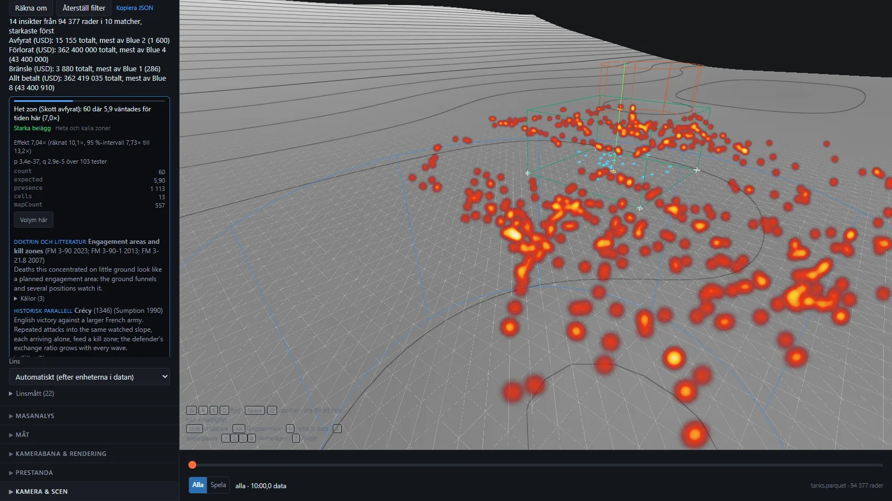

# Kunskapslinsen

När [Insikter](insights.md) hittar något förklarar den här delen det med idéer från krigshistoria, spelkonstruktion och idrottsanalys, och anger boken eller uppsatsen det kommer från. Använd den för att förstå *varför* ett mönster spelar roll, inte bara att det finns.

## Prova {#try-it}

1. Läs in data och öppna **Insikter**, tryck sedan på **Hitta insikter**.
2. Klicka på ett fynd för att öppna det.
3. Läs **Doktrin och litteratur** och **Historisk parallell**; hela källhänvisningarna är ihopfällda under dem.
4. Byt **Lins** (till exempel till *Militär doktrin*) för att läsa samma fynd genom en annan litteratur.

## Så fungerar det {#how-it-works}

Panelen Insikter bedömer sina fynd på det sätt en yrkesanalytiker skulle göra: genom militär doktrin och operationsanalys, historiska fältslag, samt litteraturen om spelkonstruktion, banutformning och analys. Det sker offline, från en kurerad kunskapsbas i betraktaren, och samma material ges till en extern modell när den skriver genomgången.

## Vad panelen visar {#what-the-panel-shows}

- **Lins** väljer vilken litteratur fynden läses genom: *Auto* (valt efter vilka slags enheter datan har: flygplan, fartyg, markfordon, infanteri), *Militär doktrin*, *Luftstrid*, *Sjökrig*, *Stad*, *Speldesign och balans*, *Esport*. Poster utanför den valda linsen utelämnas.
- Varje öppnat fynd visar sin närmaste post under **doktrin och litteratur** och sin närmaste **historiska parallell**, med hela källhänvisningarna ihopfällda under.
- **Linsmått** listar måtten från operationsanalysen som beräknats på samma rader (nedan), var och en med vad det betyder och sin litteratur.
- **Genomgången** lägger till rader för de ledande fynden och linsmåtten: "Doktrin och litteratur: ..." och "Historisk parallell: ...", var och en med författare-år-hänvisningar och källorna ihopfällda under.
- **Skriv med AI** skickar de mest relevanta posterna (sammanfattning, lärdom, de fynd de hör till, hela källhänvisningarna) med rapporten, och ber modellen hänvisa till dem med id – `{concept.lanchester-square}` – och inte använda några andra källor.

Etiketterna är översatta; kunskapen i sig är på engelska.

## Linsmått {#lens-metrics}

Beräknas i insiktsarbetaren, i samma genomgång av raderna som detektorerna (`src/insights/lensMetrics.ts`). Varje mått utelämnas när datan inte kan bära det.

| Mått | Vad det mäter | Behöver |
|---|---|---|
| Lanchester-anpassning | Varje sidas förluster per 20 s regredierade mot båda sidornas levande styrkor (Poisson, kvasi-likelihood-fel); exponenterna för fiendens och egen styrka, prövade mot kvadratlagen (riktad eld) och linjärlagen (områdeseld) | tid, lag, dödanden och dödsfall |
| Utbytesförhållande | Dödanden per dödsfall per sida och plats; andelen dödsfall på den dödligaste marken som håller 5 % av tiden som gått, mot andelen som slumpen ger med så många dödsfall; Gini för dödsfall mot tid; Morans I för dödstakten | dödanden och dödsfall |
| Lokalt styrkeförhållande | Egna och fientliga enheter levande inom engagemangsavstånd från varje dödande (avståndet satt från datan: dubbla medianavståndet till närmaste fiende); andelen dödanden av den lokalt överlägsna sidan, och dess överskott över vad antalen ensamma förutsäger | tid, lag, personer |
| Eldfält | Synfält från de mest trafikerade dödsplatserna på en 2,5D-yta med hinder (nivågeometri upp till vägghöjd, eller den mark som gåtts) mot den genomsnittliga platsen, och rangkorrelationen mellan synfält och andel dödanden | positioner; en inläst bana gör det skarpare; inte för luft |
| Energiläge | Specifik energi (höjd plus den höjd farten kan köpa) för luftdödare och luftoffer, jämförd med Mann-Whitney-statistiken | flygplansklasser, tid, höjd |
| Nyckelterräng | Hur ofta varje plats finns bland en matchs tre mest trafikerade dödsplatser | flera matcher |
| Ömsesidigt stöd (byten) | Dödsfall besvarade av en lagkamrats dödande inom engagemangsavståndet och 5 s | tid, lag |
| Första slaget | Engagemang – dödanden grupperade per match, per 20 s lugn och per tre engagemangsavstånd – vunna av sidan som gjorde första träffen | tid, lag |
| Salvomodell | Hughes salvoekvation anpassad till 20 s perioder med fartyg i kontakt: fartyg satta ur spel per anfallande fartyg, och räddade per försvarande fartyg; en Lanchester-anpassning på enbart fartyg | fartygsklasser, tid, lag |
| Stridseffektivitet | Dödanden per enhetstimme i strid för varje sida och kvoten mellan de två största (ett stridseffektivitetsvärde i Dupuys mening) med dess 95 %-intervall, och varje sidas andel av dödandena vid jämna lokala antal | tid, lag |
| Engagemangsavstånd | Avstånd till närmaste fiende vid dödanden, vid avfyrningar och vid varje livs första skott (upptäckt till engagemang), per enhetsslag | tid, lag; avfyrningar där datan har dem |
| Dödskedja | Sekunder från dödarens sista avfyrning till dödandet, och från dess första skott i striden till dödandet | tid; avfyrningar eller eldhändelser |
| Koncentration eller spridning | I varje 20 s-period spridningen hos de två största sidorna och andelen dödanden som tas av den tätare | tid, lag |
| Flygutfall | Per sida: flygutfall (start, eller flygplansspawn), landningar, förlorade flygplan och dödanden per flygplan; förlusttakt och dödanden per utfall | flygplansklasser; start eller spawn |

Data med rundor lägger till närstrids- och esportmåtten – vinstsannolikhet per runda, värdet av handlingar, öppningsduellerna, byten, peeker mot holder, sikte, korseld, hjälpmedel, manöverövertag, clutchar, uppställningar, efter bomläggning, dödliga trattar och spelarpåverkan: se [Närstrid och rundor](close-quarters.md).

Banor och lag lägger till måtten för kollektivt beteende från folkmassevetenskap, kollektiv rörelse, beteendeekonomi och militärpsykologi – samriktning och kretsande, flockning längs rutter, körfält och spår, trängsel, ledare och följare, eftersläntrare, brytpunkten, risk efter förluster, serier, köpavtal och undertryckning, var och en mot sin egen nollmodell: se [Gruppbeteende](collective-behaviour.md).

Vapen, lockbeten och byggnader räknas inte som enheter. Där vapenraderna anger sin avfyrande enhet (en kolumn `Shooter` eller `Launcher`, som data från Tacview har), krediteras avfyrningen den enheten, matchad på dess namn eller dess objekt-id.

## Hur fynd möter litteraturen {#how-findings-meet-the-literature}

Poster och fynd möts genom en **mönstertaxonomi** (`src/insights/knowledge/patterns.ts`): koncentration, lokal överlägsenhet, riktad och områdeseld, flaskhalsar, dödszoner, eldfält, omvänd sluttning, flankering, ömsesidigt stöd, energifördel, spawntryck, balans och så vidare. Varje detektortyp och varje linsmått anger vilka mönster dess siffror visar (`src/insights/lens.ts`); varje kunskapspost anger vilka mönster den berör, med en vikt. En posts relevans för ett fynd är den viktade överlappningen, skalad efter hur väl postens domän (mark, luft, sjö, stad) passar datan och efter fyndets egen styrka. Motiveringen som visas är fyndets siffror i en mening, följd av postens lärdom.

## Katalog {#catalogue}

Varje mönster, begrepp, metod, historiskt fall, konstruktionsprincip och studie, med bibliografin: se [Kunskapskatalogen](knowledge-catalogue.md).

## För utvecklare {#for-developers}

### Lägga till poster {#adding-entries}

1. Välj filen efter typ: `concepts.ts` och `concepts-more.ts`, `methods.ts`, `cases.ts`, `cases-land.ts`, `cases-air-sea.ts`, `cases-esports.ts`, `design.ts` (konstruktionsprinciper) eller `studies.ts` i `src/insights/knowledge/`.
2. Ge den ett nytt id `<typ>.<slug>` (återanvänd aldrig ett), dess linser, domäner och de mönster den berör med vikter 0..1. Lägg bara till ett mönster i `patterns.ts` när ett fynd kan visa det, och koppla det från ett fynd eller mått i `lens.ts`.
3. Skriv sammanfattningen och lärdomen **med egna ord**. Citat bara ur verk i public domain (`pd: true` i källan), och korta.
4. Hänvisa: lägg till varje nytt verk i `refs.ts` med författare, år, titel och förlag (tidskrift med volym och sidor); en URL eller DOI där det finns en offentlig post.
5. Kör `npx vitest run src/insights/lens.test.ts` (unika id, kända mönster, lösbara källhänvisningar, citat ur public domain, fall med datum och utfall) och `node tools/knowledge-doc.mjs` för att uppdatera [katalogen](knowledge-catalogue.md).
