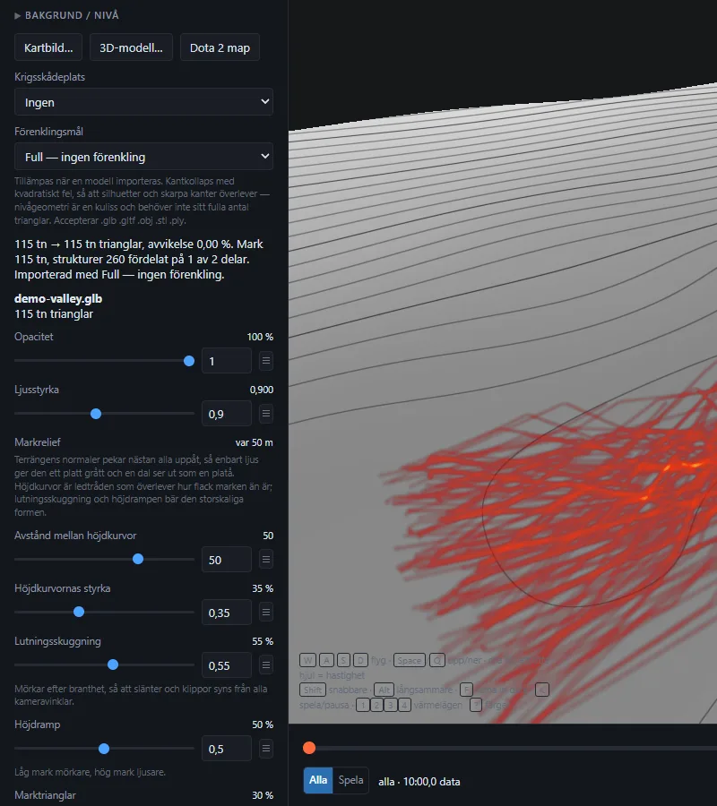

# Banor och bakgrundsgeometri

En bana är den 3D-plats där spelet ägde rum: en karta, en stad, en bana. Lägger du en bana bakom dina data kan du se *var* värmen sitter. Panelen **Bakgrund / nivå** (se [Ordlista](glossary.md) för "bana") ger dig tre slags sammanhang:

- en **kartbild**, georefererad med två ankare. Se [Kartbilder](map-images.md).
- en **3D-bana** (`.glb`, `.gltf`, `.obj`, `.stl` eller `.ply`), uppdelad i mark, konstruktioner och vatten och förenklad vid import. Se [3D-banor](model-levels.md) och [Banans utseende](level-appearance.md).
- en **verklig värld som bakgrund**: för en inspelning som anger var på jorden den är (en Tacview ACMI-fil) visas den verkliga terrängen, vägar, vatten, flygfält och byggnader, hämtade från öppna data. Se [Världsbakgrund](world-backdrop.md).

Utan något inläst är scenen mörk, med ett rutnät och färgade axlar (**Rutnät** och **Axlar** i [Kamera och scen](camera.md)). Panelen säger *Inget inläst. Scenen visar ett rutnät och axlar. Lägg till en kartbild eller ett banmesh för att ge värmen sammanhang.*

Banan delas av alla tre flikar. En bana som lästs in i fliken Racinganalys är samma bana som värmekartan visar.

## Lägg en bana bakom dina data {#put-a-level-behind-your-data}

1. Läs in dina data först ([Hämta data](getting-data-in.md)), så att banan anpassas efter dem.
2. Öppna **Bakgrund / nivå** i sidofältet.
3. Tryck på **Kartbild…** för en bild eller **3D-modell…** för en 3D-bana, och välj filen. För en inspelning från verkligheten använd **Verklig värld som bakgrund** eller **Krigsskådeplats** i stället.
4. Vänta tills förloppsraden är klar. En stor modell förenklas först (se **Förenklingsmål** nedan).
5. Tryck på **F** i vyn för att visa allt. Använd **Opacitet** och **Ljusstyrka** tills värmen sticker ut från banan.
6. Tryck på **Spara i biblioteket** om du ska använda banan igen ([Banbibliotek](level-library.md)).

## Vad en bana gör för värmen {#what-a-level-does-for-the-heat}

- Den **skymmer**. Datapunkter bakom den dämpas per yta, och datapunkter bakom terrängen döljs ([Djup och bortsortering](depth-and-culling.md)). Utan bana finns ingen skymning.
- Den **skärs** av [Skivan](slice.md) och, med *Skär nivån också*, av [avståndsgallringen](depth-and-culling.md#distance-culling), tillsammans med värmen.
- Det är det enda [skärpedjupet](camera.md#depth-of-field) suddar ut, förutom rutnätet och lådorna.
- En 3D-bana **vidgar kamerans bakre plan** när den är större än datan. Nära och fjärran plan kalibreras från datamängden. En exporterad karta som är flera kilometer bred skulle annars ligga helt bakom det bakre planet och lämna en tom vy. Det bakre planet blir 3 × banans horisontella utsträckning när den är större. Det närmare planet flyttas med det (minst fjärran / 100 000) för att behålla den djupprecision som skymningen bygger på. Flyghastigheten höjs till minst utsträckning / 12. Det vidgas bara, det smalnar aldrig.

## Panelen, uppifrån och ned {#the-panel-top-to-bottom}

| Del | Detaljer |
|---|---|
| **Kartbild…**, **3D-modell…** | Läs in en. Den ersätter den aktuella banan. |
| **Verklig värld som bakgrund**, **Glöm kartrutor** | Bara för en datamängd med geografisk referens. Bygger den verkliga platsen under den som bana, eller tar bort de nedladdade rutorna. [Världsbakgrund](world-backdrop.md) |
| **Förenklingsmål** | Triangelbudgeten för nästa modellimport: *Full - ingen förenkling* (standard), *Hög - 8 M*, *Medel - 3 M*, *Låg - 800 k*, *Silhuett - 100 k*. [3D-banor](model-levels.md#simplification) |
| Förlopp och **Avbryt** | Medan den avkodar eller importerar. |
| Importnotis | Trianglar före och efter, delningen mark / konstruktioner / vatten och vilken detaljnivå som används. |
| Namn och storlek | `bredd×höjd px · x × z m/px` för en bild, `N trianglar (från M)` för en modell. |
| **Opacitet**, **Ljusstyrka** | Båda slagen. |
| Bildreglage | **Avmätta**, **Vänd nord/syd**, **Placering** (två ankare), **Anpassa till datans gränser**, **Höjd**. [Kartbilder](map-images.md) |
| Modellreglage | Markrelief, vatten, marktrianglar, trådmodell, textur, fångad färg, konstruktioner, delklassificering. [Banans utseende](level-appearance.md) |
| **Spara i biblioteket**, **Ta bort** | [Banbibliotek](level-library.md). Ta bort lägger av banan. |
| **Bibliotek** | Banor som sparats i den här webbläsaren. [Banbibliotek](level-library.md) |

## Sidor i det här avsnittet {#pages-in-this-section}

- [Kartbilder](map-images.md)
- [3D-banor](model-levels.md): format, delar, klassificering, förenkling, texturer
- [Banans utseende](level-appearance.md): varje reglage för en 3D-bana
- [Banbibliotek](level-library.md)
- [Världsbakgrund](world-backdrop.md): den verkliga världen under en inspelning, från öppna data

Hur man får ut banor ur spel och motorer är uppgiften för de separata exportverktygen (se förrådets [README](https://github.com/Holdi601/3DHeat/blob/main/README.md)). Det gränssnitt de skriver till sammanfattas i [3D-banor](model-levels.md#the-exporter-contract).
