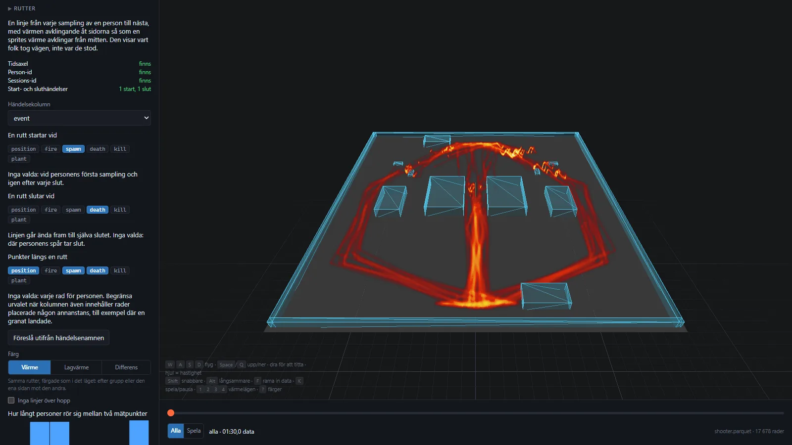

# Linjevärme

Värme visar var folk stod. Linjer visar vägarna de gick.

**Linjer** (tangent 4) är linjevärme: en linje från varje [personens](glossary.md) sampling till dess nästa, utsmetad med samma avklingning som en [sprite](glossary.md) har – tvärs över linjen i stället för runt en punkt. Den visar var folk *gick* i stället för var de stod: en korridor som bara gåtts en gång syns lika tydligt som ett rum där någon legat, och en snabb spelares glesa sampling går ihop till en obruten väg i stället för ett prickat spår. Den kräver en personkolumn och en tidskolumn.

## Så använder du den {#how-to-use-it}

1. Tryck `4` (eller välj **Linjer** i lägesraden).
2. Öppna **Rutter** och kontrollera den gröna checklistan: tidsaxel och person-id måste finnas.
3. Tryck **Föreslå utifrån händelsenamnen** för att fylla i var rutter startar och slutar.
4. Läs statistikraden: "N rutter, M av dem når ett slut".
5. Om linjer hoppar över kartan, justera **Längsta steg** (se [Gränsen för hopp](#the-jump-limit)).

En linje är meningsfull bara mellan en början och ett slut, så panelen **Rutter** säger vad som avgränsar en rutt. Allt från [Reglerna för en rutt](#the-rules-of-a-route) och framåt är detaljer du kan hoppa över.

## Panelen Rutter {#the-routes-panel}

Visas ovanför värmepanelerna i linjelägena.

### Vad datan innehåller {#what-the-data-has}

En checklista, grön när något finns, gul när det inte gör det:

| Rad | Tillstånd |
|---|---|
| **Tidsaxel** | *finns* / *saknas — krävs* |
| **Person-id** | *finns* / *saknas — krävs* |
| **Sessions-id** | *finns* / *ingen — alla rader är en session* |
| **Start- och sluthändelser** | *N starter, M slut* / *inga valda — hela spår* (grönt bara med en händelsekolumn och minst en start och ett slut) |

### Reglage {#controls}

| Reglage | Betydelse |
|---|---|
| **Händelsekolumn** | En kategorikolumn vars värden är händelser (spawn, död, position, ...). *Ingen — hela spår*: varje persons spår i varje session är en rutt, bruten där spåret har ett glapp. Bara kolumner som behölls för filtrering vid inläsningen erbjuds. |
| **En rutt startar vid** | Händelsevärden som börjar en rutt (spawn, respawn, insättning). Inga valda: en rutt startar vid personens första sampling, och igen efter varje slut. |
| **En rutt slutar vid** | Händelsevärden som avslutar en rutt (död, extraktion, teleportering). Linjen går fram till själva slutraden. Inga valda: en rutt slutar där personens spår tar slut. |
| **Punkter längs en rutt** | Händelsevärden vars rader ligger längs rutten. Inga valda: varje rad för personen. Begränsa urvalet när kolumnen även innehåller rader placerade någon annanstans, till exempel där en granat landade. |
| **Föreslå utifrån händelsenamnen** | Fyller i de tre listorna från värdenas namn (nedan). |
| **Färg** | *Värme*, *Lagvärme* eller *Differens*. Samma rutter i den färgsättningen i det läget: varje grupp i sin egen nyans, eller en sida mot den andra, med grupplistan, uppdelningen och skalorna som de fungerar i de lägena. Standard *Värme*. Lagvärme och differens kräver en gruppkolumn. |
| **Inga linjer över hopp** / **Längsta steg** | En persons nästa sampling längre bort än detta är en respawn, en teleportering eller ett fall och inte en plats personen gick till, så ingen linje förbinder de två. Ifylld vid inläsningen när datan visar ett tydligt glapp (nedan), och av när den inte gör det. Fungerar med eller utan händelsekolumn. |
| Statistikraden | `N rutter, M av dem når ett slut, K segment`, uppdateras några gånger per sekund. |

Varje lista är en rad med växlingsbrickor, en per värde, vanligast först; när du håller musen över en bricka visas dess antal rader. Högst 120 värden erbjuds (*N fler värden visas inte*).

Om du väljer en annan händelsekolumn tillämpas förslaget när förslaget väljer just den kolumnen, och annars startar listorna tomma.

### Förslaget {#the-suggestion}

Vid varje inläsning, och vid **Föreslå utifrån händelsenamnen** ([`suggestLineSettings`](https://github.com/Holdi601/3DHeat/blob/main/src/data/lines.ts)):

- **Händelsekolumn:** den första behållna kategorikolumnen som heter `event`, `eventname` eller `eventtype`; annars `kind`, `type` eller `action`; annars någon som innehåller *event*, *kind*, *action* eller *type*.
- **Starter:** värden som innehåller *spawn, deploy, join, enter, start, begin, respawn, revive, land/landed/landing, drop* – såvida de inte också matchar ett slutord.
- **Slut:** värden som innehåller *death, died, dead, kill/killed, eliminat…, extract, evac, teleport, leave, left, disconnect, quit, exit, end, finish, downed* – utom värdena `kill` och `kills` (en dödning är något dödaren gör, inte slutet på dennes rutt).
- **Punkter:** värden som är exakt *position, location, player location, move, movement, tick, sample* eller *pos*; när något av dem hittas läggs starter och slut också till punkterna. När inget hittas förblir punkterna tomma (varje rad).

### Gränsen för hopp {#the-jump-limit}

Där folk hoppar delar sig stegens längder i två grupper med nästan ingenting mellan sig: vad en person täcker mellan två samplingar, och kartans bredd. Vid inläsningen ([`suggestMaxJump`](https://github.com/Holdi601/3DHeat/blob/main/src/data/lines.ts)) räknas stegen per fördubbling av deras kvadrerade längd, upp till 16 miljoner av dem, och gränsen läggs mitt i det första intervallet över medianen som är minst en fördubbling av längd brett, håller under 0,02 % av stegen per fack, och har steg bortom sig. Utan ett sådant intervall klipps ingenting, eftersom det inte går att skilja ett hopp från en snabb bil; då startar gränsen för hand vid en tiondel av datans diagonal.

Diagrammet ovanför gränsen visar hur långa stegen verkligen är, med en linje vid gränsen: staplarna till höger om den ritas inte. Båda axlarna är logaritmiska, eftersom hoppen kan vara en hundradel av stegen och tusen gånger så långa. Håll musen över en stapel för dess intervall och andel; klicka på diagrammet för att lägga gränsen där. Under det visas andelen steg över gränsen.

## Reglerna för en rutt {#the-rules-of-a-route}

Rader går igenom i tidsordning, per person ([`buildLines`](https://github.com/Holdi601/3DHeat/blob/main/src/data/lines.ts)):

1. Rader med ett [delat namn](sessions-persons-groups.md#names-worn-by-several-things-at-once) hoppas över helt.
2. Med punkter valda hoppas en rad som varken är en start, ett slut eller en punkt över.
3. Rader följs per person och per session, så en person vars sessioner vävs in i varandra i tidsordning får en rutt i var och en. En rutt stängs när föregående rad inte hade någon efterföljare (dess [livstid](sessions-persons-groups.md#person) är "ingen") – en rutt korsar aldrig en sessionsgräns eller ett glapp som inläsningen beslutat saknar nästa sampling. Vilken rutt en rad tillhör räknas ut en gång och sparas, 4 byte per rad, så att ändring av längsta steg inte upprepar den delen.
4. En **start**-rad stänger alla öppna rutter och öppnar en ny där.
5. Med starter valda ignoreras en rad utanför en rutt. Utan starter öppnar varje icke-slutrad utanför en rutt en.
6. Varje annan rad inuti en rutt lägger till ett **segment** från rutten föregående rad till denna.
7. En **slut**-rad som förlänger en rutt stänger den efter sitt segment; den rutten räknas som *når ett slut*.
8. Ett steg längre än **Längsta steg** stänger rutten där den var, och en ny rutt startar vid det avlägsna änden, såvida inte den raden är ett slut. Ingen linje ritas över det, och statistikraden räknar det.

Varje segment lagras på sin *slut*-rad, så segmenten håller sig i tidsordning, och [tidslinjens](timeline.md) fönster, samplaren, [filtren](filters.md), gruppsynligheten och differensens tecken fungerar på dem som på punkter. Ett filter gäller därför den rad som ett segment slutar vid.

## Uppspelning {#playback}

I läget **Alla** ritas varje rutt hel. I läget **Spela** är varje person en punkt som rör sig mellan sina samplingar och ritar sin rutt bakom sig:

- ett segment som börjar efter uppspelningshuvudet ritas inte;
- segmentet personen är mitt i ritas upp till dess interpolerade position, med en ändkapsel vid huvudet;
- värmen bleknar över **svansen**: med historiken *Kumulativt* är svansen obegränsad och hela rutten hittills står kvar; med *Fönster* bleknar den bort över *Intervallet* (standard 30 s). Med *Livstid* är svansen också *Intervallet*, och i linjelägena visar tidslinjen rutan *Intervall* för den historiken också (i stället för *Reservlivstid* och *Uttoning*, som linjevärme inte använder).

Under uppspelning ritas varje bildruta hel i stället för ackumulerad, eftersom huvudena rör sig varje bildruta och ett glidande medelvärde skulle smeta ut var och en till en strimma.

## För utvecklare {#for-developers}

### Minne {#memory}

Rutterna byggs i huvudtråden när linjelägena öppnas (eller när rutt-inställningarna ändras) och frigörs när man lämnar dem: 5 byte per rad i minnet och 8 byte per rad på grafikkortet (varje segments startposition, kvantiserad till 16 bitar per axel inom datans omslutande ruta, och dess flaggor).

### Så ritas en linje {#how-a-line-is-drawn}

Båda bakändarna ritar varje segment från dess slutrad som **18 hörn** ([`lineHeatVs`](https://github.com/Holdi601/3DHeat/blob/main/src/render/webgl2/shaders.ts) och dess WGSL-tvilling):

- Halvbredden vid varje ände är [sprite-radien](sprite-shape.md#sprite-radius) vid den ändens avstånd, med pixelgränserna tillämpade. En linje smalare än 2,5 px ritas 2,5 px bred med sin värme skalad ner därefter, så tunna linjer varken försvinner eller ljusnar.
- Värmen avtar **tvärs över** linjen med samma skala som en sprite – avklingning eller kurva, mitt- och kantintensitet.
- Runda ändkapslar ritas **bara** där en rutt börjar eller slutar, så att skarvarna mellan på varandra följande segment inte pärlar ihop sig till en pärlsträng.
- Geometrin byggs i skärmrymd och interpoleras linjärt där, så att avklingningen hålls centrerad på linjen hur den än går in i djupet. Ett segment som korsar närplanet skärs där i stället för att släppas.

Punkt- och linjevärme lägger ner väldigt olika mängder värme per rad, så mättnaden mäts om när du byter mellan dem ([Färg och exponering](colour-and-exposure.md#auto-exposure)).
