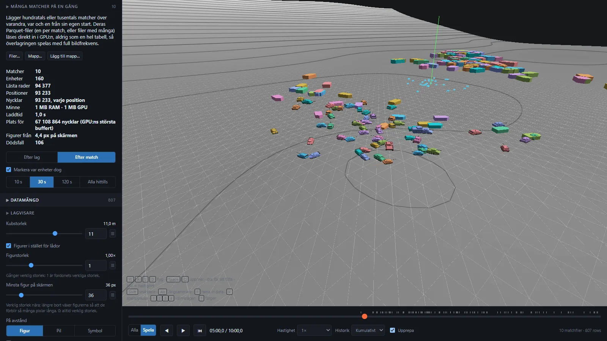

# Många matcher på en gång

**Många matcher på en gång** lägger många matcher ovanpå varandra, så att du ser vart varje matchs spelare brukar gå. Använd den för att jämföra hundratals eller tusentals matcher i en bild.

Varje match startar vid sin egen början, och dess enheter rör sig som figurer. Filerna går direkt in i grafikkortet, och ingen fullständig tabell byggs. Då spelas det jämnt där en vanlig inläsning skulle ta slut på minne.

## Så använder du det {#how-to-use-it}

1. Öppna **Många matcher på en gång** i sidofältet Värmekarta.
2. Tryck **Filer…** (välj många filer), **Mapp…** (en mapp och dess undermappar) eller **Lägg till mapp…** (lägg till i det som redan är inläst).
3. Visaren växlar till figuröverlägget och startar från början. Tryck **Spela**.

Varje fil är en match, eller innehåller flera. Parquet-filer och [`.3dheat`](container.md)-behållare fungerar. En fil behöver en position-, tid- och enhetskolumn. Namn-, typ- och sidkolumner behålls. Andra filer, och sidofilerna från konverterare (flyg, meddelanden, händelser, chatt, mål), hoppas över. För en vanlig tabell, se [Läsa in data](getting-data-in.md).

## Inställningar {#settings}

| Inställning | Vad den gör |
|---|---|
| **Efter lag** / **Efter match** | Färg efter sida, eller en färg per match. |
| **Markera var enheter dog** | En markering där varje enhet dog, i 10 s, 30 s, 120 s eller alla hittills. |

Panelen visar hur många matcher, enheter, rader och positioner som lästes, minnet som används och inläsningstiden. *Utrymme för* är hur många fler positioner grafikkortet ännu kan ta. *Figurer från* är storleken på skärmen under vilken en enhet ritas som en liten pil i stället för sin figur.

Figurernas utseende använder samma reglage som [matchrepriset](match-replay.md#figures): **Figurstorlek**, **Minsta figur på skärmen** och **På avstånd**.

## Tips {#tips}

- När allt inte skulle rymmas i minnet gallras positionerna. Bara en position var några meter behålls, och panelen säger det.
- Värmelägena fungerar också på överläggets data.
- För statistik över tusentals matcher utan att rita dem, se [Massanalys](mass-analysis.md).
