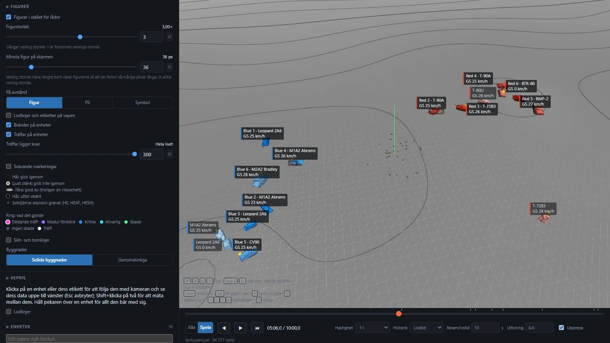
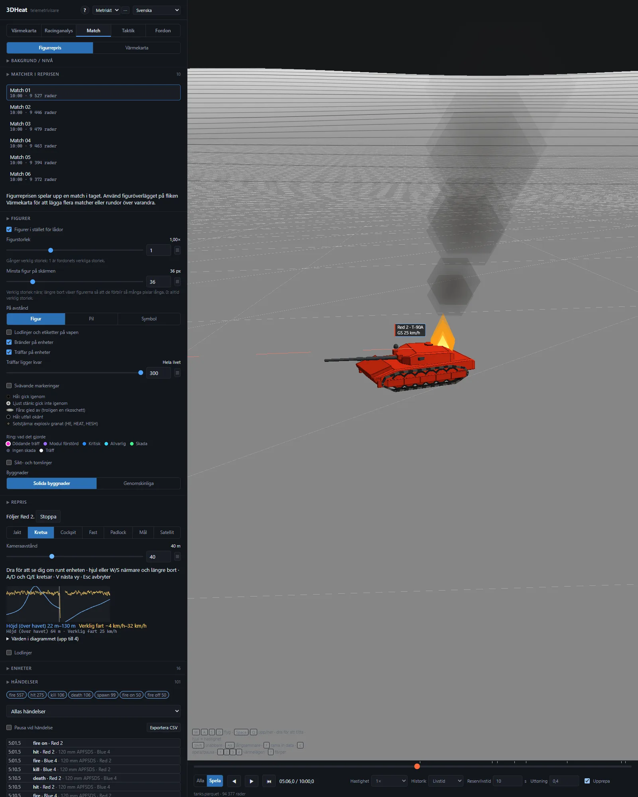
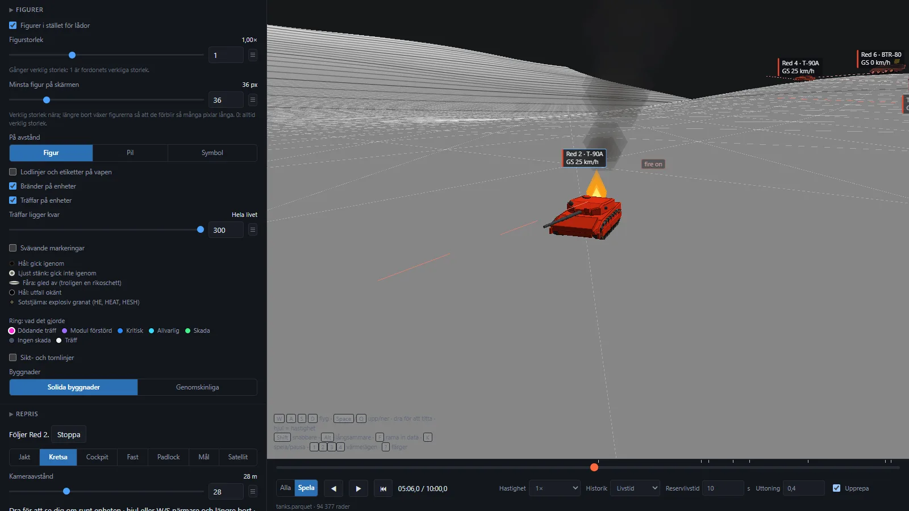
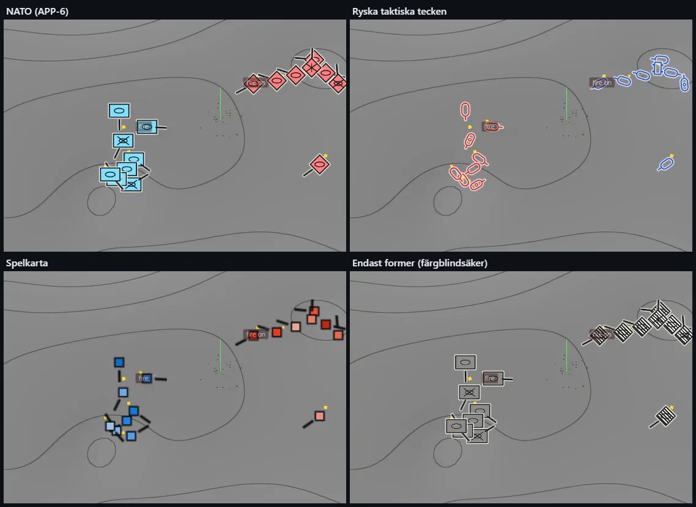
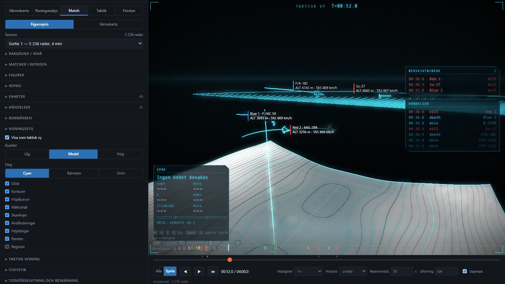
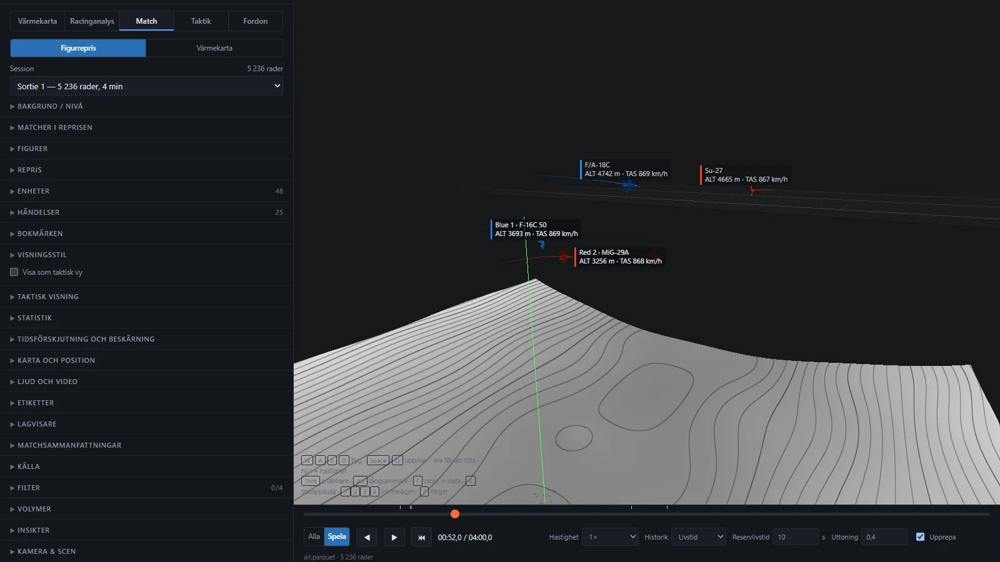

# Matchrepris

Reprisen är en film av matchen där varje spelare visas som det de körde. Använd den för att se en strid igen, följa en enhet och se vem som träffade vem.

Skott, träffar, eldgivning och vrak ritas på enheterna och målen på banan. Kameror, etiketter och en taktisk vy hjälper dig att läsa striden. Känner du till Tacview? [Tacview-paritet](tacview-parity.md) visar var varje av dess verktyg finns.

## Starta en repris {#start-a-replay}

1. Läs in en inspelning med **Källa → Filer…** eller genom att släppa den på källpanelen (vilken tabell som helst med en kolumn för **person** och en för **tid**, en Tacview-fil, en konverterad repris eller en [`.3dheat`](container.md)-match). Se [Hämta data](getting-data-in.md).
2. Öppna fliken **Match** och välj **Figurrepris**, eller välj **Figuröverlägg** i lägesfältet på fliken Värmekarta.
3. Under **Matcher i reprisen** väljer du en match, alla på en gång eller flera.
4. Tryck på **Spela** på tidslinjen (eller `K`). Dra i tidslinjen för att hoppa.

Figurer ersätter lådor för varje enhet vars namn eller typ är känd (se [Figurer](figures.md)). Data utan kolumn för namn eller typ ritas som soldater.

## Figurer {#figures}

| Inställning (avsnittet **Figurer**) | Standard | Vad det gör |
|---|---|---|
| **Figurer i stället för lådor** | på | Av ritar vanliga lådor. |
| **Figurstorlek** (gånger verklig storlek) | 1 | 1 är verklig storlek. 0,25 till 20 gånger (logaritmisk skala). Större hjälper på långt håll. |
| **Minsta figur på skärmen** | 36 px | Figurer på långt håll växer så att de blir så här långa, 0 till 200 px. 0 behåller verklig storlek. |
| **På avstånd**: Figur, Pil, Symbol | Figur | Vad en enhet på långt håll blir. |
| **Symboler** | NATO (APP-6) | NATO (APP-6), ryska taktiska tecken, ikoner för **Spelkarta**, eller **Endast former (färgblindsäker)**. |
| **Symbolstorlek**, **Min sida**, **Fientlig / Neutral**, **Kursstreck** | 28 px (12 till 64), automatisk, fientlig, på | Hur symbolerna ser ut och vilken sida som är vänlig. |
| **Lodlinjer** | på | En linje från varje enhet rakt ned till marken, så att höjder syns i 3D. |
| **Lodlinjer och etiketter på vapen** | av | Linjer till marken, och etiketter på robotar och bomber. |
| **Bränder på enheter** | på | Lågor från det ögonblick en enhet fattar eld tills elden släcks. |
| **Träffar på enheter** | på | Märken där skotten träffade (nedan). **Träffar ligger kvar**: 1 till 300 sekunder, eller **Hela livet**. **Svävande markeringar**: märken som ritas ovanför ytan. |
| **Sikt- och tornlinjer** | av | Streckade: vart spelaren tittar. Heldragna: vart kanonen pekar. |
| **Byggnader** | solida | Solida eller genomskinliga byggnader, när banan målar dem. |

### Symboler på avstånd {#symbols-at-a-distance}

När en enhet skulle bli mindre än **Minsta figur på skärmen** kan den bli en symbol som förblir läsbar. Formen visar slaget. En avrundad låda med ett bandmärke är till exempel ett pansarfordon. Färgen visar sidan. Öppna menyn **Symboler** för att ändra stilen.

### Träffmärken, vrak och bränder {#hit-marks-wrecks-and-fires}

- **Träffmärken** sitter på ytan som skottet träffade, i figurens skala. Utseendet visar vad som hände: ett hål (gick igenom), en ljus stänk (gick inte igenom), en skåra (studsade av) eller en sotstjärna (sprängladdning). En färgad ring visar vad det gjorde: dödande skott, modul förstörd, kritisk, allvarlig, skada, ingen skada eller träff. Håll markören över ett märke för rundans namn.
- En förstörd enhet ritas **förkolnad** som ett vrak från sin död tills den återuppstår eller tas bort. Dess symbol är överstruken.
- **Bränder** brinner på en enhet från det ögonblick den fattar eld tills elden släcks.
- **Torn** vrider sig dit datan säger att kanonen pekar. Utan den uppgiften vrider de sig dit spelaren tittar.

### Vapen, lockbeten och spårljus {#weapons-decoys-and-tracers}

Med **Vapen, skott och träffar** på (avsnittet Lagvisare): robotar, raketer, bomber och torpeder flyger som egna figurer med ett rökspår. Kulor och granater är spårljus. Nedslag och explosioner blinkar. Ett spårljus som ritas **streckat** har beräknats utifrån en träff, eftersom datan inte hade något skott. Facklor och stanniol ritas som skenmål. De döljs i enhetslistan om inte *Skenmål och granater* är ikryssat.

## Kameror {#cameras}

Klicka på en enhet eller dess etikett för att **följa** den. Avsnittet **Repris** erbjuder **Jakt**, **Kretsa**, **Cockpit** (med en visning i huvudet, `H`), **Fast**, **Padlock**, **Mål** och **Satellit**. `V` växlar mellan dem, och **Kameraavstånd** anger hur långt bort kameran står. Esc slutar.

- **Vy med två enheter**: välj ett **Mål** (eller Ctrl/Alt-klicka på en enhet) för att titta på den från den följda. **Byt** byter plats på dem.
- **Mått**: Shift-klicka på två enheter för bäring, avstånd och höjdskillnad mellan dem.
- **2D-karta** (`M`): hörn eller hela vyn, med spår och namn.
- **Bokmärken** (`B`): spara ögonblicket och kameran. Inspelningens egna dödanden, dödsfall och markeringar listas också.
- **Händelser**: varje händelse i tidsordning. Ett klick hoppar dit. `Page Up` och `Page Down` hoppar mellan händelser. **Pausa vid händelse** stannar vid varje.

## Taktisk visning {#tactical-display}

Avsnittet **Taktisk visning** ritar, för ingen enhet, de valda, alla, eller en typ (flygplan, mark, fartyg, vapen): hastighetsvektorer och banan framåt, nos- och lyftlinjer, radarkäglor, lås, datalänkar, engagemangszoner och linjer, siktlinjer, var spelarna tittar (vykäglor), tornsikte och den inspelade kameran.

### Visningsstil {#display-style}

`T` (eller reglaget **Visa som taktisk vy**) byter utseendet till en radarskärmsstil. Den har glöd, konturer, höjdkurvor, ett mätnät, scanlinjer, avståndsringar, höjdstegar, paneler med dödanden och händelser samt en **Regissör** som flyttar kameran till händelser av sig själv.

## Mål {#objectives}

När en match kommer med sina mål ritar avsnittet **Mål** dem på banan: erövringszoner (med ägare och erövringsförlopp), startpunkter, flygfält, områden och bombmål. Varje lager kan slås av eller på, och det finns etiketter. Målen syns genom marken. När flera spellägen är inlästa filtrerar **Läge** matcherna efter läge. Målen kommer från en konverterares matchfil bredvid inspelningen eller inuti en [`.3dheat`](container.md)-behållare.

## Etiketter och statistik {#labels-and-statistics}

- **Etiketter**: regler per typ (**Valda**, **Flygplan**, **Mark**, **Fartyg**, **Vapen**, **AI**): visas eller inte, vilka värden, och en **Prioritet** för vem som får plats när etiketter överlappar. **Håll isär etiketterna** flyttar en etikett bredvid sin enhet när den skulle täcka en annan, och lämnar den utanför när det inte finns plats. **Etikettstorlek** är 60 till 250 %. **Tillbaka till namn, fordon, höjd och fart** återställer reglerna.
  - Markenheter börjar med namn, fordon och hastighet.
  - Flygplan börjar med namn, fordon, höjd och fart.
  - Fartyg börjar med namn, fordon, hastighet och kurs.
  - Håll markören över en enhet för att se alla värden den har.
- **Statistik**: per lag och enhet: dödanden, dödsfall, skott, träffar, träffkvot, start, landningar, tid i luften, högsta hastighet, höjd och G, avstånd. Export till CSV.
- **Diagram**: en enhets värden över tid, två enheter jämförda, eller ett värde mot ett annat.

## Många matcher på en gång {#many-matches-at-once}

För att lägga hundratals eller tusentals matcher över varandra, se [Många matcher på en gång](many-matches.md). Detaljer om figurer (rök, eld och andra tidsstyrda effekter): [Figurer i figuröverlägget](figure-replay.md). Lista över Tacview-funktioner: [Tacview-paritet](tacview-parity.md), en undersida till den här.
