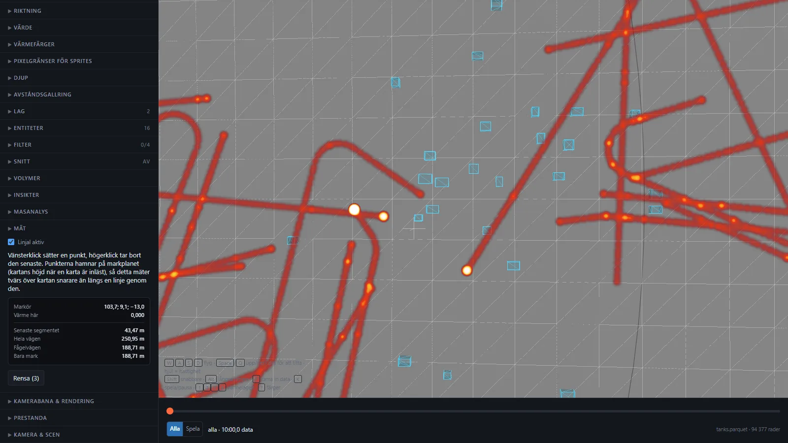

# Mätning

**Mätning** gör musen till en linjal och talar om hur livligt det är på platsen under markören. Använd den för att ta reda på hur långt isär två platser ligger, eller hur mycket trafik en plats har.

## Prova {#try-it}

1. Öppna **Mätning** i sidofältet och bocka i **Linjal aktiv**.
2. Vänsterklicka på tre platser på kartan. Varje klick lägger en punkt.
3. Läs **Hela vägen** (längden på hela vägen) och **Senaste segmentet** (den sista etappen).
4. Högerklicka för att ta bort den sista punkten, eller tryck **Rensa (3)** för att ta bort alla.

| Åtgärd | Effekt |
|---|---|
| Vänsterklick | Lägger en punkt där markören möter markplanet. Ett klick som flyttade markören mer än 4 pixlar mellan tryck och släpp är ett kameradrag, inte en punkt. |
| Högerklick | Tar bort den sista punkten. |
| Rörelse | Markörens position och värmen under den uppdateras direkt. |

Kameran fungerar medan linjalen är på. Dragning vrider fortfarande blicken, och tangenterna flyger fortfarande. Medan linjalen är på tar den varje klick, så [välj genom att klicka](camera.md#click-to-pick) väntar tills den är av.

**Markplanet** är [kartbildens](map-images.md) höjd när en kartbild är inläst. Annars är det den lägsta Y i datamängden (0 utan en). Punkterna hamnar på planet, så linjalen mäter över kartan, inte längs en linje genom den. Med en 3D-bana är planet fortfarande datamängdens lägsta Y, inte banans yta. För en punkt på den verkliga ytan, stäng av linjalen och klicka på den ([välj genom att klicka](camera.md#click-to-pick)). Då läses koordinaterna från banans egna trianglar.

## Avläsningar {#readouts}

| Rad | Betydelse |
|---|---|
| **Markör** | Världens X, Y, Z för punkten under markören, på planet. |
| **Värme här** | Hur mycket värme det är vid markörens pixel. Ett större tal betyder mer trafik på platsen. Det är värdet som färgrampen matas med före mättnadspunkten delar det, så du kan jämföra det med [Mättnadspunkten](colour-and-exposure.md#saturation-point). |
| **Senaste segmentet** | Avståndet från sista punkten till markören, eller mellan de två sista punkterna. |
| **Hela vägen** | Längden på polylinjen genom varje punkt och markören. |
| **Fågelvägen** | 3D-avståndet från första punkten till markören, eller till sista punkten. |
| **Bara mark** | Samma, men bara på X och Z. |
| **Rensa (N)** | Tar bort alla punkter. |

Avstånden visas i centimeter under 1 enhet, i meter under 1 000 och i kilometer över det. Det förutsätter att en världsenhet är en meter ([Axlar, enheter och tid](axes-units-and-time.md#unit-scale)). Koordinaterna är världskoordinater, även när en axel är [vänd för visningen](camera.md#invert-world-axis).

Punkterna och linjen mellan dem ritas som ett överlägg i vyn, med storlek efter rutnätets avstånd. Linjalens punkter sparas inte i vyer. De finns kvar när du läser in andra data.

## För utvecklare {#for-developers}

**Värme här** läses från GPU:n högst var 120 ms, eftersom en avläsning av en enda pixel stannar pipelinen. Den använder samma väg som `engine.readHeatProbe()`: delad med förstärkningen som bildrutan skrevs med. På ackumuleringsvägen i halvprecision (`?heat=f16`) är den därför i samma enheter som på ett 32-bitarsmål ([Ackumulering i halvprecision](half-float-accumulation.md)).
