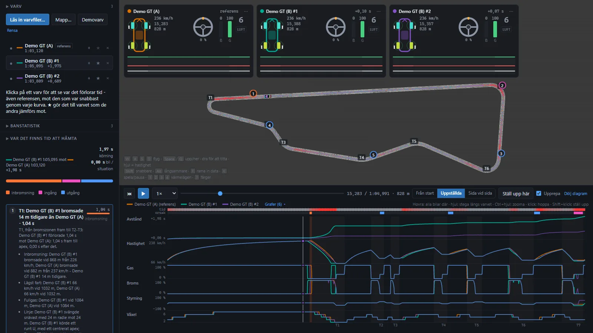

# Racinganalys

Du körde samma bana två gånger. Fliken **Racinganalys** spelar upp båda körningarna tillsammans i 3D, visar var ett varv var långsammare och säger varför. Inga varv än? Tryck **Demovarv**.

Fliken jämför två eller fler varv av samma bana. Den delar duken, kameran och banmodellen (**Bakgrund / nivå**) med värmekartan; allt annat är eget: egen sidofält och egen rad under vyn. Ord som *varv*, *referens* och *scheitel* finns i [ordlistan](glossary.md).

Den här sidan är kartan över fliken. Varje del har sin egen sida:

| Sida | Vad den täcker |
|---|---|
| [Läsa in varv](race-loading-laps.md) | varje filformat, mappar och banor, bilnamn, demovarv, varvlistan, referens och fokus |
| [Repris och 3D-scen](race-replay-and-scene.md) | transportraden, de tre replaylägena, uppställning av bilar, jaktkameran, linjer, kartor, bilar, etiketter, speglade världar |
| [Diagram och HUD](race-charts-and-hud.md) | sträckdiagrammen, grafväljaren, hovring och zoom, bilkorten, kanaltabellen |
| [Händelser för bilkontroll](race-control-events.md) | blockeringar, hjulspinn, översttyrning, snurr, understyrning, träffar, krascher, ABS/TC, handbroms, luft – hur var och en upptäcks, med varje tröskelvärde |
| [Analys kurva för kurva](race-corner-analysis.md) | justering efter sträcka, kurvor och segment, tidsräkningen för en kurva, varje orsak och i vilken ordning de prövas, linjeformen och rådet |
| [Bilprofiler och jämförelse](race-car-profiles.md) | vad varje bil klarar, mätt från dess varv; *Bilarna jämförda*; vad bilen avgör i varje kurva |
| [Banstatistik](race-course-statistics.md) | många varv av en bana: misstag per kurva och per slag, misstagskartan, exporten till värmekartan, prestandagränser |
| [Racinganalys: metoden](race-analytics.md) | forskningen bakom reglerna, med källor |
| [Andra racingspel](other-games.md) | vad betraktaren gör med varv från varje spel: glid och drift beräknade där ett spel inte skickar dem, speglade världar, de extra kanalerna |

## Skärmen {#the-screen}

**Sidofältet**, uppifrån och ner (avsnitten kan vikas ihop):

1. **Varv** – läs in, lista, visa/dölj, referens, fokus, jakt.
   Se [Läsa in varv](race-loading-laps.md).
2. **Banstatistik** – bara från tre inlästa varv och uppåt.
   Se [Banstatistik](race-course-statistics.md).
3. **Var det finns tid att hämta** – det fokuserade varvets fynd, kurva för kurva.
   Se [Analys kurva för kurva](race-corner-analysis.md).
4. **Kurva för kurva** (eller *Kurva för kurva – klass X* med flera klasser) – det snabbaste varvet genom varje kurva och dess linje. Visas med två eller fler varv.
5. **Bilkontroll** – det fokuserade varvets blockeringar, sladdar, översttyrningar och träffar.
   Se [Händelser för bilkontroll](race-control-events.md).
6. **Bilarna jämförda** (eller **Bilen** med en bil) – se
   [Bilprofiler och jämförelse](race-car-profiles.md).
7. **Vy** – vilken karta som målas på banan och vad som ritas.
   Se [Repris och 3D-scen](race-replay-and-scene.md).
8. De gemensamma panelerna **Nivå** och **Kamera & scen** (banmodell, axelvändning, kamera) – dokumenterade med värmekartan och [Kamera](camera.md).

**Vyn** visar banan, de körda linjerna, kartan, bilarna, etiketter fästa vid banan och upp till sex bilkort uppe till vänster (se [Diagram och HUD](race-charts-and-hud.md)). Utan inlästa varv står det: "Inga varv inlästa – släpp två eller fler varvfiler här, eller läs in demovarven från sidofältet."

**Raden under vyn** har repristransporten och, om de inte döljs, diagrammen över sträckan.

## Snabbstart {#quick-start}

1. Öppna fliken **Racinganalys** (bredvid **Värmekarta** överst i sidofältet).
2. Få in varv. Tryck **Demovarv** för att se vad fliken gör med tre påhittade varv. För egna varv, spela in dem först
   ([filformat och inspelare](race-loading-laps.md#file-formats)), och tryck sedan på **Läs in varvfiler…** eller **Mapp…**, eller släpp filer eller mappar på vyn.
3. Det snabbaste kompletta varvet blir referensen; det långsammaste av de andra varven fokuseras. Klicka på ett varv i listan för att fokusera det; ★ gör ett varv till referens.
4. Läs **Var det finns tid att hämta**. Klicka på ett fynd: bilarna ställs upp 40 m före det, kameran ramar in det, repriset spelar igenom det och mätningarna öppnas.
5. Håll musen över diagrammen för att flytta varje bil till den metern; Shift+klick för att ställa upp dem där.

## Tangentbord {#keyboard}

Medan fliken Racing är öppen:

| Tangent | Gör |
|---|---|
| **K** | spela / pausa repriset |
| **Home** | tillbaka till repriset start |
| siffertangenter | inget (i värmekartan byter de läge) |

Tangenter som skrivs i ett textfält eller en rullgardinslista ignoreras. Kameratangenterna fungerar som i värmekartan (**W A S D**, **Mellanslag** upp, **Q** ner, **Shift** snabbare, **Alt** långsammare, musen för att titta; allt i [Kamera](camera.md)); **F** ramar in de inlästa varven (som när man läser in varv).

## Många varv {#many-laps}

- Alla inlästa varv analyseras och räknas; dussintals tar en eller två sekunder.
- Efter **8** varv (`SHOW_ALL_UP_TO`) ritas tillagda varv bara när de är referensen, det fokuserade varvet eller det bästa varvet i det fokuserade varvets klass. *Visa alla* / *Bara de som granskas* växlar.
- Efter **10** synliga bilar (`PLAIN_PAST`) ritas varv som inte tittas på (inte fokus, den jagade bilen eller referensen) med linjer gallrade till en punkt var 6 m i stället för var 1,5 m, och med enkla bilar.
- Diagrammen ritar högst **8** varv; HUD visar högst **6** kort.
- Banstatistiken visas från **3** varv.

Mer: [Banstatistik](race-course-statistics.md#performance-with-many-laps).

## Standardinställningar för vyn {#default-view-settings}

| Inställning | Standard |
|---|---|
| Karta | Tidskarta |
| Körda linjer, Bilar, Däck & fjädring, Etiketter, Bana från varven | på |
| Alla värden på korten | av |
| Bilstorlek | 1× |
| Diagram | visas |
| Replayläge | Från linjen |
| Repristempo | 1× |
| Slinga | på |

Inget av detta sparas; en omladdning startar från standardinställningarna. Det som minns i webbläsaren: språket, och bilnamnen som lärts från varvfiler (se [Läsa in varv](race-loading-laps.md#car-names)).

## För utvecklare {#for-developers}

### Vad som händer när varv läses in {#what-happens-when-laps-are-loaded}

Varje gång uppsättningen varv, referensen eller språket ändras görs hela analysen om (`analyse` i
[`src/race/analysis.ts`](https://github.com/Holdi601/3DHeat/blob/main/src/race/analysis.ts)):

1. Härledda kanaler läggs till varje varv där spelet inte skickar dem: driftvinkel, hjulglid från hjulhastigheter, i luften, löst underlag, girhastighet ([`derive.ts`](https://github.com/Holdi601/3DHeat/blob/main/src/race/derive.ts)).
2. Referensen väljs och varje varv projiceras på dess väg och samplas om var 2 m ([`align.ts`](https://github.com/Holdi601/3DHeat/blob/main/src/race/align.ts)).
3. Om spelets värld är speglad avgörs utifrån varven ([`handedness.ts`](https://github.com/Holdi601/3DHeat/blob/main/src/race/handedness.ts)).
4. Kurvor hittas på referensen och grupperas i segment, från en inbromsningszon till nästa ([`segments.ts`](https://github.com/Holdi601/3DHeat/blob/main/src/race/segments.ts)).
5. Per bil: dess hölje (grepp, inbromsning, dragkraft per hastighet), dess profil, dess däckkurvor ([`envelope.ts`](https://github.com/Holdi601/3DHeat/blob/main/src/race/envelope.ts),
   [`profile.ts`](https://github.com/Holdi601/3DHeat/blob/main/src/race/profile.ts),
   [`control.ts`](https://github.com/Holdi601/3DHeat/blob/main/src/race/control.ts)).
6. Per varv och segment: vad det gjorde (inbromsningspunkt, långsammaste punkt, full gas, ...) och linjen det körde ([`line.ts`](https://github.com/Holdi601/3DHeat/blob/main/src/race/line.ts)).
7. Per varv: dess händelser för bilkontroll, var och en lagd mot det varv den jämförs med där.
8. Per varv och segment: tidsräkningen mot dess jämförelsevarv och fyndet i ord.
9. Tidskartan och orsakskartan per varv.

Texterna tas fram på det aktuella språket; byter man språk körs analysen igen (och demovarven döps om). Ett fel i analysen visas under knapparna **Varv** som ett felmeddelande, och varven förblir inlästa.

### Källfiler {#source-files}

| Fil | Roll |
|---|---|
| `src/race/adapters.ts`, `ibt.ts` | läser varvfiler |
| `src/race/lap.ts`, `carNames.ts`, `synthetic.ts` | varvtypen, namngivning, demovarv |
| `src/race/derive.ts`, `handedness.ts` | härledda kanaler, speglade världar |
| `src/race/align.ts`, `segments.ts`, `line.ts` | sträckaxeln, kurvor, linjer |
| `src/race/analysis.ts` | jämförda kurvor, orsaker, fynd |
| `src/race/envelope.ts`, `profile.ts` | vad en bil klarar |
| `src/race/control.ts`, `impacts.ts` | bilkontroll, träffar och krascher |
| `src/race/stats.ts` | många varv |
| `src/race/replay.ts`, `scene.ts`, `glyph.ts`, `geometry.ts` | repris och ritning |
| `src/race/schema.ts`, `graphs.ts` | kanaltabellen, diagrammens rader |
| `src/ui/race/*` | sidofältet, diagrammen, HUD, etiketterna |
| `src/state/raceStore.ts` | fliken tillstånd och repriset klocka |
