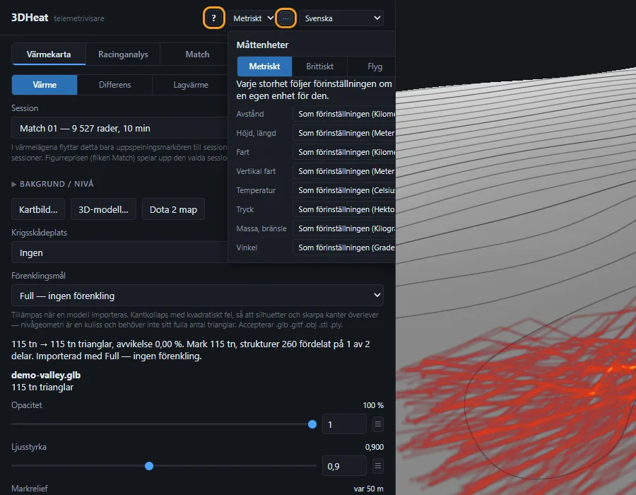
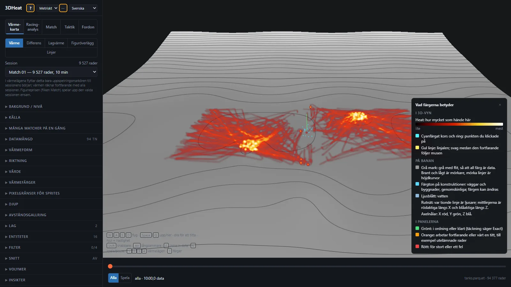
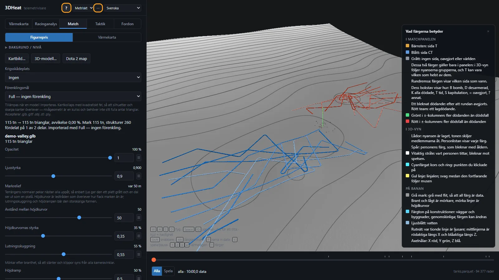

# Inställningar, enheter och tangenter

De små reglagen överst i sidofältet ändrar hur visaren talar med dig: språket, enheterna (meter eller fot, km/h eller knop) och ett hjälpläge som förklarar färgerna. Dina val sparas i din webbläsare.

## Sidhuvudet {#the-header}

Överst i sidofältet:

| Reglage | Vad det gör |
|---|---|
| **?** | Hjälpläge: vad varje färg betyder (även `?` eller `F1`) |
| Menyn **Enheter** | Metriskt, Imperial, Flyg eller Nautiskt |
| Knappen **...** bredvid **Enheter** | Öppnar ”Välj en enhet för varje storhet”: en rullgardinslista per storhet |
| Menyn **Språk** | Visarens språk: [40 språk](languages.md), eller webbläsarens |

Siffror du skriver i en ruta får använda antingen punkt eller komma (`0.35` eller `0,35`). Visaren läser båda och visar siffror så som visarens språk skriver dem.

## Enheter {#units}

1. Välj en förinställning i menyn **Enheter**. Alla storheter byter samtidigt.
2. Vill du bara ändra en storhet, klicka på knappen **...** bredvid den och välj en enhet för den storheten. Menyn visar då ett `*` efter förinställningen.
3. En storhet som du inte har ställt in följer förinställningen. Välj ”Som förinställning” för att gå tillbaka.

| Storhet | Metriskt (standard) | Imperial | Flyg | Nautiskt |
|---|---|---|---|---|
| Sträcka | km | mi | NM | NM |
| Höjd, längd | m | ft | ft | m |
| Hastighet | km/h | mph | kt | kt |
| Vertikal hastighet | m/s | ft/min | ft/min | m/s |
| Temperatur | °C | °F | °C | °C |
| Tryck | hPa | inHg | hPa | hPa |
| Massa, bränsle | kg, l | lb, gal | lb, gal | t, m³ |
| Vinkel | grader | grader | grader | grader |

Andra enheter du kan välja för en storhet: sträcka km, mi, NM; hastighet km/h, m/s, kt, mph; vertikal hastighet m/s, ft/min, m/min; temperatur °C, °F, K; tryck hPa, inHg, mmHg, psi; massa kg, lb, t; vinkel grader eller NATO-mil (6 400 på ett varv). Enheterna är desamma överallt i visaren: etiketter, kort, diagram och statistik.

## Hjälpläge {#help-mode}

Tryck `?` eller `F1`, eller klicka på knappen **?**. Den visar *Vad färgerna betyder*: förklaringar för 3D-vyn, värmerampar, lagfärger, bankens färger, panelernas statusfärger, matchpanelen och racevyn. Den är på tills du stänger av den. På fliken Match förklarar den även matchpanelens färger.

## Vad webbläsaren minns {#what-the-browser-remembers}

Dessa inställningar sparas i din webbläsare mellan besöken. Inget skickas någonstans:

- språket, enheterna och hjälpläget;
- figurens, symbolens, etikettens, kamerans och den taktiska visningens inställningar för uppspelningen;
- uppspelningshastigheten och spegling;
- bokmärken per inspelning, volymer per datamängd och objektivlager;
- inställningarna för externa AI (nyckeln bara om du kryssar i *Remember*).

Värmeinställningar, filter och läge börjar om vid varje inläsning. Den fullständiga, genererade listan: [Lagrade inställningar](ref-settings-storage.md).

## Tangenter som visaren behåller från webbläsaren {#keys-the-viewer-keeps-from-the-browser}

En session med stora data tar tid att läsa in, så visaren hindrar webbläsaren från att kasta bort den av misstag:

- `Ctrl`/`Cmd` + bokstäver som skulle skriva ut, spara, öppna, ladda om, stänga eller öppna nya fönster gör ingenting utanför textrutor. `F1`, `F3`, `F5`, `F6` och `F7` gör ingenting.
- Att stänga eller ladda om fliken när data eller en bana är inläst frågar först.
- I helskärm låser visaren de tangenter den använder (W, T, N, S, R, P, Q, Esc), så att webbläsaren inte tar dem.

Den exakta listan: [Webbläsarens tangenter](ref-browser-keys.md). Alla visarens egna tangenter: [Tangentbord och mus](keyboard-reference.md).
