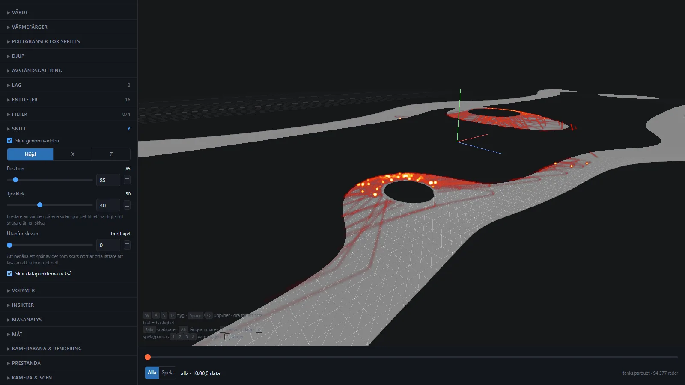

# Snitt

**Snitt** skär världen som en tårtbit, så att du kan se in i byggnader. Använd det när väggar döljer den intressanta värmen, till exempel för att se ett plan i en byggnad.

## Prova {#try-it}

1. Läs in en bana och lite data, och öppna **Snitt**.
2. Bocka i **Skär genom världen**. Axeln är **Höjd**.
3. Dra **Position** upp och ner. Skivan rör sig då genom banan.
4. Gör **Tjocklek** tunn för en planritning, eller bred för ”allt under här”.
5. Låt **Utanför skivan** stå på 0 för att ta bort resten, eller höj det för att behålla ett svagt spår.



Skivan skär **banans geometri och datapunkterna tillsammans**. Om bara banan skärs skulle värmen sväva där byggnaden en gång var. Det är motstycket till [djupskymningen](depth-and-culling.md): när banan döljer rätt det som ligger bakom den, döljs även insidan av en byggnad. Panelen visas när det finns något att skära, det vill säga en datamängd eller en 3D-bana. Rubriken visar axeln när snittet är på, annars *off*.

```
side view         Position = where the slab is
 ----------       Thickness = how tall the slab is
 | floor 3 |
 |=========|  <--- slab (kept)
 | floor 2 |  <--- outside: removed (or faint)
 | floor 1 |
 ----------
```

## Reglage {#controls}

| Reglage | Standard | Betydelse |
|---|---|---|
| **Skär genom världen** | av | Slår på skivan. Medan positionen fortfarande står på sitt startvärde 0 och tjockleken på sitt startvärde 500, flyttar påslagningen dem till mitten av axeln och till 15 % av dess spann. |
| Axel | **Höjd** | *Höjd* (Y), *X* eller *Z*. Byter du axel flyttas skivan till mitten av den nya axeln. |
| **Position** | mitten | Skivans mitt, i världsenheter, över axelns spann (500 steg). |
| **Tjocklek** | 15 % av spannet | Från 1/500 av spannet till två gånger spannet, i logaritmiska steg. Visar *förbi världen* när den är lika bred som spannet. Då når ena sidan förbi världen, och det blir ett rent snitt i stället för en skiva. |
| **Utanför skivan** | 0, *borttaget* | Hur mycket av det som ligger utanför som förblir synligt, 0–100 %. Ett svagt spår av det bortskurna är ofta lättare att läsa än att ta bort det helt. |
| **Skär datapunkterna också** | på | Av lämnar värmen hel, så den syns genom snittet. Användbart för att se vad som ligger över och under skivan. |

Spannet för en axel är det för 3D-banan när en är inläst. Annars är det datamängdens spann.

Snitt är oberoende av [bortsortering på avstånd](depth-and-culling.md#distance-culling), som skär längs blickriktningen i stället för längs en världsaxel. De två kombineras. En ändring av någon snittinställning startar om värmeackumuleringen.

## För utvecklare {#for-developers}

Skivan testas för varje rads världsposition i vertex-shadern. En rad utanför den får sitt bidrag multiplicerat med värdet *Utanför*, så vid 0 förkastas den innan något fragment ritas. Banshadrarna tillämpar samma test på varje fragment av marken, strukturerna och vattnet.
