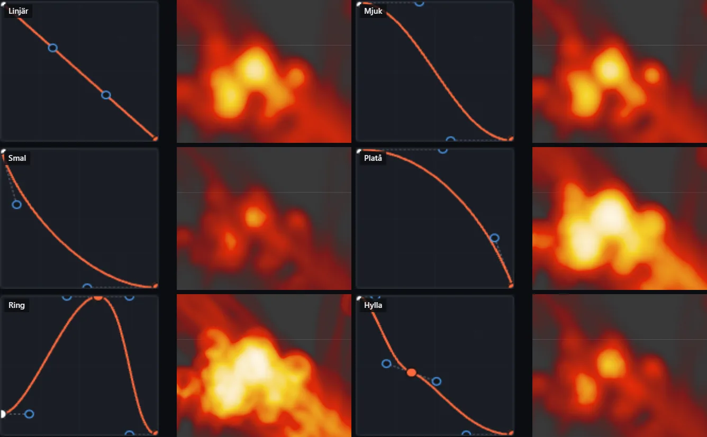

# Spriteform

Varje rad ritas som en rund sprite som alltid vetter mot kameran. Dess storlek, och profilen från mitten till kanten (**rampen**), avgör om en hotspot ser ut som en vass prick, ett mjukt moln, en skiva eller en ring. Reglagen finns i avsnitten **Värmeform** och **Pixelgränser för sprites** i sidofältet. De gäller [Värme](heat.md), [Differens](difference.md), [Lagvärme](team-heat.md) och, som linjens halva bredd, [Linjevärme](line-heat.md).

Ändrar du något av dem startar ackumuleringen om (fältet måste ritas om med den nya formen).

Tänk på varje prick som en mjuk klump av ljus. En liten klump visar enskilda fläckar. En stor klump slår samman grannar till ett moln. Formen avgör hur mjuk kanten är.



## Spriteradie {#sprite-radius}

Spritens radie i **världsenheter** (märkta meter). Standard 6. Vid varje inläsning sätts den till datans horisontella utsträckning / 120. Den är tillräckligt stor för att grannsamplingar längs en väg ska slås samman till ett band i stället för att se ut som en hårfin linje. Logaritmiskt reglage från 0,05 till 2000. Draghandtaget går upp till 50 000.


Saker långt bort ser mindre ut, så en sprite krymper på skärmen med avståndet. Under parallellprojektionen är den lika överallt. Det är en del av skälet till att parallellvyn är den rätta för att jämföra hotspots ([Kamera](camera.md#projection)).

## Pixelgränser {#pixel-clamps}

**Pixelgränser för sprites** (stängt som standard) begränsar radien på skärmen efter omvandlingen ovan.

| Reglage | Standard | Intervall (jogg) | Varför |
|---|---|---|---|
| **Minsta pixelradie** | 1 px | 0–16 (512) | Håller avlägsen data från att försvinna under en pixel. |
| **Största pixelradie** | 96 px | 2–1024, logaritmiskt (8192) | Skyddet mot överritning. En sprite som täcker N pixlar kostar N blandningsoperationer. En obegränsad radie nära kameran är det som gör en snabb bildruta långsam. Över visningens höjd begränsar den inget. |

**Samma täthet vid all zoom** (i avsnittet Värmeform, standard på) samverkar med gränserna. En sprite som en gräns gör större (långt bort) eller mindre (nära) behåller den värme som dess verkliga storlek skulle ge. Då betyder en färg samma antal rader per markyta vid all zoom. Med den av ändras bilden när du flyger in, eftersom en begränsad sprite lägger till hela sin vikt i sin begränsade storlek.

## Mitten- och kantintensitet {#centre-and-edge-intensity}

Värmen som en sprite lägger till i sin exakta mitt (**Intensitet i mitten**, standard 1, 0–10, jogg 1000) och vid sin kant (**Intensitet vid kanten**, standard 0, -2–10, jogg 1000). Rampvärdet *t* (1 i mitten, 0 vid kanten, formad av avklingningen eller kurvan nedan) blandar mellan dem. Formeln finns under [För utvecklare](#for-developers).

En **negativ intensitet vid kanten** låter kanten subtrahera. Det skär ut en sval halo runt varje hotspot och skärper klustren mot varandra. Synligheten inkluderar [skymning](depth-and-culling.md) och [skivan](slice.md). Tonen är [livstidens](timeline.md#history) toning. Tecknet är ±1 i [Differens](difference.md).

## Rampform: avklingning eller kurva {#ramp-shape-falloff-or-curve}

**Rampform** växlar mellan två sätt att forma *t* över spriten. Med *d* som avståndet från mitten (0) till kanten (1):

### Avklingning {#falloff}

Visas när *Avklingning* är vald (standard).

- **Avklingning** (standard 1,6, 0,1–8, jogg 64): `t = (1 - d) ^ falloff`. 1 ger en rak linjär ramp. Högre värden drar värmen mot mitten och smalnar av hotspoten. Under 1 plattas den ut till en skiva.
- **Mjuk ramp** (standard på): lägger en smoothstep-S-kurva på *t*, så att spriten tonar in vid kanten i stället för att sluta vid en synlig kant.

### Kurvredigeraren {#the-curve-editor}

Visas när *Kurva* är vald. En bokstavlig tvärsnittsbild av en sprite: avståndet från mitten tvärs över (*mitt* till vänster, *kant* till höger), värme uppåt. Kurvan är en styckvis kubisk Bézier-kurva genom kontrollpunkter. Varje punkt har två handtag.

| Åtgärd | Effekt |
|---|---|
| Dubbelklick på grafen | Lägger till en punkt vid det avståndet (hålls mellan 0,02 och 0,98), på kurvan och med kurvans lutning där. Att lägga till den ändrar alltså inget förrän du drar i den. |
| Dra en punkt | Flyttar den. Höjderna hålls mellan 0 och 1. |
| Dra en liten cirkel | Böjer segmentet bredvid den (flyttar det handtaget). |
| Alt-klick eller högerklick på en punkt | Tar bort den. De två ändpunkterna kan inte tas bort. |
| En förinställningsknapp | Ersätter kurvan med förinställningen. |

Ändpunkterna är låsta vid mitten och kanten. Deras höjd är fortfarande din att bestämma.

**Förinställningar** ([`curve.ts`](https://github.com/Holdi601/3DHeat/blob/main/src/state/curve.ts)):

| Förinställning | Form | Användning |
|---|---|---|
| **Linjär** | Rak från 1 till 0 | Identisk med *Avklingning* 1 med *Mjuk ramp* av. |
| **Mjuk** | S-kurva | Standardkurvan. Vad *Mjuk ramp* ger vid avklingning 1. |
| **Smal** | En brant kärna, en lång svag kjol | Glesa data. |
| **Platå** | Platt, sedan ett snabbt avtagande | Läses som en skiva snarare än en klump. |
| **Ring** | 0,15 i mitten, 1 vid 62 % av radien, 0 vid kanten | En ihålig sprite: visar var vägar passerar i stället för var de stannar. |
| **Hylla** | Tvåstegs avklingning, 0,45 vid 35 % | Skiljer en tät kärna från omgivningen. |

## Platta ut på markplanet {#flatten-onto-ground-plane}

**Platta ut på markplanet** (standard av) ignorerar varje rads höjd och ritar all värme på en och samma höjd, datamängdens lägsta Y. Det är den klassiska 2D-kartans värmekarta. Med den på är skymningen av djup och *Dölj bakom terräng* av. Varje punkt skulle då ligga exakt på den yta den testas mot. Avsnittet Djup säger det.

## För utvecklare {#for-developers}

### Formler {#formulas}

Radien på skärmen i pixlar: `radius × P[1][1] / w × visningens höjd / 2`, där `P` är projektionsmatrisen och `w` är punktens visningsdjup.

Värmen som en sprite lägger till:

```
heat added = mix(edge, centre, t) × sample weight × sign × fade × visibility
```

### Kurvan {#the-curve}

Handtagen begränsas horisontellt till sitt eget segment. Kurvan är alltså alltid en funktion av avståndet. Om du drar ett handtag långt förbi nästa punkt plattas det ut mot den i stället för att vika tillbaka kurvan. Annars skulle resultatet bero på vilken rot en lösare råkade hitta.

### Hur kurvan ritas {#how-the-curve-is-drawn}

Kurvan bakas in i en tabell med 256 poster varje gång den ändras. Den laddas upp som en flyttalstextur med 16 bitar och samplas per fragment med linjär filtrering och en halv texel inåt, så att båda ändarna förblir exakta. Att lösa en Bézier för x kräver iteration, och det hör inte hemma i programmets hetaste shader. En tabelluppslagning är dessutom billigare än `pow()` som avklingningen använder. 16 bitar i stället för 8 beror på att 8 bitar syns som band när tusentals sprites har summerats. 16-bitars halvflyttal kan filtreras i grundläggande WebGL2, där 32 bitar kräver ett tillägg.
