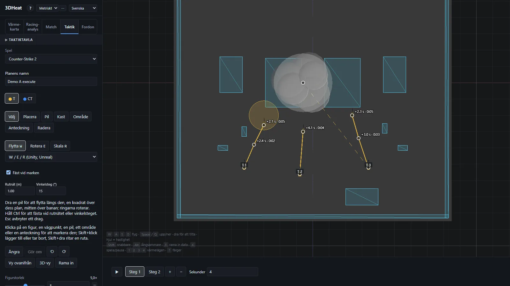

# Taktiktavlan

Fliken **Taktik** är en ritbräda för en lagplan. Du lägger ut små figurer på en karta, ritar pilar för vart de ska, och trycker på spela för att se det hända. Använd den för att planera en runda eller ett anfall innan du spelar. Den delar duken, kameran och [banan](levels.md) med de andra flikarna och ingenting annat. En plan är inte data och ritar ingen värme.

## Din första plan {#your-first-plan}

1. Öppna fliken **Taktik**. Välj **Spel** (till exempel Counter-Strike 2) och, för Valorant, tryck **Läs in Valorant-kartor** och välj en **Karta**. Eller läs in en [bana](levels.md) först.
2. Välj en **Sida** (den styr färgen) och tryck **Vy ovanifrån**.
3. Välj **Placera**, välj en figur under **Figurer** (använd **Sök figurer** för att hitta en) och klicka på kartan. Placera två eller tre.
4. Välj **Pil**, klicka på en figur, klicka längs vägen den ska gå, och tryck **Enter** för att avsluta pilen.
5. Tryck **+** under vyn för att lägga till steg 2. Varje figur börjar där dess pil slutade. Rita fler pilar där.
6. Tryck **▶** (eller `K`) för att spela planen från det visade steget till slutet.
7. Ge planen ett namn under **Planens namn** och tryck **Spara**.

## Att starta en plan {#starting-a-plan}

| Reglage | Vad det gör |
|---|---|
| **Spel** | Väljer sidorna och de figurer som paletten erbjuder: Counter-Strike 2 (T, CT; spelare och utrustning), Valorant (Angrepp, Försvar; spelare och generiska förmågor), Battlefield, Squad, Arma (infanteri, markfordon, flygplan, båtar), DCS / War Thunder / IL-2 (jetplan, propellerplan, helikoptrar, luftvärn, mark, fartyg, vapen) och Övrigt. En plan som redan har figurer behåller sina sidor när spelet byts. |
| **Planens namn** | Namnet planen sparas under. |
| **Karta**, **Läs in Valorant-kartor** | När Valorant är valt hämtar **Läs in Valorant-kartor** listan över kartor från [valorant-api.com](https://valorant-api.com). **Karta** lägger sedan den valda kartans minikarta som bana, inramad uppifrån. Bilden hämtas när den väljs och levereras aldrig med. Riots meddelande visas medan den är på skärmen (se nedan). |
| **Sida** | Sidan som nästa figur, pil eller område tillhör. Den tar sidans färg. |

Utan bana är tavlan det platta markplanet. Läs in en bana under **Bakgrund / nivå** för att planera på en riktig karta: en CS2-karta exporterad med CS2-verktyget, en bana från biblioteket eller en kartbild.

## Verktyg {#tools}

| Verktyg | Klick | Noteringar |
|---|---|---|
| **Välj** | En figur, en vägpunkt, en pil, ett område eller en anteckning väljer den. | Shift+klick lägger till eller tar bort. Shift+dra ritar en ruta runt det som ska läggas till. Markeringen får en transformeringsgizmo (se nedan). `Delete` eller `Backspace` tar bort den. `M` flyttar den valda figuren till nästa klick. |
| **Placera** | Lägger ned den valda figuren. | En figur väljs i paletten **Figurer** (med **Sök figurer**). Med inget valt vrider `R` nästa figur 15° innan den placeras (`Shift+R` åt andra hållet). |
| **Pil** | Varje klick lägger till en punkt. Enter, dubbelklick eller högerklick avslutar den, och Esc kastar den. | **Förflytta**, **Anfall** (bredare spets) eller **Bevaka** (en tunn linje i ögonhöjd). En pil som börjar på en figur är den figurens rutt i det här steget. När den spelas upp går figuren den, och nästa steg börjar där den slutade. |
| **Kast** | Kastaren, och sedan var den landar. | En streckad båge mellan dem. Den valda utrustningen (rök, bländare, molotov ...) visas där den landar och blir kvar från det här steget och framåt. |
| **Område** | Mitten, sedan kanten. | En skiva i sidans färg. |
| **Anteckning** | Var anteckningen ska ligga. Frågar efter texten. | Visas som en nål, med texten ovanför. |
| **Radera** | En figur, pil, ett område eller en anteckning. | Tar bort den från det här steget och framåt. I dess första steg tas den bort helt. |

**Ångra** och **Gör om** (`Ctrl+Z`; `Ctrl+Y` eller `Ctrl+Shift+Z`) stegar igenom varje ändring. En rad under planen visar hur många figurer, pilar och steg den har. **Vy ovanifrån** ser rakt ned (ortografisk), **3D-vy** återgår till perspektiv, och **Rama in** anpassar vyn till planen, eller till banan när planen är tom.

**Figurstorlek** skalar varje figur på tavlan. 1× är verklig storlek, vilket från långt ovanför är några pixlar för en person.

## Flytta, vrid och skala {#moving-turning-and-scaling}

Allt på tavlan kan flyttas som i en 3D-redigerare: figurer, utrustning, markeringar, enskilda vägpunkter och hela pilar, områden och anteckningar. Det som är valt får en gizmo vid sin mitt:

| Läge | Tangenter | Handtag |
|---|---|---|
| **Flytta** | W (eller G) | En pil per axel (X röd, Y grön och uppåt, Z blå) flyttar längs den. En kvadrat flyttar i dess plan. Mitten flyttar över banan under pekaren. |
| **Rotera** | E (eller R) | En ring per axel vrider kring den. En enskild figurs ringar är dess egen girning, stigning och rollning. En grupp vrids kring världens axlar runt sin mitt. |
| **Skala** | R (eller S) | Sprider eller samlar markeringen från dess mitt längs en axel eller åt alla håll. Ett områdes radie växer med den. |

**Tangenter** växlar mellan W / E / R (Unity, Unreal) och G / R / S (Blender). Tangenterna väljer läge bara när något är valt. Annars flyger kameran. Så betyder `R` **Skala** med W / E / R-tangenterna och **Rotera** med G / R / S-tangenterna när något är valt. När inget är valt vrider det nästa figur att placera. Alla tavlans tangenter finns i [tangentbordsreferensen](keyboard-reference.md#tactics-board). Håll **Ctrl** nedtryckt när du drar för att låsa en flytt till **Rutnätet** (meter) eller en vridning till **Vinkelsteget**. **Fäst vid marken** (på som standard) lägger flyttade personer, fordon, markeringar, vägpunkter och områden på banans yta. Flygplan och helikoptrar behåller sin höjd, och en dragning längs Y-pilen snäpper aldrig. Att dra i ett handtag flyttar aldrig kameran. **Esc** avbryter en dragning, och varje ändring är ett steg i Ångra.

Vägpunkter visas som prickar på det visade stegets pilar. Klicka på en för att välja den, dra den för att flytta den, och tryck Delete för att ta bort den. Avsnittet **Vald** visar markeringens plats i meter, en figurs girning, stigning och rollning i grader och ett områdes radie, var och en att skriva in.

## Tidtagning {#timing}

En figurs rutt är tidsatt. Varje segment tar sin längd över banan (samplad på ytan var par meter, så att en kulle eller en trappa mellan två punkter räknas) i den rörelsehastighet **läget** som gäller för figuren i det spelet, plus eventuell **väntan** vid en vägpunkt. Infanteri kryper, hukar, går (tyst), springer eller sprintar. Fordon och båtar kryper, kör försiktigt, normalt eller på hög fart. Flygplan och helikoptrar flyger långsamt, i marschfart, i stridsfart eller maximalt. Ett läge som spelet inte har (CS2 har ingen sprint) tar det närmaste läget det har. Hur en backe bromsar beror på spelet. I CS2 och Valorant räknas bara det horisontella avståndet, som i spelen. Militärsimulatorer bromsar infanteri uppför (Toblers vandringsfunktion) och fordon efter lutning.

Hastigheterna kommer från tabeller per spel, med sina källor (se [Rörelsehastigheter](tactics-speeds.md)): CS2 efter vapnet som hålls, från spelets vapendefinitioner; Valorant efter vapen; Battlefield, Squad, Arma och luftspelen efter fordonstyp och klass. **Rör sig som** väljer en figurs profil (ett vapen, en fordonstyp). **Egen (m/s)** åsidosätter vilket läge som helst för den figuren. Lägena heter som tavlan visar dem: *Kryp*, *Huk*, *Gå (tyst)*, *Spring*, *Sprint*; *Försiktigt*, *Normalt*, *Skyndar*; *Långsamt*, *Marschfart*, *Strid*, *Maximalt*.

Varje vägpunkt visar tiden sedan den föregående och tiden sedan planens start (”+3,9 s · 0:12”). Den valda figurens rutt listar varje segment med dess läge, längd och tid, samt väntan och ankomsten. **Ankomster** under **Tidtagning** lägger varje figur med rutt på en gemensam tidslinje, med första ankomst överst. Med **Spela i verklig tid** (på som standard) varar ett steg tills dess långsammaste rutt är framme, och varje figur rör sig i sin egen hastighet. **Sekunder** är då stegets kortaste längd. **Banenheter per meter** anger vad banan är i: 39,37 för CS2-kartor (spelenheter), 1 för kartor i meter.

## Jämför med matchdata {#compare-with-match-data}

**Läs in matchfiler…** läser CS2-matchtabeller för kartan (CS2-verktygets Parquet-filer, så många man vill; bara de kolumner som behövs, i bakgrunden). **Använd inlästa data** tar datan som lästs in i visaren. Sedan:

- **Tidigaste ankomst på kartan** färgar kartan efter tiden sedan rundans start då en spelare först nådde varje plats. Knappen **Snabbast** visar det snabbaste över alla ronder, **Typisk (median)** den mittersta rundan. Grönt tidigt till rött sent, för den ena sidan eller båda. Den visar vad som är möjligt och när.
- Den valda rutten jämförs med vad spelare uppnådde från dess start (eller från rundans start) till dess slut. Varje ände är en skiva med den angivna radien: ”Snabbast observerad 14,2 s, p10 15,0 s, median 18,3 s över 41 körningar; din plan 15,1 s”.
- Hastigheterna spelarna faktiskt rörde sig med (springande, gående, hukande, från tabellernas gång- och duckkolumner), i m/s.

## Steg {#steps}

Fältet under vyn innehåller stegen. En plan startar med ett. **+** lägger till ett, och varje figur börjar där dess rutt i det sista steget slutade. **−** tar bort det visade. **Sekunder** är hur lång tid det visade steget tar när det spelas. **▶** (K) spelar från det visade steget till slutet. Figurer med en rutt går den, figurer som flyttats till en ny plats i nästa steg glider dit, och resten står still. Medan ett steg visas ritas varje figurs plats i nästa steg som en svag skugga, och det sista stegets pilar svagt under det här stegets.

## Spara {#saving}

Avsnittet **Fil** innehåller **Spara**, **Öppna** och **Rensa**. **Spara** skriver planen som `<namn>.h3dplan.json` (ren JSON: sidor, steg, figurer med en plats per steg, pilar, områden, anteckningar). **Öppna** läser tillbaka en. En fil från en annan version, eller en som inte är en plan, nekas med skälet. **Rensa** tömmer planen. Ångra återställer den.

## Figurer {#figures}

Varje figur byggs av visaren själv: enkla former i en typs publicerade storlek, med de drag som skiljer den från sina grannar. Det är en stridsvagns bandhjul och torn, kanonerna, robotarna och radarerna på ett luftvärnsfordon, ett flygplans vingplan, stjärt och motorer, en helikopters rotorer och stubbvingar. Inget är taget från ett spel. En design som ett spel hittat på visas som den generiska figuren för sin klass. Se [Figurer](figures.md#which-figure-a-unit-gets) för hur datan hittar sin figur.

## Riots meddelande {#riots-notice}

Valorant-kartor visas under Riot Games ”Legal Jibber Jabber”-policy. Den tillåter gratis gemenskapsprojekt att använda dem och begär det här meddelandet där de visas: *3DHeat was created under Riot Games' "Legal Jibber Jabber" policy using assets owned by Riot Games. Riot Games does not endorse or sponsor this project.* Förmågorna på tavlan är generiska former, inte Riots konst.
