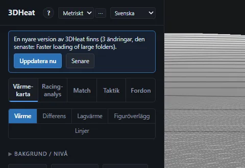

# Uppdateringar

Betraktaren säger till när en nyare version finns, och uppdaterar sig själv bara när du säger ja. Inget ändras på din dator utan ditt svar.

## Uppdatera betraktaren {#update-the-viewer}

1. **På sidan.** När en nyare version finns visas en ruta under namnet överst i sidofältet: "En nyare version av 3DHeat finns". Klicka på **Uppdatera nu**. Sidan laddas om av sig själv när det är klart. **Senare** döljer rutan tills du laddar om sidan.
2. **Om den säger att du ska köra restart.bat**, stäng serverfönstret (det svarta fönster som `start.bat` öppnade) och dubbelklicka på `restart.bat`.
3. **När du startar betraktaren.** `start.bat` kollar också. Om en nyare version finns frågar den **Update now? [Y/N]**. Tryck `Y` för att uppdatera. Tryck `N`, eller vänta 60 sekunder utan svar, för att starta den version du har.



En kopia med egna ändringar uppdateras aldrig åt dig; rutan säger bara att en uppdatering väntar, och att du ska committa eller stasha dina ändringar och köra `git pull`. En kopia som inte installerats med git (en zip-fil, till exempel) visar ingenting.

Så fungerar kollen, steg för steg:

```
sida ---(efter 4 s, sedan var 6 h)---> dev-server ---> git fetch
   efter?  nej  -> ingenting visas
           ja   -> egna ändringar eller commits?  ja  -> säg bara till
                                                  nej -> [Uppdatera nu] -> git pull
                                                        -> ladda om, eller "kör restart.bat"
```

## Säkerhetsreglerna {#the-safety-rules}

- **Bara snabbspolning framåt** (`git pull --ff-only`): en uppdatering slår aldrig ihop,
  rebasar eller skriver om något.
- **Inga lokala ändringar**: en kopia med ocommittade ändringar i spårade filer
  (`git status --porcelain --untracked-files=no` är inte tom) uppdateras aldrig
  automatiskt – någons eget arbete är inte en uppdatering som ska skriva över det.
  Den får bara veta att en uppdatering väntar. Ospårade filer (data, exporter)
  räknas inte som ändringar.
- **Inga lokala commits**: en kopia med commits som uppströms saknar ("divergerad")
  uppdateras inte – en snabbspolning framåt kan inte föra den vidare, och
  sammanslagning är för `git pull` för hand. Sidan och `start.bat` säger det med
  samma ord, och `start.bat` startar den version som finns där.
- **Bara från sidan själv**: dev-serverns uppdateringsanrop måste bära en egen
  rubrik och, när webbläsaren skickar en `Origin`, komma från serverns egen värd
  (nedan).
- Bara en git-kopia med en uppströmsgren uppdateras någonsin; allt annat
  (en kopia utan `.git`, git inte installerat, en statisk build) lämnas ifred
  och säger ingenting.

## Vad start.bat gör {#what-startbat-does}

`start.bat` (dubbelklicka på den; fönstret är servern) gör, i ordning:

1. Hittar Node.js – i `PATH`, annars i `%ProgramFiles%\nodejs`,
   `%ProgramFiles(x86)%\nodejs` eller `%LOCALAPPDATA%\Programs\nodejs` – och
   erbjuder att installera det med `winget install -e --id OpenJS.NodeJS.LTS` när
   det saknas (frågas, Y/N; sedan måste fönstret öppnas igen så att Windows läser
   den nya `PATH`).
2. **Uppdaterar**, när git är installerat och mappen har `.git`:
   - `git fetch --quiet` (utan nätverk eller uppström hoppas det över tyst);
   - räknar `git rev-list --count HEAD..@{u}`; inget efter: inget sägs;
   - lokala ändringar: "A newer version of 3DHeat is available (N changes), but
     this copy has local changes, so it is not updated. Commit or stash them,
     then run git pull." – och den startar versionen som finns;
   - egna commits (`git rev-list --count @{u}..HEAD` är inte 0): "A newer
     version of 3DHeat is available (N changes), but this copy has commits of
     its own that the newest version does not, so it is not updated. Update it
     with git pull." – och den startar versionen som finns;
   - annars "A newer version of 3DHeat is available (N changes)." och frågan **Update now? [Y/N]**. `N`, eller inget svar på 60 sekunder, skriver "Not updated; starting the version you have." och startar versionen som finns. Vid `Y`: "Updating...", noterar om `package.json` eller `package-lock.json` ändras,
     kör `git pull --ff-only` (skulle det ändå misslyckas – nätverket, till exempel:
     "The update did not go through; starting the version you have."), sedan `git submodule update --init`
     (de fästa verktygen, se [Underhålla dokumentationen](maintaining.md#the-tools-under-exporters)), sedan `npm install` när paketfilerna ändrats och
     `node_modules` finns, och "Updated."
3. Vägrar starta en andra server: när något redan lyssnar på port
   **5273** säger den det och pekar på `restart.bat` / `stop.bat`.
4. Vid första körningen (ingen `node_modules`) frågar den innan beroendena hämtas
   (cirka 300 MB till `node_modules\`, inget systemomfattande).
5. Startar dev-servern på `127.0.0.1:5273` (`--strictPort`) och öppnar webbläsaren när den är klar.

`restart.bat` stoppar servern (via porten) och kör `start.bat` igen, så den ställer samma fråga. `stop.bat` stoppar bara.

## För utvecklare {#for-developers}

### Medan den kör: uppdateringsrutten {#while-it-runs-the-update-route}

Dev-servern (Vite-insticksprogrammet `heat3d-self-update` i `vite.config.ts`) svarar på
`/__heat3d/update`. Den finns bara på dev-servern – inte i en statisk build
och inte i `vite preview`.

**`GET /__heat3d/update`** svarar på om kopian ligger efter:

```json
{ "checkout": true, "upstream": "origin/main", "behind": 3, "ahead": 0, "dirty": false, "latest": "the newest commit's subject" }
```

- `checkout: false` när mappen inte är en git-kopia;
- den kör `git fetch --quiet` **högst var 30:e minut** (frågor mellan dem svarar
  utifrån senast hämtade);
- `behind` / `ahead` från `git rev-list --count HEAD..@{u}` / `@{u}..HEAD`,
  `dirty` från `git status --porcelain --untracked-files=no`, `latest` är uppströmmens
  senaste commits rubrik;
- utan uppströmsgren är `upstream: null` och `behind: 0`.

**`POST /__heat3d/update/apply`** får kopian uppdaterad:

1. Avvisas med `403 { ok: false, reason: "forbidden" }` om inte anropet har
   rubriken `X-Heat3d-Update: 1` och, när det bär en `Origin`, den originens värd
   är anropets `Host`. Ett formulär från en annan sajt kan inte skicka en egen
   rubrik utan en CORS-förkontroll, och den servern ger aldrig en sådan.
2. Inget att göra (ingen git-kopia, ingen uppström, inte efter):
   `{ ok: true, updated: false }`.
3. Lokala ändringar: `{ ok: false, reason: "dirty" }`; lokala commits:
   `{ ok: false, reason: "diverged" }`.
4. Annars: noterar vilka filer som ändras (`git diff --name-only HEAD @{u}`),
   `git pull --ff-only` (2 min tidsgräns), `git submodule update --init`
   (fel ignoreras), `npm install` när `package.json` eller
   `package-lock.json` ändrats (15 min tidsgräns), och svarar
   `{ ok: true, updated: true, restart }` – `restart` säger varför den
   körande servern inte kan ta emot uppdateringen: `"dependencies"` när de
   installerats om, `"config"` när bara en `vite.config`-fil ändrades, `false`
   när ingen omstart behövs.
5. Ett misslyckat git- eller npm-kommando svarar
   `{ ok: false, reason: "<felet, upp till 300 tecken>" }`.

Svaren är JSON med `Cache-Control: no-store`. Servern lyssnar bara på
`127.0.0.1`, så rutten går inte att nå från nätverket.

### Noteringen på sidan {#the-notice-in-the-page}

`UpdateBanner`, under namnet överst i sidofältet:

- Den frågar rutten **4 sekunder** efter att sidan laddats (inte de första sekunderna: sidan har en datamängd att läsa in och ett grafikkort att starta) och igen
  **var 6:e timme** medan sidan är öppen.
- Den visar **ingenting** när rutten saknas (en statisk build), mappen inte är en
  kopia, eller inget är nyare – en notis vid varje start är något folk lär sig
  ignorera.
- Efter, utan lokala ändringar: "En nyare version av 3DHeat finns (N ändringar, den senaste: <rubrik>)." med **Uppdatera nu** och **Senare**
  (*Senare* döljer den tills sidan laddas om).
- Efter, med lokala ändringar: samma mening och "Den här kopian har lokala ändringar och uppdateras därför inte automatiskt; committa eller stasha dem och kör sedan git pull." – ingen knapp.
- **Uppdatera nu** postar till `/apply` ("Uppdaterar…"). Sedan:
  - "Uppdaterat. Sidan laddas om." – och den laddar om 1,5 s senare (servern
    serverar redan de nya filerna);
  - när beroendena installerats om: "Uppdaterat. Beroendena har ändrats: stäng serverfönstret och kör **restart.bat** för att slutföra.";
  - när bara serverns inställningar ändrats: "Uppdaterat. Serverinställningarna har ändrats: stäng serverfönstret och kör **restart.bat** för att slutföra.";
  - inget att hämta trots allt (`updated: false` – kopian uppdaterades under tiden, av `start.bat` till exempel): "Inget att uppdatera: den här kopian är redan den senaste versionen." – och ingen omladdning;
  - avvisad: meningen om *dirty*, eller "Den här kopian har egna commits som den senaste versionen saknar; uppdatera den med git pull.", eller "Uppdateringen gick inte igenom: <orsak>".
