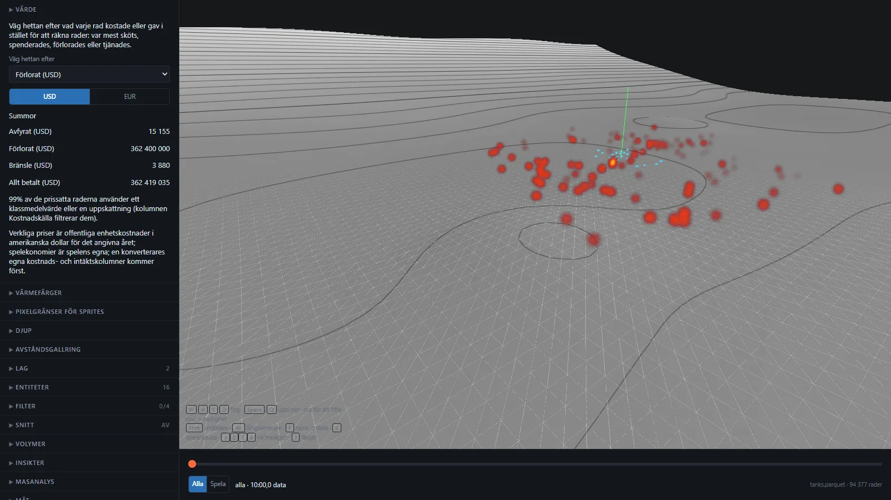

# Värdeviktning

Varje skott, varje ammunition, varje förlorat fordon och varje liter bränsle har ett pris. Visaren räknar ut vad varje rad kostade eller inbringade, och kan väga hettan efter det. Kartan visar då **var pengarna tog vägen** i stället för var raderna finns.

## Så använder du det {#how-to-use-it}

1. Läs in data med händelser (skott, dödanden, dödsfall) och namn på fordon eller vapen.
2. Öppna **Värde** i sidofältet Värme.
3. Välj **Väg hettan efter**, till exempel *Förlorat (USD)*. Värmen lägger nu till varje rads pris i stället för 1.
4. Läs **Summor**: summan av varje värdekolumn för det som visas. Filter och tidsfönster gäller.
5. Där priserna är verkliga pengar visas en växlare **USD / EUR**.

Välj det tomma första valet i menyn för att räkna rader igen.

## Vad som kan vägas {#what-can-be-weighed}

Värdekolumnerna läggs till vid inläsningen, en per slag och valuta:

| Slag | Rader det landar på | Hur det prissätts |
|---|---|---|
| **Avfyrat** | skott och avfyrningar | vapnet, annars ett medelvärde för ammunitionstypen |
| **Spenderat** | köp och uppsättning | spelets pengakolumner (till exempel en skyttes köpmeny) |
| **Förlorat** | dödsfall, förstörda | det egna fordonet, annars medelvärdet för dess klass |
| **Förstörd** | dödanden | målfordonet |
| **Utdelad skada** | träffar | en andel av målets värde |
| **Bränsle** | positioner | använt bränsle, från en bränslekolumn eller uppskattat från klass och tid |
| **Allt betalt** | | avfyrat + spenderat + förlorat + bränsle |
| **Intjänat** | belöningar | spelets egna belöningskolumner (`earn_…`) |
| **Netto** | | intjänat minus betalt. Ritas som värme med tecken: positiv ramp där mer har tjänats in, negativ där mer har betalats |

Kolumnnamnen är `cost_<kind>_<currency>`, `earn_<currency>` och `net_<currency>`. En omvandlare som känner spelets egen valuta, till exempel en repriskonverterare som skriver i spelkrediter, går före de inbyggda pristabellerna.

## Pristabellerna {#the-price-tables}

| Tabell | Valuta |
|---|---|
| Verkliga militära: robotar, bomber, granater, motmedel, flygplan, helikoptrar, markfordon, fartyg, bränsle | USD (EUR = USD × 0,92, den fasta `EUR_PER_USD` i [`cost.ts`](https://github.com/Holdi601/3DHeat/blob/main/src/data/cost.ts); det är ingen levande kurs) |
| Skytteköpmenyer och dödsbelöningar | spelets krediter |
| Stridsvagns- och sjöspel | spelets krediter |
| Strategispel (flera resurser) | en kolumn per resurs, plus en samlad |
| Krigsspel | poäng |

Spelet känns igen på namnen i datan. Verkliga priser kommer från offentliga källor, som budgetdokument och uppslagsverk, eller är markerade som uppskattningar. De är inte justerade för inflation. Den genererade listan över tabellerna finns på [Värdetabeller](ref-value-tables.md).

## Uppskattningar {#estimates}

Den extra kategorikolumnen **Cost source** visar hur varje rad prissattes: `table`, `class average`, `estimate` eller `none`. Avsnittet Värde visar vilken andel av de prissatta raderna som är medelvärden eller uppskattningar. För att behålla bara exakt prissatta rader, avmarkera *estimate* och *class average* under **Cost source** i [Filter](filters.md).

## Var värdet annars syns {#where-else-value-shows}

- [Insikter](insights.md): fynden *Costly ground* och *Earning ground*.
- [Uppdelning](breakdown.md): Intjänat, Förlorat och Netto i pengar per lag, spelare eller vapen.
- [Volymer](volumes.md): värdekolumner i statistiken och i jämförelsen.
