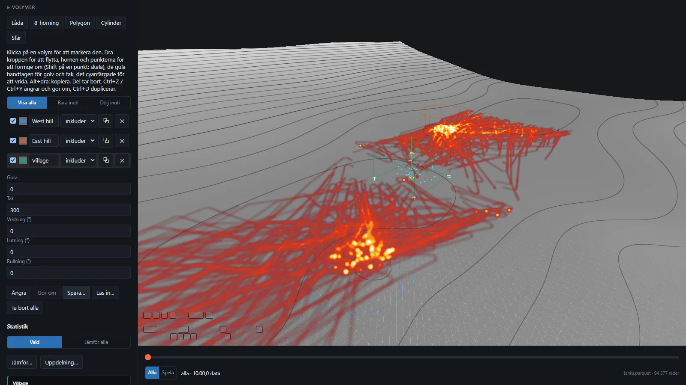
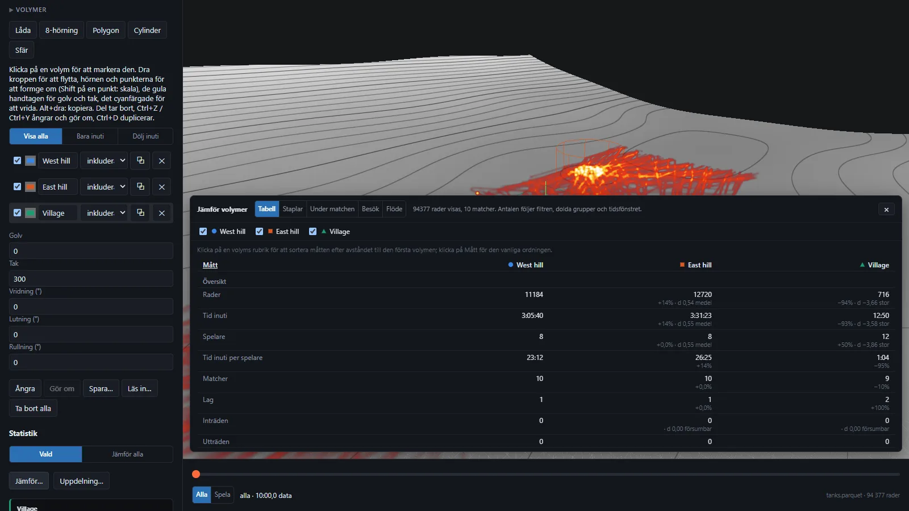
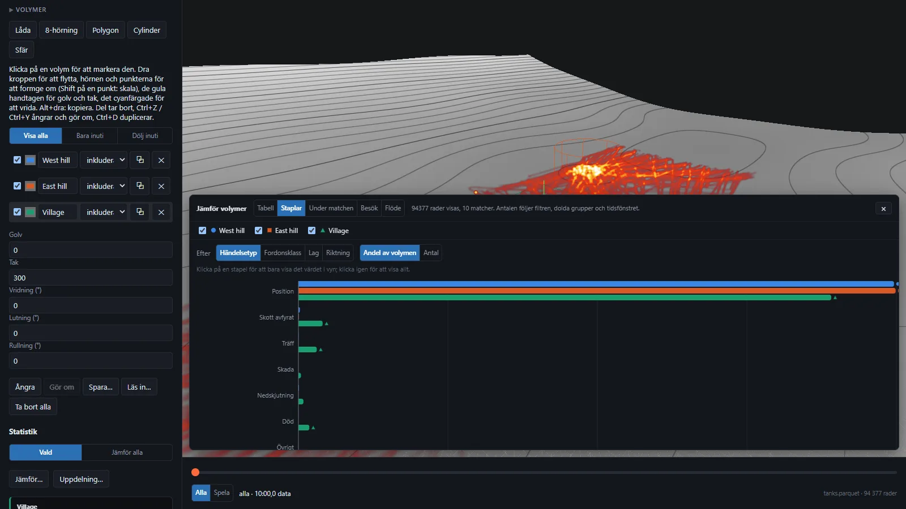

# Volymer och jämförelse

En **volym** är en osynlig låda (eller cylinder, eller sfär) som du ritar runt en plats för att fråga: vad hände här inne? Använd den för att räkna dödningar vid en bro, för att jämföra två kullar eller för att visa bara aktiviteten i ett område.

```
 uppifrån                 Du ritar en form ->  visaren räknar
 +------------+           vad som finns inuti:
 |   ( A )    |            rader, spelare, dödningar, tid ...
 |        [B] |           Jämför A med B, sida vid sida.
 +------------+
```



Volymer mäter vad som händer inuti dem, filtrerar vyn till dem, exporterar deras rader och kan jämföras sida vid sida. Se även [ordlistan](glossary.md) för rad, person och match.

## Rita en volym {#draw-a-volume}

1. Öppna **Volymer** i sidofältet.
2. Välj ett verktyg och rita i 3D-vyn eller på 2D-kartan. Golv och tak utgår från datan under den. Esc avbryter.
3. Klicka på volymen för att välja den. Dess **Statistik** visas.

| Verktyg | Så ritar du |
|---|---|
| **Låda** | Dra en rektangel (Shift: en kvadrat). Ett klick placerar en standardlåda. |
| **n-hörning** | Dra från mitten (Shift håller den regelbunden). *Hörn* anger n, från 3 till 64 (standard 8, så knappen säger **8-hörning**). |
| **Polygon** | Klicka på hörnen. Stäng med dubbelklick, Enter eller ett klick på första hörnet. Backsteg tar bort sista hörnet. |
| **Cylinder** | Dra radien. |
| **Sfär** | Dra radien. Den vilar på marken. |

## Redigera {#edit}

- Klicka på en volym för att välja den. Dra i dess kropp för att flytta den, i hörnen för att forma om den (Shift på ett hörn skalar).
- De **gula** handtagen anger golv och tak, det **cyan** handtaget vrider den.
- Alt+dra kopierar, Del tar bort, Ctrl+Z / Ctrl+Y ångrar och gör om, Ctrl+D duplicerar. **Ta bort alla** tar bort varje volym.
- Exakta värden: Golv, Tak, Vridning / Stigning / Rollning (lådor), Radie (sfärer, cylindrar).

Varje volymrad har en kryssruta för visning, en färg, ett namn, **inkludera** eller **exkludera**, samt knappar för att duplicera och ta bort. Volymer sparas i webbläsaren för varje datamängd. **Spara…** och **Läs in…** skriver och läser en fil `volumes.json`.

## Filtrera vyn {#filter-the-view}

| Filter | Effekt |
|---|---|
| **Visa alla** (standard) | Volymer mäter bara. |
| **Bara inuti** | Värme, uppspelning och [träffanalys](hit-analysis.md) ritar bara det som ligger inuti de inkluderade volymerna och utanför de exkluderade. |
| **Dölj inuti** | Motsatsen. |

GPU-filtret tar upp till 8 volymer med 64 konturpunkter sammanlagt. Ett ”!” markerar en volym bortom det. Statistik och export räknar den ändå.

## Statistik {#statistics}

Området **Statistik** följer filtren, tidsfönstret och dolda grupper. *Vald* visar den valda volymen, och *Jämför alla* ställer alla volymer sida vid sida. Det visar:

- **Rader inuti (visade)** och **Rader inuti (all data)**, **Spelare**, **Lag**, **Matcher**, **Tid inuti**, **In- / utgångar**, **Toppvärme**, **Medelvärme**, **Volym / yta** och ett histogram över **När**;
- **Vinstandel**, där datan säger vem som vann ([resultatkolumner](data-formats.md#outcome-columns)): av ronderna med en spelare inuti, varje spelares rond räknad en gång, andelen som deras sida vann - dragen mot andelen över allt som visas med 4 ronder, som [uppdelningen](breakdown.md) gör - med de vunna och spelade ronderna och den totala andelen;
- per kolumn: kategorier med **Lift** (andel inuti delat med andel i all visad data), och tal med spann, median och 5:e till 95:e percentilen.

**Statistik som CSV / JSON** sparar dem. **Exportera datan inuti** skriver raderna inuti som CSV eller Parquet (*Bara de visade raderna* är på som standard). Det kan gälla en volym eller alla, med en kolumn som anger vilken volym varje rad hör till.

## Jämför volymer {#compare-volumes}

Med två eller fler synliga volymer, tryck **Jämför…**.

1. Rita tre volymer, till exempel Västra kullen, Östra kullen och Byn.
2. Tryck **Jämför…** under Statistik.
3. I **Tabell** läser du varje värdes skillnad från den första volymen.
4. Byt till **Staplar** för att se andelarna som staplar.



| Vy | Visar |
|---|---|
| **Tabell** | Rader, tid inuti, spelare, matcher, lag, in-, utgångar, besök, besökens längd, dödningar, dödsfall, dödningar per dödsfall, dödningar per minut, tid per spelare, värdekolumner. Grupperat efter händelser, fordonsklass, spelare eller AI, lag och riktning. Varje värde visar sin skillnad från den första volymen och en effektstorlek (försumbar, liten, medel, stor). Klicka på en volyms rubrik för att sortera efter avstånd från den första. |
| **Staplar** | Antal eller andelar efter händelse, klass, aktör, lag eller riktning. Klicka på en stapel för att filtrera vyn till den. |
| **Under matchen** | En graf per volym över matchens minuter: närvaro, rader eller dödningar. Klicka för att hoppa dit. |
| **Besök** | Låd- och violindiagram över hur länge besöken varar (logaritmisk skala). |
| **Flöde** | Vart spåren tar vägen efter att ha lämnat varje volym: en övergångsmatris eller flödesband. |



## Tips {#tips}

- Börja från ett fynd: i [Insikter](insights.md) lägger **Volym här** till en cylinder runt fyndets plats.
- **Uppdelning…** öppnar [Uppdelningen](breakdown.md) för den valda volymen: vem och vad som gör det bäst inuti den.
- [Riktningsvärme](directional-heat.md) kan rita diagram över riktningarna inuti den valda volymen.
- [Fliken Fordon](hit-analysis.md#restrict-to-an-area) använder samma volymer som sitt områdesfilter.
