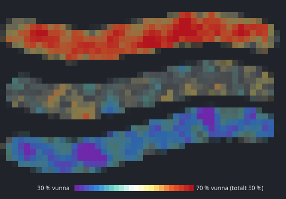

# Vinstandel: hur ofta en plats, en väg eller ett drag vinner

Var en spelare står, vilken väg de går, var de kastar sin utrustning - och hur ofta deras sida sedan vinner ronden. **Vinstandelskartan** färgar varje plats efter andelen av raderna där som hör till ronder som radens sida vann, jämfört med andelen över allt som visas: varmt där den är högre, kallt där den är lägre, ingenting där den är densamma.

*Bilden är påhittade data: tre vägar på en tom bana, med 68 %, 50 % och 33 % av sina rader i vunna ronder.*

Den behöver data som säger vem som vann: [resultatkolumnerna](data-formats.md#outcome-columns) (`won`, `matchWon`, `roundEndReason`). Konverterarna för CS2 och War Thunder skriver dem, Tacview-konverteraren för en DCS-servers kampanjer ([DCS-servrar](tacview-acmi.md#dcs-servers-who-won-and-how-each-sortie-ended)); vilken fil som helst kan göra det.

## Prova {#try-it}

1. Läs in matcher med en resultatkolumn och tryck på `2` (**Differens**).
2. I **Differensuppdelning** trycker du på **Vinstandel per rond** (eller **Vinstandel per match**). Den lägger de vunna ronderna på **+** och de förlorade på **−** och växlar panelen till **Andel +**.
3. Läs av färgerna. Panelen anger totalandelen: *Totalt ligger 52,0 % av 1 200 000 rader på +.*
4. Smalna av det med [filtren](filters.md): en sida (T eller CT), en händelsetyp (*Position* för var folk stod, *Skott avfyrat* eller *Avfyring* för var de sköt eller kastade ifrån), ett köp, en karta.

En plats som är varm med *Position*-rader är en plats där de som höll den brukade vinna ronden. Med *Nedskjutning*-rader är det en plats där de nedskjutningar som gjordes ledde till vunna ronder.

## Inställningarna {#the-settings}

| Inställning | Vad den gör | Standard |
|---|---|---|
| **Differens** / **Andel +** | själva differensen, eller +-sidans andel av raderna på båda sidor | Differens |
| **Full färg vid** | hur långt över eller under totalandelen en plats visas i full färg, i procentenheter | ± 20 procentenheter |
| **Minst antal rader för att färga en plats** | en plats med färre rader färgas inte; den tonas in från hälften av det | 12 |
| **Dragning mot totalandelen (rader)** | varje plats börjar med så här många rader på totalandelen, så att en plats med 3 rader, alla vunna, inte visas som 100 % | 12 |

Alla tre verkar på den färdiga bilden: att dra i dem startar aldrig om ackumuleringen.

Andelen gäller vilken uppdelning som helst, inte bara vinster: *Andel +* med en uppdelning efter sida visar var T-sidan var den större delen av närvaron, och med en uppdelning efter två kartors filer var den ena filens rader väger tyngre än den andras.

## Rader, inte ronder {#rows-not-rounds}

Kartan räknar rader. En spelare som står på ett ställe i tjugo sekunder lägger till en rad för varje prov, alla från en och samma rond, så underlaget på en plats är raderna nära den, inte ronderna. Därför anges minimum och dragning i rader, och därför är de större än vad en rond ger.

För själva ronderna:

- **[Uppdelning](breakdown.md)** på en punkt, vyn eller en volym: *Vinst %* räknar varje spelares rond en gång, dragen mot platsens totala andel på samma sätt (4 ronder).
- **[Volymer](volumes.md)**-statistik: *Vinstandel* - ronderna med en spelare inne i volymen, var och en en gång, dragen mot andelen över allt som visas, med antalen.

## Resultatfilter {#outcome-filters}

Panelen [Filter](filters.md) listar resultatkolumnerna direkt efter visarens egna: **Rondresultat** och **Matchresultat** (*Alla*, *Vunnen*, *Förlorad*) och **Hur ronden slutade** (Eliminering, Bomben exploderade, Bomben desarmerad, Tiden tog slut, Kapitulation, Oavgjort, Mål, Zoner hållna, Biljetter förlorade, Alla fordon förlorade), på visarens språk.

## För utvecklare {#for-developers}

Värmepasset skriver tre summor till det fyrkanaliga mål som lagvärme använder: värmen `R = Σ|v|`, +-sidans värme `P` och `S = Σ v²/w`, där `w` är passets vikt (samplingsvikt gånger bildförstärkning). Sammansättningen läser andelen `P/R` (ett kärnviktat medelvärde) och de rader den vilar på, `n = R²/S` (Kishs effektiva urvalsstorlek), drar andelen mot totalandelen, `p = (n·P/R + m·r0)/(n + m)`, och färgar `p - r0` över spannet på differensskalorna.

`n` dividerar bort varje faktor som raderna vid en pixel har gemensamt - bildförstärkningen, samplingsvikten, en klippt sprites areavikt - så bilden är densamma vid varje zoom och samplingstäthet, och bilder av var k:te rad smälter samman till helheten utan att färgerna hoppar. Totalandelen kommer från CPU:ns räkning per sida, hållen till tiondels procent; ingenting läses tillbaka från GPU:n. Beräkningen och dess kontroller: [`render/rateMap.ts`](https://github.com/Holdi601/3DHeat/blob/main/src/render/rateMap.ts) och dess test.

Det kostar lika mycket som lagvärme: det fyrkanaliga målet fyrdubblar värmepassets blandningsbandbredd, bara medan *Andel +* är på.
