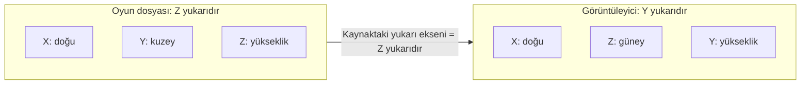

# Eksenler, birimler ve zaman

Oyunlar ve haritalar, hangi yönün yukarı olduğu, bir birimin ne kadar uzun olduğu ya da zamanın nasıl yazıldığı konusunda aynı fikirde değildir. Bu sayfa, verinizin doğru yönde durmasını, doğru ölçekte olmasını ve doğru sırada oynamasını sağlayan üç ayarı gösterir.

Haritanız bir zemin gibi yatmak yerine bir duvar gibi duruyorsa **Kaynaktaki yukarı ekseni** ayarını değiştirin.

Yanlış **Kaynaktaki yukarı ekseni** ile harita bir duvar gibi durur; doğru olanla bir zemin gibi yatar.

## Görüntüleyicinin çizdiği dünya {#the-world-the-viewer-draws-in}

Görüntüleyicinin dünyası **Y-yukarı**dır: X ve Z zemin düzlemidir, Y yüksekliktir. Çoğu oyun motoru **Z-yukarı**dır: onlar için X ve Y zemindir, Z yüksekliktir. Bazı motorlar ayrıca aynalanmıştır (sol el kuralı). Eşleme, dosyanın eksenlerinin görüntüleyicininkine nasıl çevrileceğini söyler. (Teknik olarak görüntüleyici sağ el kuralını kullanır; three.js geleneği.)

### Yukarı ekseni {#up-axis}

[Sütun eşleme](column-mapping.md) içindeki **Kaynaktaki yukarı ekseni**:

| Ayar | Dosya (x, y, z) dünya (X, Y, Z) olur |
|---|---|
| *Z yukarıdır (çoğu oyun motoru)* - varsayılan | (x, **z**, **y**): dosyanın Z'si yükseklik olur ve dosyanın Y'si dünyanın Z'si olur |
| *Y yukarıdır (grafik geleneği)* | (x, y, z) değişmeden kalır |

Z-yukarı verilerde üç dizi kopyalanmak yerine yeniden etiketlenir ([`remapAxesInPlace`](https://github.com/Holdi601/3DHeat/blob/main/src/data/ingest.ts)); bu, büyük yüklemelerde yüzlerce megabayt tasarruf sağlar. Tahmin örnekten yapılır: Y ve Z sütunlarından yayılımı daha küçük olan yukarıdır.

### Çevirmeler {#flips}

**X'i çevir**, **Y'yi çevir**, **Z'yi çevir** o ada sahip *dosyanın* eksenini, yeniden etiketlemeden önce olumsuzlaştırır - yani Z-yukarı verilerde *Y'yi çevir*, dünyanın Z'si olacak olanı olumsuzlaştırır. Bir çevirme yüklenen veriyi değiştirir: [cetvelde](measure.md), dilimde ve kamera konumunda gösterilen koordinatlar çevrilmiş olanlardır.

Dünyayı, verileri değiştirmeden doğru yönde aynalanmış çizmek için bunun yerine **Kamera ve sahne → Dünya eksenini ters çevir** kullanın ([Kamera](camera.md#invert-world-axis)). Dünyası sol elli olan oyunlar için bu daha iyi seçimdir, çünkü araçların gösterdiği her koordinat oyunun kendi koordinatı olarak kalır.

### Birim ölçeği {#unit-scale}

**Birim ölçeği** her konumu çarpar. *1 (m)* 1'e, *0,01 (cm→m)* 0,01'e ayarlar (Unreal Engine birimleri santimetredir, bu yüzden 0,01 kullanın; Source motoru birimleri inçtir, bu yüzden 0,0254 kullanın; ikisi de metre değildir), kutu ise her değeri kabul eder. Yazılan bir 0 ya da sayı olmayan bir değer 1 ile değiştirilir.

Görüntüleyici mesafeleri metre cinsinden etiketler (sprite yarıçapı, eleme mesafeleri, cetvel, uçuş hızı). Bu yalnızca ölçeklenmiş dünya birimi bir metre olduğunda doğrudur. Değilse bir şey bozulmaz; etiketler birim ne olursa olsun "m" yazar.

## Zaman {#time}

### Zaman birimleri {#time-units}

Pratik kural: 17000000000 gibi değerler (on ya da daha fazla basamak) bir Unix zaman damgasıdır; 0, 0,25, 0,5 gibi değerler başlangıçtan itibaren saniyedir.

| Zaman birimi (menü etiketi) | Okunuşu | Duvar saati gösterilir |
|---|---|---|
| *Saniye (göreli)* | değer × 1 s | hayır |
| *Milisaniye (göreli)* | değer × 0,001 s | hayır |
| *Mikrosaniye (göreli)* | değer × 10^-6 s | hayır |
| *Nanosaniye (göreli)* | değer × 10^-9 s | hayır |
| *Unix zaman damgası (s)* | 1970-01-01 UTC'den itibaren saniye | evet |
| *Unix zaman damgası (ms)* | 1970-01-01 UTC'den itibaren milisaniye | evet |
| *ISO-8601 tarih metni* | `2026-03-14T18:02:11.250Z` gibi metin, tarayıcının `Date.parse` ile ayrıştırılır | evet |

Mutlak bir birimle (son üçü), veri kümesi en erken satırının duvar saati anını tutar ve zaman çizelgesi oynatma imlecinin yanında geçerli UTC günün saatini (`HH:MM:SSZ`) gösterir.

**Parquet `TIMESTAMP` ve `DATE` sütunları** gerçek anlara çözülür; bu yüzden birim ayarları yok sayılır ve panel bunu söyler. Bir `DATE` sütunu bütün bir gündür: bir günün her satırı tek bir ana sahiptir ve oynatma bir günde bir sıçrar; panel bunu uyarır.

**ISO-8601 metinleri CSV ve Parquet'te aynı şekilde çalışır.** ISO birimli bir metin zaman sütunu, her farklı metin için bir kez ayrıştırılır; hiçbiri ayrıştırılamazsa yükleme *Eşlenen zaman sütununda ayrıştırılabilir ISO-8601 zaman damgası yok.* hatasıyla başarısız olur - ve eşleme, örneklenen değerlerin hiçbiri ayrıştırılamıyorsa zaten başlamayı reddeder. Bir Parquet `TIMESTAMP` sütunu hangi birim ayarlanmış olursa olsun zaman damgası olarak okunur; ISO birimli sayısal bir Parquet sütunu ise Unix milisaniyesi olarak okunur. Sayısal bir birimli metin zaman sütunu yüklemeden önce reddedilir: her değer NaN olarak okunurdu.

### Zaman nasıl saklanır {#how-time-is-stored}

Dosyalar birleştirilirken zamanlar 64 bit saniyedir; böylece mutlak bir epoch saniyenin altındaki ayrıntısını korur. Tüm dosyalar geldiğinde, seçimin en erken zamanı 0 olur ve her satır ondan itibaren 32 bit saniye saklar. 32 bit kayan noktanın 24 bit mantisi vardır: yaklaşık bir buçuk güne kadar olan aralıklar 1/100 s'den daha iyi çözülür, yarım yıla kadar olanlar yaklaşık bir saniyeye kadar. Zamanı eksik ya da sayı olmayan bir satır 0'a, yani başlangıca yerleştirilir.

Satırlar daha sonra zamana göre sıralanır; zaman çizelgesini ucuz yapan da budur: bir zaman penceresi iki ikili aramayla bulunur (bkz. [Örnekleme ve bütçeler](sampling-and-budgets.md)).

### Geçen süre ve duvar saati {#elapsed-time-versus-wall-clock}

`match_time` ya da `round_time` gibi bir zaman sütunu, her maçın kendi başlangıcından sayar. Bunu seçmek her maçı tek bir ortak eksene koyar - her maçın 3. dakikasında ne olduğunu karşılaştırmak için iyi - ve panel bunu belirtir. Bir duvar saati sütunu maçları gerçekte oldukları sırayla gösterir; örtüştükleri yerde üst üste gelerek.

## Bakış yönü {#look-direction}

Bakış yönü yalnızca [kutu tekrarı](box-replay.md) tarafından kullanılır (her kutudan çıkan ışınlar). Radyan cinsinden iki açı, yaw ve pitch olarak saklanır.

- **Yaw / pitch sütunları** olduğu gibi okunur; *Derece* seçildiğinde derecelerden dönüştürülür. Yukarı ekseni ya da çevirmeler için ayarlanmazlar.
- **Yön vektörü sütunları** konumlarla aynı yeniden etiketleme ve çevirmelerden geçer; sonra dünya eksenlerinde yaw = atan2(x, -z) ve pitch = atan2(y, √(x² + z²)) olur; böylece ışın, aynalanmış kaynaklı bir dünyada da kutunun baktığı yöne işaret eder.

Bir çevirmeden, bir yön vektöründen ya da ayarlanmış açılardan sonra yaw/pitch sütunları ters yöne çıkıyorsa, çözüm budur.
