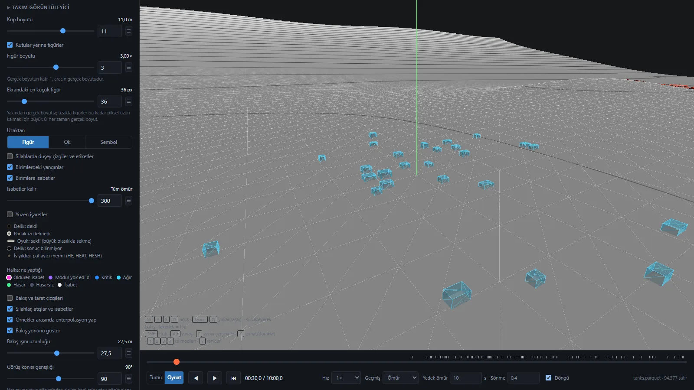

# Figür bindirme (kutu tekrarı)

Küçük bir film: her kişi için bir figür; zaman ilerledikçe hareket eder ve arkasında bir iz bırakır.

Mod, mod çubuğunda **Figür bindirme** olarak adlandırılır. Bu sayfa eskiden "kutu tekrarı" adını taşıyordu, çünkü figürler gelmeden önce her kişi bir kutuydu; "figür tekrarı" ve "kutu tekrarı" aynı şeyi anlatır. **Figür bindirmenin** bir sayı tuşu yoktur: mod çubuğundan seçin. Her [kişi](glossary.md) için bir figür (ya da kutu) çizer; [zaman çizelgesi](timeline.md) boyunca hareket ettirir ve isteğe bağlı olarak bakış ışınları ve izler ekler. Yoğunluk değil, oynatmadır: *kim, ne zaman, nerede*. Bir kişi sütununa ihtiyaç duyar; zaman sütunu olmadan her örnek bir anda çizilir.

## Nasıl kullanılır {#how-to-use-it}

1. Bir kişi sütunu ve bir zaman sütunu olan veriyi yükleyin.
2. Mod çubuğunda **Figür bindirme**yi seçin.
3. Zaman çizelgesini **Oynat**a çevirin ve oynatın (`K`).
4. **Takım görüntüleyici**yi açarak **İz uzunluğu**nu, figür boyutunu ya da bakış ışınlarını değiştirin.

Bu modda ısı çizilmez ve uyarlanır sprite bütçesi boşta kalır.

Varsayılan olarak her kişi bir kutu yerine, ne olduğunun figürü olarak çizilir - bir birime hangi figürün verildiğini görmek için [Figürler](figures.md), etiketler, takip kamerası, iki birim arasında ölçüm ve olay listesi için [Maç tekrarı](match-replay.md) sayfasına bakın.

## Takım görüntüleyici paneli {#the-team-viewer-panel}

Bu modda ısı panelleri yerine gösterilir.

| Denetim | Varsayılan | Aralık (kaydırma) | Anlamı |
|---|---|---|---|
| **Kutular yerine figürler** | açık | | Her kişi ne olduğunun figürü olarak: yaya bir asker, verinin adını verdiği tank ya da uçak. Verinin hiçbir şey söylemediği, kutu olarak kalır. |
| **Figür boyutu** | 1× | | 1× gerçek boyuttur. |
| **Ekrandaki en küçük figür** | 36 px | 0 = her zaman gerçek boyut | Yakından gerçek boyut; uzaktaki figürler bu kadar piksel uzunlukta kalmak için büyür. |
| **Silahlar, atışlar ve isabetler** | açık | | Duman ile uçuştaki silahlar, izleyiciler, çarpmalar, isabetler ve öldürmeler. Bir isabetten çıkarılan izleyiciler kesiklidir. |
| **Küp boyutu** | varlık boyutu ya da yükte kapsam / 500 | 0,05-200 m, logaritmik (5000) | Her kutunun kenar uzunluğu. Bkz. [varlık boyutu](sessions-persons-groups.md#entity-size). |
| **Örnekler arasında enterpolasyon yap** | açık | | Aynı oturumda aynı kişinin iki örneği arasında, kutuyu oransal olarak aralarına yerleştirir. Asla bir oturum sınırını aşmaz. |
| **Bakış yönünü göster** | açık | | Her kutudan kişinin bakış yönüne bir ışın (bakış sütunlarına ihtiyaç duyar: [bakış sütunları](axes-units-and-time.md#look-direction)). |
| **Bakış ışını uzunluğu** | varlık boyutu × 4, ya da yükte kapsam / 200 | 0,5-500 m, logaritmik (20.000) | Bakış yönü açıkken gösterilir. |
| **İz uzunluğu** | 8 s | 0-300 s (86.400); 0 = kapalı | Her kişinin arkasında çizilen geçmişin saniyesi. |
| **Her ham örneği çiz** | kapalı | | Kişi başına enterpole edilmiş tek kutu yerine, penceredeki saklanan her örnek için bir kutu. Etkileşimli kalması için alt örneklenir. |

Paneldeki ipuçları, enterpolasyonun ve izlerin yalnızca tek bir oturum içindeki örnekleri birleştirdiğini ve yüklemede [ortak adlar](sessions-persons-groups.md#names-worn-by-several-things-at-once) varsa kaç adın tek örnek olarak çizildiğini açıklar.

## Oynatılan oturum {#the-session-being-played}

Bir oturum sütunu varsa, kenar çubuğunun üstündeki **Oturum** seçici ([Oturumlar](sessions-persons-groups.md#the-session-picker)) hangi maçın geri oynatılacağını belirler. Yüklemede en yoğun olan seçilir. Yalnızca o oturumun satırları kutu ve iz olur ve zaman çizelgesi tüm veri kümesinin yerine o oturumun aralığında çalışır. **Tüm oturumlar** her oturumu aynı anda oynatır; yine de oturumlar arasında örnekleri asla birleştirmez.

## Ne zaman ne çizilir {#what-is-drawn-when}

[`TrackCursor`](https://github.com/Holdi601/3DHeat/blob/main/src/data/tracks.ts) dosyasından:

**Canlı kutular** (Oynat modu, ham örnekler kapalı). Görünen her kişi için, oynatma imlecinde ya da öncesindeki en son örnekleri:

- Kişinin bir sonraki örneği varsa, aynı oturumdaysa ve ad paylaşılmıyorsa, kutu iki örnek arasına zamanla orantılı olarak yerleştirilir; yaw kısa yoldan, pitch doğrusal enterpole edilir (*Enterpolasyon* açıkken).
- Aksi halde kutu, zaman çizelgesinin **Yedek ömrü** (varsayılan 10 s) boyunca son örnekte kalır ve sonra düşürülür; böylece elenen oyuncular oyalanmaz.

**Tüm mod** oynatma imlecini yok sayar ve aralıktaki her örneği bir kutu olarak çizer.

**Ham örnekler**, penceredeki saklanan her örnek için bir kutu çizer: *Pencere* geçmişiyle *Aralık*, aksi halde oynatma imlecine kadar her şey. En fazla 65.536 kutu; daha fazla örnek varsa her *k*'inci çizilir.

**İzler** (iz uzunluğu 0'ın üstündeyse ve ham örnekler çizilmiyorsa): oynatma imlecine kadar, son *iz uzunluğu* saniye içindeki bir kişinin ardışık her iki örneği arasında bir çizgi, yaşla birlikte %80 opaklıktan saydama solar. Bir iz oturum değişiminde durur ve ortak adlar için çizilmez. En fazla 131.072 köşe; daha fazlası olduğunda satırlar eşit biçimde atlanır.

**Kimin görünür olduğu:** bir kişi, grubu [Takımlar listesinde](teams-list.md) işaretsizse (grubu ilk satırının grubudur), bir grup filtresi onu dışarıda bırakıyorsa ya da [Varlıklar](entities.md) paneli onu içermeyen bir seçime sahipse gizlenir. [Sütun filtreleri](filters.md) kutulara uygulanmaz.

## Renkler {#colours}

Grup başına bir ton ailesi ve üye başına bir ton; böylece bir bakışta kimin hangi tarafta olduğu anlaşılır ([`teamMemberColor`](https://github.com/Holdi601/3DHeat/blob/main/src/render/colors.ts)). Grup tonları sabit on renkli bir listeden döner - mavi, kırmızı, yeşil, kehribar, menekşe, camgöbeği, macenta, limon, turuncu, indigo - ve bir grubun üyeleri 42-76% parlaklık ve 90-65% doygunluk arasına yayılır.

## Notlar {#notes}

- Figür bindirme, figürlerini yalnızca bir şey değiştiğinde yeniden oluşturur; boş bir kare son figürleri yeniden çizer.
- [İstatistik katmanının](performance-and-stats.md) *Küpler* satırı ekrandaki kutuları sayar.
- Figür bindirme, seviyeyle aynı sahnede çizilir; bu yüzden [alan derinliği](camera.md#depth-of-field) kutuları bulanıklaştırır ama asla ısıyı bulanıklaştırmaz.
