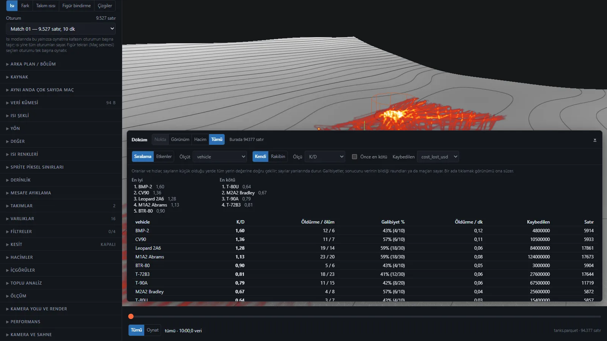
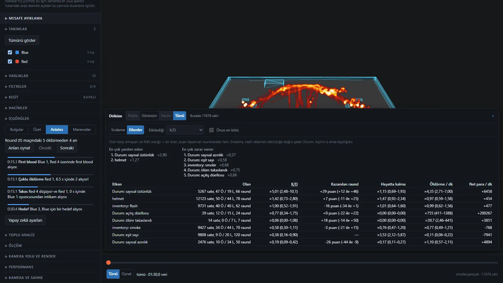

# Döküm: kim ve nerede en iyi

**Döküm** tek bir soruyu yanıtlar: bu yerde hangi araç, oyuncu ya da silah en iyi sonucu veriyor? Köprüde kazanan tankı bulmak ya da bir kaskın gerçekten işe yarayıp yaramadığını görmek için kullanın.

Bir yerde olan şeyleri (seçilen bir nokta, görünüm, bir hacim ya da gösterilen her şey) herhangi bir kategoriye göre sıralar ve her durum etkenini olsun ve olmasın ölçer.

## Deneyin {#try-it}

1. Öldürme ve ölümleri olan bir maç yükleyin ve **Hacimler**i açın.
2. İlgilendiğiniz yerin etrafına bir hacim çizin ve seçin.
3. İstatistikler altında **Döküm...** düğmesine basın.
4. **Ölçüt** altında *Araç*'ı seçin ve *K/D* (ölüm başına öldürme) ölçüsünü seçin.
5. Listeyi en iyiden başlayarak okuyun. Çevirmek için **Önce en kötü**ye basın. Görünümü bir adla süzmek için adına tıklayın; bırakmak için yeniden tıklayın.

## Açın {#open-it}

| Nereden | Başladığı bölge |
| --- | --- |
| [Hacimler](volumes.md) (İstatistikler) içindeki **Döküm...** | seçili hacim |
| Bir noktaya tıkladıktan sonra seçim kartındaki **Burada döküm** | o noktanın etrafındaki bir küre (**Yarıçap**, varsayılan verinin boyutunun %3'ü) |
| **Fark** bölünmüş paneli | görünüm |

Başlık bölgeyi değiştirir: **Nokta**, **Görünüm** (son sayımda kameranın gördükleri; taşındıktan sonra **Yeniden say**), **Hacim** (birini seçin) ya da **Tümü**. Arka planda sayar; durum satırı bölgede kaç satır olduğunu söyler.

## Sıralama {#ranking}

Neyin sıralanacağını ve bir ölçüyü seçin:

| Ölçü | Anlamı |
| --- | --- |
| A, B | Fark haritasının her iki yanındaki satırlar, ısının onları böldüğü gibi |
| A / B, A - B, A / (A + B) | İki katmanın birbirine karşı |
| K/D | öldürmeler ölümlere karşı |
| Kazanma % | veri kimin kazandığını söylediğinde kazanılan turlar (ya da maçlar) |
| Öldürme / dk | mevcut dakika başına öldürmeler (hareket örneklerinin boşlukları) |
| Kazanılan, Kaybedilen, Net para | `earn_*` ve `cost_*` sütunlarının toplamları; bir seçici para birimini belirler |

Öldürmeler, ölümler, varlık, galibiyetler ve para, görünümün o yerde gösterdiği her satırı sayar; bölmenin iki yanında ya da hiçbirinde.

Oranlar ve hızlar, sayılar küçük olduğunda tüm yerin değerine doğru çekilir; böylece 1 hayatta 2 öldürme listenin başına çıkmaz. Sayılar yanlarında gösterilir.

Grupları, oyuncuları ve maçları, herhangi bir kategori sütununu (bir araç, bir silah, bir taraf, bir satın alma türü, bir ajan ya da bir kit), aralıklarla herhangi bir sayı sütununu (zırh, bir donanımın değeri), bir silah sütununun **sınıfını** (tüfek, keskin nişancı, SMG, tabanca...) ve `inventory` gibi bir liste sütununun kaç **yardımcı** parça tuttuğunu sıralayabilirsiniz.

**Kendi** değeri, satırın kendi değerine göre sıralar. **Rakibin** değeri, diğer tarafın değerine göre sıralar: bir öldürmede kurbanın silahı, bir ölümde öldürenin silahı (onları adlandıran bir `other` / `victim` sütunu gerekir).

## O andaki durum {#state-at-the-time}

Bir satırın değeri kendisine aittir; satır hiçbir şey kaydetmiyorsa (donanımsız bir olay satırı) ya da bir ölümse (silah sütunu öldürenin silahını adlandırabilir) bu değil, aynı kişinin maçın önceki bölümünde en son taşıdığı şeydir.

## Etkenler: ile karşı ve olmadan {#factors-with-against-without}

**Sıralama**dan **Etkenler**e geçin, **Etkilediği** seçin ve *En çok yardım eden* ile *En çok zarar veren*i okuyun:

Her etkenin K/D, kazanılan turlar, hayatta kalma (ölüm başına dakika), dakika başına öldürme ve dakika başına net para üzerindeki etkisi, %95 aralığıyla: oranlar x olarak, kazanılan turlar puan farkı olarak. Sıralama her tahmini kendi belirsizliğiyle etkisizliğe doğru çeker; bu yüzden nadir bir etkenin yüksek sıralanması için net bir etki gerekir; gösterilen aralık çekilmemiş olanıdır.

Turları olan veriler, yakın dövüş **durumlarını** ekler ([Yakın dövüş ve turlar](close-quarters.md)); bir veri kümesi için bir kez hesaplanır: *körlenmiş* (satırın `state_flashed` değeri, ya da son 3 s içinde 15 m'de bir düşman flaşı), *ölüm karşılıklı*, *açılış düellosu* ve *adam üstünlüğü*, *eşit sayı* ya da *adam eksikliği* (satırın tarafındaki hayatta olan oyuncular, düşmana karşı). Bir ölüm, kurbanının hemen öncesindeki durumda sayılır.

Tek bir geçişte en fazla 256 etken ölçülür.

## Geliştiriciler için {#for-developers}

### Küçük örnekleri çekmek {#pulling-small-samples}

Sıralama değeri `(n + m*r0) / (d + m)`'dir: `n` ve `d` sayılar, `r0` tüm yerin oranı ve `m` o önsel'in ağırlığıdır.

### Dönüştürücü yazarları için: etken sütunlarını adlandırmak {#for-converter-authors-naming-factor-columns}

Bir dönüştürücü, sütununu adlandırarak bir etken ekler:

| Sütun | Etken |
| --- | --- |
| `state_<name>` sayı | sıfır olmadığı sürece açık (`state_scoped`, `state_suppressor`) |
| `state_<name>` kategori | değer başına bir etken (`state_ammo` = AP, HE...) |
| `active_<name>` | aynısı, açılmış ya da yakın zamanda kullanılmış bir şey için: bir yetenek, bir nihai yetenek, bir gadget, bir güçlendirme (`active_ult`, `active_stim`) |
| liste sütunu (`inventory`, `loadout`, `perks`, `abilities`, `attachments`, `modules`, `buffs`, `debuffs`, `upgrades` ya da `s` ile biten bir `state_`/`active_` adı) | `a\|b\|c` değerindeki her öğe için bir etken |
| zaten yaygın olan donanım bayrakları (`helmet`, `defuser`, `armor`, `scoped`, `airborne`, `duck`, `flashed`...) | sıfır olmadığı sürece açık |
| `ammoType`, `shellType`, `ammoName` | en son ateşlenen mermi |

Sonuçlar: 0/1 bir `won` sütunu (satırın tarafı turu ya da maçı kazandı) ve bir `round` sütunu. Para: `earn_<currency>` ve `cost_<kind>_<currency>`; yalnızca türüne göre bir gelir (`earn_round_cs2`, bir dönüştürücünün kesin tur ödülleri) o türdeki maliyet modelinin gelirini yerine koyar (`round` ayrıca yerleştirmeleri ve etkisiz hale getirmeleri de kapsar) ve model gerisini fiyatlandırmaya devam eder.

Eşleme bu sütunları kendi başına, dosyanın kendi listesinin yanında yükler: her `state_*`, `active_*`, `won`, `round` ve liste sütunu; bir Parquet dosyasının istatistiklerinin tamamında tek bir değer taşıdığını gösterenler hariç (yüklenen her sütun satır başına 4 bayt).
