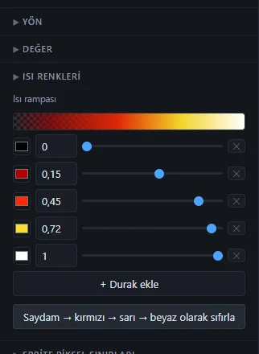

# Renk ve pozlama

Bu denetimler, her miktarda ısının hangi renge geçeceğini belirler. **Doygunluk noktası**, ne kadar ısının beyaz-sıcak sayılacağını gösterir.

## Hızlı çözümler {#quick-fixes}

- Her şey beyaz: **Doygunluk noktasını** yükseltin ya da **Alana göre otomatik pozlama** düğmesine basın.
- Hiçbir şey görünmüyor: **Doygunluk noktasını** düşürün ya da **Alana göre otomatik pozlama** düğmesine basın.
- Yalnızca birkaç tek nokta görünüyor: **En düşük ısıyı** artırın.

Bu sayfadaki her denetim, ısı renge dönüştürülürken etkili olur. Bu yüzden herhangi birini sürüklediğinizde görüntü hemen yeniden çizilir ve **birikimi asla yeniden başlatmaz**.

## Doygunluk noktası {#saturation-point}

**Doygunluk noktası** (Isı şekli bölümü): en üst renk skalasına karşılık gelen birikmiş ısı miktarı (*Doğrusal* tepki ile; diğerleri için aşağıya bakın). Logaritmik kaydırıcı 0,1-4000 arasındadır, tutamaç ise 10.000.000 değerine kadar sürüklenebilir, çünkü birikmiş ısı satır sayısıyla birlikte büyür. Varsayılan değer 24'tür. Her yüklemede önce bir **analitik tahmin** yapılır, sonra resimden **ölçülür**.

Bunu yanlış ayarlamak, ısı haritası ile boş (ya da beyaz) bir ekran arasındaki farktır. Bu değer güvenilir biçimde hesaplanamaz: telemetri öyle sıkı kümelenir ki - bir doğuş noktası, bir kapı, bir darboğaz - tepe ve ortalama yoğunluk oranı veri setleri ve kamera açıları arasında on kat değişir.

## Otomatik pozlama {#auto-exposure}

**Alana göre otomatik pozlama**, shader'ın gerçekten ürettiği alanı ölçer. Boş pikselleri yok sayar, aydınlanmış piksellerin 98. yüzdelik dilimini alır ve bunu doygunluk noktasına giden yolun %85'ine yerleştirir. Böylece skalanın üst kısmı gerçek tepe noktalar için saklanır.

Panel daha sonra *çerçevenin %X'i ölçüldü; 98. yüzdelik R, skalanın üst kısmına yakın yerleştirildi* yazısını gösterir. *Doyuran* tepki ile doygunluk noktasının %85 değeri, skalanın %85'i yerine yaklaşık %69'una denk gelir.

Bu işlem **otomatik olarak** da çalışır:

- Bir veri seti yüklendikten 8 işlenmiş kare sonra;
- [filtreler](filters.md) değiştikten 8 kare sonra (her konumu yüz olaya kadar filtrelemek yoğunluğu kat kat değiştirir);
- nokta ısısı ile [çizgi ısısı](line-heat.md) arasında geçiş yaptıktan veya çizgi ısısının hangi rotaları çizdiğini değiştirdikten 8 kare sonra, çünkü bir çizgi, bir sprite'a göre örnek başına çok daha az ısı bırakır.

Hiçbir şey aydınlanmadığında otomatik çalıştırma doygunluğu olduğu gibi bırakır; düğme analitik tahmine döner ve *ölçmek için aydınlatılmış bir şey yok - analitik tahmin kullanıldı* yazısını gösterir.

### Görünümü izle {#follow-the-view}

**Görünümü izle** (Isı şekli bölümü, varsayılan olarak açık), kamera durduğu her seferde yeniden ölçüm yapar. Böylece içine uçtuğunuz bir bölge, tüm harita için ölçülmüş skala yerine tüm renk skalasını kullanır. Küçük değişiklikler yok sayılır ve skala sıçramak yerine yumuşakça kayar. Bu, dört ısı modunda çalışır, figür bindirmesinde çalışmaz.

Tek bir skalada yerleri karşılaştırmak istiyorsanız bunu kapatıp skalayı kilitleyin. **Doygunluk noktasını** elle sürüklemek de onu kilitler.

## Yoğunluk tepkisi {#density-response}

**Yoğunluk tepkisi** - *k* (ısı / doygunluk) değerinin skalaya nasıl eşlendiği:

| Tepki | Formül | Kullanım |
|---|---|---|
| **Doyuran** (varsayılan) | t = 1 - e^(-k) | Üst renge asimptotik olarak yaklaşır, tıpkı üst üste binen yarı saydam spritelar gibi. Hiçbir şey düz beyaza kırpılmaz; bu, tanıdık olmayan veriler için güvenli varsayılandır. |
| **Doğrusal** | t = k | Eşit rengin eşit sayım anlamına geldiği tek eşleme budur. İki veri setini ya da iki zaman aralığını karşılaştırmak için kullanın. |
| **Log** | t = log₂(1 + 7k) / 3 | Uzun kuyruğu sıkıştırır, böylece tek bir aşırı sıcak nokta diğer her şeyi skalanın dibine düzleştirmez. Seyrek alanları yukarı kaldırır. |

## En düşük ısı {#minimum-heat}

**En düşük ısı** (varsayılan kapalı, %0-100): herhangi bir ısı taşıyan her piksel, skalanın en az bu noktasına yükseltilir. Bunu artırın, sprite yarıçapını azaltın; böylece *bir şeyin nerede hiç olduğunu* görürsünüz. Tek tek veri noktaları, saydam olanın hemen üstünde oturmak yerine açıkça görünür olur. Yoğunluğu değerlendirirken kapalı bırakın, çünkü bu, tasarım gereği skalanın dibini düzleştirir. Eşik (k > 0,0001) gerçekten boş pikselleri boş tutar.

## Renk skalası düzenleyicisi {#the-ramp-editor}

**Isı renkleri** bölümünde. Etiketi skalanın ne için olduğunu söyler: Isı ve Çizgilerde *Isı skalası*, Farkta *Pozitif (ekleyici takımlar)*, [Takım ısısında](team-heat.md) *Opaklık skalası (renk gruptan gelir)*, burada yalnızca alfası kullanılır.



Üstteki çubuk skalayı önizler. Altında her durak için bir satır vardır:

| Parça | Anlamı |
|---|---|
| Renk örneği | Durağın rengi (tarayıcının renk seçici). |
| Sayı | Durağın skaladaki konumu, 0 ile 1 arası (0 = ısı yok). |
| Kaydırıcı | Durağın opaklığı, %0-100. |
| ✕ | Durağı kaldırır; yalnızca iki durak kaldığında devre dışıdır. |

**+ Durak ekle** son iki durağın tam ortasına bir durak ekler; rengi ve opaklığı son durakla aynıdır. **Saydam → kırmızı → sarı → beyaz olarak sıfırla** varsayılanı geri yükler.

Duraklar herhangi bir sırada verilebilir; skala oluşturulurken sıralanırlar. **Alfa**, ısının sahne üzerine karışmasını sağlayan değerdir. Varsayılan skalanın sıfır ucunun tamamen saydam olmasının nedeni budur.

### Varsayılan skalalar {#the-default-ramps}

| Konum | Pozitif (Isı, Çizgiler, Fark +) | Negatif (Fark −) |
|---|---|---|
| 0,00 | siyah, alfa 0 | siyah, alfa 0 |
| 0,15 | rgb(180, 0, 0), alfa 0,55 | rgb(0, 170, 60), alfa 0,55 |
| 0,45 | rgb(255, 40, 0), alfa 0,85 | rgb(0, 190, 200), alfa 0,85 |
| 0,72 | rgb(255, 220, 40), alfa 0,95 | rgb(40, 80, 255), alfa 0,95 |
| 1,00 | beyaz, alfa 1 | rgb(170, 60, 255), alfa 1 |

## Kamera hareket ederken {#while-the-camera-moves}

Kamera hareket ettiğinde birikim her karede yeniden başlar. **Her kareye her satırı çiz** açıkken (varsayılan), hareket eden her kare yine de doğrudur; kapalıyken ise hareket eden bir kare tek bir örneklenmiş tahmini gösterir - daha parlak, ağırlığa göre ölçeklenmiş kümeler - ve durduğunuzda bu, daha pürüzsüz gerçek resme yakınsar. Bu beklenen bir durumdur; bkz. [Birikim](accumulation.md).

## Geliştiriciler için {#for-developers}

### Bileşim geçişi {#the-composite-pass}

Isı birikip tamamlandıktan sonra, her pikselin değeri tek bir bileşim geçişinde ([`COMPOSITE_FS`](https://github.com/Holdi601/3DHeat/blob/main/src/render/webgl2/shaders.ts)) bir renge dönüştürülür. Adımlar şöyledir:

```
k = |heat| / saturation point
t = response(k)                         clamped to 0..1
if minimum heat > 0 and k > 0.0001:  t = minimum + (1 - minimum) × t
colour, alpha = ramp(t)                  (the negative ramp when heat < 0, Difference only)
pixel = mix(scene, colour, alpha)
```

### Analitik tahmin {#the-analytic-estimate}

**Analitik tahmin** ([`estimateSaturation`](https://github.com/Holdi601/3DHeat/blob/main/src/data/calibrate.ts)), satırların verinin X-Z ayak izi üzerinde yayıldığını varsayar: ortalama ısı = satır sayısı × (π r² / ayak izi alanı) × 1/3 × merkez yoğunluğu (1/3, doğrusal bir rampanın disk ortalamasıdır), bunu varsayılan 25 tepe-ortalama oranıyla çarpın ve 0,1-1.000.000 arasında sınırlayın. Doğru değerin bir kat içinde olması yeterlidir.

### Ölçüm {#metering}

[`exposure.ts`](https://github.com/Holdi601/3DHeat/blob/main/src/render/exposure.ts):

1. ısı hedefi GPU'dan geri okunur ve en fazla 40.000 değere indirgenir;
2. boş pikseller (ısı ≤ 0,0001) atılır - bir ısı alanının çoğu boştur ve bunları ortalamaya katmak her şeyi yetersiz pozlar, tıpkı siyah bir arka plana doğrultulmuş bir kamera ölçeri gibi;
3. aydınlanmış piksellerin 98. yüzdelik dilimi referanstır;
4. doygunluk noktası referans / 0,85 olur; böylece referans doygunluk noktasına giden yolun %85'inde durur ve skalanın üst kısmı gerçek tepe noktalar için saklanır.

### Renk tablosu {#the-colour-table}

Skala, 256 × 2 RGBA tabloya işlenir (pozitif skala ilk satırda, negatif olan ikinci satırda) ([`buildColorLut`](https://github.com/Holdi601/3DHeat/blob/main/src/render/colors.ts)). Renkler doğrusal ışıkta enterpole edilir ve sRGB olarak saklanır; opaklık doğrusal olarak enterpole edilir.
