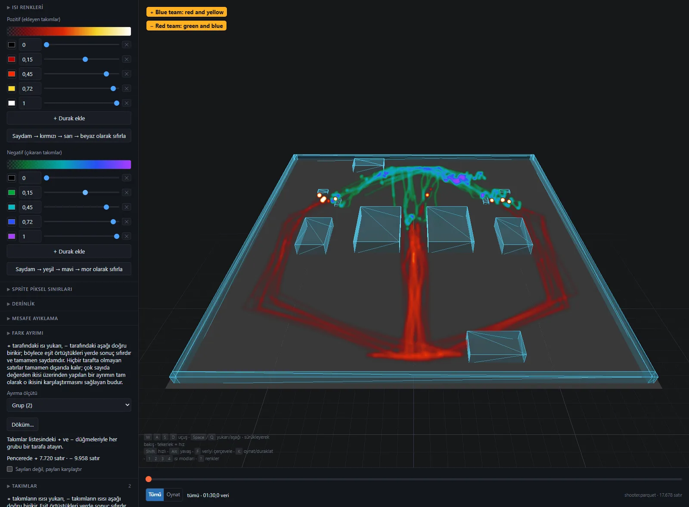

# Fark

Takım A'nın daha çok olduğu yerler kırmızı, takım B'nin daha çok olduğu yerler yeşil-mavi, eşit oldukları yerlerde hiçbir şey.

**Fark** (tuş 2) işaretli bir ısıdır. Bir nüfusun satırları ısı ekler; bir diğerinin satırları onu çıkarır. İki taraf eşit olarak üst üste geldiğinde sonuç sıfırdır ve tamamen saydamdır; biri baskın olduğunda kendi tarafının renklerinde görünür - varsayılan olarak **+** tarafı için sıcak renkler (saydam → kırmızı → sarı → beyaz) ve **−** tarafı için soğuk renkler (saydam → yeşil → mavi → mor).

## Nasıl kullanılır {#how-to-use-it}

1. `2` tuşuna basın (ya da mod çubuğunda **Fark**'ı seçin).
2. Kenar çubuğunda **Fark ayrımı**'nı açın.
3. **Ayırma ölçütü**'nü seçin: genellikle *Gruplar*.
4. Bir grubu (ya da değeri) **+** tarafına, bir diğerini **−** tarafına koyun.
5. Renkleri okuyun: sıcak renk + tarafı, soğuk renk − tarafı demektir. Taraflardan birinde hiç satır yoksa panel uyarır (bkz. [Görebileceğiniz iletiler](#messages-you-may-see)).

*Hangi* iki nüfus olduğu sorunun tamamıdır; bu yüzden ayırma, yalnızca gruplar değil, tutulan herhangi bir sütun olabilir. **Hiçbir** tarafa düşmeyen satırlar **dışarıda bırakılır**, sıfır sayılmaz: bu, birçok değerden iki tanesi üzerindeki bir ayrımın tam olarak bu ikisini karşılaştırmasını sağlar ve [filtrelerle](filters.md) birlikte çalışır - önce tek bir haritaya süzün, sonra bunu yapıya göre ayırın.

Mod iki tarafa ihtiyaç duyar: en az iki grubu olan bir grup sütunu ya da süzme için tutulan bir sütun üzerinde bir ayrım. İkiden az grubu olan veride bir yükleme, bir sütun ayrımıyla başlar - birden çok dosyalı bir yüklemenin *Kaynak dosyası* sütunu önce gelir, yoksa iki değeri olan ilk kategori sütunu, yoksa bir aralığı olan ilk sayısal sütun - böylece *iki yüklemeyi karşılaştır* hiç grubu olmayan veride de çalışır. Yalnızca hiçbiri olmayan veride mod kullanılamaz; bir tarafı boş bırakılmış bir sütun ayrımı da öyle.

## Fark ayrımı paneli {#the-difference-split-panel}

Fark modunda, ısı panellerinin altında gösterilir.

**Ayırma ölçütü** şunları sunar:

| Seçenek | Gösterilen | Ayırma kuralı |
|---|---|---|
| Gruplar | *Grup (N)* (bir grup sütunu varken) | Her grup +, − ya da hiçbiri, [Takımlar listesinde](teams-list.md) ayarlanır |
| Bir kategori sütunu | *sütun (N değer)* | Değerler +, − ya da hiçbiri |
| Bir sayısal sütun | *sütun (sayısal)* | Her taraf için bir değer aralığı |
| Kaynak dosya | *Kaynak dosya - iki yüklemeyi karşılaştır* (birden çok dosya yüklendiğinde) | Dosyalar +, − ya da hiçbiri |

Yalnızca yükleme sırasında *Filtreleme için tut* altında tutulan sütunlar sunulur.

### Sayıları değil, payları karşılaştır {#compare-shares-not-counts}

**Sayıları değil, payları karşılaştır** (varsayılan kapalı) her tarafı kendi satır sayısının tersiyle ağırlıklandırır; böylece beş kat satırı olan bir taraf yalnızca sayılarla kazanmaz. Renk, her tarafın diğerine göre orantısal olarak nerede daha yaygın olduğunu gösterir. İki tarafın veri miktarı çok farklı olduğunda kullanın, örneğin farklı uzunlukta iki oturum.

### Görebileceğiniz iletiler {#messages-you-may-see}

Panel, resim gerçek bir fark olmadığında uyarır:

| İleti | Anlamı |
|---|---|
| *N + / M −* (ya da *N + / M − / K kullanılmadı*) | Her tarafta (ve hiçbirinde) kaç değer olduğu. |
| Penceredeki hiçbir satır **+** tarafında değil | Yalnızca **−** tarafı çizilir. Zaman çizelgesi penceresini taşıyın ya da ayrımı değiştirin. |
| Penceredeki hiçbir satır **−** tarafında değil | Yalnızca **+** tarafı çizilir. |
| Hiçbir değer iki tarafta değil | Fark hiçbir şey çizmez. **+** ya da **−** tarafına en az bir değer koyun. |
| *sütun* bu şekilde ayrılamaz | Seçilen sütun ayrıma uymuyor. Sütunu yeniden seçin. |
| Ayırma sütunu, M parçadan N tanesinde GPU belleğine sığmadı | Bu satırlar çizilmiyor. Performans → Kaynak bütçeleri altında GPU bütçesini artırın ya da daha az satır yükleyin. |

### Gruba göre {#by-group}

Panel yalnızca [Takımlar listesine](teams-list.md) işaret eder; orada her grubun bir **+** ve bir **−** düğmesi vardır. Her yüklemede grupların ilk yarısı (yukarı yuvarlanmış) +'ya, geri kalanı −'ye konur; Takımlar listesindeki **Eşit böl** aynısını bir kez daha yapar. Hiçbir tarafta olmayan ya da onay kutusuyla gizlenmiş bir grup hiçbir şeye katkıda bulunmaz.

### Kategori değerlerine göre {#by-category-values}

| Bölüm | Anlamı |
|---|---|
| `a + / b − / c kullanılmadı` | Her tarafta (ve hiçbirinde) kaç değer olduğu. |
| **Temizle** | Her değeri hiçbir tarafa koymaz. |
| Değer listesi | Her değer bir **+** ve bir **−** düğmesiyle (etkin olanı yeniden tıklayarak o taraftan çıkarın). Boş bir değer *(eksik)* olarak listelenir. |
| Sınır notu | Yalnızca ilk 200 değer listelenir: *N değerden ilk 200'ü gösteriliyor. Bu kadar geniş bir sütunu önce bir filtreyle daraltmak ya da değerleri sıralıysa aralığa göre ayırmak daha iyi olur.* |

Sütunu seçmek, ilk değerini + ya da ikincisini − tarafına koyar. İki tarafta da hiç değer yoksa ayrım boş bir çerçeve göstermek yerine gruplara döner. *Kaynak dosya* aynı şekilde çalışır, dosya başına bir değerle - iki dışa aktarma, iki test koşusu ya da iki sürüm bu şekilde karşılaştırılır.

### Aralığa göre {#by-range}

| Bölüm | Anlamı |
|---|---|
| İpucu | Sütunun en küçük ve en büyük değeri. |
| **Pozitif aralık (+)**, **başlangıç** / **bitiş** | Bu aralıktaki bir değere sahip satırlar, iki uçta da dahil, ekler. |
| **Negatif aralık (−)**, **başlangıç** / **bitiş** | Bu aralıktaki satırlar çıkarır. |
| **Orta noktadan ayır** | + aralığını [en küçük, orta] ve − aralığını [orta, en büyük] olarak ayarlar - sütunu seçmenin de yaptığı şey. |

İki aralıkta da olan bir değer + sayılır. Aralıkların sütunu kapsaması gerekmez; hiçbirinde olmayan değerler dışarıda bırakılır. *İlk iki dakika ile son iki dakika* zamana benzer bir sütun üzerinde bir aralık ayrımıdır.

## Renkler {#colours}

**Isı renkleri** bölümü bu modda iki renk rampası düzenleyicisi gösterir: **Pozitif (ekleyen takımlar)** ve **Negatif (çıkaran takımlar)**; her birinin kendi sıfırlama düğmesi vardır (*Saydam → kırmızı → sarı → beyaz olarak sıfırla*, *Saydam → yeşil → mavi → mor olarak sıfırla*). Bileşim, net ısının mutlak değerini [doygunluk noktası ve tepki](colour-and-exposure.md) üzerinden alır ve net sıfırın altındayken negatif rampayı seçer. Bkz. [Renk ve pozlama](colour-and-exposure.md#the-ramp-editor).

Farkın büyüklüğü önemli olduğunda *Doğrusal* yoğunluk tepkisini kullanın: eşit renk eşit sayım demek olan tek tepki budur.

## Nasıl çalışır {#how-it-works}

Her satır köşe gölgelendiricisinde +1, -1 ya da 0 işareti alır ([`POINT_HEAT_VS`](https://github.com/Holdi601/3DHeat/blob/main/src/render/webgl2/shaders.ts)); 0, herhangi bir parça çizilmeden önce satırı reddeder.

- Gruba göre işaret, satırın grup kimliğiyle indekslenen 4.096 girişli bir grup tablosundan gelir (grup kimliği satır konum dokusunun dördüncü kanalında taşınır).
- Kategoriye göre işaret, her kategori değeri için doldurulan ikinci bir 4.096 girişli tablodan gelir ve satırın değeri sütunun süzme dokusundan okunur; tablonun sonunu aşan bir değer her iki arka uçta da reddedilir.
- Aralığa göre satırın değeri iki aralıkla karşılaştırılır.

Ayrımı değiştirmek birikimi yeniden başlatır.

**Gizli gruplar her ayrımda gizli kalır.** Bir sütuna göre ayrımda grup tablosu artık işaret taşımaz; gösterilen bir grup için 1, gizli bir grup için 0 tutar ([`frameSignTables`](https://github.com/Holdi601/3DHeat/blob/main/src/render/filterTables.ts)); ve iki tablo birlikte gölgelendiriciye ulaşır - WebGL2'de bir işaret dokusunun iki satırı, WebGPU'da bir depolama tamponunun iki yarısı. Bir satır yalnızca grubu gösterildiğinde *ve* sütun değeri bir tarafta olduğunda çizilir. Bu yüzden [Takımlar listesinde](teams-list.md) işareti kaldırılmış ya da Maç sekmesinin taraf odağıyla dışarıda bırakılmış bir grup, fark hangi biçimde ayrılırsa ayrılsın hiçbir şeye katkıda bulunmaz.
