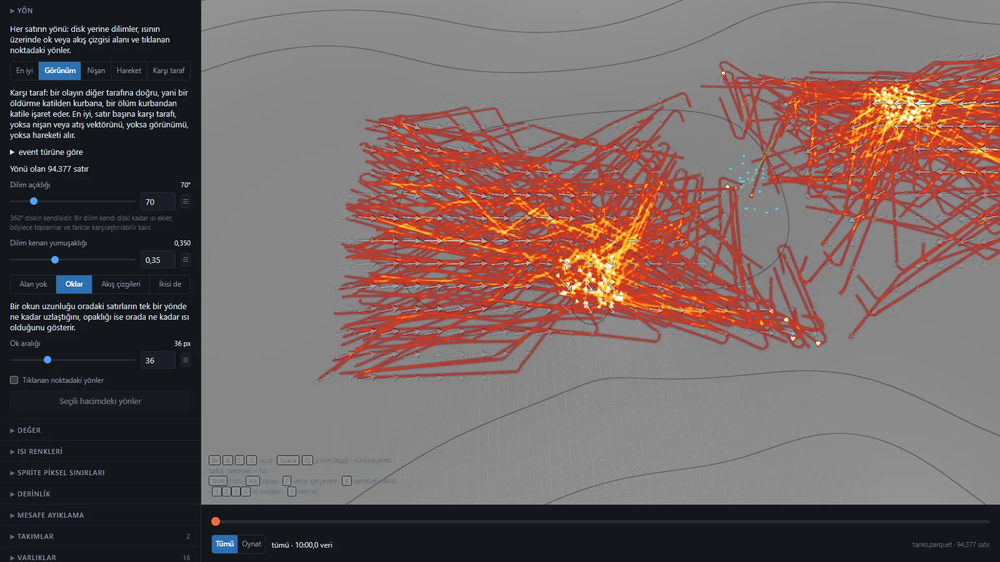

# Yönlü ısı

Düz ısı, şeylerin **nerede** olduğunu söyler. Yönlü ısı ayrıca **hangi yöne** olduğunu da söyler: insanların nereye baktığını, nişan aldığını, hareket ettiğini ya da bir çatışmanın öteki tarafının nerede olduğunu.

Normal bir sprite tam bir disktir (360 derece). **Dilim açıklığı** 70 derece olduğunda aynı sprite, satırın baktığı yöne işaret eden dar bir dilime dönüşür ve aynı toplam ısıyı ekler.

## Nasıl kullanılır {#how-to-use-it}

1. İçinde bir yön olan veriyi yükleyin (bkz. [Bir satıra yönü ne verir](#what-gives-a-row-a-direction)).
2. Mod çubuğunda **Isı**, **Fark** ya da **Takım ısısı**nı seçin.
3. Kenar çubuğunda **Yön** bölümünü açın.
4. Bir **kaynak** seçin (hangi yönün kullanılacağı), sonra çizimi açın:
   - Her satırı diskten ziyade kendi yönüne işaret eden bir dilim olarak çizmek için **Dilim açıklığı**nı 360°'nin altına indirin;
   - Isının üzerine oklar ya da akış çizgileri çizmek için bir **Alan** seçin;
   - **Tıklanan noktadaki yönler**i işaretleyin ve o noktanın kutupsal grafiğini almak için ısıya tıklayın.

Durum satırı, seçilen kaynaktan kaç satırın bir yönü olduğunu söyler.

## Ayarlar {#settings}

| Ayar | Varsayılan | Ne yapar |
|---|---|---|
| Kaynak: **En iyi**, **Görünüm**, **Nişan**, **Hareket**, **Karşı taraf** | En iyi | Her satırın hangi yönü alacağı. *En iyi*, satır başına karşı tarafı, yoksa nişanı, yoksa görünümü, yoksa hareketi alır. |
| **Olay türüne göre** | yukarıdaki gibi | Her olay türü için farklı bir kaynak; örneğin öldürmeler için *Karşı taraf*, konumlar için *Görünüm*. Veride en fazla 40 değeri olan bir olay sütunu varsa gösterilir. |
| **Dilim açıklığı** | 360° | 360° normal disktir (kapalı). Daha küçük, daha dar bir dilimdir. Bir dilim, diskinin eklediği kadar ısı ekler; böylece toplamlar ve farklar karşılaştırılabilir kalır. |
| **Dilim kenarı yumuşaklığı** | 0,35 | 0 keskin kenarlı bir dilim, 1 yumuşak bir yelpazedir. |
| **Alan**: Alan yok, Oklar, Akış çizgileri, İkisi de | Alan yok | Oklar: bir okun uzunluğu, oradaki satırların tek bir yönde ne kadar anlaştığı, opaklığı ise orada ne kadar ısı olduğu. Oklar yalnızca ısının olduğu yerde görünür. |
| **Ok aralığı** | 28 px | Ekranda oklar arasındaki mesafe. |
| **Akış çizgilerini canlandır** | açık | Açıkken akış çizgileri akar. |
| **Tıklanan noktadaki yönler** | kapalı | O noktadaki yönleri görmek için ısıya tıklayın (aşağıda). |
| **Seçili hacimdeki yönler** | | Seçili [hacmin](volumes.md) içindeki her şey için aynı grafik. |

## Bir noktadaki kutupsal grafik {#the-polar-chart-at-a-spot}

**Tıklanan noktadaki yönler** açıkken ısıya tıklayın. O noktaya yakın satırlar (1,5 sprite yarıçapı içinde), 15°'lik 24 dilimlik bir gülü oluşturacak şekilde toplanır:

- **turuncu** taçyapraklar: giden yönler (satırların işaret ettiği yerler);
- **mavi** taçyapraklar: gelen yönler (geldikleri yerler);
- bir taçyaprağın **alanı** sayısıyla birlikte büyür; bir ok ana yönü gösterir;
- grafiğin altındaki satırlar ana yönü, satırların ne kadar güçlü anlaştığını (R, 0 ile 1 arası), derece cinsinden yayılımı ve satır sayısını verir.

Grafikte 0° yukarıdır; bu dünya −Z'dir (Tacview kayıtları için kuzey). Nokta 3B görünümde de bir ok ve bir halkayla işaretlenir.

## Bir satıra yönü ne verir {#what-gives-a-row-a-direction}

| Kaynak | Verinin içinde olması gereken |
|---|---|
| Görünüm | bir yaw sütunu (bakış yönü olarak eşlenmiş): `yaw`, `heading`, `azimuth`, `view_yaw`, `rot_z` |
| Nişan | `aim_x`/`aim_y`, `shot_x`/`shot_y`, `fire_x`/`fire_y`, `hit_dir_x`/`hit_dir_y` gibi sayı çiftleri (isteğe bağlı bir `…_z`) |
| Hareket | ek bir şey yok: aynı kişinin önceki örneğinden adım (en fazla 10 s önce, aynı oturumda) |
| Karşı taraf | bir olayın öteki tarafını adlandıran bir sütun (`other`, `victim`, `target`, `killer`, `attacker`, `shooter`, `other_player` ...), değerleri kişi adları olan; bir öldürme katilden kurbanı gösterir, bir ölüm kurbandan katili |

## İpuçları {#tips}

- Dilimlerin ekranda bir miktar boyutu olmalı; birkaç pikselin altında yeniden disk olarak çizilirler.
- Öldürme satırlarında *Karşı taraf*'ı, çatışmaların **nereden** kazanıldığını görmek için; konum satırlarında *Görünüm*'ü, insanların **nereye baktığını** görmek için kullanın.
- **Fark** ile iki tarafın dilimleri kendi yönlerini gösterir; böylece tartışmalı ateş hatları öne çıkar.
