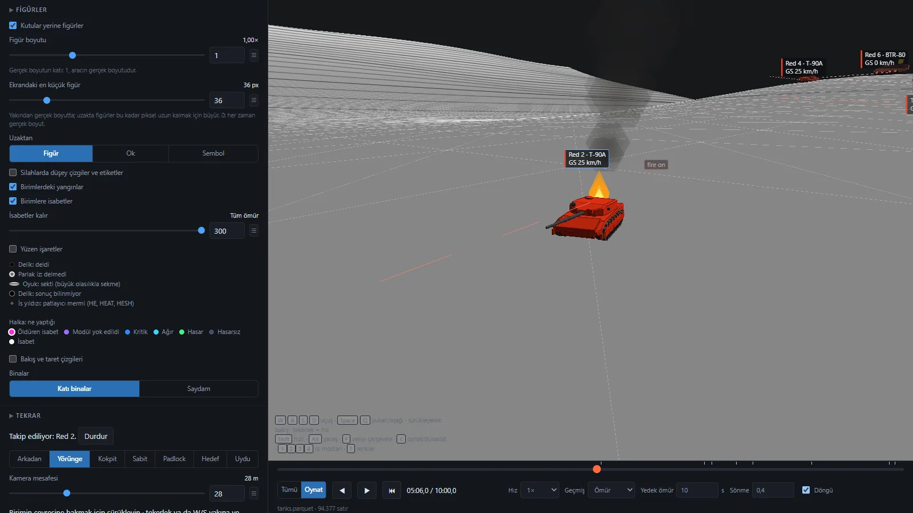

# Figürler

Bir **figür**, bir birimin gerçekte ne olduğunun küçük bir 3B modelidir: bir tank, bir jet, bir gemi, bir asker. [Tekrar](match-replay.md) her birimi düz bir kutu yerine, gerçek boyutunda kendi figürüyle çizer.

Görüntüleyicinin kendisi tarafından yapılmış, adlandırılmış yaklaşık 2.000 araç, uçak, gemi, silah ve asker vardır.

## Katalogda neler var {#what-is-in-the-catalogue}

| Alan | Örnekler |
|---|---|
| İnsanlar | ayakta, çömelmiş, yüzüstü asker; keskin nişancı, tanksavar, sağlık görevlisi, mürettebat |
| Kara | tanklar, piyade savaş araçları, hava savunma, topçu, kamyonlar ve arabalar, trenler ve tramvaylar |
| Hava | avcılar, saldırı uçakları, bombardıman uçakları, nakliye uçakları, helikopterler; çift kanatlı uçaklardan modern jetlere |
| Deniz | sınıfa göre savaş gemileri, uçak gemileri, denizaltılar, botlar, ticaret gemileri |
| Silahlar | füzeler, roketler, bombalar, torpidolar, fişekler ve paçavralar |
| İşaretler | duman, flaş ve yangın bombaları, yerleştirilmiş bombalar, bayraklar, doğmalar, ara noktalar |

## Figürler nasıl yapılır {#how-the-figures-are-made}

- **Yayımlanmış boyutlardan yapılır.** Figürlerin çoğu, görüntüleyicinin kendi figür oluşturucusu tarafından herkese açık sayılardan yapılır: uzunluk, genişlik, yükseklik, yol tekerlekleri, taret ve top, kanatlar ve kuyruk. Biçimleri daha sonra herkese açık fotoğraflara, çizimlere ve yayımlanmış boyutlara göre ayarlanır. Hiçbir oyunun modeli kullanılmaz.
- **Ücretsiz modeller.** Birkaç figür, daha doğru olduklarında ücretsiz 3B modeller (CC0 ya da CC BY) kullanır; bazen yapılmış gövdeyle birleştirilerek. CC BY eserlerin yazarları [Figür künyeleri](figure-credits.md) sayfasında anılır; CC0 eserler anılmayı gerektirmez ve orada listelenmez.
- Her figürün tam, kaba ve uzak bir sürümü vardır (ayrıntı düzeyleri, LOD); böylece binlercesi aynı anda çizilebilir.

## Bir birim hangi figürü alır {#which-figure-a-unit-gets}

Görüntüleyici verinin kendi sütunlarına bakar:

1. **Adlar** - *Name*, *Vehicle*, *Unit*, *Unit type*, *Model*, *Aircraft*, *Plane*, *Tank*, *Ship*, *Craft*, *Loadout*, *Kit* ya da *Figure* adlı sütunlar - katalogla eşleştirilir: tam olarak, yaklaşık 4.000 takma adla (birkaç oyunun birim kimlikleri), bilinen en uzun başlangıçla (`F-16C_50` F-16C'dir) ya da onunla başlayan en kısa figür adıyla.
2. Figürü birimin **türüne** uymayan bir ad kullanılmaz (*Typhoon* adlı bir kamyon avcı uçağı değildir).
3. **Türler** - *Type*, *Class*, *Kind*, *Category*, *Icon*, *Role* ya da *Domain* adlı sütunlar - bir sınıf figürü verir: Tacview etiketleri (`Air+FixedWing`, `Ground+Heavy+Armor+Vehicle+Tank`, `Sea+Watercraft+Warship`, `Weapon+Missile`), harita simgeleri ya da düz sözcükler (tank, helikopter, piyade).
4. İkisi de olmayan veri insanların verisidir: herkes asker olur.

Bu yüzden doğru figürleri almanın en kolay yolu, gerçek adlarla bir `vehicle` sütunu ya da Tacview etiketleriyle bir `type` sütunudur.

**Birimim kutu ya da asker olarak görünüyor.** Gerçek adla bir `vehicle` sütunu ya da bir Tacview etiketiyle bir `type` sütunu ekleyin. Hangi adın eşleştiğini görmek için birimin üzerine gelin. Bu tür sütunları olan ama bir birim hakkında bir şey söylemeyen veri birimi kutu olarak bırakır; ikisi de olmayan veri asker olarak çizilir.

## Ayarlar {#settings}

Tekrar kenar çubuğunun **Figürler** bölümü boyutu, ekrandaki en küçük boyutu, uzaktaki birimlerin ne olacağını (figür, ok, sembol) ve üzerlerinde çizilen efektleri ayarlar. Bkz. [Maç tekrarı](match-replay.md#figures). Duman, ateş ve diğer zamanlı efektler: [Figür bindirmedeki figürler](figure-replay.md).

## İsteğe bağlı yerel bir figür paketi {#an-optional-local-figure-pack}

Kendi makinenizde isteğe bağlı olarak kendi figürlerinizden oluşan bir paket tutabilirsiniz. Bu figürler aynı adlı katalog figürlerinin yerini alır. Asla deponun ya da yayımlanmış bir sürümün parçası olmaz; biri yoksa hiçbir şey değişmez.
