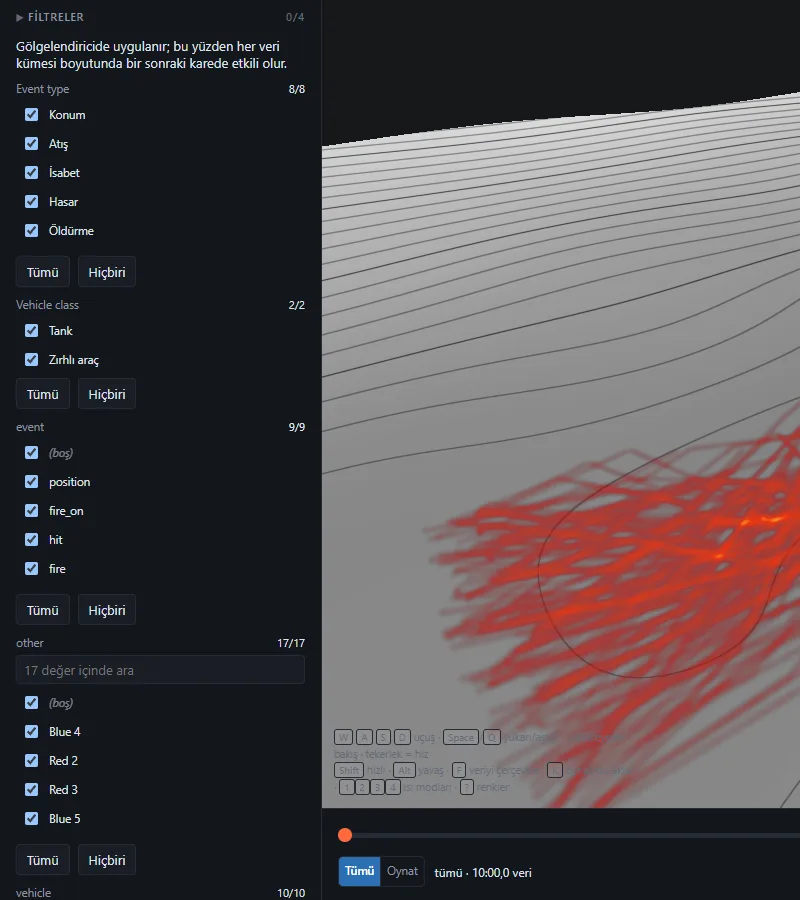
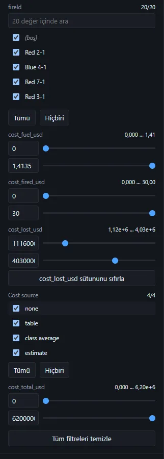

# Filtreler

**Filtreler** ilgilenmediğiniz satırları gizler, örneğin tek bir araç sınıfını ya da tek bir olay türünü; resim hemen güncellenir. Panel, yüklemede *Filtreleme için tut* altında tutulan sütunları ([Sütun eşleme](column-mapping.md)) ve birden çok dosya yüklendiğinde *Kaynak dosya*yı listeler.

## Deneyin {#try-it}

1. Bir veri kümesi yükleyin ve kenar çubuğunda **Filtreler**'i açın.
2. **Araç sınıfı** altında *Tank*'ı işaretten kaldırın. Resim hemen değişir.
3. Geri almak için **Tüm filtreleri temizle**'ye basın.

İlk satırlar görüntüleyicinin kendi sütunlarıdır (aşağıda). Onlardan sonraki satırlar dosyanızdan gelir.

## Görüntüleyicinin eklediği sütunlar {#columns-the-viewer-adds}

Yüklemede görüntüleyici kendi dört sütununu çıkarır ve bunları **ilk sırada** listeler; adları ve değerleri sizin dilinizdedir; böylece aynı filtre her oyun ve veri kaynağı için çalışır:

| Sütun | Değerler | Nereden hesaplanır |
|---|---|---|
| **Olay türü** | 23 tür: Konum, Ateş edildi, Fırlatma (füze, roket, bomba), İsabet, Iska (silah bir hedefin yakınında bitti), Patlama, Hasar, Öldürme, Ölüm, Yok edildi, Çarpma, Ejeksiyon / atlama, Doğma, Yok olma, Kalkış, İniş, Yere temas, Yerde durma, Yeniden silahlanma / yakıt ikmali, Yakalama / hedef, Yem, İleti, Diğer | `event`, `events`, `event_type` ya da `event_name` adlı bir sütun; her oyunun kendi sözcükleri (`shot`, `burst`, `fired`, `struck`, `flare`, `plant` ...) bu türlere eşlenir. Tam tablo: [Olay türleri ve sınıfları](ref-event-types.md). |
| **Oyuncu veya YZ** | Oyuncu, YZ | `ai`, `is_ai`, `bot` ya da `actor` sütunu; yoksa `is_player` / `human`; yoksa bir hesap kimliği (`user_id`, `steam_id`; boş ya da 0 YZ'dir); Tacview kayıtları için nesnenin bir pilotu olup olmadığı |
| **Araç sınıfı** | 17 sınıf: Avcı, Saldırı uçağı, Bombardıman uçağı, Diğer uçak, Helikopter, Tank, Zırhlı araç, Hava savunma, Topçu, Kamyon / araba, Gemi, Denizaltı, Piyade, Silah, Yem, Yapı, Diğer | araç ya da birim adı ([figür kataloğuyla](figures.md) eşleşir) ve tür sütunları |
| **Hedef sınıfı** | aynı sınıflar | öteki tarafın aracı (`other_vehicle`, `target_vehicle`, `victim_type` ...) |

Hemen ardından, verilerde varsa [sonuç sütunları](data-formats.md#outcome-columns) gelir: **Raunt sonucu** ve **Maç sonucu** (*Herhangi*, *Kazanıldı*, *Kaybedildi*) ve değerleri sizin dilinizde olan **Raunt nasıl bitti**. Bunlara göre filtreleyin ya da ısıyı bunlara göre bir [kazanma oranı haritası](win-rate.md) olarak ayırın.

Yalnızca oluşan türler listelenir. Değer sütunları (`cost_*`, `earn_*`, `net_*` ve *Maliyet kaynağı*, bkz. [Değer ağırlıklandırma](value-weighting.md)) herhangi bir sayı sütunu gibi süzülebilir: örneğin yalnızca fiyatlandırılmış satırları tutmak için *Maliyet kaynağı* altında *tahmin*i işaretten kaldırın.

12'den fazla değeri olan bir kategori listesi bir arama kutusu (*n değeri ara*) ve yalnızca eşleşen değerlere izin veren bir **Yalnızca bunlar** düğmesi alır.

Hangi sütunların süzülebileceği yükleme sırasında belirlenir, çünkü o sırada okunmaları gerekir. Hiç tutulan sütun yoksa panel bunu söyler ve *Filtreleme için tut*'a işaret eder.

## Rainbow Six Siege hızlı filtreleri {#rainbow-six-siege-quick-filters}

Bir Rainbow Six Siege maçı yüklüyken panel, filtreleri tek tıkla ayarlayan düğmelerle başlar: **Kurşun delikleri ve izler** (seviyede kalan izler), **Atıcısı olan izler** ve **Silah sınıfı olan izler** (bir atıcının ya da atıcının aynı andaki öldürmesinden bir silahın belirlenebildiği izler; bunları `byOperator` ya da `byItemClass` ile daha da bölün veya süzün), **Kurma ve etkisizleştirme girişimleri**, **Kesilen girişimler** (başlayıp bitmeyen, oyuncunun durduğu yerde) ve **Güçlendirmeler** (bir duvarın ya da kapağın güçlendirildiği yer, dönüştürücünün çıkardığı savunucuda). Her biri olay sütunundaki filtrenin yerini alır ve geri kalanını korur; **Tüm filtreleri temizle** bunu geri alır. Sütunlar dönüştürücünün belgelerinde açıklanır.

## Sayısal sütunlar (aralık) {#numeric-columns-range}

| Bölüm | Anlamı |
|---|---|
| Ad ve `min ... max` | Sütun ve geçerli aralık (hiçbir filtre ayarlı değilken sütunun tam aralığı). |
| İlk satır: sayı kutusu ve kaydırıcı | Alt sınır. Kaydırıcıyı üst sınırın üstüne sürüklemek üst sınırı da beraberinde iter. |
| İkinci satır: sayı kutusu ve kaydırıcı | Üst sınır. Alt sınırın altına sürüklemek onu da iter. |
| **Sıfırla *sütun*** | Bu filtreyi kaldırır. |

Kaydırıcılar sütunun en küçük değerinden en büyüğüne 1.000 adımda uzanır; sayı kutuları herhangi bir değeri kabul eder. Bir satır, değeri aralığın içinde kaldığında geçer; iki uç da dahildir. Büyük değerler üstel biçimde gösterilir (`1.23e6`).

## Kategori sütunları {#category-columns}

| Bölüm | Anlamı |
|---|---|
| Ad ve `izinli/toplam` | Sütun ve izin verilen değer sayısı. |
| Değer listesi | Her değer için bir onay kutusu; boş bir değer *(boş)* olarak gösterilir. |
| **Tümü** / **Hiçbiri** | Her değere / hiçbir değere izin ver. |

Her değere izin vermek filtreyi kaldırır.

## Kurallar {#rules}

- **Aynı anda dört filtre.** Üst bilgi `aktif/4` gösterir. Beşinci bir filtre uygulanmaz ve panel bunu söyler. [Varlıklar](entities.md) içindeki bir seçim (ya da Maç sekmesinin oyuncu odağı) da dört tane biriyle kullanılır. Tüm sütunu kapsayan bir filtre hiçbirini kullanmaz.
- **Bir kategori sütununda en fazla 4.096 değer olabilir**; daha geniş olanı yüklemede tutulmaz.
- **Filtreler VE ile birleşir**; takım görünürlüğü, fark ayrımı, zaman penceresi, mesafe elemesi ve [kesit](slice.md) ile birlikte.
- **Bir filtreyi değiştirmek birikimi yeniden başlatır ve birkaç kare sonra pozlamayı yeniden ölçer**, çünkü süzme yoğunluğu çok değiştirebilir ([Renk ve pozlama](colour-and-exposure.md#auto-exposure)).
- **Tüm filtreleri temizle** her sütun filtresini kaldırır. Takım görünürlüğü ve başka yerde ayarlanmış oyuncu seçimleri korunur.
- Sütun filtreleri ısı modlarını değiştirir. [Figür tekrarının](box-replay.md) figürlerini değiştirmezler; onlar takım görünürlüğünü ve Varlıklar seçimini izler. Varlıklar seçimi ikisini de değiştirir.
- [Çizgi ısısında](line-heat.md) bir filtre, her parçanın *bittiği* satıra karşı sınanır.
- Her yeni veri kümesinde tüm filtreler temizlenir.

## Geliştiriciler için {#for-developers}

**Yuvalar.** Her etkin filtre dört GPU yuvasından birini alır ([`MAX_FILTER_SLOTS`](https://github.com/Holdi601/3DHeat/blob/main/src/render/types.ts)); satır başına 4 bayt olan bir doku. Yuvalar filtrelere en son değiştirilme sırasına göre dağıtılır ([`filterSlots`](https://github.com/Holdi601/3DHeat/blob/main/src/render/filterTables.ts), gölgelendirici ve her iki panel tarafından paylaşılır). Dörtten sonra bir hata çıkar: *Yalnızca ilk 4 filtre uygulanır. Birini temizleyin - diğerleri sessizce birleştirilmek yerine yok sayılıyor*; fazla filtrelerin adları *sütun (uygulanmadı)* okur. Filtreler köşe gölgelendiricide satır başına çalışır; bu yüzden bir eşiği değiştirmek yeniden ayrıştırma ve yeniden yükleme gerektirmez.

**Panelin göstermediği filtreler.** Uygulama durumunda iki tür daha vardır ([`FilterSpec`](https://github.com/Holdi601/3DHeat/blob/main/src/state/types.ts)):

- Maç sekmesi bir tarafa odaklandığında ayarlanan bir **gruplar** filtresi. Diğer grupları her modda gizler; sütuna göre bir [fark](difference.md) ayrımı da dahil.
- [Varlıklar](entities.md) paneli ve Maç sekmesi tek bir oyuncuya odaklandığında ayarlanan bir **kişiler** filtresi. Figür tekrarını ve ısı modlarını kısıtlar. Isıda kişi kimlikleri üzerinde bir kategori filtresidir ve dört yuvadan birini alır. Maskesi 65.536 kimlik tutar ([`FILTER_MASK_CAPACITY`](https://github.com/Holdi601/3DHeat/blob/main/src/render/types.ts)); bu sınırın ötesindeki bir kişi, seçili olsa bile etkin olduğu sürece ısıda çizilmez. Figür tekrarı yine de onları gösterir.
