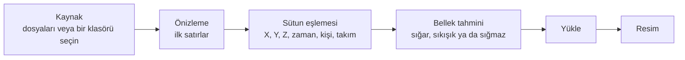

# Veri alma

3DHeat bir şey çizebilmeden bir tabloya ihtiyaç duyar: her satır bir şeyin nerede olduğunu söyler ve sizde varsa ne zaman ve kimin olduğunu. Bu bölüm bir dosyanın nasıl bir resme dönüştüğünü gösterir. Henüz verinizin yok mu? [Demo verilerini](demo-data.md) deneyin.

**Şimdi bunu yapın:**

1. Isı haritası kenar çubuğunda **Kaynak**'ı açın ve **Dosyalar…**'a basın (ya da bir dosyayı ya da klasörü bırakma alanına sürükleyin).
2. **Sütun eşlemesi**'ne bakın: kutular genellikle zaten doldurulmuştur.
3. **Bellek tahmini**'nin *sığar* dediğini denetleyin.
4. **Yükle**'ye basın.

Isı haritası sekmesinin gösterdiği her şey tek bir **veri kümesinden** gelir: her biri bir konumu ve isteğe bağlı olarak bir zamanı, bir kişiyi, bir grubu, bir oturumu, bir bakış yönünü ve süzme için tutulan istediğiniz kadar ek sütunu olan satırlardan oluşan bir tablo. Bu bölüm bir veri kümesinin nasıl yapıldığını anlatır.

## Dosyalardan resme giden yol {#the-path-from-files-to-picture}

1. **Kaynak** panelinde **dosyaları seçin** - tek bir dosya, birkaçı, bir klasör ağacı ya da bırakarak. Parquet, CSV, Tacview, GPS izleri ve daha fazlası kabul edilir; eksiksiz liste [Veri biçimleri](data-formats.md#files) sayfasındadır. Bkz. [Dosya yükleme](loading-files.md).
2. **Önizleme.** Seçimin ilk dosyası açılır: sütun adları, ilk 50 satırı, hangi sütunların sayısal göründüğü ve (Parquet için) her sütunun mantıksal türü ile dosyanın kendi okuma talimatları, yani `heat3d` altbilgi girdisi.
3. **Otomatik eşleme.** Sütunlar rollere atanır - X, Y, Z, zaman, kişi, oturum, grup, bakış yönü - ve birkaçı süzme için tutulur. Her tahmin **Sütun eşlemesi** panelinde gösterilir ve değiştirilebilir. Bkz. [Sütun eşleme](column-mapping.md) ve [Eksenler, birimler ve zaman](axes-units-and-time.md).
4. **Sayma.** Her dosyanın satır sayısı okunur (Parquet altbilgilerinden tam olarak, CSV için tahmini), böylece panel yüklemeden önce yüklemenin ne kadar bellek isteyeceğini ve sığıp sığmadığını söyleyebilir. Sığmazsa, her *N*'inci satırı yüklemeyi önerir. Bkz. [Bellek ve bütçeler](memory-and-budgets.md).
5. **Yükle.** Arka plan işçisi her dosyanın yalnızca eşlenmiş sütunlarını ayrıştırır - aynı anda birkaç dosya, [ayrıştırıcı iş parçacıkları](memory-and-budgets.md#parser-threads) bütçesine kadar - ve bunları seçim sırasına göre tek bir veri kümesinde birleştirir: tüm dosyalar boyunca tek bir ortak kişi, grup ve oturum sözlüğü, tek bir ortak zaman başlangıcı, tüm satırlar zamana göre sıralı. Bkz. [Oturumlar, kişiler ve gruplar](sessions-persons-groups.md).
6. **Yükleme.** Ana iş parçacığı bir kare boyunca "N satır GPU'ya yükleniyor" diye bildirir, sonra satırları GPU belleğine GPU bütçesi içinde paketler. Bkz. [GPU bellek yerleşimi](gpu-memory.md).
7. **İlk resim.** Kamera veriyi çerçeveler, nokta yarıçapı ve doygunluk verinin kapsamından ve satır sayısından ayarlanır ve 8 çizilmiş kareden sonra doygunluk resmin kendisinden ölçülür ([Renk ve pozlama](colour-and-exposure.md)).

## Yüklemeden önce denetlenen gereksinimler {#requirements-checked-before-a-load}

| Gereksinim | Olmadan ne olur |
|---|---|
| **X / Y / Z'den en az ikisi** | Yükleme reddedilir. Tam olarak iki tane varsa üçüncü eksen 0 olur ve veri 3B sahnede düz bir düzlem olarak çizilir - yukarıdan bakan bir harita ısı haritasının istediği şey budur. |
| Bir zaman sütunu | İsteğe bağlı. Olmadan zaman çizelgesi devre dışı kalır, görünüm **Tümü** modunda kalır ve kenar çubuğu bunu söyler. |
| Bir kişi sütunu | İsteğe bağlı. [Figür bindirme](box-replay.md) (her kişi için bir figür), [çizgi ısısı](line-heat.md) (her kişinin yürüdüğü yol), enterpolasyon, izler ve **Ömür** geçmişi için gerekir. |
| Bir grup sütunu | İsteğe bağlı. [Takım ısısı](team-heat.md) ve [fark](difference.md) modu için gerekir (en az iki grup). |

Yüklenen verinin desteklemediği bir mod, mod çubuğunda soluk gösterilir; üzerine gelindiğinde nedenini söyler.

## Kendi verinizi olmadan {#without-your-own-data}

**Veri kümesi** paneli (**Kaynak**'ın altında), her boyutta bir battle-royale biçimli veri kümesi üreten bir [yapay veri üretici](synthetic-generator.md) içerir; görüntüleyiciyi denemek ve bir makinenin neyi kaldırabileceğini test etmek için kullanışlıdır.

## Bu bölümdeki sayfalar {#pages-in-this-section}

- [Dosya yükleme](loading-files.md) - seçiciler, klasörler, sürükle ve bırak, çoklu dosya birleştirme, hareket dosyası kuralı, ilerleme ve iptal
- [Sütun eşleme](column-mapping.md) - eşleme panelinin her alanı, otomatik eşlemenin nasıl tahmin ettiği, `heat3d` ipuçları
- [Eksenler, birimler ve zaman](axes-units-and-time.md) - yukarı ekseni, çevirmeler, birim ölçeği, zaman birimleri, bakış yönü
- [Oturumlar, kişiler ve gruplar](sessions-persons-groups.md) - her birinin ne yaptığı, sınırlar, ortak adlar, varlık boyutu, Veri kümesi paneli
- [Yapay veri üretici](synthetic-generator.md)
- [Bellek ve bütçeler](memory-and-budgets.md) - bellek modeli, sığma denetimi, seyreltme, sıralama tavanı, kaynak bütçeleri
