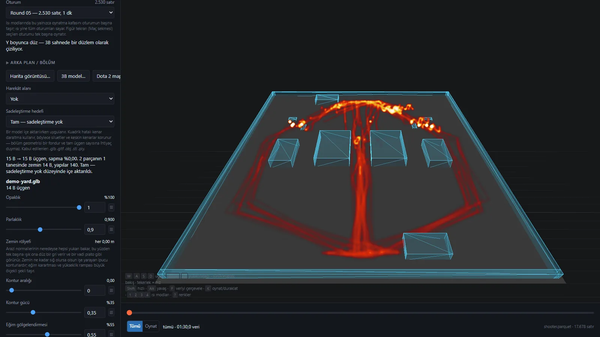
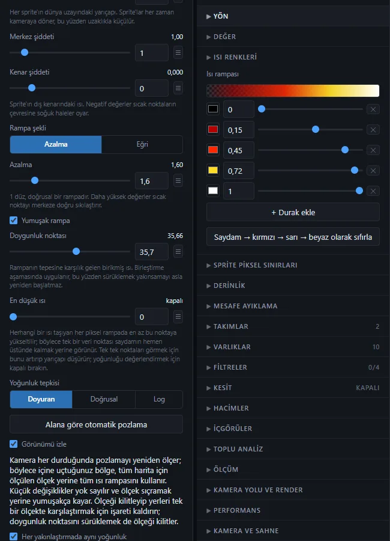

# Isı

Isı, çok şeyin olduğu yerleri boyar: biraz olduğu yerler kırmızı, çok olduğu yerler beyaz-sıcak. "Bu nerede oluyor ve ne kadar?" sorusunu yanıtlar.

**Isı** (tuş 1) varsayılan moddur. Görünür her [satır](glossary.md) kameraya bakan yuvarlak bir [sprite](glossary.md) katkıda bulunur; üst üste binen sprite'lar kayan noktalı bir tamponda toplanır; toplam bir renk rampasından geçirilir - varsayılan olarak saydam → kırmızı → sarı → beyaz - ve sahnenin üzerine çizilir.

Resim, binaları olan bir haritada bir nişancı turunun ısısını gösterir: sıcak noktalar yalnızca zeminde değil, odalarda ve merdivenlerde durur.

## Nasıl kullanılır {#how-to-use-it}

1. Veriyi yükleyin ve `1`'e basın (ya da mod çubuğunda **Isı**yi seçin).
2. Her şey beyazsa ya da boşsa, **Isı şekli** bölümünde **Alana göre otomatik pozlama** düğmesine basın.
3. Komşu noktalar bantlarda birleşene kadar **Sprite yarıçapı**nı değiştirin: daha küçük tek tek noktaları, daha büyük alanları gösterir.
4. Renkleri değiştirmek için **Isı renkleri**ni, tepelerin ve duvarların arkasındaki ısıyı gizlemesi için **Derinlik**i açın.

Aynı paneller [Fark](difference.md), [Takım ısısı](team-heat.md) ve [Çizgi ısısı](line-heat.md) modlarını da şekillendirir; farkları neyin eklendiğindedir (işaretli, renkli ya da çizgiler boyunca), nasıl eklendiğinde değil.

## Paneller ve varsayılanları {#the-panels-and-their-defaults}

Her denetim kendi sayfasında açıklanır; Ayrıntılar sütunu oraya bağlanır. Kaydırıcıların yanında yazılabilir bir kutu ve bir sürükleme tutamacı vardır (sağdaki küçük tutamaç: yukarı ya da aşağı sürükleyin, daha uzağa sürüklemek daha hızlıdır, ince ayar için Shift); bir kaydırıcının izi gerçek bir sınırdan önce bittiğinde tutamaç, burada verilen *kaydırma tavanına* kadar geçebilir. *Yüklemede* işaretli değerler her yeni veri kümesi için yeniden hesaplanır.

### Isı şekli (açık) {#heat-shape-open}

| Denetim | Varsayılan | Aralık (kaydırma tavanı) | Ayrıntılar |
|---|---|---|---|
| **Sprite yarıçapı** | 6 m; yüklemede kapsam / 120 | 0,05-2000 m, logaritmik (50.000) | [Sprite şekli](sprite-shape.md#sprite-radius) |
| **Merkez şiddeti** | 1 | 0-10 (1000) | [Sprite şekli](sprite-shape.md#centre-and-edge-intensity) |
| **Kenar şiddeti** | 0 | -2-10 (1000) | [Sprite şekli](sprite-shape.md#centre-and-edge-intensity) |
| **Rampa şekli** | *Azalma* | *Azalma* / *Eğri* | [Sprite şekli](sprite-shape.md#ramp-shape-falloff-or-curve) |
| **Azalma** (yalnızca Azalma) | 1,6 | 0,1-8 (64) | [Sprite şekli](sprite-shape.md#falloff) |
| **Yumuşak rampa** (yalnızca Azalma) | açık | | [Sprite şekli](sprite-shape.md#falloff) |
| Eğri düzenleyici (yalnızca Eğri) | *Yumuşak* hazır ayar | | [Sprite şekli](sprite-shape.md#the-curve-editor) |
| **Doygunluk noktası** | 24; yüklemede bir tahmin, sonra ölçülür | 0,1-4000, logaritmik (10.000.000) | [Renk ve pozlama](colour-and-exposure.md#saturation-point) |
| **En düşük ısı** | kapalı (0) | %0-100 | [Renk ve pozlama](colour-and-exposure.md#minimum-heat) |
| **Yoğunluk tepkisi** | *Doyuran* | *Doyuran* / *Doğrusal* / *Log* | [Renk ve pozlama](colour-and-exposure.md#density-response) |
| **Alana göre otomatik pozlama** | | düğme | [Renk ve pozlama](colour-and-exposure.md#auto-exposure) |
| **Görünümü izle** | açık | | Kamera durduğu her seferde pozlamayı yeniden ölçer; böylece içine uçtuğunuz bir bölge tüm renk rampasını kullanır. Küçük değişiklikler yok sayılır ve skala kayar. Skalayı kilitlemek ve yerleri tek bir skalada karşılaştırmak için kutusunu kaldırın ya da **Doygunluk noktası**nı sürükleyin. [Renk ve pozlama](colour-and-exposure.md#follow-the-view) |
| **Her yakınlaştırmada aynı yoğunluk** | açık | | Bir renk, ne kadar yakın olursanız olun zemin alanı başına aynı satır sayısını anlatır. Piksel sınırlarının büyüttüğü (uzakta) ya da küçülttüğü (yakında) bir sprite, gerçek boyutunun ekleyeceği ısıyı korur; böylece uzaktan pozlanmış bir resim, içine uçtukça solmaz. Kapalıyken sınırlanmış bir sprite, sınırlanmış boyutunda tam ağırlığını ekler. [Sprite şekli](sprite-shape.md#pixel-clamps) |
| **Zemin düzlemine yasla** | kapalı | | [Sprite şekli](sprite-shape.md#flatten-onto-ground-plane) |

### Isı renkleri (kapalı) {#heat-colours-closed}

| Denetim | Varsayılan | Ayrıntılar |
|---|---|---|
| Grup renk örnekleri ve **Renk ayrımı** (yalnızca Takım ısısı) | 1,4 | [Takım ısısı](team-heat.md) |
| **Isı rampası** düzenleyicisi (Farkta *Pozitif (ekleyici takımlar)*, Takım ısısında *Opaklık rampası*) | saydam → kırmızı → sarı → beyaz | [Renk ve pozlama](colour-and-exposure.md#the-ramp-editor) |
| **Saydam → kırmızı → sarı → beyaz olarak sıfırla** | | |
| **Negatif (çıkaran takımlar)** rampası (yalnızca Fark) | saydam → yeşil → mavi → mor | [Fark](difference.md#colours) |

### Sprite piksel sınırları (kapalı) {#sprite-pixel-clamps-closed}

| Denetim | Varsayılan | Aralık (kaydırma tavanı) | Ayrıntılar |
|---|---|---|---|
| **En küçük piksel yarıçapı** | 1 px | 0-16 (512) | [Sprite şekli](sprite-shape.md#pixel-clamps) |
| **En büyük piksel yarıçapı** | 96 px | 2-1024, logaritmik (8192) | [Sprite şekli](sprite-shape.md#pixel-clamps) |

### Derinlik (açık) {#depth-open}

| Denetim | Varsayılan | Ayrıntılar |
|---|---|---|
| **Arazinin arkasındakini gizle** | açık | [Derinlik ve eleme](depth-and-culling.md#hide-behind-terrain) |
| **Geometrinin arkasında kalan** | 0,8 (*%80 daha koyu*) | [Derinlik ve eleme](depth-and-culling.md#hidden-behind-geometry) |

### Uzaklık elemesi (kapalı) {#distance-culling-closed}

| Denetim | Varsayılan | Aralık (kaydırma tavanı) | Ayrıntılar |
|---|---|---|---|
| **Yakın** | kapalı (0) | 0,5-5000 m, logaritmik, izin altı = kapalı (200.000) | [Derinlik ve eleme](depth-and-culling.md#distance-culling) |
| **Uzak** | kapalı (0) | 1-200.000 m, logaritmik, alt kısım = kapalı (10.000.000) | [Derinlik ve eleme](depth-and-culling.md#distance-culling) |
| **Bir düzlemde kes** | açık | | [Derinlik ve eleme](depth-and-culling.md#distance-culling) |
| **Bölümü de kes** | açık | | [Derinlik ve eleme](depth-and-culling.md#distance-culling) |

Tuşlar: `[` ve `]` uzak sınırı içeri ve dışarı iter, `\` onu açıp kapatır ([Derinlik ve eleme](depth-and-culling.md#keyboard)).

### Yön ve Değer {#direction-and-value}

Isı şekli'nin altında iki bölüm daha vardır. **Yön** her satırı bir kama olarak çizer ve oklar ekler: bkz. [Yönlü ısı](directional-heat.md). **Değer**, ısıyı her satırın neye mal olduğuna ya da ne kazandırdığına göre tartar: bkz. [Değer ağırlıklandırma](value-weighting.md).

## Ne kaydedilir {#what-is-saved}

Yukarıdaki ısı ayarları oturumlar arasında saklanmaz: sayfayı yeniden yüklemek varsayılanları geri getirir. Tarayıcıda iki şey saklanır: son oynatma hızı (`heat3d.speed`, bkz. [Zaman çizelgesi](timeline.md)) ve [figür bindirmenin](box-replay.md) uzak figür ayarları (sembol stili, boyut, isabet işaretleri ve benzeri). Dil, [ters çevrilmiş dünya eksenleri](camera.md#invert-world-axis), yarış sekmesinin hatırlanan araba adları ve [harita kütüphanesi](level-library.md) de öyle. Tam liste [Saklanan ayarlar](ref-settings-storage.md) sayfasındadır.
