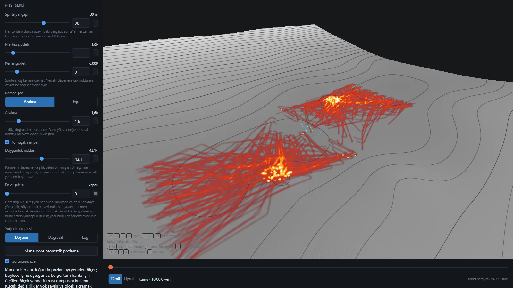
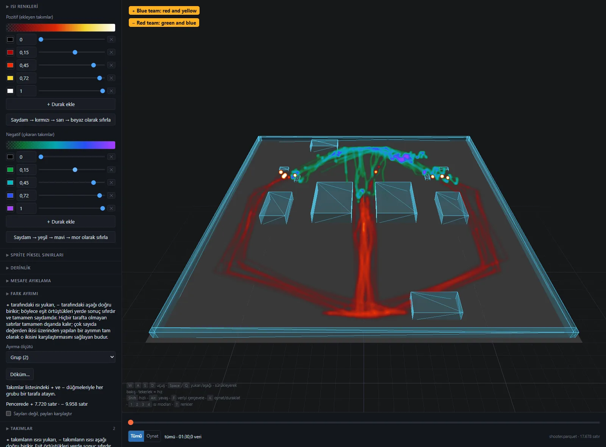
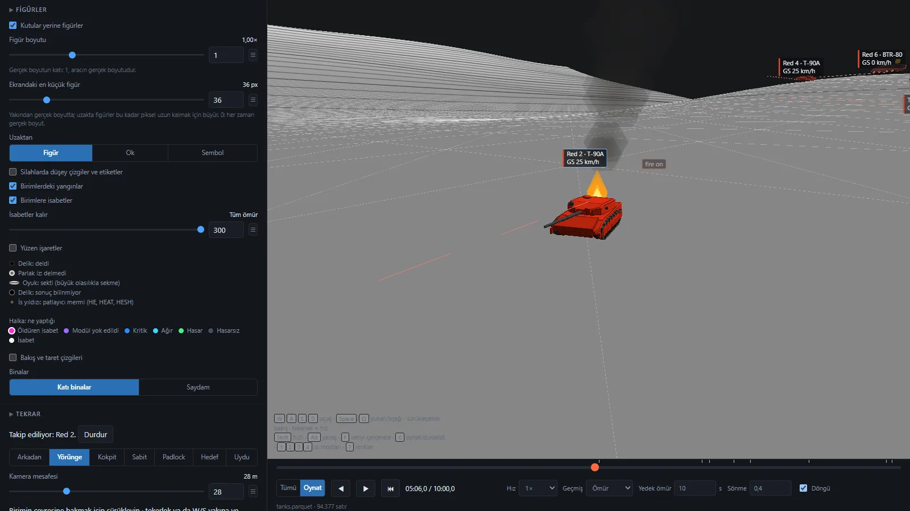
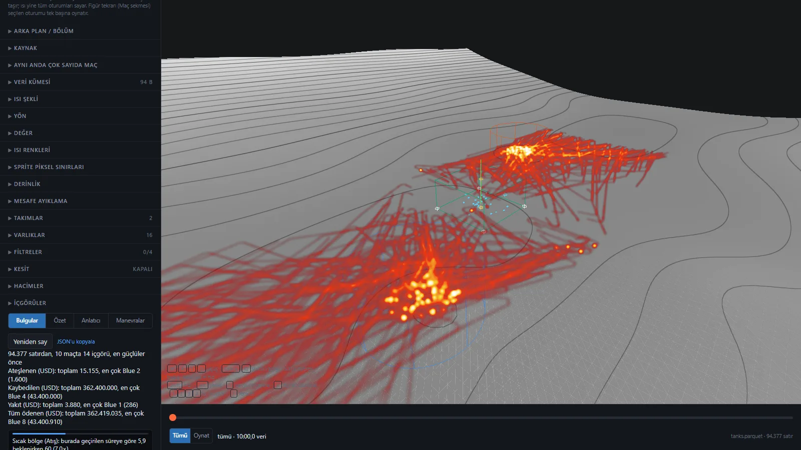
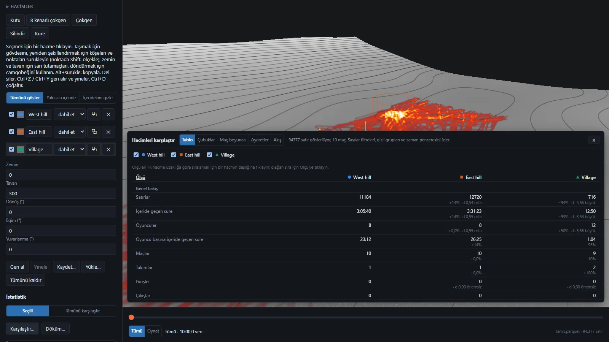
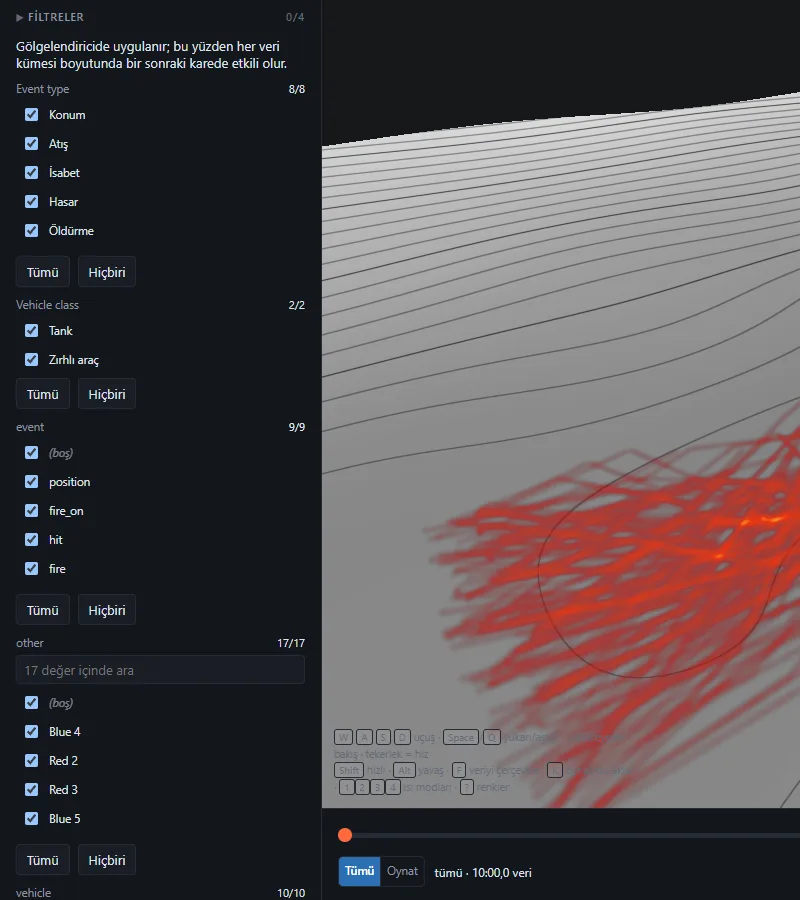
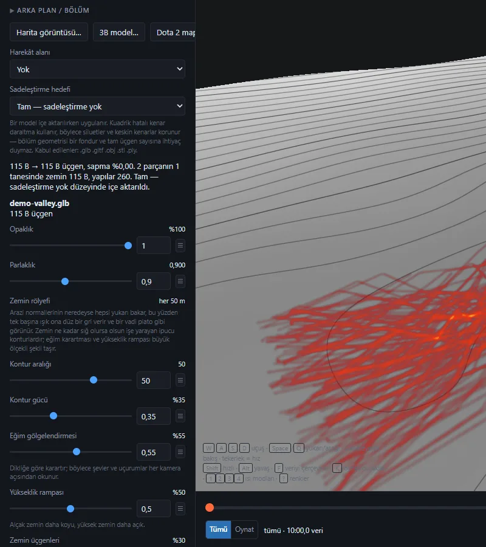

# 3DHeat

3DHeat, bir oyunda olayların nerede yaşandığını gösterir - oyuncuların nereye gittiğini, nerede savaştığını ve nerede düştüğünü - içinde uçabileceğiniz parlak renkler olarak ya da maçı yeniden oynatan küçük 3B figürler olarak.

Konum verilerini yükleyin - CSV, Parquet, Tacview kayıtları, dönüştürülmüş tekrarlar, tek bir dosya, bir klasör ya da binlerce maç - ve bunları **içinde uçabileceğiniz bir ısı haritası** olarak, **maçı yeniden oynatan figürler** olarak, insanların izlediği rotalar boyunca çizgiler olarak ya da bir nüfusu ötekiyle karşılaştırarak görün. Öne çıkanı kendi başına bulur ve her şey tarayıcınızda çalışır: hiçbir şey bir yere yüklenmez.



**Burada yeniyseniz:** [demo verilerini](demo-data.md) oluşturun ve yedi adımını izleyin. Bu sitedeki her resim onunla çekildi.

## Neler yapar {#what-it-does}

| | |
|---|---|
|  | **[Isı modları](heat-modes.md)** - ısı, [fark](difference.md) (bir tarafın daha çok olduğu yerler kırmızı, diğer tarafın olduğu yerler yeşil-mavi), [takım ısısı](team-heat.md), [çizgi ısısı](line-heat.md); kama, ok alanları ve kutupsal grafiklerle [yönlü ısı](directional-heat.md); [değere göre ağırlıklandırılmış](value-weighting.md) ısı: silahların, araçların ve yakıtın maliyeti. |
|  | **[Maç tekrarı](match-replay.md)** - her birim, ne olduğunun [figürü](figures.md) olarak; uzakta NATO ya da Rus sembolleri, füzeler ve izler, isabet işaretleri, enkazlar, yangınlar, taretler, hedefler, Tacview tarzı kameralar ve taktik ekran; [birçok maç birden](many-matches.md). |
|  | **[İçgörüler](insights.md)** - güçlü konumlar, ölümcül zemin, doğma tuzakları, boğazlar ve öne çıkan oyuncular; kanıtlarıyla bulunup sıralanır; yazılı bir değerlendirme, isterseniz seçtiğiniz bir yapay zekâ tarafından; tek bir maç için bir yayıncı modu; [bilgi merceği](knowledge.md). |
|  | **[Hacimler](volumes.md)** - kutular, prizmalar, silindirler ve küreler çizin, onlara göre süzün, içinde olanları sayın, dışa aktarın ve yerleri yan yana karşılaştırın; bir yerde kimin ve neyin en iyi olduğunun [dökümü](breakdown.md). |
|  | **[Filtreler](filters.md)** - olay türüne, oyuncuya ya da yapay zekâya, araç sınıfına, değere, herhangi bir sütuna göre; veri boyutu ne olursa olsun grafik kartında. |
|  | **[Haritalar](levels.md)** - harita görselleri, [veri araçlarıyla](#related-repositories) yapılan 3B haritalar, sadeleştirme, uçuş verileri için gerçek arazili [dünya arka planı](world-backdrop.md). |

Ayrıca: yarış oyunlarının turları için [Yarış analizi](race-analysis.md) sekmesi, Counter-Strike 2 özetleri için [Maç](match-analysis.md) sekmesi, bir haritadaki planlar için [Taktik tahtası](tactics-board.md), araç başına [isabet analizi](hit-analysis.md), binlerce maçın [toplu analizi](mass-analysis.md), [kamera yolları ve video](camera-path-and-video.md), [40 dil](languages.md), [metrik ya da imparatorluk birimleri](settings.md).

## Sekmeler {#the-tabs}

Sekmeler kenar çubuğunun üstünde, adın, birimlerin ve dil menüsünün altında durur.

| Sekme | Ne için |
|---|---|
| **Isı haritası** | Her konum tablosu: ısı modları, figür bindirme, filtreler, hacimler, içgörüler, haritalar, ölçüm ve video. |
| **Yarış analizi** | Bir pistin iki ya da daha fazla turu: zaman nerede kaybediliyor, neden ve neyi değiştirmeli. |
| **Maç** | Bir maçın figür tekrarı ve Counter-Strike 2 maç özetleri. |
| **Taktik** | Bir haritadaki planlar: figürler, rotalar, atılan yardımcı öğeler, alanlar ve notlar, oynatılan adımlar halinde. |
| **Araçlar** | Her birimin nerede vurulduğu, kim tarafından ve neyle. |

## Kurulum ve çalıştırma {#install-and-run}

### Windows, kolay yol {#windows-the-easy-way}

Depo kökünde üç toplu iş dosyası bulunur.

| Dosya | Ne yapar |
|---|---|
| `start.bat` | Görüntüleyiciyi başlatır. Node.js `PATH` üzerinde olmasa bile bulur (`%ProgramFiles%\nodejs`, `%ProgramFiles(x86)%\nodejs` ve `%LOCALAPPDATA%\Programs\nodejs` klasörlerine bakar); Node.js yoksa LTS sürümünü `winget install -e --id OpenJS.NodeJS.LTS` ile kurmayı önerir. İlk çalıştırmada bağımlılıkları indirmeden önce sorar (klasörün içindeki `node_modules\` klasörüne yaklaşık 300 MB, sisteme hiçbir şey kurulmaz). Bağlantı noktası 5273 zaten bir şey tarafından dinleniyorsa başlamayı reddeder ve bunun yerine `restart.bat` dosyasına işaret eder. Klasör yerel değişikliği olmayan bir git kopyasıysa ve daha yeni bir sürüm varsa, güncellemek isteyip istemediğinizi sorar (Y/N; 60 sn içinde yanıt verilmezse bu sürümde kalır; bkz. [Güncellemeler](updates.md)). Ardından `http://127.0.0.1:5273/` adresinde geliştirme sunucusunu çalıştırır ve tarayıcıyı açar. **Pencere sunucudur**: açık bırakın; kapatın ya da durdurmak için Ctrl+C'ye basın. |
| `restart.bat` | `stop.bat quiet` çalıştırır, ardından `start.bat`. Yalnızca `vite.config.ts` değiştirildiğinde, bir bağımlılık eklendiğinde ya da sunucu kilitlendiğinde gerekir - kaynak düzenlemeleri sıcak yüklenir. |
| `stop.bat` | Bağlantı noktası 5273'ü dinleyen her şeyi durdurur; işlem kimliğini `netstat` ile bulur, asla görüntü adına göre değil, böylece makinedeki diğer Node.js işlemleri olduğu gibi kalır. Soketin serbest kalması için yaklaşık iki saniye bekler. `quiet` argümanıyla sonunda duraksamaz. |

### Elle (her işletim sistemi) {#by-hand-any-os}


```bash
git clone --recursive https://github.com/Holdi601/3DHeat.git
cd 3DHeat
npm install
npm run dev      # http://127.0.0.1:5273
```

`exporters/` klasörü ayrı veri araçlarını git alt modülleri olarak tutar; her biri kendi deposudur. Yalnızca düz bir klon aldıysanız `git submodule update --init` çalıştırın. Görüntüleyici kendisi çalışmak için bunlara ihtiyaç duymaz. `exporters/ext/` isteğe bağlı dönüştürücüleri tutar (War Thunder, World of Tanks, World of Warships, Squad tekrarları; DCS ve IL-2 haritaları); biri ile ilgili bir sorun diğerlerini etkilemesin diye ayrı tutulurlar.

Hiçbir oyun verisi bunların hiçbiriyle birlikte gelmez: haritalar, harita verileri ve kayıtlar, sahip olduğunuz oyunlardan, araçlarla kendi makinenizde yapılır.

### npm betikleri {#npm-scripts}

| Betik | Ne çalıştırır |
|---|---|
| `npm run dev` | 5273 bağlantı noktasında Vite geliştirme sunucusu, `127.0.0.1` adresine bağlı. |
| `npm run build` | Tür denetimi (`tsc --noEmit`) ve `dist/` içine bir üretim paketi. |
| `npm run preview` | Üretim paketini sunar. |
| `npm run typecheck` | Yalnızca tür denetimi. |
| `npm test` / `npm run test:watch` | Birim ve tümleştirme testleri (vitest). |
| `npm run smoke` | Gerçek uygulamayı başsız Chromium'da çalıştırır ve tuvalde veri renkli piksellerin olup olmadığını denetler; ekran görüntüleri `tools/.smoke/` klasörüne gider. Geliştirme sunucusunun çalışmasını bekler. |
| `npm run smoke:f16` | Aynı paket, `?heat=f16` ile çalışır; yarım kayan noktalı birikim yolunu zorlar (bkz. [Yarım kayan noktalı birikim](half-float-accumulation.md)). |
| `npm run bench` | Veri alma ölçümü; `tools/.smoke/ingest-bench.json` dosyasına yazar. |
| `npm run test:heavy` | Büyük gerçek veri dosyaları gerektiren testler; dosyalar yoksa kendiliğinden atlanırlar. |
| `npm run inspect -- <file.parquet>` | Bir Parquet dosyasının şemasını ve birkaç satırını yazdırır (`tools/inspect-parquet.mjs`). |

### Geliştirme sunucusunun eklediği şeyler {#what-the-dev-server-adds}

Görüntüleyici statik bir web sayfasıdır, ancak geliştirme sunucusu (bkz. `vite.config.ts`) statik bir `dist/` yayınında olmayan iki yerel yol ekler:

- `/__host/memory` makinenin kurulu ve boş belleğini bildirir; okuyabildiği yerlerde grafik kartının belleğini de (`nvidia-smi` üzerinden ya da Windows'ta ekran bağdaştırıcısının kayıt defteri girdisinden). Bu sayede [bellek bütçeleri](memory-and-budgets.md) tarayıcının sınırlı tahminleri yerine gerçek değerleri kullanabilir.
- `/__heat3d/update` kopyanın geride olup olmadığını denetler ve ileri sarabilir ([Güncellemeler](updates.md)).

Sunucu yalnızca `127.0.0.1` adresine bağlanır; bu yüzden iki yol da ağdan erişilemez. `http://127.0.0.1:5273` olarak açın: `localhost`, dinleme yapılmayan IPv6 döngü adresi `::1`'e çözülebilir. Çapraz kaynak yalıtım başlıkları (COOP/COEP) göndermez: görüntüleyicide hiçbir şey `SharedArrayBuffer` kullanmaz ve işçiler verilerini aktarım yoluyla teslim eder; bunun için hiçbir başlık gerekmez.

## Tarayıcı ve grafik gereksinimleri {#browser-and-gpu-requirements}

- **WebGPU ya da WebGL2 destekleyen bir tarayıcı.** Önce WebGPU denenir (Chrome ve Edge'de vardır); yoksa WebGL2 arka ucu kullanılır. WebGL2 `EXT_color_buffer_float` desteklemelidir (kayan noktalı dokulara çizim yapmak için), yoksa görüntüleyici "Render motoru başlatılamıyor." uyarısını gösterir. Bkz. [İki arka uç](backends.md). Görüntüleyici Chromium'da geliştirilip test edilir; diğer tarayıcılar doğrulanmamıştır.
- **Donanım hızlandırması açık.** Tarayıcı işi işlemciyle çiziyorsa (SwiftShader, llvmpipe, Microsoft Basic Render Driver ve benzerleri), kenar çubuğunun üstünde kırmızı bir şerit bunu ve nasıl düzeltileceğini söyler. Bkz. [Yazılımsal çizim algılama](software-rendering.md).
- **Ayrı bir grafik işlemci yardımcı olur ama şart değildir.** İki arka uç da yüksek performanslı bağdaştırıcıyı ister. Grafik işlemcide tutulabilecek veri miktarı, görebileceğiniz ve değiştirebileceğiniz bir bütçedir ([Bellek ve bütçeler](memory-and-budgets.md)).
- **İsteğe bağlı özellikler** ek tarayıcı API'leri kullanır: video çizimi VP9 ya da VP8 ile WebCodecs `VideoEncoder` ister ([Kamera yolu ve video](camera-path-and-video.md)); haritaların ağ sadeleştirmesi WebAssembly ister; klasörleri bırakmak Dosya ve Dizin Girdileri API'sini kullanır; harita kitaplığı IndexedDB kullanır; oyun kumandaları Gamepad API'sini kullanır.

## Belge haritası {#documentation-map}

**Başlangıç**: [Demo verileri](demo-data.md) · [Veri alma](getting-data-in.md) ([dosya yükleme](loading-files.md), [sütun eşleme](column-mapping.md), [eksenler, birimler ve zaman](axes-units-and-time.md), [oturumlar, kişiler ve gruplar](sessions-persons-groups.md), [Tacview](tacview-acmi.md), [dönüştürücüler](converters.md), [.3dheat](container.md), [bellek ve bütçeler](memory-and-budgets.md))

**Bakın**: [Isı modları](heat-modes.md) ([ısı](heat.md), [sprite şekli](sprite-shape.md), [renk ve pozlama](colour-and-exposure.md), [derinlik ve eleme](depth-and-culling.md), [fark](difference.md), [takım ısısı](team-heat.md), [çizgi ısısı](line-heat.md), [kutu tekrarı](box-replay.md), [yönlü ısı](directional-heat.md), [değer ağırlıklandırma](value-weighting.md)) · [Zaman çizelgesi](timeline.md) · [Haritalar](levels.md) ([harita görselleri](map-images.md), [3B haritalar](model-levels.md), [görünüm](level-appearance.md), [kitaplık](level-library.md), [dünya arka planı](world-backdrop.md), [kaynakları](world-backdrop-sources.md)) · [Kamera](camera.md) ([oyun kumandası](gamepad.md), [tuşlar](keyboard-reference.md)) · [Kamera yolu ve video](camera-path-and-video.md)

**İncele**: [Filtreler ve araçlar](filters-and-tools.md) ([filtreler](filters.md), [takımlar](teams-list.md), [varlıklar](entities.md), [kesit](slice.md), [ölçüm](measure.md), [hacimler](volumes.md), [dökümleme](breakdown.md)) · [İçgörüler](insights.md) ([bilgi merceği](knowledge.md)) · [Toplu analiz](mass-analysis.md)

**Tekrar**: [Maç tekrarı](match-replay.md) · [Birçok maç birden](many-matches.md) · [Figürler](figures.md) ([figür bindirmede](figure-replay.md), [künyeler](figure-credits.md)) · [Tacview eşdeğerliği](tacview-parity.md) · [İsabet analizi](hit-analysis.md)

**Diğer sekmeler**: [Yarış analizi](race-analysis.md) ([yöntem](race-analytics.md), [diğer oyunlar](other-games.md)) · [Maç analizi](match-analysis.md) · [Taktik tahtası](tactics-board.md) ([hızlar](tactics-speeds.md))

**Görüntüleyici**: [Terimler sözlüğü](glossary.md) · [Ayarlar, birimler ve tuşlar](settings.md) · [Diller](languages.md) · [Güncellemeler](updates.md) · [Çizim iç yapısı](rendering-internals.md) ([arka uçlar](backends.md), [birikim](accumulation.md), [örnekleme ve bütçeler](sampling-and-budgets.md), [yarım kayan nokta](half-float-accumulation.md), [GPU belleği](gpu-memory.md), [yazılımsal çizim](software-rendering.md), [performans ve istatistikler](performance-and-stats.md)) · [Veri biçimleri](data-formats.md) · [Başvuru](reference.md) · [Belgelerin bakımı](maintaining.md)

## İlgili depolar {#related-repositories}

Görüntüleyici veriyi okur; bu araçlar veriyi üretir. Her biri kendi belgeleriyle birlikte kendi herkese açık deposudur (MIT). Hiçbiri oyun verisi içermez: haritalar, harita verileri ve kayıtlar, sahip olduğunuz oyunlardan, kendi makinenizde yapılır.

| Depo | Ne yapar | Kullanım alanı |
|---|---|---|
| [3DHeat-GameFiles](https://github.com/Holdi601/3DHeat-GameFiles) | Oyunların gönderdiği arşivlerden (Forza Horizon, BeamNG, Assetto Corsa Rally; Unreal, Unity, Frostbite ve Source 2 okuyucuları) pistleri ve haritaları glTF olarak çıkarır | ısı haritanızın ya da tekrarınızın altındaki bir 3B harita |
| [3DHeat-GameCapture](https://github.com/Holdi601/3DHeat-GameCapture) | Yarış oyunlarının yayımladığı arayüzlerden tur telemetrisini kaydeder ve oynanış videosundan haritaları yeniden kurar | Yarış analizi için turlar; hiçbir dosyanın okunamadığı bir harita |
| [3DHeat-UnrealExporter](https://github.com/Holdi601/3DHeat-UnrealExporter) | Bir haritayı tek bir glTF dosyası olarak dışa aktaran Unreal Editor eklentisi | kendi Unreal projelerinizin haritaları |
| [3DHeat-CS2](https://github.com/Holdi601/3DHeat-CS2) | Counter-Strike 2 demolarını ısı haritası tablolarına ve maç özetlerine, CS2 haritalarını geometriye dönüştürür | CS2 ısısı, tekrarlar ve Maç sekmesi |
| [3DHeat-Watcher](https://github.com/Holdi601/3DHeat-Watcher) | Oyunların yayımladığı verilerden arka planda oyununuzu kaydeder: telemetri, oyun durumu entegrasyonları, günlükler, tekrarlar | elle hiçbir şey yapmadan kendi istatistikleriniz |
| [3DHeat-Ext-WarThunder](https://github.com/Holdi601/3DHeat-Ext-WarThunder) | War Thunder tekrarlarını (`.wrpl`) tablolara çevirir: hava ve kara izleri, atışlar, isabetler, öldürmeler, taretler, hedefler | War Thunder tekrarları, isabet işaretleri ve içgörüler |
| [3DHeat-Ext-WoT](https://github.com/Holdi601/3DHeat-Ext-WoT) | World of Tanks tekrarlarını tablolara çevirir: her aracın konumu, ölümleri ve öldürmeleri | World of Tanks ısısı ve tekrarları |
| [3DHeat-Ext-WoWs](https://github.com/Holdi601/3DHeat-Ext-WoWs) | World of Warships tekrarlarını tablolara çevirir: her geminin konumu ve batırmaları | World of Warships ısısı ve tekrarları |
| [3DHeat-Ext-Squad](https://github.com/Holdi601/3DHeat-Ext-Squad) | Squad sunucu demolarını tablolara çevirir: her oyuncunun konumu, takımı ve bölüğü | Squad ısısı ve tekrarları |
| [3DHeat-Ext-DCS](https://github.com/Holdi601/3DHeat-Ext-DCS) | Kendi kurulumunuzdaki DCS World arazilerini haritalara çevirir: zemin, yollar, kasabalar, hava alanları, tarlalar, su | DCS ve Tacview kayıtları gerçek arazilerinde |
| [3DHeat-Ext-IL2](https://github.com/Holdi601/3DHeat-Ext-IL2) | IL-2 Great Battles haritalarını haritalara çevirir | IL-2 kayıtları kendi haritalarında |

## Kaynak yapısı, kısaca {#source-layout-briefly}

| Klasör | İçerik |
|---|---|
| [`src/data/`](https://github.com/Holdi601/3DHeat/tree/main/src/data) | Dosya seçimi, CSV ve Parquet alımı, otomatik eşleme, doğrulama, bellek modeli, veri kümesi oluşturucu, model ayrıştırma, sınıflandırma, sadeleştirme, harita kitaplığı |
| [`src/render/`](https://github.com/Holdi601/3DHeat/tree/main/src/render) | Kare döngüsü (`engine.ts`), örnekleme, iki arka uç, kamera, oyun kumandası, ölçüm, kamera yolu, video kaydı |
| [`src/state/`](https://github.com/Holdi601/3DHeat/tree/main/src/state) | Her varsayılanı içeren uygulama durumu (`store.ts`), alan türleri (`types.ts`), sprite eğrisi |
| [`src/ui/`](https://github.com/Holdi601/3DHeat/tree/main/src/ui) | Kenar çubuğu panelleri, zaman çizelgesi, katmanlar |
| [`src/race/`](https://github.com/Holdi601/3DHeat/tree/main/src/race), [`src/match/`](https://github.com/Holdi601/3DHeat/tree/main/src/match) | Yarış analizi ve Maç sekmeleri |
| [`src/i18n/`](https://github.com/Holdi601/3DHeat/tree/main/src/i18n) | Çeviriler |
| [`src/insights/`](https://github.com/Holdi601/3DHeat/tree/main/src/insights) | İçgörüler: dedektörler, değerlendirme, yayıncı, yapay zekâ sağlayıcıları, bilgi merceği |
| [`src/mass/`](https://github.com/Holdi601/3DHeat/tree/main/src/mass) | Birçok maç üzerinde toplu analiz |
| [`src/volumes/`](https://github.com/Holdi601/3DHeat/tree/main/src/volumes) | Hacimler, istatistikleri, dışa aktarma ve karşılaştırma |
| [`src/breakdown/`](https://github.com/Holdi601/3DHeat/tree/main/src/breakdown) | Dökümleme ve etkenler |
| [`src/overlay/`](https://github.com/Holdi601/3DHeat/tree/main/src/overlay) | Birçok maç katmanı |
| [`src/figures/`](https://github.com/Holdi601/3DHeat/tree/main/src/figures) | Figür kataloğu ve oluşturucusu |
| [`src/vehicle/`](https://github.com/Holdi601/3DHeat/tree/main/src/vehicle) | İsabet analizi (Araçlar sekmesi) |
| [`src/tactics/`](https://github.com/Holdi601/3DHeat/tree/main/src/tactics) | Taktik tahtası |
| [`src/world/`](https://github.com/Holdi601/3DHeat/tree/main/src/world) | Dünya arka planı |
| [`src/units/`](https://github.com/Holdi601/3DHeat/tree/main/src/units) | Ölçü birimleri |
