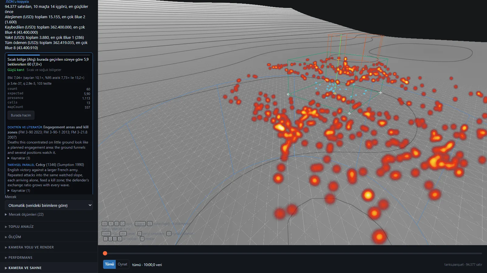

# Bilgi merceği

[İçgörüler](insights.md) bir şey bulduğunda, bu bölüm onu askerî tarihten, oyun tasarımından ve spor analizinden fikirlerle açıklar ve onun geldiği kitabı ya da makaleyi adlandırır. Yalnızca bir kalıbın var olduğunu değil, *neden* önemli olduğunu öğrenmek için kullanın.

## Deneyin {#try-it}

1. Veri yükleyin, **İçgörüler**'i açın ve **İçgörü bul**'a basın.
2. Açmak için bir bulguya tıklayın.
3. **Doktrin ve literatür** ile **Tarihsel paralel**'i okuyun; tam kaynakça altında katlanmış durur.
4. Aynı bulguyu başka bir literatür üzerinden okumak için **Mercek**'i değiştirin (örneğin *Askerî doktrin*'e).

## Nasıl çalışır {#how-it-works}

İçgörüler paneli bulgularını, profesyonel bir analistin yapacağı gibi yargılar: askerî doktrin ve yöneylem araştırması, tarihsel çatışmalar, oyun tasarımı, seviye tasarımı ve analitik literatürü üzerinden. Bunu çevrimdışı, görüntüleyicideki özenle derlenmiş bir bilgi tabanından yapar. Bir dış model özet yazdığında aynı malzemeyi ona da verir.

## Panelin gösterdikleri {#what-the-panel-shows}

- **Mercek**, bulguların hangi literatürden okunacağını seçer: *Otomatik* (veride hangi birim türlerinin olduğuna göre seçilir: uçaklar, gemiler, kara araçları, piyade), *Askerî doktrin*, *Hava muharebesi*, *Deniz*, *Kentsel*, *Oyun tasarımı ve denge*, *E-spor*. Seçilen merceğin dışındaki kayıtlar bırakılır.
- Açılan her bulgu, en yakın **doktrin ve literatür** kaydını ve en yakın **tarihsel paralelini** gösterir; tam kaynakça altında katlanmış durur.
- **Mercek ölçümleri**, aynı satırlar üzerinden hesaplanan yöneylem analizi ölçülerini listeler (aşağıya bakın). Her biri ne anlama geldiği ve literatürüyle birlikte.
- **Özet**, önde gelen bulgular ve mercek ölçümleri için satırlar ekler: "Doktrin ve literatür: ..." ve "Tarihsel paralel: ...". Her biri yazar-yıl atıflarıyla ve altında katlanmış kaynakçayla gelir.
- **Yapay zekâ ile yaz**, en ilgili kayıtları (özet, ders, ilişkili olduğu bulgular, tam kaynakça) rapor ile birlikte gönderir. Modelden onlara kimlikleriyle atıfta bulunmasını ister (`{concept.lanchester-square}` gibi) ve başka kaynak kullanmamasını ister.

Etiketler çevrilmiştir; bilginin kendisi İngilizcedir.

## Mercek ölçümleri {#lens-metrics}

İçgörü işçisinde, dedektörlerle aynı satır geçişinde hesaplanır (`src/insights/lensMetrics.ts`). Verinin taşıyamadığı her biri atlanır.

| Ölçüm | Neyi ölçer | Gerekenler |
|---|---|---|
| Lanchester uyumu | Her tarafın 20 sn'deki kayıpları, iki tarafın canlı güçleri üzerinden regresyonla (Poisson, yarı-olabilirlik hataları). Düşman ve kendi gücündeki üsler, kare yasasına (hedefli ateş) ve doğrusal yasaya (alan ateşi) karşı sınanır | zaman, takımlar, imhalar ve ölümler |
| Değişim oranı | Tarafa ve yere göre imha başına imha; zamanın %5'ini tutan en ölümcül zeminde ölümlerin payı, o kadar ölümle yalnızca şansın vereceği payla karşılaştırılır; ölümlerin zamana göre Gini'si; ölüm oranlarının Moran I'i | imhalar ve ölümler |
| Yerel kuvvet oranı | Her imhanın çatışma menzili içindeki dost ve düşman canlı birimleri (menzil veriden alınır: en yakın düşmana medyan mesafenin iki katı); yerel olarak üstün tarafın imhalardaki payı ve yalnızca sayıların öngördüğünün üstündeki fazlası | zaman, takımlar, kişiler |
| Ateş alanları | En yoğun imha yerlerinin 2,5B engel yüzeyindeki görüş alanları (duvar yüksekliğine kadar harita geometrisi ya da yürünen zemin), ortalama yere karşı; görüş ile imha payının sıra korelasyonu | konumlar; yüklü bir seviye keskinleştirir; hava için değil |
| Enerji durumu | Hava avcılarının ve hava kurbanlarının özgül enerjisi (yükseklik artı yüksekliğin hızın satın alabileceği), Mann-Whitney istatistiğiyle karşılaştırılır | uçak sınıfları, zaman, irtifa |
| Kilit arazi | Bir yerin bir maçın en yoğun üç imha yerinden biri olma sıklığı | birkaç maç |
| Karşılıklı destek (takaslar) | Menzil içinde ve 5 sn içinde bir takım arkadaşının imhasıyla yanıtlanan ölümler | zaman, takımlar |
| İlk vuruş | Çatışmalar (imhalar maça, 20 sn sessizliğe ve üç çatışma menzili uzaklığa göre gruplanır) için ilk puanı alan tarafın kazandığı | zaman, takımlar |
| Salvo modeli | Hughes'un salvo denklemi, temastaki gemilerin 20 sn'lik dönemlerine uydurulur: saldırgan gemi başına devre dışı kalan gemiler ve savunan gemi başına kurtarılanlar. Yalnızca gemilerde bir Lanchester uyumu | gemi sınıfları, zaman, takımlar |
| Muharebe etkinliği | Her tarafın çatışmadaki birim-saat başına imhası ve iki en büyük tarafın oranı (Dupuy anlamında bir muharebe etkinliği değeri), %95 aralığıyla; her tarafın eşit yerel sayılarda imhalardaki payı | zaman, takımlar |
| Çatışma menzilleri | İmhalarda, fırlatmalarda ve her yaşamın ilk atışında (tespitten çatışmaya) en yakın düşmana uzaklık; birim türüne göre | zaman, takımlar; veride varsa fırlatmalar |
| İmha zinciri | Katilin son fırlatmasından imhaya ve dövüşün ilk atışından imhaya geçen saniyeler | zaman; fırlatmalar ya da ateş olayları |
| Yoğunlaşma ya da dağılma | Her 20 sn'lik dönemde iki en büyük tarafın yayılımı ve imhaların daha sıkı olanın aldığı pay | zaman, takımlar |
| Sorti | Taraf başına: sorti (kalkışlar ya da uçak doğmaları), inişler, kaybedilen uçaklar ve uçaklarla imhalar; kayıp oranı ve sorti başına imha | uçak sınıfları; kalkışlar ya da doğmalar |

Turları olan veri, yakın dövüş ve e-spor ölçülerini ekler: tur kazanma olasılığı, eylemlerin değeri, açılış düelloları, takaslar, gözetleyen karşısında bekleyen, nişan, çapraz ateş, yardımcı öğeler, adam üstünlüğü, son adam, kurulumlar, plant sonrası, ölümcül huniler ve oyuncu etkisi. Bkz. [Yakın çarpışma ve turlar](close-quarters.md).

Rotaları ve takımları olan veri, kalabalık bilimi, toplu hareket, davranış ekonomisi ve askerî psikolojiden toplu davranış ölçülerini ekler: hizalanma ve dönüp durma, rota sürülmesi, şeritler ve izler, kalabalıklaşma, liderler ve izleyenler, geride kalanlar, kırılma noktası, kayıplardan sonra risk, seriler, satın alma anlaşması ve bastırma. Her biri kendi sahte modeline karşı. Bkz. [Toplu davranış](collective-behaviour.md).

Silahlar, aldatmacalar ve binalar birim sayılmaz. Silah satırları kendi fırlatıcı birimlerini adlandırdığında (Tacview'dan türetilmiş veride olduğu gibi bir `Shooter` ya da `Launcher` sütunu), fırlatma o birime, adıyla ya da nesne kimliğiyle eşleşerek yazılır.

## Bulgular literatürle nasıl buluşur {#how-findings-meet-the-literature}

Kayıtlar ve bulgular bir **kalıp taksonomisi** (`src/insights/knowledge/patterns.ts`) üzerinden buluşur: yoğunlaşma, yerel üstünlük, hedefli ve alan ateşi, boğazlar, ölüm bölgeleri, ateş alanları, ters yamaç, kanatlama, karşılıklı destek, enerji avantajı, doğma baskısı, denge ve benzeri. Her dedektör türü ve her mercek ölçümü hangi kalıpları gösterdiğini söyler (`src/insights/lens.ts`). Her bilgi kaydı ise, ağırlıklı olarak hangi kalıplara değindiğini söyler. Bir kaydın bir bulguyla ilgisi, ağırlıklı çakışmadır. Bu, kaydın alanının (kara, hava, deniz, kentsel) veriye ne kadar uyduğuna ve bulgunun kendi gücüne göre ölçeklenir. Gösterilen gerekçe, bulgunun sayılarını bir cümlede verir ve ardından kaydın dersini ekler.

## Katalog {#catalogue}

Her kalıp, kavram, yöntem, tarihsel vaka, tasarım ilkesi ve çalışma, kaynakçasıyla birlikte: bkz. [Bilgi kataloğu](knowledge-catalogue.md).

## Geliştiriciler için {#for-developers}

### Kayıt eklemek {#adding-entries}

1. Dosyayı türüne göre seçin. `src/insights/knowledge/` içinde `concepts.ts` ve `concepts-more.ts`, `methods.ts`, `cases.ts`, `cases-land.ts`, `cases-air-sea.ts`, `cases-esports.ts`, `design.ts` (tasarım ilkeleri) ya da `studies.ts`.
2. Ona yeni bir kimlik verin: `<tür>.<slug>` (asla bir kimliği yeniden kullanmayın). Merceklerini, alanlarını ve 0..1 arası ağırlıklarla değindiği kalıpları ekleyin. Bir kalıbı yalnızca bir bulgu onu gösterebildiğinde `patterns.ts`'e ekleyin ve `lens.ts` içinde bir bulgu ya da ölçümden eşleyin.
3. Özeti ve dersi **kendi sözlerinizle** yazın. Alıntılar yalnızca kamu malı eserlerden olsun (kaynakta `pd: true`) ve kısa olsun.
4. Atıf verin: yeni her eseri, yazarları, yılı, başlığı ve yayıncısıyla (dergi ise cilt ve sayfalarıyla) `refs.ts`'e ekleyin. Herkese açık bir kayıt varsa bir URL ya da DOI ekleyin.
5. `npx vitest run src/insights/lens.test.ts` çalıştırın (benzersiz kimlikler, bilinen kalıplar, çözülen kaynaklar, kamu malı alıntılar, tarih ve sonucu olan vakalar) ve [kataloğu](knowledge-catalogue.md) yenilemek için `node tools/knowledge-doc.mjs` çalıştırın.
