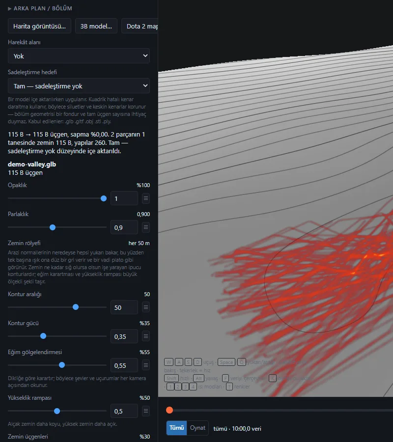

# Haritalar ve arka plan geometrisi

Bir seviye, oyunun gerçekleştiği 3B yerdir - bir harita, bir kasaba, bir pist. Verinizin arkasına koyarsanız ısının *nerede* olduğunu görebilirsiniz. **Arka plan / bölüm** paneli (bir "seviye" için [Terimler sözlüğü](glossary.md)'ne bakın) üç tür bağlam sunar:

- iki çapayla coğrafi olarak konumlandırılmış bir **harita görüntüsü** - bkz. [Harita görselleri](map-images.md);
- zemine, yapılara ve suya ayrılmış ve içe aktarımda sadeleştirilmiş bir **3B seviye** - `.glb`, `.gltf`, `.obj`, `.stl` ya da `.ply` - bkz. [3B haritalar](model-levels.md) ve [Harita görünümü](level-appearance.md);
- bir **dünya arka planı** - kaydın dünyada nerede olduğunu söyleyen bir kayıt için (bir Tacview ACMI dosyası), açık veriden indirilen gerçek arazi, yollar, su, havalimanları ve binalar - bkz. [Dünya arka planı](world-backdrop.md).

Hiçbir şey yüklü değilken sahne, bir ızgara ve renkli eksenlerle (**Izgara** ve **Eksenler**, [Kamera ve sahne](camera.md) içinde) karanlıktır ve panel *Hiçbir şey yüklü değil - sahne bir ızgara ve eksenler gösteriyor. Isıya bağlam vermek için bir harita görüntüsü ya da seviye ağı ekleyin.* der.

Seviye üç sekmenin hepsi tarafından paylaşılır: Yarış analizi sekmesinde yüklenen bir pist, ısı haritasının gösterdiği aynı seviyedir.

## Verinizin arkasına bir seviye koyun {#put-a-level-behind-your-data}

1. Önce verinizi yükleyin ([Veri almak](getting-data-in.md)), böylece seviye ona uydurulur.
2. Kenar çubuğunda **Arka plan / bölüm**ü açın.
3. Bir resim için **Harita görüntüsü…** ya da bir 3B seviye için **3B model…** düğmesine basın ve dosyayı seçin. Gerçek dünya kaydı için bunun yerine **Gerçek dünya arka planı** ya da **Harekât alanı**nı kullanın.
4. İlerleme satırının bitmesini bekleyin. Büyük bir model önce sadeleştirilir (aşağıdaki **Sadeleştirme hedefi**ne bakın).
5. Her şeyi çerçevelemek için görünümde **F**'ye basın. Isı seviyeden öne çıkana kadar **Opaklık** ve **Parlaklık**'ı kullanın.
6. Seviyeyi yeniden kullanacaksanız **Kitaplığa kaydet**e basın ([Seviye kitaplığı](level-library.md)).

## Bir seviye ısı için ne yapar {#what-a-level-does-for-the-heat}

- **Okluzyon** yapar: arkasındaki veri noktaları yüzey başına soluklaşır ve arazinin arkasındaki veri noktaları gizlenir ([Derinlik ve eleme](depth-and-culling.md)). Seviye yoksa okluzyon da yoktur.
- [Dilim](slice.md) ve *Bölümü de kes* seçiliyken [uzaklık elemesi](depth-and-culling.md#distance-culling) tarafından, ısıyla birlikte **kesilir**.
- [Alan derinliğinin](camera.md#depth-of-field) bulanıklaştırdığı tek şeydir; ızgara ve kutuların yanında.
- Bir 3B seviye verinin kendisinden büyük olduğunda **kameranın uzak düzlemini genişletir**: yakın ve uzak düzlemler veri kümesinden kalibre edilir ve birkaç kilometre genişliğindeki dışa aktarılmış bir harita, aksi halde tamamen uzak düzlemin arkasında kalır ve boş bir görünüm bırakırdı. Uzak düzlem, yatay kapsam daha büyükse 3 × seviyenin yatay kapsamı olur; yakın düzlem onunla birlikte hareket eder (okluzyonun bağlı olduğu derinlik hassasiyetini korumak için en az uzak / 100.000) ve uçuş hızı en az kapsam / 12'ye çıkarılır. Yalnızca genişletilir, asla daraltılmaz.

## Panel, yukarıdan aşağıya {#the-panel-top-to-bottom}

| Parça | Ayrıntılar |
|---|---|
| **Harita görüntüsü…**, **3B model…** | Birini yükler; mevcut seviyenin yerini alır. |
| **Gerçek dünya arka planı**, **Harita karolarını unut** | Yalnızca coğrafi bir referansı olan bir veri kümesi için: onun altındaki gerçek yeri seviye olarak kurar ya da indirilen karoları siler. [Gerçek dünya arka planı](world-backdrop.md) |
| **Sadeleştirme hedefi** | Bir sonraki model içe aktarımının üçgen bütçesi: *Tam - sadeleştirme yok* (varsayılan), *Yüksek - 8M*, *Orta - 3M*, *Düşük - 800k*, *Siluet - 100k*. [3B haritalar](model-levels.md#simplification) |
| İlerleme ve **İptal** | Çözme ya da içe aktarma sırasında. |
| İçe aktarma notu | Öncesi ve sonrası üçgenler, zemin / yapı / su ayrımı, kullanılan ayrıntı düzeyi. |
| Ad ve boyut | Bir resim için `genişlik×yükseklik px · x × z m/px`, bir model için `N üçgen (M'den)`. |
| **Opaklık**, **Parlaklık** | Her iki tür için. |
| Görüntü denetimleri | **Doygunluğu azalt**, **Kuzey/güneyi çevir**, **Yerleşim** (iki çapa), **Veri sınırlarına sığdır**, **Yükseklik**. [Harita görselleri](map-images.md) |
| Model denetimleri | Zemin rölyefi, su, zemin üçgenleri, tel kafes, doku, yakalanan renk, yapılar, parça sınıflandırması. [Harita görünümü](level-appearance.md) |
| **Kitaplığa kaydet**, **Kaldır** | [Seviye kitaplığı](level-library.md); Kaldır seviyeyi boşaltır. |
| **Kitaplık** | Bu tarayıcıda saklanan seviyeler. [Seviye kitaplığı](level-library.md) |

## Bu bölümdeki sayfalar {#pages-in-this-section}

- [Harita görselleri](map-images.md)
- [3B haritalar](model-levels.md) - biçimler, parçalar, sınıflandırma, sadeleştirme, dokular
- [Harita görünümü](level-appearance.md) - bir 3B seviye için her denetim
- [Seviye kitaplığı](level-library.md)
- [Dünya arka planı](world-backdrop.md) - açık veriden, bir kaydın altındaki gerçek dünya

Seviyelerin oyunlardan ve motorlardan nasıl çıkarılacağı, ayrı dışa aktarıcı araçların işidir (bkz. depodaki [README](https://github.com/Holdi601/3DHeat/blob/main/README.md)); onların yazdığı sözleşme [3B haritalar](model-levels.md#the-exporter-contract) sayfasında özetlenmiştir.
