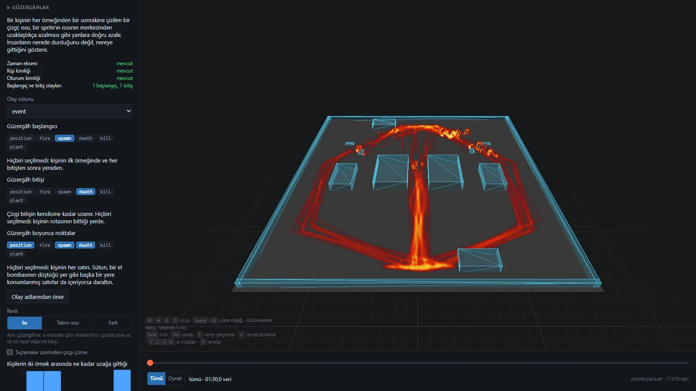

# Çizgi ısısı

Isı, insanların nerede durduğunu gösterir. Çizgiler ise izledikleri yolları gösterir.

**Çizgiler** (tuş 4) çizgi ısısıdır: bir [kişinin](glossary.md) her örneğinden bir sonrakine bir çizgi; bir [figürün](glossary.md) sahip olduğu aynı sönümlenmeyle, bir nokta etrafında değil çizginin iki yanında yayılır. İnsanların *nerede durduğunu* değil, *nereye gittiğini* gösterir: bir kez geçilen bir koridor, içinde kamp kurulan bir oda kadar görünürdür; hızlı bir oyuncunun seyrek örnekleri de noktalı bir izden çok kesintisiz bir güzergâha bağlanır. Bir kişi sütunu ve bir zaman sütunu gerektirir.

## Nasıl kullanılır {#how-to-use-it}

1. `4` tuşuna basın (ya da mod çubuğunda **Çizgiler**'i seçin).
2. **Güzergâhlar**'ı açın ve yeşil denetim listesini kontrol edin: zaman ekseni ve kişi kimliği bulunmalıdır.
3. Güzergâhların nerede başlayıp bittiğini doldurmak için **Olay adlarından öner**'e basın.
4. İstatistik satırını okuyun: "N güzergâh, bunlardan M tanesi bir sona ulaşıyor".
5. Çizgiler haritada sıçrıyorsa **En uzun adım**'ı ayarlayın (bkz. [Sıçrama sınırı](#the-jump-limit)).

Bir çizgi yalnızca bir başlangıç ile bir son arasında anlam taşır; bu yüzden **Güzergâhlar** paneli bir güzergâhı neyin sınırladığını söyler. [Bir güzergâhın kuralları](#the-rules-of-a-route) bölümünden itibaren olan her şey atlanabilecek ayrıntıdır.

## Güzergâhlar paneli {#the-routes-panel}

Çizgiler modunda ısı panellerinin üstünde gösterilir.

### Verinin içinde ne var {#what-the-data-has}

Bir denetim listesi: varsa yeşil, yoksa sarı.

| Satır | Durumlar |
|---|---|
| **Zaman ekseni** | *var* / *eksik - gerekli* |
| **Kişi kimliği** | *var* / *eksik - gerekli* |
| **Oturum kimliği** | *var* / *yok - bütün satırlar tek bir oturum* |
| **Başlangıç ve bitiş olayları** | *N başlangıç, M bitiş* / *seçilmedi - tam izler* (yalnızca bir olay sütunu ve en az bir başlangıç ile bir bitiş varsa yeşil) |

### Denetimler {#controls}

| Denetim | Anlamı |
|---|---|
| **Olay sütunu** | Değerleri olay olan (doğma, ölüm, konum, ...) bir kategori sütunu. *Yok - tam izler*: her oturumdaki her kişinin izi bir güzergâhtır; izde bir boşluk varsa orada kırılır. Yalnızca yüklemede filtre için tutulan sütunlar sunulur. |
| **Güzergâh başlar** | Bir güzergâhı başlatan olay değerleri (doğma, yeniden doğma, konuşlanma). Hiçbiri seçilmezse, güzergâh bir kişinin ilk örneğinde başlar ve her bitişten sonra yeniden başlar. |
| **Güzergâh biter** | Bir güzergâhı bitiren olay değerleri (ölüm, çıkarılma, ışınlanma). Çizgi bitiş satırının kendisine kadar uzanır. Hiçbiri seçilmezse, güzergâh kişinin izinin bittiği yerde biter. |
| **Güzergâh boyunca noktalar** | Satırları güzergâh boyunca uzanan olay değerleri. Hiçbiri seçilmezse: kişinin her satırı. Sütun, başka bir yere (örneğin bir bombanın düştüğü yer) konmuş satırlar da tutuyorsa daraltın. |
| **Olay adlarından öner** | Üç listeyi, değerlerin adlarından (aşağıda) doldurur. |
| **Renk** | *Isı*, *Takım ısısı* ya da *Fark*. Aynı güzergâhlar, o modun renklendirmesiyle: her grup kendi tonunda ya da bir taraf diğerine karşı, grup listesi, bölme ve renk skalaları o modlarda olduğu gibi çalışır. Varsayılan *Isı*. Takım ısısı ve fark bir grup sütunu gerektirir. |
| **Sıçramalar üzerinden çizgi çizme** / **En uzun adım** | Bir kişinin bir sonraki örneği bundan daha uzaktaysa, bu gidilen bir yer değil bir yeniden doğma, ışınlanma ya da düşüştür; iki nokta arasında çizgi çizilmez. Veri net bir boşluk gösterdiğinde yüklemede doldurulur (aşağıya bakın), göstermediğinde kapalı olur. Bir olay sütunuyla ya da olay sütunu olmadan çalışır. |
| İstatistik satırı | `N güzergâh, bunlardan M tanesi bir sona ulaşıyor, K bölüm`; saniyede birkaç kez güncellenir. |

Her liste, değer başına bir tane olmak üzere bir açma/kapama çipleri satırıdır; en sık olan önce. Bir çipin üzerine gelince satır sayısı görünür. En fazla 120 değer sunulur (*N değer daha gösterilmiyor*).

Başka bir olay sütunu seçmek, öneri aynı sütunu seçtiğinde öneriyi uygular; aksi halde boş listelerle başlar.

### Öneri {#the-suggestion}

Her yüklemede ve **Olay adlarından öner** düğmesinde ([`suggestLineSettings`](https://github.com/Holdi601/3DHeat/blob/main/src/data/lines.ts)):

- **Olay sütunu:** tutulan ilk kategori sütunu, adı `event`, `eventname` ya da `eventtype`; yoksa `kind`, `type` ya da `action`; yoksa *event*, *kind*, *action* ya da *type* içeren herhangi biri.
- **Başlangıçlar:** *spawn, deploy, join, enter, start, begin, respawn, revive, land/landed/landing, drop* içeren değerler; ayrıca bir son kelimesiyle de eşleşmiyorlarsa.
- **Bitişler:** *death, died, dead, kill/killed, eliminat…, extract, evac, teleport, leave, left, disconnect, quit, exit, end, finish, downed* içeren değerler. `kill` ve `kills` değerleri hariçtir (bir öldürme, öldürenin yaptığı bir şeydir, güzergâhının sonu değil).
- **Noktalar:** tam olarak *position, location, player location, move, movement, tick, sample* ya da *pos* olan değerler. Biri bulunursa başlangıçlar ve bitişler de noktalara eklenir. Hiçbiri bulunmazsa noktalar boş kalır (her satır).

### Sıçrama sınırı {#the-jump-limit}

İnsanların sıçradığı yerde, adımların uzunlukları birbirine neredeyse hiç bağlantısı olmayan iki gruba düşer: bir kişinin iki örnek arasında kat ettiği yol ve haritanın genişliği. Yüklemede ([`suggestMaxJump`](https://github.com/Holdi601/3DHeat/blob/main/src/data/lines.ts)) adımlar, karelerinin uzunluğunun her iki katına göre sayılır (16 milyona kadar). Sınır, medyanın üstündeki ilk aralığın ortasına konur: en az bir uzunluk iki katı genişliğinde, aralık başına adımların %0,02'sinden azını barındıran ve ötesinde adımlar olan. Böyle bir aralık yoksa hiçbir şey kesilmez; çünkü bir sıçramayı hızlı bir arabadan ayırmanın yolu yoktur. Sınırı elle açmak o zaman verinin köşegeninin onda birinden başlar.

Sınırın üstündeki grafik, adımların gerçekte ne kadar uzun olduğunu ve sınırda bir çizgiyle gösterir; sağındaki çubuklar çizilmez. İki eksen de logaritmiktir, çünkü sıçramalar adımların yüzde biri olabilir ve bin kat uzun olabilir. Bir çubuğun üzerine gelince aralığı ve payı görünür; grafiğe tıklamak sınırı oraya koyar. Altında, sınırın üstündeki adımların payı yer alır.

## Bir güzergâhın kuralları {#the-rules-of-a-route}

Satırlar, kişi başına ve zaman sırasıyla taranır ([`buildLines`](https://github.com/Holdi601/3DHeat/blob/main/src/data/lines.ts)):

1. [Ortak bir adı](sessions-persons-groups.md#names-worn-by-several-things-at-once) taşıyan satırlar tamamen atlanır.
2. Noktalar seçilmişse, ne başlangıç ne bitiş ne de nokta olan bir satır atlanır.
3. Satırlar kişi başına, oturum başına izlenir; böylece oturumları zaman sırasında iç içe geçen bir kişinin her birinde bir güzergâhı olur. Bir güzergâh, önceki satırın bir ardılı olmadığında kapanır (kişinin [ömrü](sessions-persons-groups.md#person) "yok" ise). Bir güzergâh asla bir oturum sınırını ya da yükleme sırasında bir sonraki örneği olmadığına karar verilmiş bir boşluğu geçmez. Bir satırın hangi güzergâhta olduğu bir kez hesaplanır ve tutulur (satır başına 4 bayt); böylece en uzun adımı değiştirmek bu kısmı yinelemez.
4. Bir **başlangıç** satırı açık her güzergâhı kapatır ve orada yenisini açar.
5. Başlangıçlar seçilmişse, bir güzergâhın dışındaki bir satır yok sayılır. Başlangıç seçilmemişse, bir güzergâhın dışındaki bitiş olmayan her satır bir tane açar.
6. Bir güzergâhın içindeki diğer her satır, güzergâhın önceki satırından bu satıra bir **bölüm** ekler.
7. Bir güzergâhı uzatan bir **bitiş** satırı, bölümünden sonra onu kapatır; bu güzergâh *bir sona ulaşan* olarak sayılır.
8. **En uzun adım**'dan uzun bir adım, güzergâhı olduğu yerde kapatır ve uzak uçta yeni bir güzergâh başlar; o satır bir bitiş değilse. Aradan çizgi çizilmez ve istatistik satırı bunu sayar.

Her bölüm *bitiş* satırında saklanır; böylece bölümler zaman sırasında kalır. [Zaman çizelgesi](timeline.md) penceresi, örnekleyici, [filtreler](filters.md), grup görünürlüğü ve fark işareti, onları noktalar gibi kullanır. Bu nedenle bir filtre, bir bölümün bittiği satıra uygulanır.

## Oynatma {#playback}

**Tümü** modunda her güzergâh bütün olarak çizilir. **Oynat** modunda her kişi, örnekleri arasında hareket eden bir noktadır ve arkasında güzergâhını çizer:

- oynatma kafasından sonra başlayan bir bölüm çizilmez;
- kişinin tam ortasında olduğu bölüm, enterpolasyonlu konumuna kadar çizilir; başta bir bitiş ucu ile;
- ısı **kuyruk** boyunca söner: *Kümülatif* geçmişte kuyruk sınırsızdır ve şimdiye kadarki bütün güzergâh kalır; *Pencere* ile bütün, *Aralık* (varsayılan 30 sn) boyunca hiçliğe söner. *Ömür* ile kuyruk da *Aralık*tır ve Çizgiler modunda zaman çizelgesi bu geçmiş için de *Aralık* kutusunu gösterir (çizgi ısısının kullanmadığı *Yedek ömür* ve *Sönme* yerine).

Oynarken her kare, birikmek yerine bütün olarak çizilir; çünkü başlar her karede hareket eder ve hareketli bir ortalama her birini bir çizgiye dönüştürür.

## Geliştiriciler için {#for-developers}

### Bellek {#memory}

Güzergâhlar, Çizgiler modu açıldığında (ya da güzergâh ayarları değiştiğinde) ana iş parçacığında kurulur ve mod kapatıldığında serbest bırakılır: bellekte satır başına 5 bayt, GPU'da satır başına 8 bayt (her bölümün başlangıç konumu, veri sınır kutusu içinde eksen başına 16 bit olarak kuantalanmış, ve bayrakları).

### Bir çizginin nasıl çizildiği {#how-a-line-is-drawn}

Her iki arka uç da her bölümü bitiş satırından **18 köşe** olarak çizer ([`lineHeatVs`](https://github.com/Holdi601/3DHeat/blob/main/src/render/webgl2/shaders.ts) ve onun WGSL ikizi):

- Her ucun yarı genişliği, o ucun uzaklığındaki [sprite yarıçapıdır](sprite-shape.md#sprite-radius) ve piksel sınırları uygulanır. 2,5 px'ten dar bir çizgi 2,5 px genişlikte çizilir ve ısısı buna uyacak şekilde küçültülür; böylece ince çizgiler ne kaybolur ne de parlar.
- Isı, çizginin **karşısında** bir sprite ile aynı skalayla söner: sönme ya da eğri, merkez ve kenar yoğunluğu.
- Yuvarlak uçlar **yalnızca** bir güzergâhın başladığı ya da bittiği yerde çizilir; böylece ardışık bölümler arasındaki eklemler bir inci dizisine dönüşmez.
- Geometri ekran uzayında kurulur ve orada doğrusal olarak enterpole edilir; böylece sönme, derinliğe nasıl girerse girsin çizgiye ortalı kalır. Yakın düzlemi kesen bir bölüm orada kesilir, düşürülmez.

Nokta ısısı ve çizgi ısısı satır başına çok farklı miktarda ısı bırakır; bu yüzden ikisi arasında geçerken doygunluk yeniden ölçülür ([Renk ve pozlama](colour-and-exposure.md#auto-exposure)).
