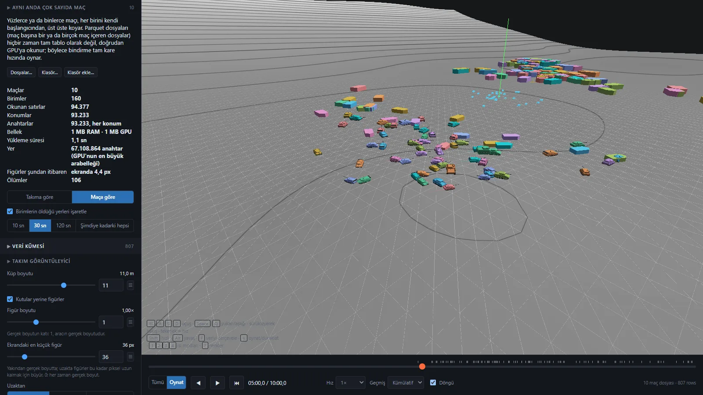

# Aynı anda çok sayıda maç

**Aynı anda çok sayıda maç**, çok sayıda maçı üst üste oynatır; böylece her maçın oyuncularının genellikle nereye gittiğini görürsünüz. Yüzlerce ya da binlerce maçı tek bir resimde karşılaştırmak için kullanın.

Her maç kendi başlangıcından başlar ve birimleri figür olarak hareket eder. Dosyalar doğrudan grafik kartına gider ve tam bir tablo oluşturulmaz; bu yüzden normal bir yüklemenin belleğinin tükeneceği yerde de akıcı çalışır.

## Nasıl kullanılır {#how-to-use-it}

1. Isı haritası kenar çubuğunda **Aynı anda çok sayıda maç**'ı açın.
2. **Dosyalar…** (birçok dosya seçin), **Klasör…** (bir klasör ve alt klasörleri) ya da **Klasör ekle…** (yüklenmiş olana ekler) düğmesine basın.
3. Görüntüleyici figür bindirmeye geçer ve başlangıçtan başlar. **Oynat**'a basın.

Her dosya bir maçtır (ya da birkaçını tutar). Parquet dosyaları ve [`.3dheat`](container.md) kapsayıcıları çalışır. Bir dosyanın bir konum, bir zaman ve bir birim sütunu olmalıdır; ad, tür ve taraf sütunları tutulur. Diğer dosyalar ve dönüştürücülerin yan dosyaları (uçuş, iletiler, olaylar, sohbet, hedefler) atlanır. Normal bir tablo için bkz. [Veri alma](getting-data-in.md).

## Ayarlar {#settings}

| Ayar | Ne yapar |
|---|---|
| **Takıma göre** / **Maça göre** | Tarafa göre renklendirir ya da maç başına bir renk. |
| **Birimlerin öldüğü yerleri işaretle** | Her birimin öldüğü yerde 10 sn, 30 sn, 120 sn ya da şu ana kadar tümü için bir işaret. |

Panel, kaç maç, birim, satır ve konumun okunduğunu, kullanılan belleği ve yükleme süresini gösterir. *Yer* grafik kartının hâlâ kaç konum alabileceğidir. *Figürler şundan itibaren* ekranda bu boyutun altında bir birimin figürü yerine küçük bir ok olarak çizildiği boyuttur.

Figürlerin görünümü [maç tekrarıyla](match-replay.md#figures) aynı denetimleri kullanır: **Figür boyutu**, **Ekrandaki en küçük figür** ve **Uzaktan**.

## İpuçları {#tips}

- Her şey bellekte sığmayacağında, konumlar seyreltilir (her birkaç metrede bir konum tutulur) ve panel bunu söyler.
- Isı modları bindirmenin verisi üzerinde de çalışır.
- Çizmeden binlerce maç üzerinde istatistik için bkz. [Toplu analiz](mass-analysis.md).
