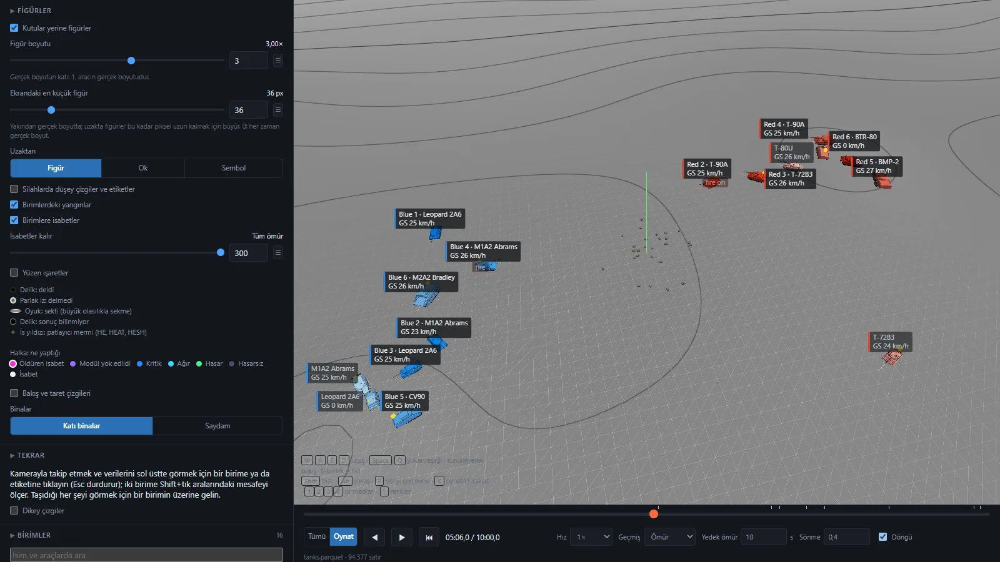
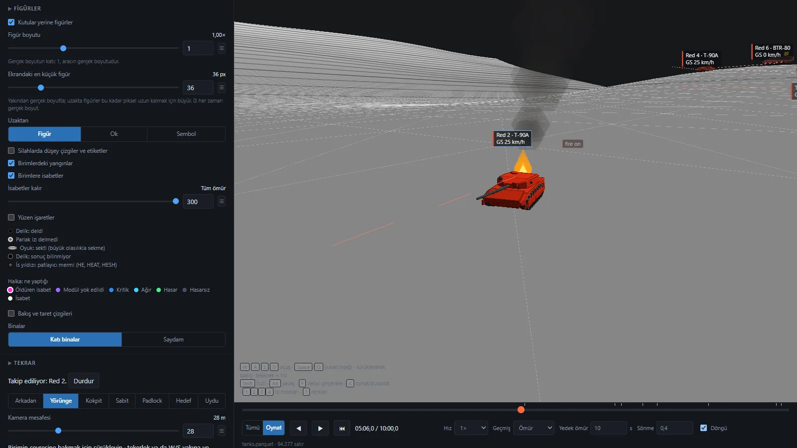
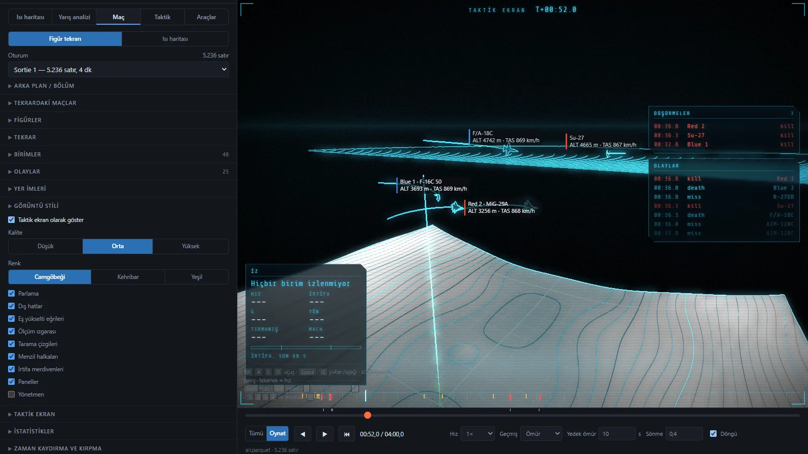

# Maç tekrarı

Tekrar, maçın her oyuncunun kullandığı şey olarak çizildiği bir filmdir. Bir çatışmayı yeniden izlemek, tek bir birimi takip etmek ve kimin kimi vurduğunu görmek için kullanın.

Atışlar, isabetler, ateşler ve enkazlar seviyedeki birimlerin ve hedeflerin üzerine çizilir. Kameralar, etiketler ve bir taktik ekran çatışmayı okumanıza yardım eder. Tacview'u biliyor musunuz? [Tacview eşdeğerliği](tacview-parity.md) araçlarının her birinin nerede olduğunu gösterir.

## Bir tekrar başlatın {#start-a-replay}

1. **Kaynak → Dosyalar…** ile ya da Kaynak panelinin üzerine bırakarak bir kayıt yükleyin (bir **kişi** ve bir **zaman** sütunu olan herhangi bir tablo, bir Tacview dosyası, dönüştürülmüş bir tekrar, bir [`.3dheat`](container.md) maçı). Bkz. [Veri alma](getting-data-in.md).
2. **Maç** sekmesini açın ve **Figür tekrarı**'nı seçin ya da Isı haritası sekmesinin mod çubuğunda **Figür bindirme**'yi seçin.
3. **Tekrardaki maçlar** altında bir maç seçin, hepsini bir kerede ya da birkaçını.
4. Zaman çizelgesinde **Oynat**'a basın (ya da `K`). Atlamak için zaman çizelgesini sürükleyin.

Adı ya da türü bilinen her birim için figürler kutuların yerini alır (bkz. [Figürler](figures.md)). Ad ya da tür sütunu olmayan veri asker olarak çizilir.

## Figürler {#figures}

| Ayar (**Figürler** bölümü) | Varsayılan | Ne yapar |
|---|---|---|
| **Kutular yerine figürler** | açık | Kapalıyken düz kutular çizer. |
| **Figür boyutu** (gerçek boyutun katı) | 1 | 1 gerçek boyuttur; 0,25 ile 20 kat arası (logaritmik ölçek). Uzaktan daha büyük olması yardımcı olur. |
| **Ekrandaki en küçük figür** | 36 px | Uzaktaki figürler bu kadar uzun kalmak için büyür, 0-200 px; 0 gerçek boyutu korur. |
| **Uzaktan**: Figür, Ok, Sembol | Figür | Uzaktaki bir birimin ne olacağı. |
| **Semboller** | NATO (APP-6) | NATO (APP-6), Rus taktik işaretleri, **Oyun haritası** simgeleri ya da **Yalnızca şekiller (renk körü dostu)**. |
| **Sembol boyutu**, **Benim tarafım**, **Düşman / Tarafsız**, **Yön çizgileri** | 28 px (12-64), otomatik, düşman, açık | Sembollerin görünümü ve hangi tarafın dost olduğu. |
| **Dikey çizgiler** | açık | Her birimden doğruca yere bir çizgi; böylece yükseklikler 3B'de okunur. |
| **Silahlarda düşey çizgiler ve etiketler** | kapalı | Füze ve bombalarda yere çizgiler ve etiketler. |
| **Birimlerdeki yangınlar** | açık | Bir birim tutuşmaya başladığı andan söndürülene kadar alevler. |
| **Birimlere isabetler** | açık | Atışların çarptığı yerlerdeki işaretler (aşağıda). **İsabetler kalır**: 1-300 saniye ya da **Tüm ömür**. **Yüzen işaretler**: yüzeyin üstünde çizilen işaretler. |
| **Bakış ve taret çizgileri** | kapalı | Kesikli: oyuncunun baktığı yer; düz: topun yönelttiği yer. |
| **Binalar** | düz | Düz ya da saydam binalar, seviye bunları boyadığında. |

### Uzaktaki semboller {#symbols-at-a-distance}

Bir birim **Ekrandaki en küçük figür**den daha küçük olacaksa, okunabilir kalan bir sembole dönüşebilir. Şekil türünü söyler (örneğin zırhlı için paletli işaretli yuvarlak bir kutu); renk tarafı söyler. Stili değiştirmek için **Semboller** menüsünü açın.

### İsabet işaretleri, enkazlar ve ateşler {#hit-marks-wrecks-and-fires}

- **İsabet işaretleri**, atışın karşılaştığı yüzeyde, figürün ölçeğinde durur. Görünümleri ne olduğunu söyler: bir delik (geçti), parlak bir sıçrama (geçmedi), bir oyuk (sektirdi), bir is yıldızı (patlayıcı mermi). Renkli bir halka ne yaptığını söyler: öldürücü atış, modül yok edildi, kritik, ağır, hasar, hasarsız, isabet. Turun adını görmek için bir işarete üzerine gelin.
- Yok edilmiş bir birim, ölümünden yeniden doğana ya da kaldırılana kadar bir enkaz olarak **kömürleşmiş** çizilir; sembolü üstü çizilidir.
- **Ateşler**, bir birim tutuşduğu andan söndürülene kadar onda yanar.
- **Taretler**, veri topun yöneldiği yeri söylediğinde oraya döner (ya da bu yoksa, oyuncunun baktığı yere).

### Silahlar, yem ve izler {#weapons-decoys-and-tracers}

**Silahlar, atışlar ve isabetler** açıkken (Takım görüntüleyici bölümü): füzeler, roketler, bombalar ve torpidolar kendi figürleriyle bir duman izi bırakarak uçar; kurşunlar ve mermiler izlerdir; çarpmalar ve patlamalar parlar. **Kesikli** çizilen bir iz, veride atış olmadığı için bir isabetten hesaplanmıştır. Fişekler ve paçavralar yem olarak çizilir; *Yem ve mermiler* işaretli değilse birim listesinden gizlenirler.

## Kameralar {#cameras}

Bir birime ya da etiketine tıklayarak onu **takip** edin; **Tekrar** bölümü **Arkadan**, **Yörünge**, **Kokpit** (baş üstü ekranla, `H`), **Sabit**, **Padlock**, **Hedef** ve **Uydu** sunar. `V` bunlar arasında döner, **Kamera mesafesi** ne kadar uzak olduğunu ayarlar. Esc durdurur.

- **İki birimli görünüm**: bir **Hedef** seçin (ya da bir birime Ctrl/Alt-tıklayın); takip edilen birimden ona bakın; **Değiştir** ikisini yer değiştirir.
- **Ölçü**: aralarındaki yönü, menzili ve yükseklik farkını görmek için iki birime Shift-tıklayın.
- **2B harita** (`M`): köşe ya da tam görünüm, izler ve adlarla.
- **Yer imleri** (`B`): anı ve kamerayı kaydedin; kaydın kendi öldürmeleri, ölümleri ve işaretleri de listelenir.
- **Olaylar**: zaman sırasına göre her olay; tıklamak oraya atlar. `Page Up` / `Page Down` olaylar arasında atlar; **Olayda duraklat** her birinde durdurur.

## Taktik ekran {#tactical-display}

**Taktik ekran** bölümü, hiçbir birim için değil, seçilmiş olanlar, hepsi ya da bir tür (uçak, kara, gemiler, silahlar) için şunları çizer: hız vektörleri ve önündeki yol, burun ve kaldırma çizgileri, radar konileri, kilitler, veri bağlantıları, angajman bölgeleri ve çizgileri, görüş hatları, oyuncuların baktığı yerler (görüş konileri), taret nişanı ve kaydedilen kamera.

### Görünüm stili {#display-style}

`T` (ya da **Taktik ekran olarak göster** düğmesi) görünümü bir radar ekranı stiline çevirir: parıltı, ana hatlar, kontur çizgileri, bir ölçüm ızgarası, tarama çizgileri, menzil halkaları, irtifa merdivenleri, öldürme ve olaylı paneller ve olaylara kendi kendine kamerayı taşıyan bir **Yönetmen**.

## Hedefler {#objectives}

Bir maç hedefleriyle birlikte geldiğinde, **Hedefler** bölümü bunları seviyenin üzerine çizer: ele geçirme bölgeleri (sahibi ve ele geçirme ilerlemesiyle), doğmalar, hava alanları, alanlar ve bombalama hedefleri, her katman açılıp kapanabilir, etiketlerle. Yerin altından görünürler. Birden çok oyun modu yüklüyken **Mod**, maçları moda göre süzer. Hedefler, kayıtların yanındaki bir dönüştürücü maç dosyasından ya da bir [`.3dheat`](container.md) kapsayıcısının içinden gelir.

## Etiketler ve istatistikler {#labels-and-statistics}

- **Etiketler**: tür başına kurallar (**Seçili**, **Uçaklar**, **Kara**, **Gemiler**, **Silahlar**, **YZ**): gösterilip gösterilmediği, hangi değerler ve etiketler üst üste bindiğinde yeri kimin alacağını belirleyen bir **Öncelik**. **Etiketleri ayrı tut**, bir etiket başka bir birimi kapatacaksa onu kendi birimi yanına taşır ve yer yoksa dışarıda bırakır. **Etiket boyutu** %60 ile %250 arasındadır. **Ad, araç, irtifa ve hıza geri dön** kuralları sıfırlar.
  - Kara birimleri ad, araç ve hızla başlar.
  - Uçaklar ad, araç, irtifa ve hızla başlar.
  - Gemiler ad, araç, hız ve yönle başlar.
  - Sahip olduğu her değeri görmek için bir birimin üzerine gelin.
- **İstatistikler**: takım ve birim başına: öldürmeler, ölümler, atışlar, isabetler, isabet oranı, kalkışlar, inişler, havada geçen süre, en yüksek hız, yükseklik ve G, mesafe. CSV dışa aktarma.
- **Grafikler**: bir birimin değerleri zaman içinde, iki birim karşılaştırılmış ya da bir değer diğerine karşı.

## Aynı anda çok sayıda maç {#many-matches-at-once}

Yüzlerce ya da binlerce maçı birbirinin üstüne koymak için bkz. [Aynı anda çok sayıda maç](many-matches.md). Figür ayrıntıları (duman, ateş, diğer zamanlı efektler): [Figür bindirmedeki figürler](figure-replay.md). Tacview özellik listesi: bu sayfanın alt sayfası olan [Tacview eşdeğerliği](tacview-parity.md).
