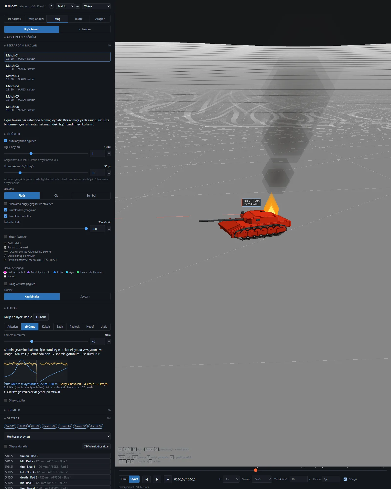
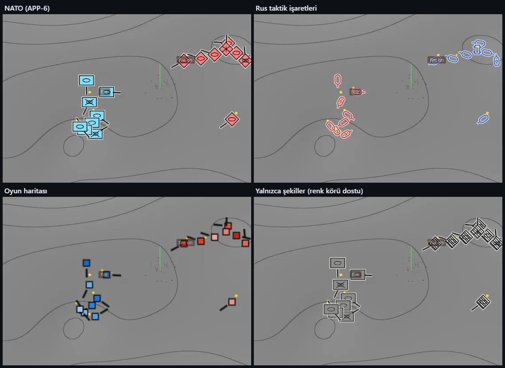
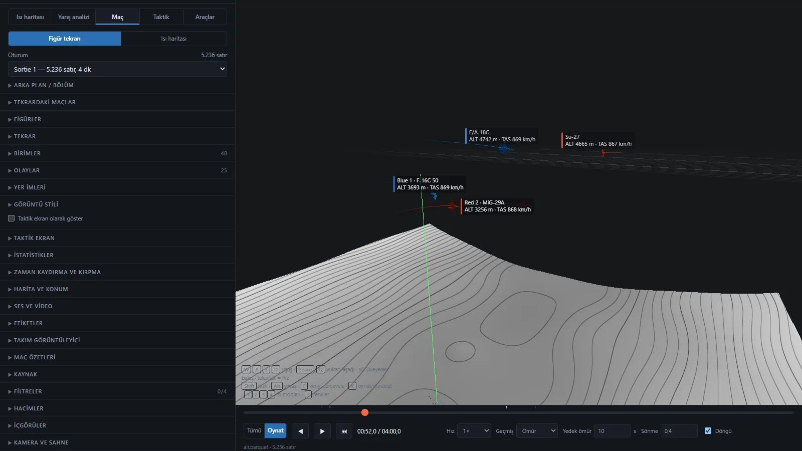

# Maç tekrarı

Tekrar, maçın bir filmidir ve her oyuncu kendi sürdüğü şeyle çizilir. Bir çatışmayı yeniden izlemek, tek bir birimi takip etmek ve kimin kimi vurduğunu görmek için kullanın.

Atışlar, isabetler, ateşlemeler ve enkazlar, seviyedeki birimlerin ve hedeflerin üzerine çizilir. Kameralar, etiketler ve taktik bir ekran, çatışmayı okumanıza yardım eder. Tacview'u biliyor musunuz? [Tacview uyumu](tacview-parity.md) sayfası, onun araçlarının her birinin nerede olduğunu gösterir.

## Tekrarı başlatın {#start-a-replay}

1. Bir kaydı **Kaynak → Dosyalar…** ile ya da Kaynak panelinin üzerine bırakarak yükleyin (**kişi** ve **zaman** sütunu olan herhangi bir tablo, bir Tacview dosyası, dönüştürülmüş bir tekrar, bir [`.3dheat`](container.md) maçı). Bkz. [Veri almak](getting-data-in.md).
2. **Maç** sekmesini açın ve **Figür tekrarı** seçin ya da Isı sekmesinin mod çubuğundan **Figür bindirme** seçin.
3. **Tekrardaki maçlar** altında bir maç, hepsi birden ya da birkaç maç seçin.
4. Zaman çizelgesinde **Oynat** düğmesine basın (ya da `K`). Zaman çizelgesini sürükleyerek atlayın.

Adı ya da türü bilinen her birim için figürler, kutuların yerini alır (bkz. [Figürler](figures.md)). Ad ya da tür sütunu olmayan veriler asker olarak çizilir.

## Figürler {#figures}

| Ayar (**Figürler** bölümü) | Varsayılan | Ne yapar |
|---|---|---|
| **Kutular yerine figürler** | açık | Kapalıyken düz kutular çizilir. |
| **Figür boyutu** (gerçek boyutun katı) | 1 | 1 gerçek boyuttur; 0,25 ile 20 kat arası (logaritmik ölçek). Uzaktan görmek için artırın. |
| **Ekrandaki en küçük figür** | 36 px | Uzaktaki figürler bu uzunluğa kadar büyür, 0 ile 200 px arası; 0 gerçek boyutu korur. |
| **Uzaktan**: Figür, Ok, Sembol | Figür | Uzaktaki bir birim neye dönüşür. |
| **Semboller** | NATO (APP-6) | NATO (APP-6), Rus taktik işaretleri, **Oyun haritası** simgeleri ya da **Yalnızca şekiller (renk körü dostu)**. |
| **Sembol boyutu**, **Benim tarafım**, **Düşman / Tarafsız**, **Yön çizgileri** | 28 px (12 ile 64), otomatik, düşman, açık | Semboller nasıl görünür ve hangi taraf dosttur. |
| **Dikey çizgiler** | açık | Her birimden yere doğru düz bir çizgi, böylece yükseklikler 3B'de okunur. |
| **Silahlarda düşey çizgiler ve etiketler** | kapalı | Füzelerde ve bombalarda yere çizgiler ve etiketler. |
| **Birimlerdeki yangınlar** | açık | Bir birim tutuşmaya başladığı andan söndürülene kadar alevler. |
| **Birimlere isabetler** | açık | Mermilerin nerede çarptığını gösterir (aşağıda). **İsabetler kalır**: 1 ile 300 saniye arası ya da **Tüm ömür**. **Yüzen işaretler**: yüzeyin üstünde çizilen işaretler. |
| **Bakış ve taret çizgileri** | kapalı | Kesikli: oyuncunun baktığı yer; düz: topun doğrultulduğu yer. |
| **Binalar** | katı | Seviye bunları çizdiğinde katı ya da saydam binalar. |

### Uzaktaki semboller {#symbols-at-a-distance}

Bir birim **Ekrandaki en küçük figür** değerinden daha küçük görüneceği zaman, okunabilir kalan bir sembole dönüşebilir. Şekil türü söyler (örneğin zırhlı araçlar için paletli bir işaretli yuvarlak kutu); renk tarafı söyler. Stili değiştirmek için **Semboller** menüsünü açın.

### İsabet işaretleri, enkazlar ve yangınlar {#hit-marks-wrecks-and-fires}

- **İsabet işaretleri**, atışın değdiği yüzeyde, figürün ölçeğinde durur. Görünüşleri neyin olduğunu söyler: bir delik (geçti), parlak bir sıçrama (geçemedi), bir oyuk (sekti), bir is yıldızı (patlayıcı mermi). Renkli bir halka ne yaptığını söyler: öldürücü atış, modül yok edildi, kritik, ağır, hasar, hasar yok, isabet. Adını görmek için bir işaretin üzerine gelin.
- Yok edilmiş bir birim, ölümünden yeniden doğana ya da kaldırılana kadar **yanmış** bir enkaz olarak çizilir; sembolü üstü çizilidir.
- **Yangınlar**, bir birim tutuştuğu andan söndürülene kadar üzerinde yanar.
- **Taretler**, veri topun nereye yöneldiğini gösterdiğinde oraya döner (ya da bu veri yoksa oyuncunun baktığı yere).

### Silahlar, yemler ve izleyiciler {#weapons-decoys-and-tracers}

**Silahlar, atışlar ve isabetler** açıkken (Takım izleyicisi bölümü): füzeler, roketler, bombalar ve torpidolar kendi figürleriyle, bir duman izi bırakarak uçar; mermiler ve obüsler izleyicidir; çarpmalar ve patlamalar parlar. Verinin atışı olmadığı için bir isabetten hesaplanan izleyici **kesikli** çizilir. Fişekler ve çaff yem olarak çizilir; *Yemler ve mermiler* işaretli değilse birim listesinde gizlenirler.

## Kameralar {#cameras}

Bir birime ya da etiketine tıklayarak onu **takip** edin; **Tekrar** bölümü **Arkadan**, **Yörünge**, **Kokpit** (baş üstü ekranla, `H`), **Sabit**, **Padlock**, **Hedef** ve **Uydu** sunar. `V` bunların arasında döner, **Kamera mesafesi** ne kadar uzak olacağını belirler. Esc takibi durdurur.

- **İki birimli görünüm**: takip edilen birimden bakmak için bir **Hedef** seçin (ya da bir birime Ctrl/Alt ile tıklayın); **Değiştir** ikisini yer değiştirir.
- **Ölçü**: iki birim arasındaki yönü, mesafeyi ve yükseklik farkını görmek için Shift ile iki birime tıklayın.
- **2B harita** (`M`): köşe ya da tam görünüm, izler ve adlarla.
- **Yer imleri** (`B`): anı ve kamerayı kaydeder; kaydın kendi öldürme, ölüm ve işaretleri de listelenir.
- **Olaylar**: zaman sırasına göre her olay; tıklamak oraya atlatır. `Page Up` / `Page Down` olaylar arasında atlar; **Olayda duraklat** her olayda durur.

## Taktik ekran {#tactical-display}

**Taktik ekran** bölümü, hiçbir birim için değil, seçilenler, hepsi ya da bir tür (uçaklar, kara, gemiler, silahlar) için şunları çizer: hız vektörleri ve önündeki yol, burun ve kaldırma çizgileri, radar konileri, kilitler, veri bağlantıları, angajman bölgeleri ve çizgileri, görüş çizgileri, oyuncuların baktığı yerler (görüş konileri), taret nişanı ve kaydedilen kamera.

### Görüntü stili {#display-style}

`T` (ya da **Taktik ekran olarak göster** düğmesi) görünümü radar ekranı stiline geçirir: parlama, ana hatlar, kontur çizgileri, bir ölçüm ızgarası, tarama çizgileri, menzil halkaları, irtifa merdivenleri, öldürme ve olay panelleri ve olayları kendiliğinden kameraya getiren bir **Yönetmen**.

## Hedefler {#objectives}

Bir maçla birlikte hedefler geldiğinde, **Hedefler** bölümü bunları seviyenin üzerine çizer: ele geçirme bölgeleri (sahip ve ele geçirme ilerlemesiyle), doğuş noktaları, havalimanları, alanlar ve bombalama hedefleri; her katman ayrı ayrı açılıp kapanabilir, etiketleriyle birlikte. Hedefler zemine saydam olarak görünür. Birden çok oyun modu yüklüyse **Mod** maçları moda göre süzer. Hedefler, kaydın yanındaki bir dönüştürücü maç dosyasından ya da bir [`.3dheat`](container.md) kapsayıcısının içinden gelir.

## Etiketler ve istatistikler {#labels-and-statistics}

- **Etiketler**: her tür için kurallar (**Seçili**, **Uçaklar**, **Kara**, **Gemiler**, **Silahlar**, **YZ**): gösterilip gösterilmeyeceği, hangi değerlerin gösterileceği ve etiketler üst üste geldiğinde alanı kimin alacağını belirleyen bir **Öncelik**. **Etiketleri ayrı tut**, bir etiketi üzerinde durduğu birime yan yana taşır ve yer olmadığında onu gizler. **Etiket boyutu** %60 ile 250 arasıdır. **Ad, araç, irtifa ve hıza geri dön** kuralları sıfırlar.
  - Kara birimleri ad, araç ve hız ile başlar.
  - Uçaklar ad, araç, irtifa ve hız ile başlar.
  - Gemiler ad, araç, hız ve yön ile başlar.
  - Bir birimin tüm değerlerini görmek için üzerine gelin.
- **İstatistikler**: takım ve birim başına öldürme, ölüm, atış, isabet, isabet oranı, kalkış, iniş, havada geçen süre, en yüksek hız, yükseklik ve G, mesafe. CSV dışa aktarma.
- **Grafikler**: bir birimin değerleri zamana göre, iki birim karşılaştırmalı ya da bir değer diğerine karşı.

## Aynı anda birçok maç {#many-matches-at-once}

Yüzlerce ya da binlerce maçı üst üste bindirmek için bkz. [Aynı anda birçok maç](many-matches.md). Figür ayrıntıları (duman, yangın ve diğer zamanlı efektler): [Figür bindirmede figürler](figure-replay.md). Tacview özellik listesi: [Tacview uyumu](tacview-parity.md), bu sayfanın alt sayfasıdır.
