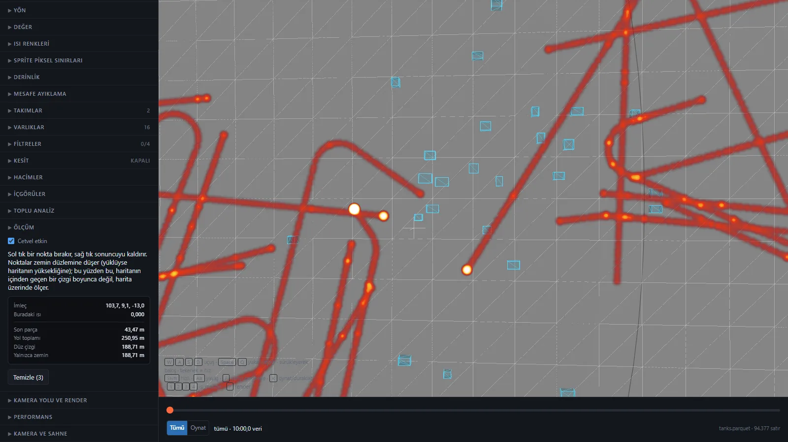

# Ölçü

**Ölçü**, fareyi bir cetvele çevirir ve imlecin altındaki noktanın ne kadar yoğun olduğunu söyler. İki yerin birbirine ne kadar uzak olduğunu ya da bir noktanın ne kadar trafik gördüğünü öğrenmek için kullanın.

## Deneyin {#try-it}

1. Kenar çubuğunda **Ölçü**'yü açın ve **Cetvel etkin** kutusunu işaretleyin.
2. Haritada üç yere sol tıklayın. Her tıklama bir nokta bırakır.
3. **Yol toplamı** (tüm yolun uzunluğu) ve **Son parça** (son bacak) değerlerini okuyun.
4. Son noktayı kaldırmak için sağ tıklayın ya da hepsini kaldırmak için **Temizle (3)**'e basın.

| Eylem | Etkisi |
|---|---|
| Sol tıklama | İmleç zemin düzlemine değdiği yerde bir nokta bırakır. Basış ve bırakış arasında 4 pikselden fazla hareket eden bir tıklama bir nokta değil, kamera sürüklemesidir. |
| Sağ tıklama | Son noktayı kaldırır. |
| Hareket | İmlecin konumu ve altındaki ısı canlı güncellenir. |

Cetvel açıkken kamera çalışmaya devam eder: sürükleme hâlâ etrafa bakar, tuşlar hâlâ uçurur. Cetvel açıkken her tıklamayı o alır; bu yüzden [tıklayarak seçme](camera.md#click-to-pick) kapatılana kadar bekler.

**Zemin düzlemi**, bir harita görseli yüklüyse [harita görselinin](map-images.md) yüksekliğidir; yoksa veri kümesinin en düşük Y'si (görsel yoksa 0). Noktalar buraya düşer; bu yüzden cetvel bir çizgi boyunca değil, harita üzerinden ölçer. 3B bir seviyeyle düzlem yine de veri kümesinin en düşük Y'sidir, seviyenin yüzeyi değildir. Gerçek yüzeydeki bir nokta için cetveli kapatın ve üzerine tıklayın ([tıklayarak seçme](camera.md#click-to-pick)); bu, koordinatları seviyenin kendi üçgenlerinden okur.

## Okumalar {#readouts}

| Satır | Anlamı |
|---|---|
| **İmleç** | İmlecin altındaki noktanın düzlemdeki dünya X, Y, Z değerleri. |
| **Buradaki ısı** | İmlecin piksellerindeki ısı miktarı. Büyük sayı, o noktada daha fazla trafik demektir. Doygunluk noktası bölmeden önce renk rampasına beslenen değerdir; bu yüzden [Doygunluk noktası](colour-and-exposure.md#saturation-point) ile karşılaştırabilirsiniz. |
| **Son parça** | Son noktadan imlece (ya da son iki nokta arasındaki) mesafe. |
| **Yol toplamı** | Her noktadan ve imleçten geçen çokgen çizginin uzunluğu. |
| **Düz çizgi** | İlk noktadan imlece (ya da son noktaya) 3B mesafe. |
| **Yalnızca zemin** | Aynısı, yalnızca X ve Z üzerinde. |
| **Temizle (N)** | Tüm noktaları kaldırır. |

Mesafeler 1 birimin altında santimetre, 1.000'in altında metre, üstünde kilometre olarak gösterilir; bir dünya biriminin bir metre olduğu varsayılır ([Eksenler, birimler ve zaman](axes-units-and-time.md#unit-scale)). Koordinatlar dünya koordinatlarıdır; bir eksen [görüntü için ters çevrilmiş](camera.md#invert-world-axis) olsa bile.

Noktalar ve aralarındaki çizgi, görünümde ızgara aralığına göre boyutlandırılmış bir katman olarak çizilir. Cetvelin noktaları görünümlerde kaydedilmez; başka veri yüklediğinizde de kalırlar.

## Geliştiriciler için {#for-developers}

**Buradaki ısı**, GPU'dan en fazla her 120 ms'de bir okunur; çünkü tek piksellik bir okuma boru hattını durdurur. `engine.readHeatProbe()` ile aynı yolu kullanır: kare yazıldığı kazançla bölünür; bu yüzden yarım kayan noktalı birikim yolunda (`?heat=f16`) 32 bitlik bir hedefle aynı birimlerdedir ([Yarım kayan noktalı birikim](half-float-accumulation.md)).
