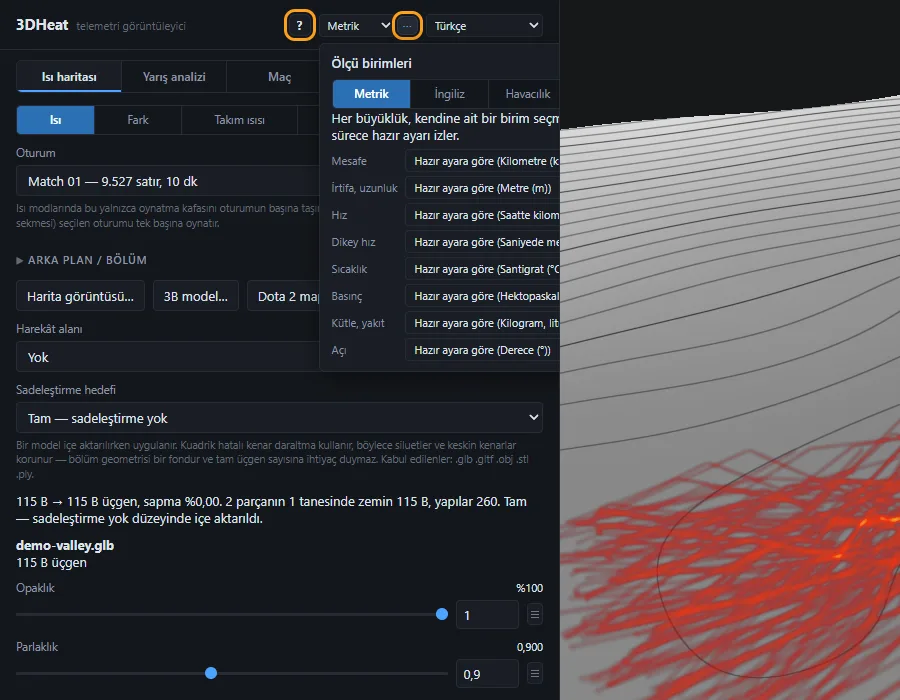
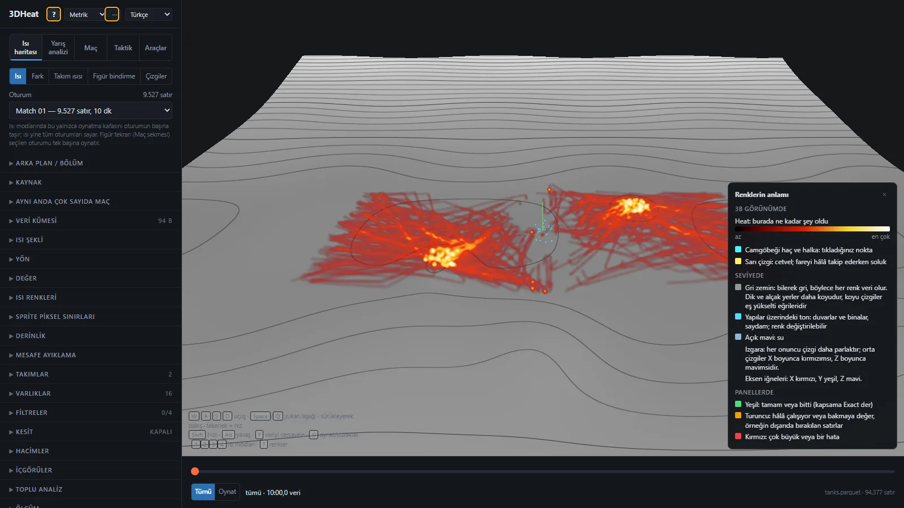
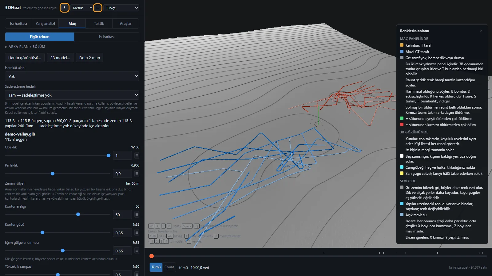

# Ayarlar, birimler ve tuşlar

Kenar çubuğunun üstündeki küçük denetimler, görüntüleyicinin sizinle nasıl konuştuğunu değiştirir: dil, birimler (metre ya da feet, km/sa ya da deniz mili) ve renkleri açıklayan bir yardım modu. Seçimleriniz tarayıcınızda hatırlanır.

## Üst bilgi {#the-header}

Kenar çubuğunun en üstünde:

| Denetim | Ne yapar |
|---|---|
| **?** | Yardım modu: her rengin ne anlama geldiği (ayrıca `?` ya da `F1`) |
| **Birimler** menüsü | Metrik, Imperial, Havacılık ya da Denizcilik |
| **Birimler** yanındaki **...** düğmesi | "Her büyüklük için bir birim seçin" penceresini açar: büyüklük başına bir açılır liste |
| **Dil** menüsü | Görüntüleyicinin dili: [40 dil](languages.md) ya da tarayıcınınki |

Bir kutuya yazdığınız sayılarda nokta ya da virgül kullanabilirsiniz (`0.35` ya da `0,35`). Görüntüleyici ikisini de okur ve sayıları görüntüleyicinin dilinin yazdığı biçimde gösterir.

## Birimler {#units}

1. **Birimler** menüsünde bir ön ayar seçin. Tüm büyüklükler birlikte değişir.
2. Yalnızca bir büyüklüğü değiştirmek için yanındaki **...** düğmesine tıklayın ve o büyüklük için bir birim seçin. Menü, ön ayardan sonra bir `*` gösterir.
3. Ayarlamadığınız bir büyüklük ön ayarı izler. Geri dönmek için "Ön ayara göre" seçin.

| Büyüklük | Metrik (varsayılan) | Imperial | Havacılık | Denizcilik |
|---|---|---|---|---|
| Mesafe | km | mi | NM | NM |
| Yükseklik, uzunluk | m | ft | ft | m |
| Hız | km/sa | mph | kt | kt |
| Dikey hız | m/sn | ft/dk | ft/dk | m/sn |
| Sıcaklık | °C | °F | °C | °C |
| Basınç | hPa | inHg | hPa | hPa |
| Kütle, yakıt | kg, l | lb, gal | lb, gal | t, m³ |
| Açı | derece | derece | derece | derece |

Tek bir büyüklük için seçebileceğiniz diğer birimler: mesafe km, mi, NM; hız km/sa, m/sn, kt, mph; dikey hız m/sn, ft/dk, m/dk; sıcaklık °C, °F, K; basınç hPa, inHg, mmHg, psi; kütle kg, lb, t; açı derece ya da NATO mil (çember başına 6400). Birimler görüntüleyicinin her yerinde aynıdır: etiketler, kartlar, grafikler, istatistikler.

## Yardım modu {#help-mode}

`?` ya da `F1` tuşuna basın ya da **?** düğmesine tıklayın. *Renklerin anlamı* gösterilir: 3B görünüm için açıklamalar, ısı rampaları, takım renkleri, seviyenin renkleri, panellerin durum renkleri, maç paneli ve yarış görünümü. Kapatana kadar açık kalır. Maç sekmesinde maç panelinin renklerini de açıklar.

## Tarayıcının hatırladıkları {#what-the-browser-remembers}

Bu ayarlar ziyaretler arasında tarayıcınızda saklanır (hiçbir yere gönderilmez):

- dil, birimler ve yardım modu;
- tekrar oynatmanın figür, sembol, etiket, kamera ve taktik görüntü ayarları;
- oynatma hızı ve aynalama;
- kayıt başına yer imleri, veri kümesi başına ses düzeyleri, hedef katmanları;
- harici yapay zekâ ayarları (anahtar yalnızca *Hatırla* kutusunu işaretlerseniz).

Isı ayarları, filtreler ve mod her yüklemede sıfırdan başlar. Tam ve üretilmiş liste: [Kayıtlı ayarlar](ref-settings-storage.md).

## Görüntüleyicinin tarayıcıdan tuttuğu tuşlar {#keys-the-viewer-keeps-from-the-browser}

Büyük verili bir oturumun yüklenmesi zaman alır, bu yüzden görüntüleyici tarayıcının onu yanlışlıkla atmasını engeller:

- Yazdıran, kaydeden, açan, yeniden yükleyen, kapatan ya da yeni pencere açan `Ctrl`/`Cmd` + harf tuşları metin kutuları dışında hiçbir şey yapmaz; `F1`, `F3`, `F5`, `F6` ve `F7` hiçbir şey yapmaz.
- Veri ya da seviye yüklüyken sekmeyi kapatmak ya da yeniden yüklemek önce sorar.
- Tam ekranda görüntüleyici kullandığı tuşları (W, T, N, S, R, P, Q, Esc) kilitler; böylece tarayıcı onları almaz.

Tam liste: [Tarayıcı tuşları](ref-browser-keys.md). Görüntüleyicinin kendi tüm tuşları: [Klavye ve fare başvurusu](keyboard-reference.md).
