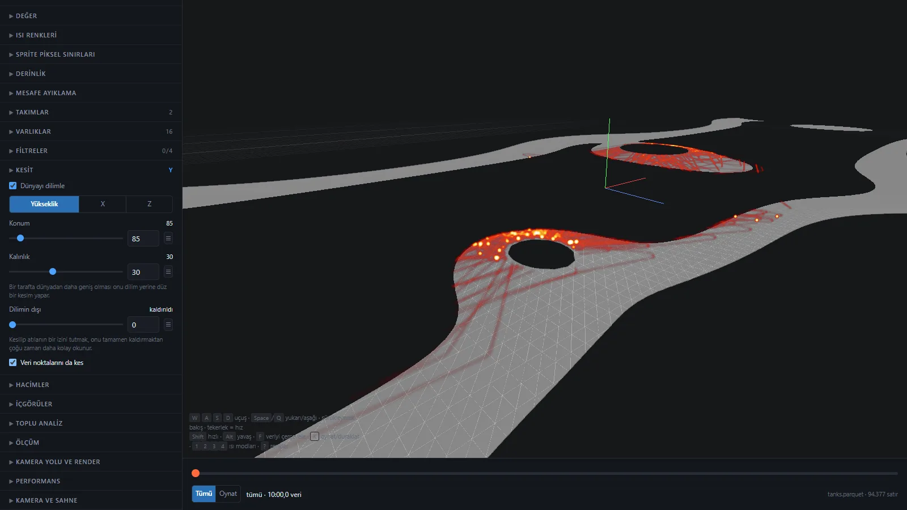

# Kesit

**Kesit**, dünyayı bir pasta dilimi gibi keser, böylece binaların içine bakabilirsiniz. Duvarlar ilginç ısıyı sakladığında kullanın; örneğin bir binanın tek bir katını görmek için.

## Deneyin {#try-it}

1. Bir seviye ve biraz veri yükleyin ve **Kesit**'i açın.
2. **Dünyayı dilimle**'yi işaretleyin. Eksen **Yükseklik**'tir.
3. **Konum**'u yukarı ve aşağı sürükleyin: dilim seviyenin içinden hareket eder.
4. Bir kat planı için **Kalınlık**'ı ince, "burada aşağıdaki her şey" için geniş yapın.
5. Kalanı kaldırmak için **Dilimin dışı**'nı 0'da tutun ya da soluk bir iz için yükseltin.



Dilim, **seviye geometrisini ve veri noktalarını birlikte** keser. Yalnızca seviyeyi kesmek, binanın eskiden durduğu yerde ısıyı havada bırakırdı. Bu, [derinlik örtmesinin](depth-and-culling.md) karşılığıdır: seviye arkasındakini doğru gizlediğinde, bir binanın içi de gizlenir. Panel, kesilecek bir şey olduğunda (bir veri kümesi ya da 3B bir seviye) gösterilir; başlığı açıkken eksenini, kapalıyken *kapalı* yazar.

```
yan görünüm       Konum = dilimin nerede olduğu
 ----------       Kalınlık = dilimin ne kadar yüksek olduğu
 | kat 3  |
 |=========|  <--- dilim (tutulur)
 | kat 2  |  <--- dışarıda: kaldırılır (ya da soluk)
 | kat 1  |
 ----------
```

## Denetimler {#controls}

| Denetim | Varsayılan | Anlamı |
|---|---|---|
| **Dünyayı dilimle** | kapalı | Dilimi açar. Konum hâlâ başlangıç değeri 0'da ve kalınlık başlangıç değeri 500'de iken açmak, ikisini eksenin ortasına ve açıklığının %15'ine taşır. |
| Eksen | **Yükseklik** | *Yükseklik* (Y), *X* ya da *Z*. Ekseni değiştirmek dilimi yeni eksenin ortasına taşır. |
| **Konum** | orta | Dilimin merkezi, dünya birimleri cinsinden, eksenin açıklığı boyunca (500 adım). |
| **Kalınlık** | açıklığın %15'i | Açıklığın 1/500'ünden açıklığın iki katına kadar, logaritmik adımlarla. Açıklık kadar genişleyince *dünyanın ötesi* okunur: bir taraf dünyanın ötesine uzanır ve bu bir dilim olmaktan çıkıp düz bir kesime dönüşür. |
| **Dilimin dışı** | 0, *kaldırılmış* | Dışarıda kalan şeylerden ne kadarının görünür kalacağı, %0-100. Kesilip atılan şeyin soluk bir izi, tamamen kaldırmaktan çoğu zaman daha kolay okunur. |
| **Veri noktalarını da kes** | açık | Kapalıyken ısı bütün kalır ve kesitten görünür; dilimin üstünde ve altında ne olduğunu görmek için kullanışlıdır. |

Bir eksenin açıklığı, bir 3B seviye yüklüyse o seviyenin, yoksa veri kümesinin açıklığıdır.

Kesit, [uzaklık eleme](depth-and-culling.md#distance-culling) ile bağımsızdır; bu, bir dünya ekseni yerine görüş yönü boyunca keser; ikisi birleşir. Herhangi bir kesit ayarındaki değişiklik ısı birikimini yeniden başlatır.

## Geliştiriciler için {#for-developers}

Dilim, köşe gölgelendiricide her satırın dünya konumunda sınanır: dışarıdaki bir satırın katkısı *Dışarı* değeriyle çarpılır, yani 0'da hiçbir parça çizilmeden reddedilir. Seviye gölgelendiricileri aynı sınamayı zeminin, yapıların ve suyun her parçasına uygular.
