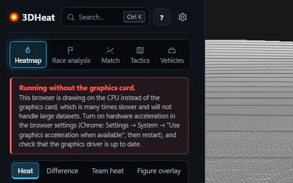

# Yazılımsal çizim algılama

Tarayıcınız grafik kartı yerine ana işlemci üzerinde çiziyorsa görüntüleyici birkaç kat yavaş olur. Görüntüleyici bunu fark eder ve neyi açmanız gerektiğini söyleyen kırmızı bir kutu gösterir.

Bir tarayıcının donanım hızlandırması kapalıysa ya da sürücüsü kara listedeyse, WebGL ve WebGPU'yu işlemci üzerinde çizer. Her şey hâlâ çalışır, yalnızca birkaç kat yavaş olarak; ve deneyim "bu görüntüleyici benim verimle kullanılamayacak kadar yavaş" biçiminde olur. Bu bir belirtidir ve tarayıcıdaki bir anahtar değil, aracı işaret eder. Bu yüzden görüntüleyici oluşturucunun adına bakar ve bunu söyler ([`gpuClass.ts`](https://github.com/Holdi601/3DHeat/blob/main/src/render/gpuClass.ts)).

## Uyarı şeridi {#the-banner}

Oluşturucu kesin olarak yazılım olarak tanımlandığında, kenar çubuğunun en üstünde, mod çubuğunun üstünde kırmızı bir kutu belirir (Isı haritası ve Maç sekmeleri):

> **Running without the graphics card.**
> This browser is drawing on the CPU instead of the graphics card, which is many times slower and will not handle large datasets. Turn on hardware acceleration in the browser settings (Chrome: Settings → System → "Use graphics acceleration when available", then restart), and check that the graphics driver is up to date.

Uyarı metni, görüntüleyicinin İngilizce olarak gösterdiği haliyle korunur.

## Geliştiriciler için {#for-developers}

### Nasıl karar verir {#how-it-decides}

Oluşturucu dizgisi (WebGL2'nin `UNMASKED_RENDERER_WEBGL` değeri ya da WebGPU'nun adaptör satıcısı, mimarisi ve aygıtı) küçük harfe çevrilir ve sınıflandırılır:

- `swiftshader`, `llvmpipe`, `softpipe`, `swrast`, `microsoft basic render driver`, `apple software renderer` ya da `generic renderer` içeriyorsa **yazılım**;
- bilinen bir GPU satıcısı ya da ailesi (`nvidia`, `geforce`, `rtx`, `quadro`, `amd`, `radeon`, `intel`, `arc`, `apple m`, `adreno`, `mali`, `powervr`, `xclipse`) içeriyorsa **donanım**;
- aksi halde **bilinmeyen**.

Yalnızca *yazılım* uyarı şeridini gösterir. Tanınmayan bir adaptör hiçbir şey söylemez: çalışan bir GPU'su olan birini tarayıcısını yeniden yapılandırmaya göndermek, bir durumu kaçırmaktan daha kötü bir hatadır.

### Kısa ad {#the-short-name}

Aynı modül oluşturucu dizgisini gösterim için kısaltır: `ANGLE (Vendor, Vendor Model (0x0000ABCD) Direct3D11 vs_5_0 ps_5_0, D3D11)` gibi bir ANGLE dizgisinden aygıt alanını tutar, PCI kimliğini ve sondaki API ile gölgelendirici modelini atar ve `Vendor Model` gösterir. Kısa ad **Kaynak bütçeleri** içinde görünür; tam dizgi ipucu olarak gösterilir; bellek tahmini tam dizgiyi gösterir.
