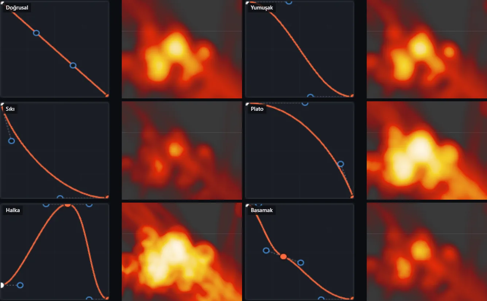

# Sprite şekli

Her satır, her zaman kameraya bakan yuvarlak bir sprite olarak çizilir. Boyutu ve merkezinden kenarına kadar olan profili - **rampa** - bir sıcak noktanın sıkı bir nokta mı, yumuşak bir bulut mu, bir disk mi ya da bir halka mı göründüğünü belirler. Bu denetimler kenar çubuğunun **Isı şekli** ve **Sprite piksel sınırları** bölümlerindedir ve [Isı](heat.md), [Fark](difference.md), [Takım ısısı](team-heat.md) için ve bir çizginin yarı genişliği olarak [Çizgi ısısı](line-heat.md) için geçerlidir.

Bunlardan herhangi birini değiştirmek birikimi yeniden başlatır (alanın yeni şekille yeniden çizilmesi gerekir).

Her noktayı yumuşak bir ışık lekesi gibi düşünün. Küçük bir leke tek tek noktaları gösterir; büyük bir leke komşuları bir bulutta birleştirir. Şekil, kenarın ne kadar yumuşak olacağını belirler.



## Sprite yarıçapı {#sprite-radius}

Spritein **dünya birimi** cinsinden yarıçapı (metre olarak etiketlenir). Varsayılan 6'dır ve her yüklemede verinin yatay genişliği / 120 olarak ayarlanır - bir yoldaki komşu örnekler, ince bir çizgi gibi okunmak yerine bir banda birleşecek kadar büyük. Logaritmik kaydırıcı 0,05-2000 arasındadır, tutamaç 50.000'e kadar sürüklenebilir.


Uzaktaki şeyler daha küçük görünür, bu yüzden bir sprite mesafeyle ekranda küçülür. Paralel projeksiyonda her yerde aynıdır; paralel görünümün sıcak noktaları karşılaştırmak için doğru görünüm olmasının nedenlerinden biri budur ([Kamera](camera.md#projection)).

## Piksel sınırları {#pixel-clamps}

**Sprite piksel sınırları** (varsayılan olarak kapalı), yukarıdaki dönüşümden sonra ekrandaki yarıçapı sınırlar.

| Denetim | Varsayılan | Aralık (kaydırma) | Neden |
|---|---|---|---|
| **En küçük piksel yarıçapı** | 1 px | 0-16 (512) | Uzaktaki verilerin bir pikselin altında kaybolmasını önler. |
| **En büyük piksel yarıçapı** | 96 px | 2-1024, logaritmik (8192) | Aşırı çizim koruması. N piksel kaplayan bir sprite N karıştırma işlemine mal olur; bu yüzden kameraya yakın sınırsız bir yarıçap, hızlı bir kareyi yavaş bir kareye çevirir. Görüntü alanı yüksekliğini aştığında artık hiçbir şeyi sınırlamaz. |

**Her yakınlaştırmada aynı yoğunluk** (Isı şekli bölümünde, varsayılan açık) sınırlarla birlikte çalışır. Bir sınırın büyüttüğü (uzakta) ya da küçülttüğü (yakında) bir sprite, gerçek boyutunun ekleyeceği ısıyı korur; böylece bir renk, her yakınlaştırmada zemin alanı başına aynı satır sayısı anlamına gelir. Kapalıyken sınırlanmış bir sprite, sınırlanmış boyutunda tam ağırlığını ekler ve siz uçup yaklaştıkça resim değişir.

## Merkez ve kenar şiddeti {#centre-and-edge-intensity}

Bir spritein tam merkezine (**Merkez şiddeti**, varsayılan 1, 0-10, kaydırma 1000) ve kenarına (**Kenar şiddeti**, varsayılan 0, -2-10, kaydırma 1000) eklediği ısı. Rampa değeri *t* (merkezde 1, kenarda 0; azalma ya da aşağıdaki eğriyle şekillenir), bu ikisi arasında karışır (formül [Geliştiriciler için](#for-developers) bölümünde).

**Negatif kenar şiddeti**, kenarın çıkarma yapmasını sağlar; bu, her sıcak noktanın etrafında serin bir hale oyar ve kümeleri birbirine karşı keskinleştirir. Görünürlük [okluzyonu](depth-and-culling.md) ve [dilimi](slice.md) içerir; solma [Ömür](timeline.md#history) solmasıdır; işaret, [Fark](difference.md) modunda ±1'dir.

## Rampa şekli: Azalma ya da Eğri {#ramp-shape-falloff-or-curve}

**Rampa şekli**, *t* değerini sprite boyunca şekillendirmenin iki yolu arasında geçiş yapar. *d*, merkezden (0) kenara (1) olan uzaklık olmak üzere:

### Azalma {#falloff}

*Azalma* seçiliyken gösterilir (varsayılan).

- **Azalma** (varsayılan 1,6, 0,1-8, kaydırma 64): `t = (1 - d) ^ azalma`. 1 düz bir doğrusal rampadır; daha yüksek değerler ısıyı merkeze çeker ve sıcak noktayı sıkılaştırır; 1'in altı onu bir diske düzleştirir.
- **Yumuşak rampa** (varsayılan açık): *t* değerine bir smoothstep S eğrisi uygular; böylece sprite, görünür bir kenarda bitmek yerine kenarında yavaşça solar.

### Eğri düzenleyici {#the-curve-editor}

*Eğri* seçiliyken gösterilir. Bir spritein kelimenin tam anlamıyla kesiti: merkezden olan uzaklık (sol tarafta *merkez*, sağ tarafta *kenar*), yukarı doğru ısı. Eğri, her biri iki tutamaca sahip kontrol noktalarından geçen parçalı bir kübik Bézier'dir.

| Eylem | Etkisi |
|---|---|
| Grafikte çift tıklama | O uzaklıkta bir nokta ekler (0,02 ile 0,98 arasında tutulur), eğrinin üzerinde ve oradaki eğimiyle; bu yüzden onu sürükleyene kadar hiçbir şeyi değiştirmez. |
| Bir noktayı sürükleme | Onu taşır. Yükseklikler 0 ile 1 arasında tutulur. |
| Küçük bir daireyi sürükleme | Yanındaki parçayı büker (o tutamacı taşır). |
| Bir noktaya Alt-tıklama ya da sağ tıklama | Onu kaldırır. İki uç nokta kaldırılamaz. |
| Bir hazır ayar düğmesi | Eğriyi hazır ayarla değiştirir. |

Uç noktalar merkez ve kenarda sabittir; yükseklikleri yine sizin seçiminizdedir.

**Hazır ayarlar** ([`curve.ts`](https://github.com/Holdi601/3DHeat/blob/main/src/state/curve.ts)):

| Hazır ayar | Şekil | Kullanım |
|---|---|---|
| **Doğrusal** | 1'den 0'a düz | *Yumuşak rampa* kapalıyken *Azalma* 1 ile aynı. |
| **Yumuşak** | S eğrisi | Varsayılan eğri; azalma 1'de *Yumuşak rampa*'nın verdiği şey. |
| **Sıkı** | Dik bir çekirdek, uzun ve soluk bir etek | Seyrek veri. |
| **Plato** | Düz, sonra hızlı bir düşüş | Bir leke yerine disk gibi okunur. |
| **Halka** | Merkezde 0,15, yarıçapın %62'sinde 1, kenarda 0 | İçi boş sprite: durdukları yerden değil, yolların geçtiği yerleri gösterir. |
| **Basamak** | İki aşamalı azalma, %35'te 0,45 | Yoğun bir çekirdeği çevresinden ayırır. |

## Zemin düzlemine yasla {#flatten-onto-ground-plane}

**Zemin düzlemine yasla** (varsayılan kapalı), her satırın yüksekliğini yok sayar ve tüm ısıyı tek bir yükseklikte - verinin en düşük Y değeri - çizer; klasik 2B harita ısı haritasıdır. Açıkken, derinlik okluzyonu ve *Arazinin arkasını gizle* kapanır (her nokta, test edildiği yüzeyin tam üzerinde oturur) ve Derinlik bölümü bunu söyler.

## Geliştiriciler için {#for-developers}

### Formüller {#formulas}

Piksel cinsinden ekrandaki yarıçap: `radius × P[1][1] / w × viewport height / 2`; burada `P` projeksiyon matrisi ve `w` noktanın görüş derinliğidir.

Bir spritein eklediği ısı:

```
heat added = mix(edge, centre, t) × sample weight × sign × fade × visibility
```

### Eğri {#the-curve}

Tutamaçlar yatay olarak kendi parçalarına sıkıştırılır; böylece eğri her zaman bir uzaklık fonksiyonudur: bir tutamacı bir sonraki noktanın çok ötesine sürüklemek, eğriyi geri katlamak yerine ona karşı yassılaştırır. Eğriyi geri katlamak, sonucu bir çözücünün tesadüfen bulduğu köke bağımlı kılardı.

### Eğrinin çizimi {#how-the-curve-is-drawn}

Eğri her değiştiğinde 256 girdilik bir tabloya dönüştürülür, 16 bit kayan noktalı bir doku olarak yüklenir ve her fragmentte doğrusal filtreleme ve yarım texel içeri alma ile örneklenir; böylece iki uç da tam kalır. Bir Bézier'i x için çözmek yineleme gerektirir; bu, programın en sıcak shader'ında yeri olmayan bir iştir; ayrıca bir tablo okuması, azalmanın kullandığı `pow()`'dan daha ucuzdur. 8 bit yerine 16 bit, binlerce sprite toplandığında 8 bitin bant oluşturmasını önlemek içindir; 16 bitlik yarım kayan nokta, çekirdek WebGL2'de filtrelenebilirdir, oysa 32 bit bir uzantı gerektirir.
