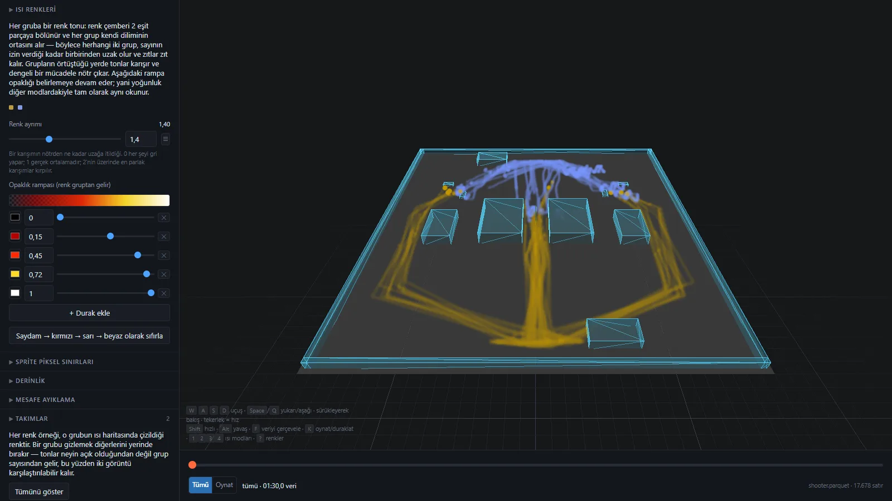

# Takım ısısı

Takım ısısı her takımın nerede olduğunu gösterir, her takım kendi renginde. Takımlar üst üste geldiğinde renkler karışır.

**Takım ısısı** (tuş 3), her [grubun](glossary.md) kendi tonu verilmiş [Isı'nın](heat.md) yoğunluk alanıdır. Gruplar üst üste geldiğinde tonları karışır; eşit bir mücadele nötr çıkar. Opaklık diğer modlardaki gibi yoğunluğu aynen taşır, böylece resim *ne kadar* ve *kimin* sorularını aynı anda yanıtlar. Bir grup sütunu gerektirir.

[Figür bindirme](box-replay.md) değildir: o kişi başına bir figür çizer; bu ise aynı sütunla renklendirilmiş bir ısı alanıdır.

## Nasıl kullanılır {#how-to-use-it}

1. `3` tuşuna basın (ya da mod çubuğunda **Takım ısısı**'nı seçin).
2. **Isı renkleri**'ni açın. Renk örnekleri her grubun rengini gösterir; takım adı için bir örneğin üzerine gelin.
3. Her şey griye çalıyorsa **Renk ayrımı**'nı artırın.
4. Dışarı çıkarmak için [Takımlar listesinde](teams-list.md) bir grubun işaretini kaldırın; diğer grupların renkleri olduğu yerde kalır.

## Denetimler {#controls}

**Isı renkleri** bölümünde:

| Denetim | Varsayılan | Anlamı |
|---|---|---|
| Renk örnekleri | | İlk 12 grubun her birinin rengi, sonra *+N daha*. Grup adı ve rengi için üzerine gelin. |
| **Renk ayrımı** | 1,4 | Bir karışımın nötrden ne kadar uzağa itildiği, 0-4. 0 her şeyi gri yapar; 1 gerçek ortalamadır; yaklaşık 2'nin üstünde en parlak karışımlar görüntülenebilir aralığın dışına çıkar ve kanal başına kırpılır, bu da tonlarını kaydırır. |
| **Opaklık rampası (renk gruptan gelir)** | ısı rampasının varsayılanı | Burada yalnızca rampanın **alfası** kullanılır: hiçbir şeyin olmadığı yerde saydam, en üstte opak. Renkleri yok sayılır. |

Diğer tüm ısı denetimleri - şekil, doygunluk, tepki, en az ısı, derinlik, eleme - [Isı](heat.md) sayfasındaki gibi çalışır.

[Takımlar listesi](teams-list.md) bu modda her grubun takım ısısı rengini kendi örneği olarak gösterir. Bir grubu gizlemek, diğer her grubun rengini olduğu yerde bırakır: tonlar açık olanlardan değil, toplam grup sayısından gelir; böylece iki resim karşılaştırılabilir kalır.

## Palet {#the-palette}

[`colors.ts`](https://github.com/Holdi601/3DHeat/blob/main/src/render/colors.ts) dosyasından:

- Renkler, sabit bir parlaklıkta (0,7) ve kromada (0,115) **Oklab** renk düzleminde yaşar; böylece her grup eşit parlaktadır ve kırmızı bir grup maviden daha sıcak görünmez.
- *n* grup ile ton çemberi *n* eşit parçaya bölünür ve *i*. grup parçasının **merkezini** alır, `(i + 0,5) / n` tur. Herhangi iki grup sayının izin verdiği kadar uzaktadır ve zıtlar, sayı ne olursa olsun zıt kalır.
- En fazla **16** ayrı ton kullanılır. Daha fazla grup olduğunda kimlikler tekrarlı yarılama ile yerleştirilir (bit ters çevrilmiş kimlikler: 0, ½, ¼, ¾, ⅛, …); böylece komşu kimlikler aynı tonu paylaşmaz; 16'nın üstündeki gruplar zorunlu olarak paylaşır.
- Etiketi "grup yok" anlamına gelen bir grup - `0`, boş, `none`, `unknown`, `null` ya da `-1`, büyük küçük harf duyarsız - çemberden bir dilim almak yerine **nötr gri** çizilir. Grup listesindeki bu tür ilk etiket yalnızca bu şekilde ele alınır.

Varsayılan ayrım 1 değil 1,4'tür, çünkü 1'de beş eşit aralıklı tonun karışımı *gridir*: doğru ama okunamaz. 1'in biraz üstü eşitlikleri dürüst tutarken %60/40'lık bir ayrımı görünür kılar.

## Nasıl çalışır {#how-it-works}

Bu modda ısı hedefinin dört kanalı vardır. Her sprite yoğunluğu *v*'yi birinci kanala, *v* × grubun Oklab *a* ve *b* koordinatlarını ikinci ve üçüncü kanallara ekler. Bileşimde pikselin karışımı yoğunlukla ağırlıklandırılmış ortalamadır: *a* = G / R, *b* = B / R, renk ayrımıyla ölçeklenir ve paletin parlaklığında sRGB'ye çevrilir. Birikmiş yoğunluğa bölmek, tonu ne kadar veri olduğundan bağımsız tutar ve her yoğunluk denetiminin neden yalnızca opaklığa etki ettiğinin nedenidir.

Dört kanallı hedef, aynı çözünürlükte tek kanallı ısı hedefinin GPU belleğinin dört katına mal olur.
