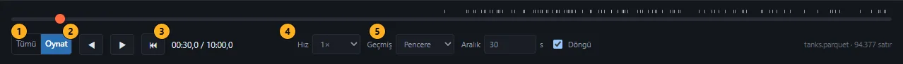

# Zaman çizelgesi ve oynatma

Resmin altındaki çubuk bir video oynatıcısına benzer: verileri bir film gibi oynatabilir, duraklatabilir, atlayabilir ve hızı değiştirebilirsiniz.

Görünümün altındaki çubuk zaman çizelgesidir ([`Timeline.tsx`](https://github.com/Holdi601/3DHeat/blob/main/src/ui/Timeline.tsx)). Her an hangi satırların görünür olduğuna karar verir. Bir zaman sütunu gerektirir; yoksa çubuğun tamamı devre dışı kalır, görünüm **Tümü**'nde kalır ve kenar çubuğu *Bu veride zaman sütunu yok — zaman çizelgesi devre dışı ve tüm veri noktaları aynı anda gösteriliyor.* der.

## Tümü ve Oynat {#all-and-play}

İki üst düzey mod vardır, çünkü farklı soruları yanıtlarlar.

- **Tümü** (her yüklemede varsayılan) oynatma kafasını tamamen yok sayar ve süzgeçlerden geçen her satırı gösterir. "Bu nerede oluyor" görünümüdür; sona sürüklemekle aynı değildir. Kaydırıcı devre dışıdır ve saat `tümü ·  veri` okur.
- **Oynat** veriyi bir zaman hızlandırmalı film olarak çalıştırır. Kaydırıcı, aktarım ve geçmiş ayarları görünür.

**Tümü**'nü seçmek oynatmayı da durdurur.

## Denetimler {#the-controls}

| Denetim | Varsayılan | Anlamı |
|---|---|---|
| Kaydırıcı | başlangıç | Oynatma kafası. Aramak için sürükleyin; aralık boyunca 20.000 adım. |
| **Tümü** / **Oynat** | Tümü | Yukarıya bakın. |
| ▶ / ❚❚ | duraklatılmış | Oynat ya da duraklat; ayrıca `K`. |
| ◀ **Geriye oynat (J)** | | Veriyi tersine oynatır. Yalnızca **Figür bindirme** modunda gösterilir; `J` tuşu orada da çalışır (bkz. [Klavye](#keyboard)). |
| ⏮ | | Aralığın başına döner. |
| Saat | | `geçen / toplam` biçiminde `mm:ss.s` (ya da `h:mm:ss`) ve zaman sütunu mutlak bir zaman damgasıysa, oynatma kafasının duvar saatindeki günün saati `HH:MM:SSZ` (UTC) olarak. |
| **Hız** | 1× | Gerçek her saniyede veri saniyesi. Menüde 0,01×'ten 1800×'e kadar 17 adım vardır (0,01, 0,02, 0,05, 0,1, 0,25, 0,5, 1, 2, 4, 8, 16, 32, 64, 128, 256, 600, 1800), bir de **Özel…**: 0,001×'ten 3600×'e kadar herhangi bir hız yazın (örneğin 0,3 ya da 12) ve Enter'a basın; Esc mevcut hızı korur. Son hız bir sonraki ziyarette hatırlanır (bkz. [Kayıtlı ayarlar](ref-settings-storage.md)). |
| **Geçmiş** | Kümülatif | Oynatma kafasında neyin görünür sayıldığı: *Kümülatif*, *Pencere* ya da *Ömür* (aşağıda). |
| **Aralık** (Pencere; Çizgiler modunda ayrıca Ömür) | 30 sn | Oynatma kafasında biten pencerenin uzunluğu; en az 0,01 sn. [Çizgi ısısında](line-heat.md#playback) bu, kuyruğun uzunluğudur. |
| **Yedek ömür** (yalnızca Ömür, Çizgiler modunda değil) | 10 sn | Kişisinin bir sonraki örneği olmayan bir veri noktasının ne kadar görünür kaldığı. |
| **Sönme** (yalnızca Ömür, Çizgiler modunda değil) | 0,4 | Her veri noktasının ömrünün, 0-1 arasında, sönmeye harcanan kesri. |
| **Döngü** | açık | Sonunda yeniden başlar; kapalıyken sonunda durur. |
| Sağ taraf | | Veri kümesinin adı. |

**Aralık**, veri kümesinin zaman aralığıdır - ya da bir oturum seçiliyken [figür bindirmede](box-replay.md), o oturumun aralığıdır.

## Geçmiş {#history}

Oynat modunda:

- **Kümülatif** - aralığın başından oynatma kafasına kadar her şey. Oynadıkça ısı birikir.
- **Pencere** - oynatma kafasında biten sabit uzunlukta bir geçmiş (*Aralık*).
- **Ömür** - her veri noktası, **aynı kişinin bir sonraki örneğine** (aynı oturumda) kadar yaşar; böylece her an kişi başına tam olarak bir konum geçerlidir. Bir daha hiç görünmeyen bir veri noktası - bir ölüm, bir bağlantı kesilmesi, günlüğün sonu - bir sonraki örneğe sahip olmaz ve anında kaybolmak ya da sonsuza dek kalmak yerine *Yedek ömür* kadar yaşar. Veri noktaları, ömrünün son *Sönme* kesrinde ani kaybolmak yerine **söner**: kişi başına bir örnek canlıyken, bir veri noktasının bir kareden diğerine kaybolması tüm alanın örnekleme hızında titremesine yol açar. *Sönme* 0 sert kesmeyi geri getirir.

Ömür, zaman sütununun yanında bir kişi sütunu da gerektirir; yoksa geçmiş yüklemede Kümülatif'e döner. [Çizgi ısısında](line-heat.md#playback) geçmiş, bir yolun kuyruğunun ne kadar görünür kalacağını belirler; [figür bindirmede](box-replay.md) *Yedek ömür*, başka örneği olmayan bir kişinin ne kadar tutulacağıdır.

## Oynatma davranışı {#playback-behaviour}

Kare döngüsünden ([`engine.ts`](https://github.com/Holdi601/3DHeat/blob/main/src/render/engine.ts)):

- Oynatma kafası *kare süresi × hız* kadar ilerler. Kare süresi 0,1 sn ile sınırlıdır; böylece sekme değiştirmek oynatma kafasını ışınlamaz.
- Aralığın tam sonunda oynat'a basmak bir medya oynatıcısı gibi baştan başlar. Her yüklemede oynatma kafası başta park edilir, bu yüzden oynat'a ilk basış oynatır.
- Aralığın sonunda oynatma kafası başa atlar (Döngü açık) ya da orada durur ve oynatma biter (Döngü kapalı).
- Kaydırıcı, motorun oynatma kafasını her karede doğrudan okur; uygulama durumu aramalarda, başlatmalarda, durdurmalarda ve döngülerde güncellenir.
- Oturum seçiciden bir oturum seçmek, o oturumun başlangıcına gider.

## Oynatma neden pürüzsüz ve ucuz {#why-playback-is-smooth-and-cheap}

Satırlar zamana göre sıralı saklanır; bu yüzden bir zaman penceresi, zaman sütunu üzerinde iki ikili aramadır: oynatma kafasını ilerletmek iki tamsayıyı taşır ve hiçbir satıra dokunmaz; oynatma maliyeti veri kümesinin boyutuna değil, penceredeki satır sayısına bağlıdır.

Pencere hareket ederken ısının nasıl sabit tutulduğu geçmişe bağlıdır ([Birikim](accumulation.md)):

- **Kümülatif** yalnızca büyür; bu yüzden her kare, son kareden bu yana görünür olan satırları tam ağırlıkla ekler. Alan tek yönlü olarak birikir ve duraklatmak hiçbir şeyi değiştirmez, çünkü gelecek bir şey kalmamıştır. (Bunun yerine yeniden tahmin etmek, her karenin farklı bir rastgele alt kümeyi yakıp sonra söndürmesi anlamına gelirdi; bu da parlayıp kaybolan patlamalar gibi görünürdü.)
- **Pencere** ve **Ömür** gerçekten her karede değişir ve yeniden tahmin edilir; üssel hareketli ortalama olarak harmanlanır (yeni kare için ağırlık 0,34), bu kararlı durumda yansız ve baştan başlamaktan çok daha sakindir.
- Ömür modunda aday satırlar *oynatma kafası - max(verideki en uzun boşluk, Yedek ömür)* ile oynatma kafası arasındakilerdir; gölgelendirici ardından kendi ömrü bitmiş her satırı düşürür ve sönmeyi uygular.

Tümü ile Oynat arasında geçiş yapmak ya da geçmişi değiştirmek birikimi yeniden başlatır.

## Klavye {#keyboard}

| Tuş | Etkisi |
|---|---|
| `K` | Oynat / duraklat |
| `J` | Geriye oynat; tekrar basılırsa duraklatır (yalnızca Figür bindirme) |
| `L` | İleri oynat; tekrar basılırsa duraklatır (yalnızca Figür bindirme) |

`J` ve `L` ayrıca zaman çizelgesini **Oynat**'a alır. Bir metin kutusu ya da menü odaktayken tuşlar yok sayılır. Yarış analizi sekmesinde `K` bunun yerine o sekmenin kendi tekrarını yönetir.
