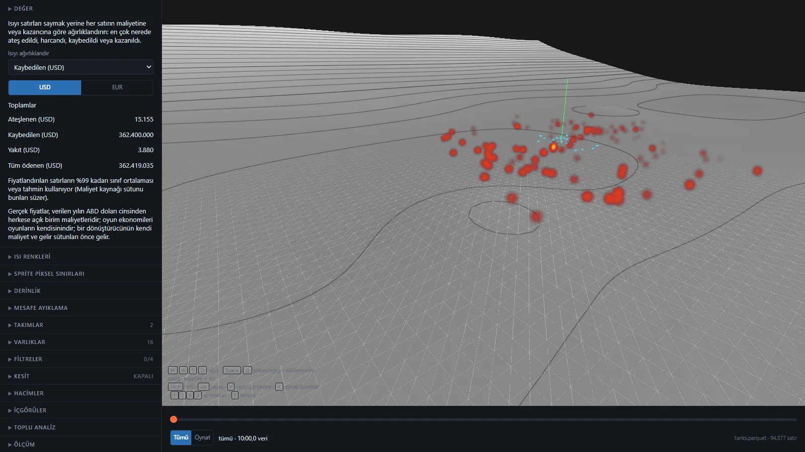

# Değer ağırlıklandırma

Her atış, mühimmat, kaybedilen araç ve litre yakıtın bir fiyatı vardır. Görüntüleyici her satırın neye mal olduğunu ya da ne kazandırdığını hesaplar ve ısıyı buna göre ağırlıklandırabilir; böylece harita satırların nerede olduğunu değil, **paranın nereye gittiğini** gösterir.

## Nasıl kullanılır {#how-to-use-it}

1. Olaylı (atışlar, öldürmeler, ölümler) ve araç ya da silah adları olan veriyi yükleyin.
2. Isı kenar çubuğunda **Değer**'i açın.
3. **Isıyı ağırlıklandır**'ı seçin, örneğin *Kaybedilen (USD)*. Isı artık her satırın 1 yerine fiyatını ekler.
4. **Toplamlar**'ı okuyun: gösterilenin her değer sütunundaki toplam (filtreler ve zaman penceresi uygulanır).
5. Fiyatlar gerçek dünya parası olduğunda bir **USD / EUR** anahtarı belirir.

Satırları yeniden saymak için menünün boş ilk girişini seçin.

## Neler ağırlıklandırılabilir {#what-can-be-weighed}

Değer sütunları yüklemede eklenir, her tür ve para birimi için bir tane:

| Tür | Düştüğü satırlar | Nasıl fiyatlanır |
|---|---|---|
| **Ateşlenen** | atışlar ve fırlatmalar | silah; yoksa mühimmat türü için ortalama |
| **Harcanan** | satın alma, doğma | oyunun para sütunları (örneğin bir nişancının satın alma menüsü) |
| **Kaybedilen** | ölümler, yok edilmeler | kendi aracı; yoksa sınıfının ortalaması |
| **Yok edildi** | öldürmeler | hedef araç |
| **Verilen hasar** | isabetler | hedefin değerinin bir payı |
| **Yakıt** | konumlar | harcanan yakıt; bir yakıt sütunundan ya da sınıf ve süreden tahmin edilir |
| **Tüm ödenen** | | ateşlenen + harcanan + kaybedilen + yakıt |
| **Kazanılan** | ödüller | oyunun kendi ödül sütunları (`earn_…`) |
| **Net** | | kazanılan eksi ödenen; işaretli ısı olarak çizilir (daha çok kazanılan yerde pozitif rampa, daha çok ödenen yerde negatif) |

Sütun adları `cost_<tür>_<para birimi>`, `earn_<para birimi>` ve `net_<para birimi>` biçimindedir. Oyunun kendi para birimini bilen bir dönüştürücü (örneğin oyun içi kredi yazan bir tekrar dönüştürücüsü), yerleşik fiyat tablolarına üstün gelir.

## Fiyat tabloları {#the-price-tables}

| Tablo | Para birimi |
|---|---|
| Gerçek dünya askeri: füzeler, bombalar, mermiler, karşı önlemler, uçaklar, helikopterler, kara araçları, gemiler, yakıt | USD (EUR = USD × 0,92; [`cost.ts`](https://github.com/Holdi601/3DHeat/blob/main/src/data/cost.ts) içindeki sabit `EUR_PER_USD`; canlı bir kur değildir) |
| Nişancı satın alma menüleri ve öldürme ödülleri | oyunun kredisi |
| Tank ve gemi oyunları | oyunun kredisi |
| Strateji oyunları (birkaç kaynak) | kaynak başına bir sütun ve birleşik bir sütun |
| Savaş oyunları | puan |

Oyun, verideki adlardan tanınır. Gerçek dünya fiyatları herkese açık kaynaklardan (bütçe belgeleri, ansiklopediler) gelir ya da tahmin olarak işaretlenir; enflasyona göre ayarlanmazlar. Tabloların üretilmiş listesi [Değer tabloları](ref-value-tables.md) sayfasındadır.

## Tahminler {#estimates}

Ek kategori sütunu **Maliyet kaynağı**, her satırın nasıl fiyatlandığını söyler: `table`, `class average`, `estimate` ya da `none`. Değer bölümü, fiyatlandırılmış satırların hangi payının ortalama ya da tahmin olduğunu gösterir. Yalnızca tam olarak fiyatlanmış satırları tutmak için [Filtreler](filters.md) içinde **Maliyet kaynağı** altındaki *estimate* ve *class average* işaretlerini kaldırın.

## Değerin başka nerede göründüğü {#where-else-value-shows}

- [İçgörüler](insights.md): *Pahalı kara* ve *Kazandıran kara* bulguları.
- [Dökümleme](breakdown.md): takım, oyuncu ya da silah başına Kazanılan, Kaybedilen ve Net para.
- [Hacimler ve karşılaştırma](volumes.md): istatistiklerde ve karşılaştırmada değer sütunları.
