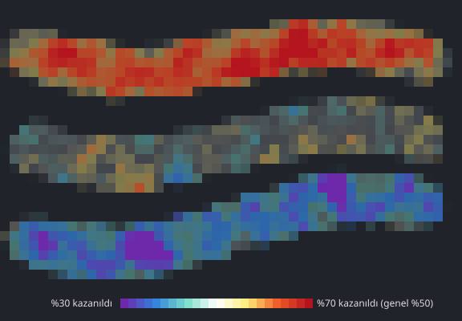

# Kazanma oranı: bir yer, bir rota ya da bir hamle ne sıklıkla kazanır

Bir oyuncunun nerede durduğu, nereye gittiği, el bombalarını nereden attığı - ve ardından tarafının raundu ne sıklıkla kazandığı. **Kazanma oranı haritası** her yeri, oradaki satırların satırın tarafının kazandığı rauntlara ait olan payına göre, gösterilen her şeydeki paya kıyasla renklendirir: daha yüksek olduğu yerde sıcak, daha düşük olduğu yerde soğuk, aynı olduğu yerde hiçbir şey.

*Resimdeki veriler uydurmadır: boş bir seviyede üç rota, satırlarının %68'i, %50'si ve %33'ü kazanılan rauntlarda.*

Kimin kazandığını söyleyen veri gerekir: [sonuç sütunları](data-formats.md#outcome-columns) (`won`, `matchWon`, `roundEndReason`). CS2 ve War Thunder dönüştürücüleri bunları yazar, Tacview dönüştürücüsü de DCS sunucusu seferleri için ([DCS sunucuları](tacview-acmi.md#dcs-servers-who-won-and-how-each-sortie-ended)); herhangi bir dosya da içerebilir.

## Deneyin {#try-it}

1. Sonuç sütunu olan maçları yükleyin ve `2` tuşuna basın (**Fark**).
2. **Fark ayrımı** içinde **Raunt kazanma oranı** (ya da **Maç kazanma oranı**) düğmesine basın. Kazanılan rauntları **+** tarafına, kaybedilenleri **−** tarafına koyar ve paneli **+ payı** moduna geçirir.
3. Renkleri okuyun. Panel genel payı söyler: *Toplamda 1.200.000 satırın %52,0 kadarı + tarafında.*
4. [Filtreler](filters.md) ile daraltın: bir taraf (T ya da CT), bir olay türü (insanların nerede durduğu için *Konum*, nereden ateş ettikleri ya da attıkları için *Atış* veya *Fırlatma (füze, roket, bomba)*), bir satın alma, bir harita.

*Konum* satırlarıyla sıcak olan bir yer, orayı tutanların raundu daha sık kazandığı bir yerdir. *Öldürme* satırlarıyla, yapılan öldürmelerin kazanılan rauntlara götürdüğü bir yerdir.

## Ayarlar {#the-settings}

| Ayar | Ne yapar | Varsayılan |
|---|---|---|
| **Fark** / **+ payı** | farkın kendisi ya da iki tarafın satırları içinde + tarafının payı | Fark |
| **Tam renk** | bir yerin genel payın ne kadar üstünde ya da altında tam renkle gösterileceği, puan olarak | ± 20 puan |
| **Bir yeri renklendirmek için en az satır** | daha az satırı olan bir yer renklendirilmez; renk bu sayının yarısından başlayarak yavaşça belirir | 12 |
| **Genel paya çekme (satır)** | her yer genel payda bu kadar satırla başlar; böylece 3 satırlı, hepsi kazanılmış bir yer %100 olarak gösterilmez | 12 |

Üçü de bitmiş resme etki eder: onları sürüklemek birikimi asla yeniden başlatmaz.

Pay yalnızca galibiyetlerin değil, herhangi bir ayrımın payı olabilir: taraflara göre ayrımla *+ payı*, T'lerin varlığın daha büyük kısmını oluşturduğu yerleri gösterir; iki haritanın dosyalarına göre ayrımla da bir dosyanın satırlarının diğerininkinden fazla olduğu yerleri.

## Rauntlar değil, satırlar {#rows-not-rounds}

Harita satırları sayar. Bir noktada yirmi saniye duran bir oyuncu her örnekte bir satır ekler, hepsi tek bir rauntten. Yani bir yerdeki kanıt, rauntlar değil, ona yakın satırlardır. Bu yüzden en az değer ve çekme satır cinsindendir, ve bu yüzden bir rauntluk değerden büyüktür.

Rauntların kendisi için:

- Bir nokta, görünüm ya da hacim üzerinde **[Döküm](breakdown.md)**: *Galibiyet %* her oyuncunun raundunu bir kez sayar, aynı şekilde yerin genel oranına doğru çekilir (4 raunt).
- **[Hacimler](volumes.md)** istatistikleri: *Kazanma oranı* - hacmin içinde bir oyuncunun olduğu rauntlar, her biri bir kez, gösterilen her şeydeki orana doğru çekilmiş, sayılarla birlikte.

## Sonuç filtreleri {#outcome-filters}

[Filtreler](filters.md) paneli sonuç sütunlarını görüntüleyicinin kendi sütunlarının hemen ardından listeler: **Raunt sonucu** ve **Maç sonucu** (*Herhangi*, *Kazanıldı*, *Kaybedildi*) ve **Raunt nasıl bitti** (eleme, bomba patladı, bomba imha edildi, süre doldu, teslim olma, berabere, hedef, tutulan bölgeler, kaybedilen biletler, tüm araçlar kaybedildi), görüntüleyicinin dilinde.

## Geliştiriciler için {#for-developers}

Isı geçişi, takım ısısının kullandığı dört kanallı hedefe üç toplam yazar: ısı `R = Σ|v|`, + tarafının ısısı `P` ve `S = Σ v²/w`; burada `w` geçişin ağırlığıdır (örnekleme ağırlığı çarpı kare kazancı). Birleştirme payı `P/R` (çekirdekle ağırlıklandırılmış bir ortalama) ve dayandığı satırları `n = R²/S` (Kish'in etkin örneklem büyüklüğü) okur, payı genel paya doğru çeker, `p = (n·P/R + m·r0)/(n + m)`, ve `p - r0` değerini aralık üzerinde fark rampalarıyla renklendirir.

`n`, bir pikseldeki satırlarda ortak olan her çarpanı sadeleştirir - kare kazancı, örnekleme ağırlığı, kırpılmış bir sprite'ın alan ağırlığı - böylece resim her yakınlaştırmada ve örnekleme yoğunluğunda aynıdır, ve her k'ıncı satırın kareleri renkler sıçramadan bütüne birleşir. Genel pay, CPU'nun taraf sayımlarından gelir, yüzde birin onda biri hassasiyetle; GPU'dan geri hiçbir şey okunmaz. Aritmetik ve denetimleri: [`render/rateMap.ts`](https://github.com/Holdi601/3DHeat/blob/main/src/render/rateMap.ts) ve testi.

Takım ısısı kadar maliyetlidir: dört kanallı hedef, ısı geçişinin karıştırma bant genişliğini dört katına çıkarır, yalnızca *+ payı* açıkken.
